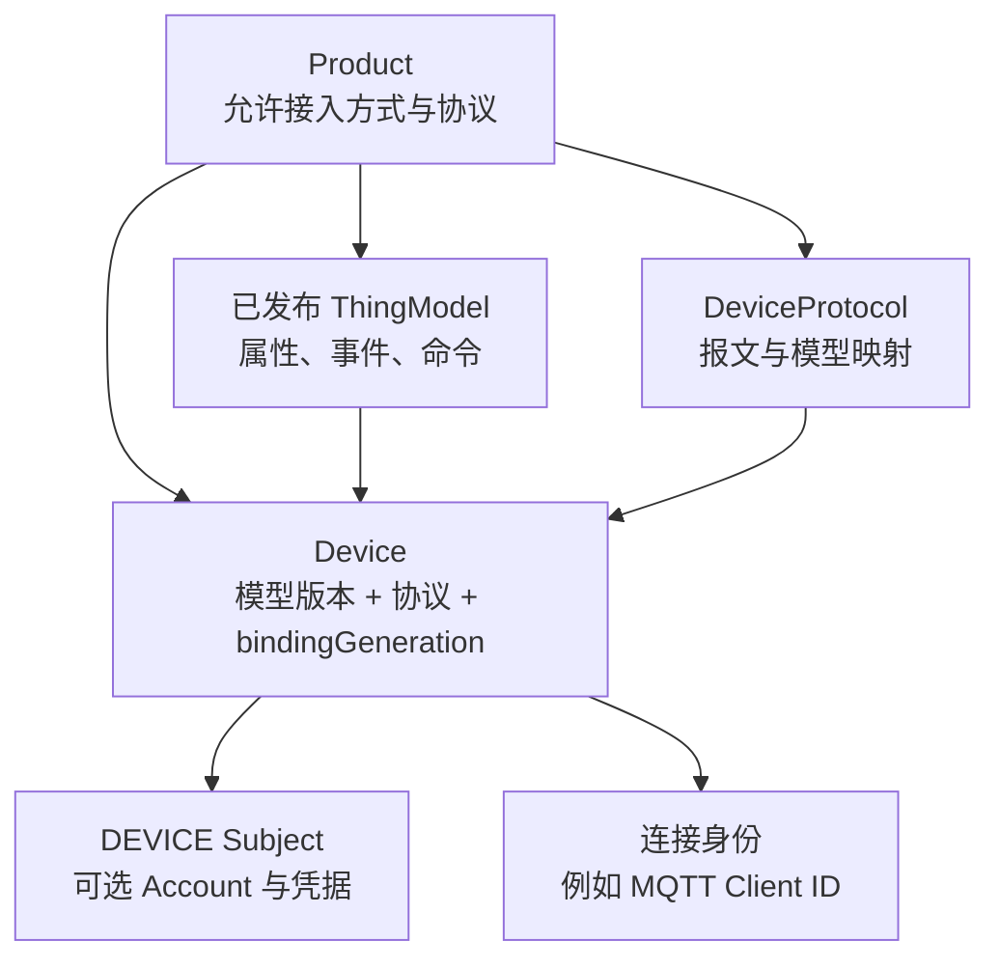
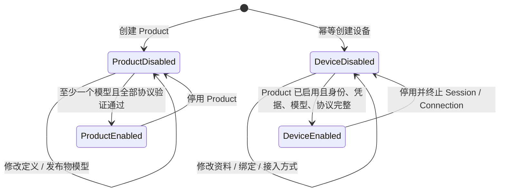
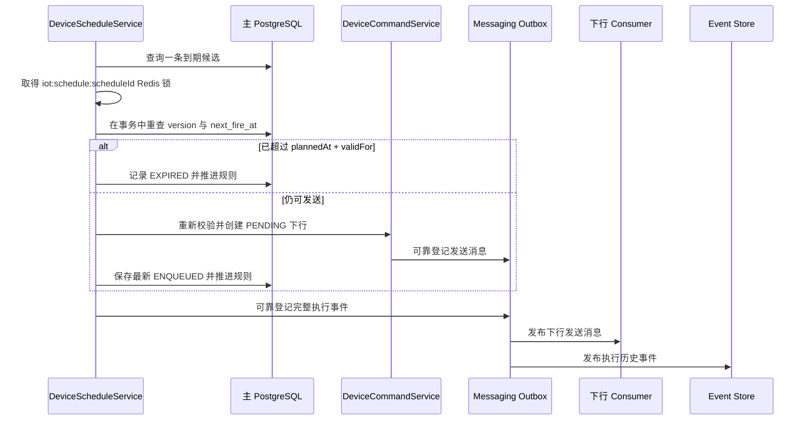
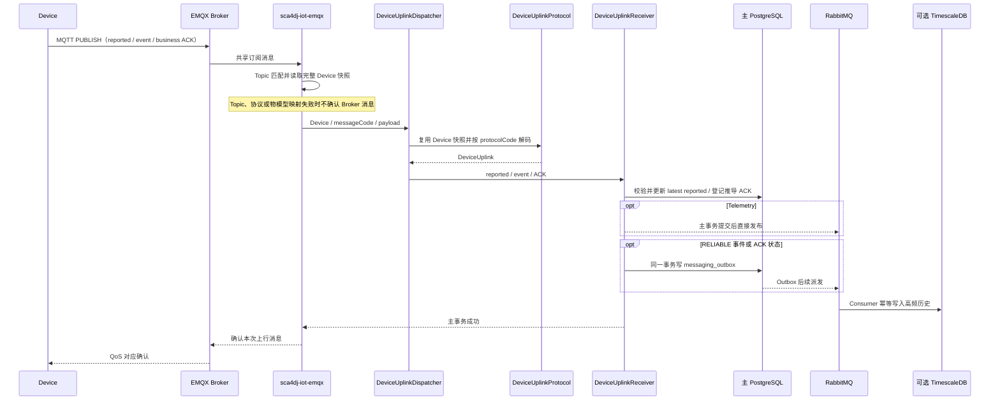

# IoT 设备生命周期

设备接入不能只保存一个 MQTT Client ID。平台还需要回答以下问题：这是什么产品；当前使用哪一版数据模型；哪个协议能解释报文；谁可以连接；这次连接是否仍有效；设备实际报告了什么；平台希望它变成什么；一条命令只是到达 Broker，还是已经被设备执行。

Sca4d-J 为这些问题分别保存事实，避免把「连接成功」「MQTT 已发送」和「业务动作成功」合并为同一个状态。

## 从产品定义到设备实例

Product 定义一类设备允许使用的接入方式和协议 code。Product 可以来自数据库，也可以由具体应用通过代码目录提供。Device 保存 Product 来源和稳定 code，物模型仓储按来源选择数据库版本或代码定义。一个 Product 可以连续发布多个不可修改的 ThingModel 版本。物模型定义属性、事件、命令，以及值类型、确认和重试策略。

Device 显式绑定一个已发布物模型版本、一个 DeviceProtocol code 和 `bindingGeneration`。直接连接的 Device 还保存 DeviceConnectionBinding 和认证接入方式，例如 MQTT Client ID 绑定。网关中继等间接 Device 的 DeviceConnectionBinding 和认证接入方式都为空。Device 不保存 Account、Secret、HMAC Key 或证书。



DeviceService 只校验 IoT 技术事实。具体应用在同一事务中创建 DEVICE Subject、可选固定 Realm Account、Device 台账和通用 Credential。重新绑定只允许在以下条件同时满足时执行：具体应用已停用 Device，且旧 `bindingGeneration` 没有活动下行消息。成功后 `bindingGeneration` 递增，并清除上一代绑定的当前 reported 与 desired。

DeviceService 使用 [DeviceQuery](/javadoc/modules/iot/sca4dj-iot/com/sca4d/iot/device/DeviceQuery.html) 查询完整 Device 台账。有明确候选标识时使用 `forIds(...)`，缺失对象不会进入结果。没有候选标识时必须使用 `list(...)`，并提供分页和安全排序。Product、文本、协议和是否直接连接可以继续作为领域条件组合。调用方不能传入表名、数据库列或任意 SQL 条件。

```java
Page<Device> knownDevices = devices.find(
        DeviceQuery.forIds(deviceIds)
                .protocol("mqtt-v1")
                .build());

Page<Device> firstPage = devices.find(
        DeviceQuery.list(new ListRequest(
                        new PageRequest(1, 50),
                        List.of(Sort.CREATED_AT.desc(), Sort.SERIAL.asc())))
                .product(productBinding)
                .directConnection(true)
                .build());
```

单个 Device 读取复用同一有界查询。具体应用的业务资料和状态仍由具体应用的 Repository 查询。具体应用可以先取得符合业务条件的 Device ID，再交给 DeviceQuery 装载公共台账。具体应用不能直接读取 IoT Mapper 或公共表。

## 接入身份、Session 与 Connection 是三个概念

设备先通过协议公开身份找到 Device，例如 EMQX 中的 MQTT Client ID。接着具体应用的 DeviceConnectionAdmission 按 Device 声明的接入方式执行只识别、共享 Secret、X.509 或 Session 认证，并返回本次连接采用的身份信息和接入方式。

- **接入身份**回答「这条协议连接声称是哪台 Device」。它在协议和身份类型范围内唯一。
- **Session** 回答「某次认证结果是否仍有效」。只有 Session 接入方式绑定 Session ID。共享 Secret、X.509 和只识别连接不伪造 Session。
- **Connection** 回答「Broker 当前观测到哪一代物理连接」。DeviceConnection 包含不透明连接代次、Device、连接协议、接入方式、建立时间和可选 Session ID。它不等同于 Session，也不单独证明业务在线。

当前连接信息保存在 Redis 中，并设置 TTL。EMQX 适配器订阅 `$SYS` 连接和断线消息作为实时触发。每次只使用事件中的 Client ID 查询 Management API 当前连接，再登记或删除准确的连接代次。启动和周期完整快照负责修复服务停机或订阅中断期间的遗漏。

具体应用通过 `DeviceOnlinePolicy` 把连接事实转换成在线结果。默认 `ConnectionPresentDeviceOnlinePolicy` 只要当前连接集合非空就判定在线。连接 TTL 由 `sca4dj.iot.connection-ttl` 配置，默认 30 分钟，必须为正数。

Session 或凭据失效时，IoT 基础模块在 PostgreSQL 登记断连任务并移除公共连接事实。Worker 再调用对应协议适配器终止 Broker 连接。Redis、主库与 Broker 之间没有跨存储事务。因此断连采用可靠任务和对账，而不是假定一次调用同时成功。

`DeviceConnectionQueryService` 批量读取 Device 当前连接事实，并为没有连接的 Device 返回空列表。它不判断业务在线状态。单个 Device 查询复用同一个批量入口。默认 Redis 实现按内部 pipeline 批次读取大量 Device，每个 Device 的 Lua 查询同时删除过期索引和已经失去主记录的索引。内部批次大小不限制调用方的查询数量。

## 应用启停与技术绑定

IoT 基础模块不拥有具体产品的启用规则。具体应用为 Product 和 Device 各保存应用 Profile，初始状态和启停规则由具体应用定义。下图为示意。



Device 创建事务同时建立 DEVICE Subject、可选 Account、连接身份和凭据。具体应用再把 Subject、Account 与具体应用 Profile 保持停用。

启用时，具体应用检查 Product 已启用。随后，IoT 基础模块验证物模型、协议、连接身份、Account、Secret 或证书是否完整。最后，应用状态和 IAM 状态在主 PostgreSQL 中原子更新。修改绑定与接入方式只允许在停用状态完成。

## 传输路由与设备协议

传输方式、设备消息协议和物模型分别负责不同事实：

- 传输路由从 MQTT Topic、TCP 端口、网关报文或其他传输输入中定位 `deviceId`，然后创建 DeviceProtocolMessage。
- 传输路由读取一次完整 Device，并把这份 Device 快照放入 DeviceProtocolMessage。StandardDeviceUplinkDispatcher 直接使用同一快照的 `protocolCode` 选择 DeviceUplinkProtocol，不再按同一上行重复查询 Device。
- DeviceUplinkReceiver 接收协议产出的 reported、事件或业务 ACK。具体应用可以替换默认 Receiver，在同一事务中更新 IoT 当前事实和具体应用的业务表。
- ThingModel 只定义属性、事件、命令和业务策略，不负责 Topic、报文格式或连接认证。

因此 MQTT 直连设备可以直接使用 MqttDeviceProtocol。经 MQTT 网关进入的中继设备报文仍可以使用独立 DeviceUplinkProtocol。中继设备协议不属于 MQTT 协议，MQTT 路由也不决定中继 Device 的 `protocolCode`。

## reported、desired 与 command

设备状态有三个方向：

- **reported**：设备实际报告的当前值。ReportedStateStore 按 Device、`bindingGeneration` 和字段组保存最新值（latest）。它按协议顺序拒绝旧报文、识别重复报文，并拒绝顺序相同但内容不同的冲突报文。默认实现保存到 PostgreSQL。具体应用也可以选择 Redis 实现。
- **desired**：平台持续期望的属性值。一次修改原子处理 set 与 clear。服务使用一次批量查询读取请求涉及的全部当前属性，只有实际变化的可写属性才生成可靠下行。
- **command**：要求设备执行的一次性动作。输入必须与当前物模型命令定义一致，然后创建独立可靠下行。

代码物模型通过同一个 `ThingCommand` 和 `DataKey<T>` 同时完成模型登记与 Java 调用。调用方使用 `DataValues` 提供完整输入。字段遗漏、额外字段和 Java 类型错误在写入下行前失败。范围、字符串长度和完整匹配 `pattern` 仍以 Device 当前绑定的物模型版本为准。只有 command code 来自数据库、HTTP 调试输入或设备定时规则时，才使用动态字符串入口。

单条 reported 覆盖属性、单次 desired 修改属性和单条上行携带事件都有独立数量上限。默认值均为 100，可配置范围为 1 到 1000。服务在读取物模型和状态前拒绝超限输入，避免一个报文放大成无界数据库、Redis 或消息写入。reported 只用轻量绑定代次查询确认传输路由读取的 Device 快照仍然有效。判断 reported 与 desired 是否一致时，一条批量 SQL 返回全部匹配的属性和下行消息，不按属性逐条查询。

`iot_downlink_message` 统一保存 desired 与 command 的可靠状态，但不合并两者的业务含义。消息保存创建时的 `bindingGeneration`、确认策略、ACK 等待时间和重试策略快照。发送 Consumer 取得消息级 Redis 分布式锁，在短事务中把 `PENDING` 推进为 `SENDING`。事务提交后通过当前协议发送，再用新事务保存 PUBACK 后的状态。重复派发可以在同一锁内继续处理进程中断留下的 `SENDING`。业务 ACK 和超时也使用同一消息锁推进状态。

## ACK

PUBACK 只说明 Broker 接受 MQTT publish，不等于设备执行业务动作。需要业务确认的下行在传输成功后进入 `WAITING_ACK`：

1. 设备显式上报 ACK，或 reported 与 desired 相等时，在 reported 主事务内登记可靠 ACK 请求。
2. Outbox 派发后，ACK Consumer 按 messageId 锁定下行并校验 Device 归属。
3. 同一 ACK 事实重复到达时不重复执行策略。
4. 确认策略决定继续等待、成功或交给重试策略。
5. 下行行内保存最新 ACK，完整 ACK 阶段可靠发布为 IoT 事件。

因此主库不需要 `iot_device_acknowledgement` 历史表。当前业务判断读取 `iot_downlink_message`，历史查询从事件存储还原 ACK 事件。传输失败、ACK 超时、设备拒绝和重试停止都保存稳定失败 code。具体应用在 HTTP 或页面层按请求 Locale 生成消息。

## 设备定时

设备定时用于在精度较高的时间向 Device 提交物模型 command，例如定时开关机。规则可以是一次绝对时间，也可以是带 IANA 时区的六字段 Cron。每个规则还声明从计划时间开始计算的 `validFor`，防止系统延迟恢复后发送已经失去业务意义的设备动作。



PostgreSQL 的 `iot_device_schedule` 保存规则、下一次触发时间、乐观版本、最新执行结果和可空稳定失败 code。服务按批次扫描索引，每条候选先取得规则级 Redis 分布式锁，再在事务中重查并用 version 条件推进。系统不使用显式行锁，不维护 Redis 到期索引，也不为每条规则创建线程。完整执行历史写入通用事件流。TimescaleDB 启用时保存到 `iot_event`，因此不需要 `iot_device_schedule_execution` 表。

预约半年后生成报表、结算业务流程或执行其他业务流程不属于设备定时。这类低精度、长周期业务计划使用普通 Job/Quartz。IoT Timer 只负责到期生成可靠设备下行。

## 上行处理顺序



Broker 只有在协议转换和 IoT 主事务完成后才收到上行成功。明确的格式、身份或协议错误记录后直接确认。其他失败最多处理三次。仍失败时保存隔离证据并确认，不能无限占用 MQTT Inflight。reported 更新与事件会按当前物模型校验。稳定设备顺序确保重复处理幂等。没有设备顺序时，Redis 只分配平台观测序号。Telemetry 在主事务提交后直接发布，不写 Outbox。可靠事件和推导 ACK 在主事务写入 Messaging Outbox，再由 Consumer 幂等写入历史库或推进下行状态。

## PUBACK 不是业务 ACK

下行也分两个确认层次：

1. `DeviceDispatchHandler` 收到可靠下行消息，锁定对应 `PENDING` 状态并调用协议适配器。
2. EMQX 适配器用 QoS 1、`Retain=false` 发布并等待 PUBACK。PUBACK 只说明 Broker 接受了这次 MQTT publish。
3. 不需要业务确认的消息可在发送成功后直接结束。需要确认的消息进入 `WAITING_ACK`。
4. 设备显式 ACK，或 reported 与 desired 相等时推导出的 ACK，都会形成 DeviceAcknowledgement。随后，消息各自的确认策略决定等待、成功或失败。
5. 传输失败、业务拒绝或 ACK 超时交给重试策略。策略可以重新排队，也可以结束为 `FAILED`。

因此监控显示 MQTT publish 成功时，不能据此宣称设备已执行命令。业务状态必须读取下行消息及其业务 ACK。

## PostgreSQL 当前事实与可选 TimescaleDB 历史

主 PostgreSQL 保存业务判断所需的当前和可靠事实：Product、已发布物模型、Device 与凭据、连接身份、latest reported、current desired、下行状态、最新业务 ACK 和 Messaging Outbox。这些事实参与 IoT 主事务。完整 ACK 和可靠事件通过可靠消息保存到 TimescaleDB。Telemetry 则在主事务提交后直接发布。

物模型事件按 delivery 声明处理。`RELIABLE` 事件要求来源事件 ID 和来源发生时间，并在主事务写通用 `messaging_outbox`。普通事件提交后直接发布。reported 推导 ACK 先写 Outbox，再由独立 Consumer 执行消息级状态转换。因此来源事务回滚时不会留下已经确认的下行。ACK 阶段、设备定时执行和断连属于必须恢复的状态变化，始终使用通用 Outbox。

TimescaleDB 是具体应用可选提供的独立数据源，用于 telemetry 样本和 IoT 事件。启用 `sca4dj.iot.timescale.enabled` 后，具体应用的 Timescale 配置创建独立 DataSource、Flyway、MyBatis 和事务管理器。它复用脚手架的 IoT 历史 Repository、Consumer 和查询实现。TimescaleDB 不替代主 PostgreSQL，也不参与主事务。未启用时，当前状态、desired、command、ACK 与连接生命周期仍然成立。未启用只意味着没有高频历史写入和查询目标。

## EMQX 适配器负责协议转换

[EMQX 设备接入模块](/capabilities/iot/emqx) 负责 MQTT/EMQX 细节：HTTP Authenticator 结果、ACL、共享订阅、Topic 匹配、协议 Pipeline、当前 Server 入站消息观察、QoS 1 发布、PUBACK、Management API 断连和连接对账。它只依赖 IoT API 与 Core Spring，不读取 IoT 基础模块的 Repository 或 Service。

具体应用仍需登记协议定义、提供受独立 Secret 保护的 EMQX HTTP Authenticator 回调，并决定 Product/Device 的权限和启停规则。服务端内部的 MQTT Client 订阅具体应用登记的业务上行 Topic 和两个 `$SYS` 连接事件 Topic。MqttMessageObserver 仍只观察业务消息，连接事件只用于刷新当前 Connection。Broker 凭据、Topic、二进制帧、字节序和厂商兼容规则留在协议与适配器。Product、Device、模型版本、reported、desired 和可靠下行状态留在 IoT 基础模块。

## 失败时状态怎样保留

- Product 协议无法解释待发布物模型时，发布失败。系统不会保存一个只能由部分协议读取的版本。
- Device 启用条件不完整、Product 未启用或绑定协议不兼容时，应用拒绝启用。
- reported 顺序倒退时忽略为旧值。同顺序不同内容是协议冲突，不能以最后写入覆盖。
- Device 重新绑定时有活动下行消息会失败，防止旧模型命令误发到新协议。
- MQTT PUBACK 后仍可能等待或最终失败于业务 ACK。两种结果不能合并。
- TimescaleDB 写入失败不会改变主库中的当前事实。可靠事件可以从消息队列重试。提交后直接发布的 Telemetry 可能丢失。
- Session 失效、Broker 断连和 Redis 连接信息更新不在同一个原子事务中。可靠断连任务、TTL 和 EMQX 对账共同保证最终连接事实与 Broker 一致。

模块职责与启用条件见 [IoT 基础模块](/capabilities/iot/iot) 和 [EMQX 设备接入模块](/capabilities/iot/emqx)。

## 下行发送准入

具体应用可以提供可选的 DeviceDispatchAdmission，在当前发送事务内允许、延后或拒绝发送尝试。未提供时直接允许。延后通过现有可靠下行消息重新检查，不消耗发送次数，也不启动 ACK 超时。再次检查仍受消息终态、取消和有效期约束。共享传输资源的占用、排队优先级和业务轮次由具体应用维护，IoT 模块不解释应用规则。

## 示例

以下示例对应温控器（Thermostat）的启用流程。应用先检查 Product 已启用，再由 IoT 基础模块验证技术事实，最后在同一事务中更新应用状态。

```java
import com.sca4d.iot.device.DeviceService;
import org.springframework.stereotype.Service;
import org.springframework.transaction.annotation.Transactional;

@Service
public class ThermostatActivationService {

    private final ThermostatProfiles profiles;
    private final DeviceService devices;

    public ThermostatActivationService(ThermostatProfiles profiles, DeviceService devices) {
        this.profiles = profiles;
        this.devices = devices;
    }

    @Transactional
    public void enable(long deviceId) {
        // 应用代码：确认 Product 的应用 Profile 已经启用。
        profiles.requireProductEnabled(deviceId);
        // IoT 基础模块：验证物模型、协议、连接身份和凭据是否完整。
        devices.validateTechnicalActivation(deviceId);
        // 应用代码：在同一事务中更新应用 Profile 与 IAM 状态。
        profiles.markEnabled(deviceId);
    }
}
```

`ThermostatProfiles` 是应用自己的仓储，不属于 IoT 模块。技术事实不完整时，`validateTechnicalActivation` 失败，应用不写入启用状态，Device 保持停用。
## 扩展方式

具体应用通过以下 Spring Bean 扩展生命周期：

- **DeviceConnectionAdmission**：实现连接准入。EMQX HTTP Authenticator 的请求先转换为 DeviceConnectionRequest，再交给该 Bean 判定。
- **DeviceOnlinePolicy**：替换在线判定。IoT 基础模块在没有其他实现时使用 `ConnectionPresentDeviceOnlinePolicy`。
- **ReportedStateStore**：替换 latest reported 的存储实现。默认 PostgreSQL 实现与可选 Redis 实现都由自动配置条件选择。
- **DeviceUplinkReceiver**：替换上行接收逻辑，在同一事务中更新 IoT 当前事实和应用业务表。
- **DeviceDispatchAdmission**：控制每次发送尝试的准入结果。
- **DeviceProtocol**：每个协议实现登记为 Bean。`DeviceProtocolCatalog` 接收全部协议 Bean，按 code 查找 Device 绑定的协议。

应用通过实现接口并注册为 Spring Bean 提供扩展。模块使用 `ConditionalOnMissingBean` 为默认实现留出替换位置，或使用 `ObjectProvider` 与集合注入获取可选实现。
