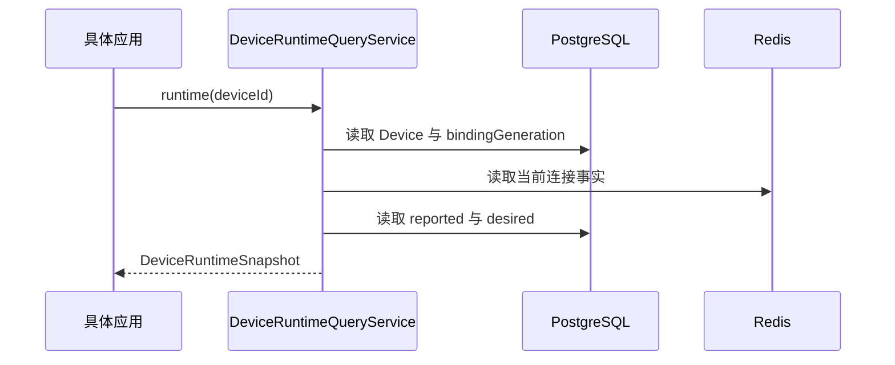

# DeviceRuntimeQueryService

DeviceRuntimeQueryService 一次读取指定 Device 的当前运行态，供具体应用转换成 HTTP、管理端或其他展示结果。它不判断具体应用的权限，也不返回历史数据。

## 查询行为

`runtime(deviceId)` 先确认 Device 存在并读取当前 `bindingGeneration`。随后读取属于当前 `bindingGeneration` 的连接事实、reported 字段组和 desired 属性，返回 [DeviceRuntimeSnapshot](/javadoc/modules/iot/sca4dj-iot-api/com/sca4d/iot/api/query/DeviceRuntimeSnapshot.html)。Device 不存在时，抛出 IoT 模块的 Device 不存在错误。



连接信息保存在 Redis 中，Redis 丢失后可以重建。reported 和 desired 保存在主 PostgreSQL 中。`runtime` 方法只保证三类数据属于同一个 Device，并且都对应当前读取到的 `bindingGeneration`。Redis 与 PostgreSQL 的读取不在同一个事务中，因此三类数据不保证是同一时刻的快照。查询期间可能发生并发连接或状态上报。

同一接口还提供 `reported` 方法，按设备集合和字段组 code 读取 reported 数据。该方法返回按 Device 标识索引的 `ReportedStateSnapshot`。

IoT 模块的数据归属与相邻接口见 [IoT 基础模块](/capabilities/iot/iot)。

## 示例

以下示例对应温控器（Thermostat）的详情页。页面读取当前运行态，再由应用转换为页面所需的字段。

```java
import com.sca4d.iot.api.query.DeviceRuntimeQueryService;
import com.sca4d.iot.api.query.DeviceRuntimeSnapshot;
import org.springframework.stereotype.Service;

@Service
public class ThermostatDetailQuery {

    private final DeviceRuntimeQueryService runtimeQueries;

    public ThermostatDetailQuery(DeviceRuntimeQueryService runtimeQueries) {
        this.runtimeQueries = runtimeQueries;
    }

    public ThermostatDetail load(long thermostatId) {
        DeviceRuntimeSnapshot snapshot = runtimeQueries.runtime(thermostatId);
        // 应用检查当前用户的访问权限，再把快照转换为页面响应。
        return ThermostatDetail.from(snapshot);
    }
}
```

`ThermostatDetail` 是应用自己的响应对象。权限检查在调用 `runtime` 之前或之后由应用完成，IoT 模块不执行权限判断。
## 扩展方式

本查询由 IoT API 固定提供。具体应用不替换 `DeviceRuntimeQueryService` 的实现。应用需要不同的展示结果时，在应用层转换 `DeviceRuntimeSnapshot`，不在 IoT 模块中新增字段。
