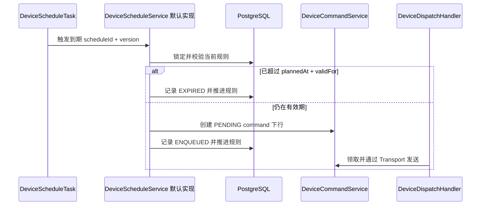

# DeviceScheduleService

DeviceScheduleService 管理只用于设备消息下发的高精度定时规则。单次绝对时间规则和带时区的六字段 Cron 规则，到期时都会生成可靠 command 下行。半年后执行的业务计划等低精度预约，使用普通 Job 或 Quartz，不通过 DeviceScheduleService 管理。

## 规则修改

- `create` 要求 Device 存在、触发时间在未来且 `validFor` 为正数，创建 `ACTIVE` 规则并登记下一次触发时间。
- `replace` 使用 `expectedVersion` 完整替换 command、触发规则和有效期，并把规则恢复为 `ACTIVE`。
- `changeStatus` 只接受 `ACTIVE` 或 `PAUSED`。恢复单次规则时保留原计划时间，恢复 Cron 时从当前时间计算下一次触发。
- `cancel` 永久取消规则。取消不会撤销已经生成的下行消息，下行继续遵守各自的状态机和最晚发送时间。

替换、状态修改和取消都使用从查询结果取得的非负乐观版本，新建规则的初始版本是 `0`。规则不存在、版本变化或当前状态不允许修改时返回状态冲突，不覆盖并发修改。

## 示例

以下示例对应温控器（Thermostat）的定时开关机。规则在指定时间关闭设备，超过有效期 10 分钟仍未执行时放弃本次动作。

```java
import com.sca4d.iot.api.schedule.DeviceSchedule;
import com.sca4d.iot.api.schedule.DeviceScheduleService;
import com.sca4d.iot.api.schedule.DeviceScheduleStatus;
import com.sca4d.iot.api.schedule.DeviceScheduleTrigger;
import com.sca4d.iot.api.schedule.DeviceScheduledCommand;
import java.time.Duration;
import java.time.Instant;
import java.util.Map;

public class ThermostatScheduleExample {

    private final DeviceScheduleService schedules;

    public ThermostatScheduleExample(DeviceScheduleService schedules) {
        this.schedules = schedules;
    }

    public DeviceSchedule scheduleShutdown(long thermostatId, Instant executeAt) {
        DeviceScheduledCommand command =
                new DeviceScheduledCommand("power", Map.of("on", false));
        return schedules.create(
                thermostatId,
                command,
                DeviceScheduleTrigger.once(executeAt),
                Duration.ofMinutes(10));
    }

    public void pause(long scheduleId, long expectedVersion) {
        schedules.changeStatus(scheduleId, expectedVersion, DeviceScheduleStatus.PAUSED);
    }
}
```

`expectedVersion` 必须是调用方最后读取到的版本。版本不一致时，`changeStatus` 返回状态冲突，不修改规则。周期性规则使用 `DeviceScheduleTrigger.cron(cronExpression, zoneId)`，表达式为六字段 Cron，时区使用 `ZoneId`。

## 到期执行



DeviceScheduleTask 不直接调用 Connection 或协议 Transport。业务校验失败时，默认实现记录 `FAILED` 并暂停规则。数据库暂时失败时，本次集群任务停止，下一次触发继续按 PostgreSQL 当前版本扫描。PostgreSQL 是规则、下一次触发时间和最新执行结果的权威存储。系统不建立 Redis 到期索引，也不处理租约。

查询规则与执行结果见 [DeviceScheduleQueryService](/javadoc/modules/iot/sca4dj-iot-api/com/sca4d/iot/api/schedule/DeviceScheduleQueryService.html)，模块整体职责见 [IoT 基础模块](/capabilities/iot/iot)。
## 扩展方式

定时规则的执行由模块内的任务完成，应用不替换 `DeviceScheduleService` 的默认实现。应用通过 `DeviceScheduleQueryService` 读取规则与执行结果，并在应用界面中提供创建、修改和取消入口。权限判断在调用 `DeviceScheduleService` 之前完成。
