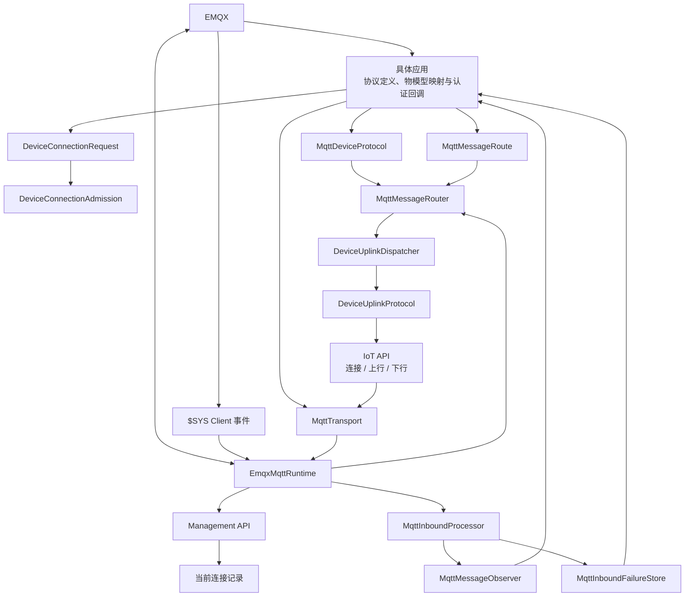

# EMQX 设备接入模块

`modules/iot/sca4dj-iot-emqx` 把 EMQX 和 MQTT 数据转换为 IoT API 对象。设备发来的 Topic 和 payload，经过连接识别、协议选择和字段转换后，才能交给 IoT 模块。下行消息也必须按当前 Device 的协议与 MQTT Client ID 编码。Product、Device、reported、desired、command 和业务 ACK 仍由 IoT 基础模块保存。

完整设备状态和确认层次见 [IoT 设备生命周期](/capabilities/iot/device-lifecycle)。

## 输入怎样转换成 IoT 对象

模块把以下外部动作转换为 IoT API 调用：

- EMQX HTTP Authenticator 原始字段先由具体应用的 EmqxDeviceConnectionRequestFactory 转换为 DeviceConnectionRequest，再由 DeviceConnectionAdmission 决定准入。模块只生成 allow/deny、`client_attrs`、ACL 和可选到期时间。
- MQTT Runtime 实际收到消息后，先通知具体应用登记的 MqttMessageObserver，再进入消息路由。观察结果只代表当前 Server 的订阅收到了消息，不代表 Broker 全局发布历史。
- 标准 MQTT 上行由 MqttDeviceProtocol 路由。具体应用也可以用 MqttMessageRoute 处理网关中继等 Topic。两者定位 Device 后都把 DeviceProtocolMessage 交给 DeviceUplinkDispatcher。具体应用路由需要返回协议 ACK 时，通过 MqttTransport 发布已经编码完成的 Topic 和 payload。
- DeviceDownlink 和完整 Device 通过 DeviceTransport 编码为 Topic 和厂商 payload。
- Session 失效后的可靠断连消息由断连 Consumer 消费，再通过 DeviceConnectionTerminator 调用 EMQX Management API。
- MQTT Runtime 通过共享订阅接收 `$SYS/brokers/+/clients/+/connected` 和 `disconnected`。事件只提供 Client ID。模块立即查询 Management API 的单个 Client 当前状态，再刷新当前连接代次。
- 启动和定期对账在 Redis watchdog 分布式锁内从 Management API 读取完整连接快照，修复服务停机或订阅中断期间遗漏的事件，并主动断开无法映射或 ACL 指纹过期的 Device 连接。

模块公开 MqttDeviceProtocol，供具体应用声明标准 MQTT 设备的 Topic、上行与下行 Pipeline，以及 DataKey 到物模型 code 的映射。模块还公开 MqttMessageRoute，让 MQTT 运行时把其他 Topic 交给具体应用负责的路由。MqttMessageObserver 和 MqttMessageProcessingObserver 观察当前 Server 的接收与处理结果。MqttInboundFailureStore 在最终 ACK 前可靠保存处理失败的消息。MqttTransport 供路由和设备下行发布已经编码完成的消息。具体应用路由可以解析网关中继帧并定位实际 Device，但实际设备协议仍由 IoT 的 DeviceUplinkDispatcher 按 Device 台账选择。



## 拥有的运行状态

模块不拥有 IoT 业务表。它在当前进程保存 MQTT 客户端和协议目录，在 Redis 保存可重建的 EMQX Client ID、Broker 节点和连接代次。完整对账只在执行期间持有运行时命名空间隔离的 watchdog 分布式锁，不保存固定时长的对账租约。IoT 基础模块另行在 Redis 保存与协议无关的当前连接信息。需要可靠断连时，DeviceConnectionService 通过通用 Messaging Outbox 发布消息，不创建 IoT 断连任务表。

连接在线状态由三个入口协作。`$SYS` 连接和断线消息负责低延迟触发。每次触发后查询 `/api/v5/clients/{clientid}`，以 Broker 此时返回的当前连接和 `client_attrs` 决定登记还是删除。完整 `/api/v5/clients` 快照只负责首次恢复、周期对账和修复漏消息。完整快照中的 Client ID 一次批量解析为 Device。Redis 中的当前连接信息、反向索引和失效标记使用 pipeline 成批读取或写入，不按 Client 重复往返 Redis。旧断线事件晚于重连到达时，单 Client 查询会返回新的当前连接，因此不能删除新连接代次。模块不配置 Rule Engine、HTTP Connector、Action 或连接事件 HTTP 回调。

平台显式停用 Device、结束 Session 或修改 Credential 时，可靠断连消息已经携带明确的连接代次。断连 Consumer 在协议终止成功后，立即按消息中的连接代次，删除通用 DeviceConnection 和公共 ConnectionRegistry 中保存的连接记录。EMQX `$SYS disconnected` 事件随后重复清理时保持幂等。显式断连不能先删除唯一的协议反向索引后再依赖 `$SYS` 事件定位通用连接，否则页面会在 Broker 已离线后仍读到旧的在线连接记录。

MqttMessageObserver 只能记录内部 MQTT Client 实际收到的业务 Topic、payload、QoS、Retain 和观察时间。MqttMessageProcessingObserver 观察拒绝、再次处理、可靠隔离和保持未确认的结果，但观察器失败不会改变 ACK。只有 MqttInboundFailureStore 正常返回才表示最终失败已经可靠保存。`$SYS` 连接事件直接进入连接刷新，不通知这些观察器，也不进入 MqttMessageRouter。没有进入当前 Server 业务订阅的消息和其他 Client 的订阅动作不属于这些接口的记录范围。

## 允许依赖

当前直接 Gradle 模块依赖是 `sca4dj-iot-api` 和 Core Spring。模块不直接依赖 `sca4dj-iot` 或任何具体 Auth 方法模块，不能读取它们的 Service、Repository、Mapper 或 Credential。它通过 EmqxDeviceConnectionRequestFactory、DeviceConnectionAdmission、DeviceConnectionResolver、DeviceConnectionReceiver、DeviceUplinkDispatcher、DeviceTransport 和 DeviceConnectionTerminator 协作。

协议的线性转换使用 Core [Pipeline](/javadoc/core/sca4dj-core-api/com/sca4d/core/api/pipeline/Pipeline.html) 和 [PipelineStage](/javadoc/core/sca4dj-core-api/com/sca4d/core/api/pipeline/PipelineStage.html)。只有输出确实依赖多个独立输入时才使用 DataGraph。

## 启用条件

自动配置仅在 `sca4dj.iot.emqx.enabled=true` 时启用。具体应用还必须完成以下配置：

- 提供 IoT 基础模块或其他实现，使前述 IoT API Bean 可用。
- 提供 EmqxDeviceConnectionRequestFactory，把 MQTT `username`、`password` 和 TLS `cert_pem` 映射为具体应用提供的匿名、Session 或 AuthenticationSubmission 输入。
- 为上行流量登记 MqttDeviceProtocol 或 MqttMessageRoute。使用 MqttDeviceProtocol 时，其 code 必须与对应 Product/Device 绑定一致。
- 配置内部 MQTT listener、共享订阅组、Management API 地址和凭据。内部 MQTT Client ID 未显式配置时，由模块按运行时命名空间为当前进程生成。内部 Runtime 还要以 `sca4dj-iot-runtime` username 连接，使 Broker ACL 只允许 `sca4dj-iot-runtime` 订阅两个连接事件 Topic。
- Management API 客户端固定使用 HTTP/1.1。`sca4dj.iot.emqx.operation-timeout` 同时限制 MQTT 操作和 Management API 的连接、响应读取。
- 根据流量和单条处理耗时设置 `inbound-worker-count`、`inbound-queue-capacity`、`inbound-maximum-attempts` 和 `inbound-retry-delay`。默认使用 4 个 Topic 分片、每个分片等待 64 条、最多处理 3 次且间隔 5 秒。
- 提供受独立 Secret 保护的唯一 EMQX HTTP Authenticator 回调。模块本身不开放 Controller。
- 由模块提供的无记录 `JobSchedule` 按 `sca4dj.iot.emqx.reconciliation-interval` 触发连接对账。Broker 需要将设备 listener 与内部 listener 分开。

启用 EMQX 后缺少 Management API 参数时，配置校验拒绝启动。内部 listener 可以只使用 username 作为 ACL 身份。配置 password 时必须同时提供 username。显式配置 Client ID 时，部署必须保证同时运行的实例之间不重复。未显式配置时，自动配置使用当前运行时命名空间、`IOT:EMQX:CLIENT` 段和随机 UUID 生成一个新的 Client ID，并在该进程的所有重连中继续使用。

具体应用可以用设备认证 Profile 保存可共享的 MQTT username 和加密 Secret。每个正式 Device 的 Account 另有独立 Account Credential 关联和认证版本。若具体应用需要发现未知 Client ID，可以使用默认 Profile 校验这些连接。通过校验的未知 Client ID 只写入具体应用自己的候选表，不创建 Device、Subject、Account 或 IAM 认证结果。正式连接先由 Client ID 确定 Device 和 Account，再通过 `AuthenticationMethods` 验证 Account Credential。username 不选择认证方法，也没有保留前缀。Profile username、Secret 或状态变化会递增关联 Credential 版本、终止对应 Session 并登记可靠断连。

## 示例

### 配置

以下配置启用 EMQX 接入。Management API 地址与凭据从部署环境读取，不写入版本库：

```yaml
sca4dj:
  iot:
    emqx:
      enabled: true
      host: emqx.internal
      port: 1883
      tls: false
      shared-subscription-group: sca4dj-iot
      operation-timeout: PT10S
      inbound-worker-count: 4
      inbound-queue-capacity: 64
      inbound-maximum-attempts: 3
      inbound-retry-delay: PT5S
      reconciliation-interval: PT10M
      management-base-url: https://emqx-api.internal:18083
      management-api-key: ${EMQX_MANAGEMENT_API_KEY}
      management-secret: ${EMQX_MANAGEMENT_SECRET}
      management-page-size: 100
```

### 中继路由

网关中继报文的 Topic 不能直接映射为单台 Device。应用实现 MqttMessageRoute，解析报文后定位实际 Device，再交给 IoT 上行分发器。下例中的 Topic 为示例约定：

```java
import com.sca4d.iot.emqx.transport.MqttMessage;
import com.sca4d.iot.emqx.transport.MqttMessageRoute;
import org.springframework.stereotype.Component;

@Component
public class GatewayRelayRoute implements MqttMessageRoute {

    @Override
    public String topicFilter() {
        return "relay/+/uplink";
    }

    @Override
    public void route(MqttMessage message) {
        String topic = message.topic();
        byte[] payload = message.payload();
        // 应用在此解析网关帧，定位实际 Device，并交给 DeviceUplinkDispatcher。
        // 报文明确无效时，抛出 MqttMessageRejectedException 并说明原因分类。
    }
}
```

### 观察器

MqttMessageObserver 只记录实际收到的业务消息，用于调试证据。观察器失败不会改变 ACK：

```java
import com.sca4d.iot.emqx.transport.MqttMessage;
import com.sca4d.iot.emqx.transport.MqttMessageObserver;
import org.springframework.stereotype.Component;

@Component
public class ReceivedMessageEvidence implements MqttMessageObserver {

    @Override
    public void messageReceived(MqttMessage message) {
        // 应用只保存辅助证据，例如 Topic、大小和观察时间。
        // 不在这里改变设备状态。
    }
}
```

## 失败时停止在哪里

- Product 发布物模型或 Device 绑定协议前调用 MqttDeviceProtocol 校验属性、事件、命令和 Java 类型。不兼容时在进入运行流量前失败。
- Topic 没有唯一消息路由、连接身份或应用业务身份找不到、Device 协议不支持上行、Pipeline 阶段失败或下行字段缺失时，不用模糊空结果继续处理。
- PipelineExecutionException 的 `stageCode()` 标明解析、字段映射或编码失败位置。日志不能记录完整凭据和敏感 payload。
- Topic、身份、Payload 或协议字段明确无效时抛出 MqttMessageRejectedException。Runtime 记录原因分类并 ACK，不让确定无法恢复的输入占用 Broker 未确认窗口。MqttMessageRouter 不根据异常链中任意 IllegalArgumentException 猜测拒绝结果。具体应用路由必须在自己的解析位置明确分类。
- 其他运行异常按配置次数再次处理。最后一次仍失败时，只有 MqttInboundFailureStore 可靠保存原始消息和失败结果后才 ACK。没有 Store 或 Store 失败时保持未确认，并通过 MqttInboundStatus 暴露。模块使用 Clean Start 和零 Session Expiry，进程停止后 Broker 不保证保留这些未确认消息。需要失败后恢复的具体应用必须提供可靠 Store。
- 业务处理已经结束但 MQTT ACK 自身失败时，不再次调用业务路由。Broker 仍可能再次交付，因此业务写入必须幂等。
- EmqxMqttRuntime 使用 Clean Start 和零 Session Expiry。首次连接及自动重连后重新订阅业务与 `$SYS` 共享订阅，不能依赖 Broker 保存旧订阅。任何 SUBACK 被拒绝时记录错误，且不执行本次首次完整对账。周期计划仍会继续尝试修复连接记录。
- `$SYS` 消息解析或单 Client Management API 查询失败时记录警告并 ACK。后续连接事件和周期完整对账从 EMQX 当前状态修复。Redis 保存观察时间和离线标记，较早开始的查询不能覆盖较新的连接代次。
- 其他实例正在完整对账时，当前实例无法立即取得对账锁，并跳过本轮，不读取 Broker 快照。取得锁的实例由 watchdog 续期，直到本轮对账成功或失败后释放，不再依赖固定租约估算执行时长。
- 完整 Management API 对账按当前连接快照重建 Redis 中的连接记录。对账发现旧 Product、协议、Device 登记或 ACL 指纹时，会直接断开该 MQTT Client，不把无法确认的连接写成在线。
- Session 失效后的 Broker 断连异步执行。删除 Redis 连接记录、提交可靠断连消息和调用 Management API 不在同一个原子事务中。Consumer 按连接代次幂等断开。暂时失败时返回 Handler 重试决定，由 Messaging 保存定向 Outbox，按 Messaging 的重试规则处理，耗尽后进入 DLQ。
- Management API 的 `/api/v5/publish` 不自动重试。收到明确的 HTTP 错误时向调用方抛出明确失败。传输中断或响应读取超时而无法确认 EMQX 是否接受请求时，抛出 `EmqxPublishResultUnknownException`。调用方必须把它当作结果未知处理，不能直接重复发布。
- 模块不决定 Device 是否启用、谁能提交 command 或查询状态，也不保存 reported 顺序、下行状态和业务 ACK。

MqttDeviceProtocol 的稳定行为见 [技术规格](/capabilities/iot/mqtt-device-protocol)。

MQTT 入站在原 Topic 串行分片内使用 RetryExecutor。具体应用需要提供 Spring Retry 运行时依赖或自定义执行器。缺少实现时，启用接入会启动失败。MQTT 确认报文不在业务重试范围内。ACK 失败不会立即重复调用业务路由。关闭中断时消息保持未确认。
## 扩展方式

具体应用通过 Spring Bean 扩展以下接口：

- **EmqxDeviceConnectionRequestFactory**：把 EMQX HTTP Authenticator 的原始字段转换为 DeviceConnectionRequest。
- **MqttDeviceProtocol**：声明标准 MQTT 设备的 Topic、上行与下行 Pipeline。MqttProtocolCatalog 接收全部协议 Bean，并按 code 查找。
- **MqttMessageRoute**：处理网关中继等非标准 Topic。`MqttMessageRouter` 接收全部路由 Bean，并拒绝重叠的 Topic Filter。
- **MqttMessageObserver**：观察当前 Server 实际收到的业务消息。Runtime 通知全部观察器 Bean。
- **MqttInboundFailureStore**：可靠保存最终失败的消息。未提供时，失败消息保持未确认。
