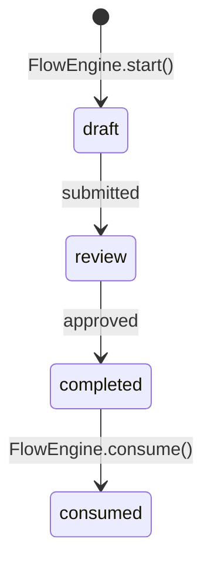

# 流程状态机：BPMN、Flowable 与 Sca4d-J

流程状态机把一次跨请求的业务操作表示为「当前处于哪个状态，收到什么已确认事件后可以进入哪个状态」。它只决定允许的状态变化，不替认证、审批或外部系统调用完成业务工作。

一次跨请求的操作，例如分步验证或分步确认，可能被重复提交、并发提交，或在较长时间后继续。若每个 Controller 各自保存「当前第几步」，调用方只能靠约定避免跳步、恢复过期请求或重复使用完成结果。`FlowGraph`、`FlowInstance` 和 `FlowEngine` 把这些规则集中为可校验的定义、可保存的当前状态和带版本的更新。

## 它在现有方案中的位置

有限状态机是软件建模中的基础模型。[UML 2.5.1](https://www.omg.org/spec/UML/2.5.1/About-UML/) 是 OMG 发布的正式建模规范。它描述状态、触发事件和状态变化，但不规定一个 Java 服务必须怎样持久化或执行业务操作。

另一条演进路线是面向业务流程的 [BPMN 2.0](https://www.omg.org/spec/BPMN/2.0/About-BPMN/) 标准。BPMN 除了状态变化，还用可交换的 XML 描述用户任务、服务任务、网关、定时器等流程元素。[Flowable](https://www.flowable.com/open-source/docs/bpmn/ch02-GettingStarted/) 是执行 BPMN 2.0 定义的 Java 引擎。它会部署流程定义，保存运行实例和历史记录，并提供任务、查询和作业服务。

Sca4d-J 当前的 `flow` 包不是 BPMN 实现，也不是 Flowable 的替代品。它是一个较小的、由 Java 代码定义的状态机 API。业务代码先完成验证或外部调用，再提交 `FlowEvent`。引擎只选择唯一转换，并保存新快照。

| 需要解决的问题 | BPMN 引擎，例如 Flowable | Sca4d-J `flow` 包 |
|---|---|---|
| 定义方式 | BPMN 2.0 XML，可由建模工具编辑和部署 | Java `FlowGraph` 与 `FlowTransition` |
| 运行内容 | 用户任务、服务任务、网关、定时器、异步作业、流程变量与历史 | 当前节点、事件匹配、过期检查、乐观更新和一次性消费 |
| 持久化 | 引擎管理自己的运行与历史数据表 | 由应用实现 `FlowStore`；Core 只声明接口 |
| 适用场景 | 长期审批、人工任务列表、可视化流程维护、定时作业和流程审计 | 代码中固定、短时、由业务 Service 明确驱动的分步操作 |

## 为什么 Core 不直接使用 Flowable

Core 需要解决的是登录、二次认证和账号恢复这类状态变化。这些变化由代码确定，通常在短时间内完成。

它只需要做三件事：校验允许的转换，拒绝过期实例，并防止并发请求覆盖彼此的结果。为这些操作引入 BPMN 引擎，会同时引入流程定义部署、引擎数据表、运行服务和版本管理。采用脚手架的应用即使不需要审批或人工任务，也必须处理这些运行条件。

`core-api` 因此使用不依赖 Spring 和第三方流程引擎的 Java 接口。流程图随代码编译。业务 Service 显式完成认证或外部操作，`FlowEngine` 只保存状态变化。这种设计依赖少、调用顺序直接，但不支持可视化建模、人工任务、定时器、异步作业和流程历史。

具体应用需要这些 BPMN 功能时，应在应用或专门模块中引入 Flowable，并把 BPMN 任务与业务 Service 明确连接。Flowable 负责完整业务流程，`flow` 包负责代码内的短时状态变化。两者解决的问题不同。

## Sca4d-J 现在实际包含什么

`core/sca4dj-core-api` 只声明通用状态机接口和基础类型。[FlowDefinition](/javadoc/core/sca4dj-core-api/com/sca4d/core/api/flow/FlowDefinition.html) 给出定义名、版本、状态图和有效时间。[FlowEngine](/javadoc/core/sca4dj-core-api/com/sca4d/core/api/flow/FlowEngine.html) 创建、推进和单次消费实例。[FlowStore](/javadoc/core/sca4dj-core-api/com/sca4d/core/api/flow/FlowStore.html) 由具体应用实现持久化。

当前没有预置的认证流程定义、生产用 `FlowStore`、Spring Bean 装配、HTTP 入口或应用运行时调用点。`FlowEngineTest` 使用测试内定义和内存存储，验证按事件推进、过期、乐观锁冲突和单次消费。

## 一个定义怎样变化

下图使用提交审核作为示例。这些节点和事件不是 Sca4d-J 预置的业务定义。具体应用应使用自己的状态和事件名称实现 `FlowDefinition`。



业务 Service 完成审核规则和外部操作后，再提交已确认的 [FlowEvent](/javadoc/core/sca4dj-core-api/com/sca4d/core/api/flow/FlowEvent.html)。引擎不读取 HTTP 请求，也不执行业务校验。

`FlowGraph.selectTransition(...)` 必须找到且只能找到一条匹配转换。随后，`FlowStore.update(...)` 以读取时的 [Version](/javadoc/core/sca4dj-core-api/com/sca4d/core/api/concurrent/Version.html) 原子写入新状态。

`FlowNodeType` 中的 `STEP` 和 `WAITING` 用来表达节点等待谁提交事件。但当前 `FlowEngine` 不会为这两个类型执行不同代码。只有 `TERMINAL` 会影响引擎行为。到达 `TERMINAL` 后不能再推进，只能通过 `consume(...)` 标记结果已使用一次。

相关规格：[流程定义（FlowDefinition）](/javadoc/core/sca4dj-core-api/com/sca4d/core/api/flow/FlowDefinition.html)、[流程图（FlowGraph）](/javadoc/core/sca4dj-core-api/com/sca4d/core/api/flow/FlowGraph.html)、[流程引擎（FlowEngine）](/javadoc/core/sca4dj-core-api/com/sca4d/core/api/flow/FlowEngine.html)、[流程实例（FlowInstance）](/javadoc/core/sca4dj-core-api/com/sca4d/core/api/flow/FlowInstance.html)、[流程存储（FlowStore）](/javadoc/core/sca4dj-core-api/com/sca4d/core/api/flow/FlowStore.html) 和[流程事件（FlowEvent）](/javadoc/core/sca4dj-core-api/com/sca4d/core/api/flow/FlowEvent.html)。

## 示例

以下代码创建并推进一个定义。`flowStore` 必须是具体应用提供的 `FlowStore` 实现，并使「版本相等才更新」和写入成为一次原子操作。省略 import 语句。

```java
FlowGraph graph = new FlowGraph(
        "draft",
        List.of(
                new FlowNode("draft", FlowNodeType.STEP),
                new FlowNode("review", FlowNodeType.STEP),
                new FlowNode("completed", FlowNodeType.TERMINAL)),
        List.of(
                new FlowTransition("draft", "review", "submitted"),
                new FlowTransition("review", "completed", "approved")));

FlowDefinition definition = new FlowDefinition() {
    public String name() { return "review"; }
    public int version() { return 1; }
    public FlowGraph graph() { return graph; }
    public Duration timeToLive() { return Duration.ofMinutes(5); }
};
FlowEngine engine = new FlowEngine(
        new FlowCatalog(List.of(definition)),
        flowStore);

FlowId flowId = new FlowId("review:" + reviewId);
engine.start(flowId, definition.name(), definition.version(), Map.of(), now);

engine.advance(
        flowId,
        new FlowEvent("submitted", Map.of()),
        now.plusSeconds(1));

engine.advance(
        flowId,
        new FlowEvent("approved", Map.of()),
        now.plusSeconds(2));
engine.consume(flowId, now.plusSeconds(3));
```

调用顺序从业务 Service 创建 `FlowEvent` 开始。

- `start(...)` 保存版本为 `0` 的起始实例。
- 每次 `advance(...)` 生成版本加一的新实例，并写入存储。
- `consume(...)` 只能在终点成功执行一次。

`FlowInstance.data()` 在创建后不可修改。步骤输入、会话、审计记录和外部副作用由业务 Service 及其自己的存储处理。

## 扩展方式

应用实现 `FlowStore` 接口，提供 `create`、`find` 和 `update` 三个方法。`update(expectedVersion, instance)` 必须在版本匹配时原子写入，并在不匹配时返回 `false`。

应用通过 `new FlowCatalog(List<FlowDefinition>)` 构造定义目录。源码中没有自动扫描 `FlowDefinition` Bean 的机制，定义列表由应用传入。

应用构造 `FlowEngine(FlowCatalog, FlowStore)` 后，在业务 Service 中调用 `start`、`advance` 与 `consume`。

## 失败与不处理的内容

- 定义不存在、定义版本无效、流程图包含不可达节点，或多个同名版本时，创建目录或启动流程失败。
- 实例不存在、过期、已经消费，或已经进入终点时，`advance(...)` 失败。事件没有匹配转换，或同时匹配多条转换时，同样失败。
- 其他请求先推进或先消费同一实例时，`FlowStore.update(...)` 返回 `false`，`FlowEngine` 抛出 `OptimisticLockException`。调用方重新读取后，自行决定提示冲突、重试或放弃。不能把旧状态当成成功结果。
- 引擎不执行任务、不管理待办、不调度定时器、不重试外部调用、不补偿已发生的副作用、不删除过期实例，也不生成历史报表。这些需求应由业务模块实现，或采用 Flowable 等流程引擎。

相关标准与组件文档：[Flowable 的 BPMN 入门与运行模型](https://www.flowable.com/open-source/docs/bpmn/ch02-GettingStarted/)、[Flowable API](https://www.flowable.com/open-source/docs/bpmn/ch04-API/)、[UML 2.5.1](https://www.omg.org/spec/UML/2.5.1/About-UML/) 和 [BPMN 2.0](https://www.omg.org/spec/BPMN/2.0/About-BPMN/)。

## 相关页面

- [Pipeline、Job 与定时调度](/capabilities/jobs-scheduling/pipeline-job-scheduling)
- [Job 模块](/capabilities/jobs-scheduling/job)
- [Quartz 调度模块](/capabilities/jobs-scheduling/quartz)
