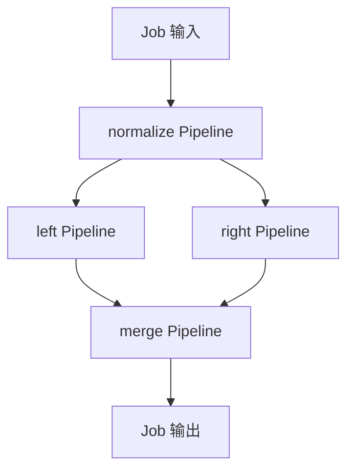

# Pipeline、DataGraph 与 Job

[Pipeline](/javadoc/core/sca4dj-core-api/com/sca4d/core/api/pipeline/Pipeline.html) 在调用线程中按固定顺序转换输入和输出。[DataGraph](/capabilities/data-configuration/data-graph) 根据数据依赖执行多输入计算。[Job](/javadoc/core/sca4dj-core-api/com/sca4d/core/api/job/Job.html) 定义由系统主体执行的后台工作。`JobSchedule` 指定何时触发它。

| 对象 | 执行范围 | 失败后能恢复到哪里 |
|---|---|---|
| Pipeline | 一条线性处理链 | 本身不保存状态；调用方决定是否重新执行 |
| DataGraph | 进程内数据依赖图 | 本身不保存节点状态；失败不返回部分结果 |
| DirectJob | 一个完整的业务动作 | `PERSISTED` 时重试整个动作 |
| PipelineJob | 多条 Pipeline 构成的顺序节点或二路分支与合并 | `PERSISTED` 时只重试失败的 Pipeline 节点 |

业务可以直接运行 `pipeline.run(input)` 或 `DataGraphExecutor.executeAsync(...)`。需要独立的后台领取、系统身份、租约和执行记录时，才提交 Job。

DirectJob 内可以调用 Pipeline 或 DataGraph。图内每个节点不会自动成为可恢复的 Job 节点。需要分别保存中间结果时，把多个 Pipeline 声明为 PipelineJob 节点。



PipelineJob 保存每个节点的输入、输出、依赖和重试参数。左右分支都成功后，合并节点按定义顺序读取 `ParallelResults`。

同一根 Run 的节点完成在数据库行锁下推进，避免两个分支同时成功却遗漏合并激活。

单条 Pipeline 内的 Stage 没有独立恢复点。节点重试从该 Pipeline 的首个 Stage 重新开始。

PipelineJob 当前只支持顺序节点、二路并发和汇合。它不表示人工等待、补偿或任意工作流。

Flow 表示跨业务调用推进的流程状态。它不领取 Job，也不解释 Pipeline 的阶段。需要人工确认时，由业务或 Flow 保存等待状态，确认后再发起下一次系统 Job。

Job 的 `target(input)` 决定由哪些实例执行：任一合格实例、指定实例，或触发时全部在线实例。

`workKey(input)` 决定同一系统身份下，哪些工作共用同一组并发限制。

实例 ID 只表示执行位置。后台权限仍由所需 `InstanceCapability` 对应的 `SystemPrincipal` 决定。

工作已向设备或厂商发出请求，但尚未保存结果时，租约接管可能导致动作重做。业务仍需唯一约束、状态条件或外部幂等键。

具体应用的到期扫描和清理，可以使用无记录 DirectJob。由下一次扫描重新读取业务状态。需要保存执行结果的业务动作，可以使用持久化 DirectJob。需要多个节点顺序或并发执行的定时流程，可以使用 PipelineJob。

业务结果保存于业务表，Job 历史只记录执行事实。具体状态、提交结果和保留规则见 [Job 模块](/capabilities/jobs-scheduling/job)。

## 示例

以下示例为 Document 打包流程声明顺序节点。`plan()` 从输入类型 `PackageRequest` 开始，依次执行 `normalize` 与 `render` 两个 Pipeline 节点。每个节点声明自己的 `RetryRule`。省略 import 语句。

```java
// 由具体应用定义的 PipelineJob。
public final class DocumentPackageJob extends PipelineJob<PackageRequest, PackageResult> {

    private final PackageSteps steps;

    public DocumentPackageJob(PackageSteps steps) {
        this.steps = steps;
    }

    @Override
    public JobKey key() {
        return new JobKey("WORKSPACE/DOCUMENT/PACKAGE");
    }

    @Override
    public int definitionVersion() {
        return 1;
    }

    @Override
    protected PipelineJobPlan<PackageRequest, PackageResult> plan() {
        Pipeline<PackageRequest, PackageRequest> normalize = Pipeline.of(PipelineStage.of(
                "normalize", PackageRequest.class, PackageRequest.class, steps::normalize));
        Pipeline<PackageRequest, PackageResult> render = Pipeline.of(PipelineStage.of(
                "render", PackageRequest.class, PackageResult.class, steps::render));

        RetryRule retry = RetryRule.atMost(3, Backoff.fixed(Duration.ofSeconds(30)));
        return PipelineJobPlan.from(PackageRequest.class)
                .then("normalize", normalize, retry)
                .then("render", render, retry);
    }
}
```

`normalize` 失败后，只重试 `normalize` 节点；已成功的节点结果保存在 PipelineJob 的节点记录中。

DirectJob 内直接同步执行 Pipeline 时，不产生 Job 节点记录：

```java
// 调用线程中同步执行，失败时抛出异常，不保存中间结果。
PackageResult result = renderPipeline.run(request);
```

## 扩展方式

应用提供 `PipelineJob` 或 `DirectJob` 子类并注册为 Spring Bean。`JobCatalog` 通过 `ObjectProvider<Job<?, ?>>` 收集全部 Job，并按 `JobKey` 与 `definitionVersion` 建立目录。

PipelineJob 的节点由 `plan()` 声明。`PipelineJobPlan.parallel(...)` 声明二路并发，`merge(...)` 声明汇合节点，并使用 `ParallelResults` 读取两个分支的输出。这些方法的泛型签名以 Javadoc 为准。

## 相关页面

- [Job 模块](/capabilities/jobs-scheduling/job)
- [Job 配置](/capabilities/jobs-scheduling/job-configuration)
- [Quartz 调度模块](/capabilities/jobs-scheduling/quartz)
- [流程状态机](/capabilities/jobs-scheduling/flow-state-machine)
- [重试规则与执行](/capabilities/foundation/retry)
