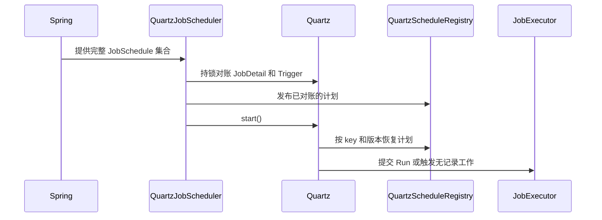

# Quartz 调度模块

`sca4dj-scheduling-quartz` 使用 Quartz JDBC JobStore 实现 [JobScheduler](/javadoc/core/sca4dj-core-api/com/sca4d/core/api/scheduling/JobScheduler.html)。所有代码计划都使用 `JobSchedule`。是否保存独立 Run，由 Job 的 `runRecording()` 决定。

## 启动与触发



Spring Boot 创建 Quartz 时保持 `autoStartup=false`。

`QuartzJobScheduler` 先取得应用隔离名称内的分布式对账锁，再在 PostgreSQL 事务中更新代码计划。完成后，发布可执行定义并启动调度器。

同一次对账会删除已有的 `sca4dj-cluster-task` 下的 JobDetail 与 Trigger。这样可以避免旧计划与统一 `JobSchedule` 重复触发。

Quartz `JobDataMap` 保存 `ScheduleKey`、计划定义版本、定义摘要和计划契约文本。契约文本包含固定输入的 JSON，但不保存 Spring Bean。

一次 fire 恢复当前代码定义后，将 Quartz 原定触发时间交给 `JobExecutor`：

- `PERSISTED + any/instance`：提交或去重 Run。
- `PERSISTED + all`：固定目标，按实例创建 Run。
- `NONE + any`：当前 Quartz 实例具备所需能力时直接执行。否则，交给一个在线合格实例的短期投递份额。两种情况都不创建 Job Run。
- `NONE + instance/all`：固定目标，保存短期投递份额，由目标实例执行。

Quartz 只决定触发时间。指定目标的在线快照、系统身份、工作键、节点租约和结果写回，由 Job 模块负责。

## 计划对账

计划摘要包含 `ScheduleKey`、计划和 Job 定义版本、时间定义、misfire、overlap 策略及固定输入。修改这些内容时，递增计划 `definitionVersion`。仅移动 Java 实现类，不改变摘要。

| 数据库中已有计划 | 当前代码 | 处理 |
|---|---|---|
| 不存在 | 新 key | 创建 durable JobDetail 和 Trigger |
| 版本较低 | 版本增加 | 更新 JobDetail 并重排 Trigger |
| 版本较高 | 版本倒退 | 拒绝启动 |
| 版本相同、摘要不同 | 定义发生变化 | 拒绝启动 |
| Trigger 缺失或 ERROR | 定义仍存在 | 按当前定义重建 |
| key 已从完整代码集合移除 | 删除计划 | 删除 JobDetail 和 Trigger |

Quartz 使用 `LocalDataSourceJobStore`、`PostgreSQLDelegate`、集群模式和 `quartz.qrtz_*` 表。`sched_name` 由运行时命名空间派生，格式为 `<应用隔离名称>:sca4dj:scheduling:quartz`。同一应用的多个实例共享 scheduler 名称。改变应用名称不会迁移旧 trigger。

## 时间与失败

`ScheduleTiming` 只允许 `CronSchedule` 和 `IntervalSchedule`。Cron 显式指定时区。固定间隔按原定触发时间计算，不以 Job 完成时间重新计时。Quartz SimpleTrigger 要求间隔至少 1 毫秒。

`MisfirePolicy.SKIP` 忽略已错过的触发。`FIRE_ONCE_NOW` 在恢复后补一次。

`OverlapPolicy.SKIP_IF_RUNNING` 跳过同键活动工作。`WAIT` 保存排队 Run。`ALLOW` 允许不同 Run 或份额并行。无记录（`JobRunRecording.NONE`）的工作不支持 `WAIT`。

Quartz fire 成功，不代表业务动作成功。Worker 失联后的重复副作用、业务结果未知和人工处理，仍由对应的业务状态负责。

配置见 [Quartz 配置](/capabilities/jobs-scheduling/quartz-configuration)，Job 状态与表归属见 [Job 模块](/capabilities/jobs-scheduling/job)。

## 示例

以下示例声明两个代码计划。它们以 Spring Bean 的形式提供给 `QuartzJobScheduler`，每次启动时与数据库对账。`dailyExportJob` 为持久化的 `DirectJob`，其定义方式见 [Job 模块](/capabilities/jobs-scheduling/job)。省略 import 语句。

```java
@Configuration
class WorkspaceScheduleConfiguration {

    // 无记录的到期扫描：每 5 分钟执行一次，每次直接读取业务状态。
    @Bean
    JobSchedule<Void, Void> invitationExpiry(DirectJob<Void, Void> invitationExpiryJob) {
        return new JobSchedule<>(
                new ScheduleKey("WORKSPACE/INVITATION/EXPIRE"),
                1,
                invitationExpiryJob,
                null,
                new IntervalSchedule(Duration.ofMinutes(5), Duration.ofMinutes(1)),
                MisfirePolicy.FIRE_ONCE_NOW,
                OverlapPolicy.SKIP_IF_RUNNING);
    }

    // 持久化的每日导出：每天 02:00 按指定时区触发，保存 Run。
    @Bean
    JobSchedule<Void, Void> dailyExport(DirectJob<Void, Void> dailyExportJob) {
        return new JobSchedule<>(
                new ScheduleKey("WORKSPACE/EXPORT/DAILY"),
                1,
                dailyExportJob,
                null,
                new CronSchedule("0 0 2 * * ?", ZoneId.of("Asia/Shanghai")),
                MisfirePolicy.FIRE_ONCE_NOW,
                OverlapPolicy.SKIP_IF_RUNNING);
    }
}
```

`invitationExpiryJob` 由 `DirectJob.unrecorded(...)` 创建，`runRecording()` 为 `NONE`，`retryRule()` 固定为 `RetryRule.once()`。它的动作读取过期邀请并处理，下一次扫描会重新读取业务状态。

```java
@Bean
DirectJob<Void, Void> invitationExpiryJob(WorkspaceInvitations invitations, Clock clock) {
    return DirectJob.unrecorded(
            new JobKey("WORKSPACE/INVITATION/EXPIRE"),
            1,
            TreeCode.ofColon("JOB:WORKER"),
            () -> invitations.expireDue(clock.instant()));
}
```

修改计划的时间、输入或重叠策略时，递增计划的 `definitionVersion`。数据库中的版本高于代码中的版本时，启动被拒绝。

## 扩展方式

应用以 Spring Bean 的形式声明 `JobSchedule`。`QuartzJobScheduler` 通过 `ObjectProvider<JobSchedule<?, ?>>` 延迟读取全部计划，并在启动时对账。

计划引用的 `Job` 必须由应用注册为 Bean，并通过 `JobCatalog` 登记。`JobSchedule` 的输入类型与 Job 的输入类型不一致时，构造失败。非 `Void` 输入的 Job 不能使用 `null` 作为计划输入。

## 相关页面

- [Quartz 配置](/capabilities/jobs-scheduling/quartz-configuration)
- [Job 模块](/capabilities/jobs-scheduling/job)
- [Job 配置](/capabilities/jobs-scheduling/job-configuration)
- [Pipeline、Job 与定时调度](/capabilities/jobs-scheduling/pipeline-job-scheduling)
