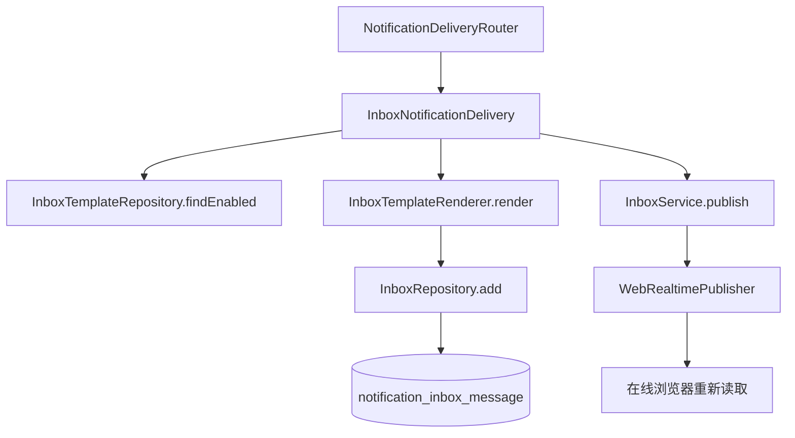

# 站内信

站内信渠道把通知渲染为 Account 收件箱中的快照，并提供未读数量、游标分页、单条已读和全部已读。快照写入或已读状态变化后，渠道通过 Realtime 通知在线浏览器重新读取收件箱。适合接入站内信渠道的开发者，以及维护站内信模板的开发者阅读。

**根构建当前未包含该模块，使用前需在构建中引入。**

依据是根目录 `settings.gradle.kts` 的 `include` 列表。该列表包含 `modules:notification:sca4dj-notification-sms`，但没有 `modules:notification:sca4dj-notification-inbox`。模块目录 `modules/notification/sca4dj-notification-inbox` 下存在 `build.gradle.kts`。引入后，该模块可以参与构建。

本页描述模块源码的行为。它不表示任何具体应用已经使用该渠道。

## 概念

站内信渠道的渠道常量是 `InboxChannels.INBOX`，值为 `NOTIFICATION/CHANNEL/INBOX`。通知的渠道集合包含该常量时，`NotificationDeliveryRouter` 调用 `InboxNotificationDelivery`。

例如，一条通知的接收人是类型为 `ACCOUNT` 的 `NotificationRecipient`，标识为 `42`。该通知的渠道集合包含 `InboxChannels.INBOX`，并且通知编码存在启用的站内信模板。

投递时，`InboxNotificationDelivery` 按通知的 Locale 与变量渲染模板。随后，它在 `notification_inbox_message` 中为 `account_id` 为 `42` 的 Account 新增一条快照。`InboxService.unreadCount(42)` 把该快照计入未读数量。

站内信快照与模板分离。快照保存渲染后的 `title`、`text_content` 和 `html_content`。之后修改模板，不会改变已有快照。

## 核心对象

| 对象 | 负责 | 不负责 |
|---|---|---|
| `InboxNotificationDelivery` | 实现 `NotificationDelivery`，判断接收人类型与模板是否可用，渲染模板，写入快照，快照新增后提示变化 | 确定接收人，管理模板 |
| `InboxTemplateRenderer` | 校验 Tiptap 模板结构，按 Locale 选择内容，生成标题、纯文本和清洗后的 HTML | 保存模板或快照 |
| `InboxTemplateRepository` | 保存模板，按通知编码查询启用模板，启用、停用和逻辑删除模板 | 渲染模板 |
| `InboxRepository` | 游标分页查询、未读计数、幂等新增快照、单条和全部已读的数据库操作 | 发布 Realtime 事件 |
| `InboxService` | 对外提供分页、未读数量和已读操作，状态变化后发布 `InboxChanged` | 定义 HTTP 接口 |
| `InboxMessage` | 表示从数据库读取的一条快照，包含 `readAt` 与 `version` | 保存模板 |
| `InboxChanged` | 作为 `NOTIFICATION/INBOX/CHANGED` 事件的载荷，只包含 `accountId` | 携带快照内容 |

模块不定义 HTTP 控制器。具体应用需要自行定义接口，并调用 `InboxService`。



投递路径在同一事务内完成渲染与快照写入。`InboxService.publish` 使用 `DispatchPolicy.afterCommit()`，事件在事务提交后发布。

## 快照与已读状态

`notification_inbox_message` 的唯一索引为 `(message_id, account_id)`。`InboxRepository.add` 使用 `ON CONFLICT (message_id, account_id) DO NOTHING`，因此同一原始消息对同一 Account 只保存一条快照。重复写入时，`InboxNotificationDelivery.deliver` 仍返回 `CONFIRMED`。

已读状态由 `read_at` 表示。`read_at` 为空表示未读。

- `InboxService.markRead(accountId, inboxMessageId, version)` 只更新同时满足以下条件的快照：未读，属于该 Account，且 `version` 与参数一致。更新成功后，把 `read_at` 设为当前时间，并把 `version` 加 1。
- 条件不满足时，`markRead` 不更新数据，不抛出异常，也不发布事件。
- `InboxService.markAllRead(accountId)` 把该 Account 的全部未读快照的 `read_at` 设为当前时间，并把 `version` 加 1。只有至少一条快照被更新时，才发布事件。

`InboxService.page(accountId, beforeId, limit)` 按 `inboxMessageId` 倒序返回快照。`beforeId` 为 `null` 时，从最新一条开始。否则，只返回 `id` 小于 `beforeId` 的快照。调用方使用上一页最后一条的 `inboxMessageId` 作为下一页的 `beforeId`。`limit` 的范围是 1 到 100。

## 模板

站内信模板保存在 `notification_inbox_template`。

- `content` 是 JSON 对象。键为 Locale 的 BCP 47 标签，每个 Locale 的值包含 `title` 与 `body` 两个 Tiptap 文档。
- `notification_code` 在未删除的记录中唯一。
- `enabled` 为 `false` 时，模板不参与投递。
- `InboxTemplateRepository.add` 新增的模板固定为停用状态，需要调用 `setEnabled` 启用。
- `delete` 只逻辑删除已停用的模板，把 `deleted` 设为 `1`。

`InboxTemplateRenderer.validate` 对模板做以下检查，失败时抛出 `IllegalArgumentException`：

- 模板至少包含一个 Locale，并且包含 `LocaleCatalog.defaultLocale()` 对应的 Locale。
- 每个 Locale 的值只能包含 `title` 与 `body`。
- 每个节点必须有文本类型的 `type`。`text` 节点必须有 `text`。
- `notificationVariable` 节点的 `attrs.name` 必须匹配 `[a-z][a-zA-Z0-9_]{0,63}`。
- 节点深度不超过 32，所有 Locale 的节点总数不超过 10000。

渲染时，Locale 按以下顺序选择：完全匹配的 Locale，同语言的已支持 Locale，默认 Locale。

渲染结果的处理如下：

- `notificationVariable` 节点替换为同名的通知变量。变量缺失时，渲染失败。
- 标题中的换行替换为空格，并去除首尾空白。
- 纯文本正文中，`hardBreak` 转为换行，`horizontalRule` 转为分隔线文本。
- HTML 正文使用 `Sanitizers.FORMATTING`、`BLOCKS`、`LINKS`、`TABLES` 和 `STYLES` 策略清洗。策略不允许的标签与属性被移除。
- 标题、纯文本和 HTML 各自不能超过 500000 个字符。

## 投递

`InboxNotificationDelivery.available` 在以下条件同时满足时返回 `true`：

- 接收人的 `type` 等于 `NotificationRecipient.ACCOUNT_TYPE`，即 `ACCOUNT`。
- 存在该通知编码的启用模板。

`deliver` 的处理顺序如下：

1. 把接收人标识解析为 `long` 类型的 `accountId`。
2. 查询启用模板，并按通知 Locale 与变量渲染。
3. 插入快照。快照新增时调用 `InboxService.publish`。
4. 返回 `DeliveryOutcome.confirmed()`。

站内信渠道没有覆盖 `retryRule()`，使用 `NotificationDelivery` 的默认值 `RetryRule.once()`。重试的含义见[重试规则与执行](/capabilities/foundation/retry)。

## 实时提示

`InboxService.CHANGED` 是事件类型 `NOTIFICATION/INBOX/CHANGED`，协议版本为 `1`，载荷为 `InboxChanged`。事件目标为 `WebRealtimeTarget.account(accountId)`，事件标识为 `accountId` 的字符串形式。

以下操作会发布该事件：

- 新增快照。
- `markRead` 更新了一条快照。
- `markAllRead` 更新了至少一条快照。

事件只说明收件箱发生变化，不包含快照内容。在线客户端收到事件后，需要通过 `page` 与 `unreadCount` 重新读取。

## 配置

站内信模块没有 `@ConfigurationProperties` 配置类，也没有读取配置键。自动配置 `InboxNotificationAutoConfiguration` 依赖以下已有 Bean：

- `LocaleCatalog`
- `VersionConditions`
- `Sca4djMapper`（`@Sca4djJson` 限定）
- `WebRealtimePublisher`
- `Clock`
- `IdGenerator`
- `NotificationMessageCodec` 与 `NotificationDeliveryRouter`

自动配置注册 `InboxTemplateRenderer`、`InboxTemplateRepository`、`InboxRepository`、`InboxService`、名为 `inboxNotificationDelivery` 的 `NotificationDelivery`，以及名为 `inboxNotificationMessageHandler` 的 `NotificationMessageHandler`。

接入步骤如下：

1. 在构建中引入 `modules:notification:sca4dj-notification-inbox`。
2. 把结构片段 `META-INF/sca4dj/schema/notification-inbox.sql` 纳入具体应用的迁移。
3. 为需要站内信的通知类型，在通知的渠道集合中加入 `InboxChannels.INBOX`。通知类型声明渠道的方式见 [Notification 模块](/capabilities/messaging-notification/notification)。
4. 为通知编码新增站内信模板，并启用该模板。

## 示例

以下示例为具体应用中的收件箱查询与已读服务。接口层由应用定义，示例省略 import 语句。

```java
// 由具体应用定义的服务。Account 标识由认证上下文提供。
@Service
class InboxFacade {

    private final InboxService inbox;

    InboxFacade(InboxService inbox) {
        this.inbox = inbox;
    }

    public List<InboxMessage> page(long accountId, Long beforeId) {
        return inbox.page(accountId, beforeId, 20);
    }

    public long unreadCount(long accountId) {
        return inbox.unreadCount(accountId);
    }

    public void markRead(long accountId, InboxMessage message) {
        // version 来自客户端最近一次读取的快照；版本不一致时不更新，也不抛出异常。
        inbox.markRead(accountId, message.inboxMessageId(), message.version());
    }

    public void markAllRead(long accountId) {
        inbox.markAllRead(accountId);
    }
}
```

`markRead` 的版本不一致时不更新数据。客户端需要重新读取快照，使用最新 `version` 再次提交。

以下 JSON 为 `notification_inbox_template.content` 的一个示例。它包含默认 Locale `en-US`，标题与正文都引用 `workspaceName` 变量。

```json
{
  "en-US": {
    "title": {
      "type": "doc",
      "content": [
        { "type": "paragraph", "content": [ { "type": "text", "text": "Workspace invitation" } ] }
      ]
    },
    "body": {
      "type": "doc",
      "content": [
        {
          "type": "paragraph",
          "content": [
            { "type": "text", "text": "You were invited to " },
            { "type": "notificationVariable", "attrs": { "name": "workspaceName" } }
          ]
        }
      ]
    }
  }
}
```

## 相关页面

- [Notification 模块](/capabilities/messaging-notification/notification)
- [通知模板](/capabilities/messaging-notification/notification-template)
- [消息内容与投递结果](/capabilities/messaging-notification/message-content)
- [Messaging 模块](/capabilities/messaging-notification/messaging)
- [Outbox 派发与清理](/capabilities/messaging-notification/outbox)
