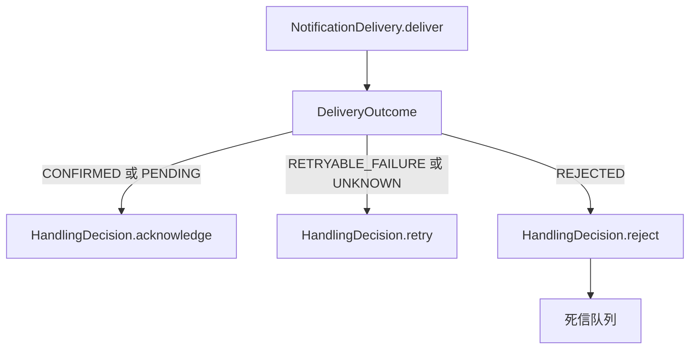

# 消息内容与投递结果

本页说明 `Message` 携带的媒体内容（`MessageContent`）、只携带内容的普通消息（`ContentMessage`），以及 `Delivery` 返回的 `DeliveryOutcome` 如何被消息 Handler 映射为确认、重试或拒绝。适合定义携带文本或附件的消息、为通知渠道实现 `Delivery` 的开发者阅读。

本页涉及的类型位于 `core/sca4dj-core-api`，通知渠道的实现位于 `modules/notification`。消息的发布与派发见 [Outbox 派发与清理](/capabilities/messaging-notification/outbox)。

## 概念

`Message` 是可以交给 `MessageBus` 的业务消息。它声明三项内容：`code()` 返回稳定的消息编码，`protocolVersion()` 返回协议版本，`contents()` 返回不可修改的 `MessageContent` 列表。

`ContentMessage` 是一种具体的 `Message`，没有业务字段，只携带 `MessageContent`。构造时传入编码、协议版本和至少一项内容。

```java
var message = new ContentMessage(
        TreeCode.of("EXAMPLE/CONTENT/DOCUMENT"),
        1,
        List.of(MessageContent.text("text/plain", "正文")));
```

上例中的 `EXAMPLE/CONTENT/DOCUMENT` 是示例编码。具体应用需要替换为自己的消息编码。

`ContentMessage` 编码时需要已注册的 `MessageCodec`。`RabbitMessageEnvelopeCodec` 按消息的 `code()` 与 `protocolVersion()` 查找 Codec。

- 未注册 Codec 时，抛出 `IllegalArgumentException`，消息为「消息没有注册 Codec」。
- 注册的 Codec 值类型与消息类型不一致时，抛出 `IllegalArgumentException`，消息为「消息没有匹配 Codec」。

这两个异常在调用 `MessageBus.dispatch` 时抛出。

源码中没有 `ContentMessage` 的 `MessageCodec` 实现，也没有使用 `ContentMessage` 的调用方。

## MessageContent 的选择

`MessageContent` 由 `mediaType`、`ContentDisposition`、`ContentBody` 和可选的 `name` 组成。

`ContentDisposition` 只有两个值：`INLINE` 表示内联展示，`ATTACHMENT` 表示作为附件处理。`ContentBody` 是封闭接口，只允许三种实现：

| 工厂方法 | disposition | 正文类型 | 用途 |
|---|---|---|---|
| `MessageContent.text(mediaType, value)` | `INLINE` | `TextContent` | 文本内容随消息传递，没有名称 |
| `MessageContent.attachment(mediaType, value, name)` | `ATTACHMENT` | `BinaryContent` | 二进制附件，正文保存在消息中 |
| `MessageContent.reference(mediaType, disposition, scheme, key, name)` | 由调用方指定 | `ReferencedContent` | 只携带外部内容的引用，`scheme` 与 `key` 由具体应用解释 |

选择规则如下：

- 正文不需要外部保存，且体积由调用方控制时，使用 `text` 或 `attachment`。
- 正文需要由具体应用的存储保存时，使用 `reference`。消息只携带 `scheme` 与 `key`。core API 中没有定义 `scheme` 的取值集合。

`MessageContent` 构造时的处理如下：

- `mediaType` 去除首尾空白并转为小写。它必须包含 `/`，且不能含控制字符。否则抛出 `IllegalArgumentException`，消息为「媒体类型格式无效」。
- `name` 为 `null` 或只含空白时保存为 `null`。否则，去除首尾空白后保存。
- `disposition`、`body` 为空时，抛出 `NullPointerException`。

`MessageContentCodec` 把内容编码为 JSON 对象，包含 `mediaType`、`disposition`（枚举名）、`name` 和 `source`。`source.type` 的值为 `text`、`binary` 或 `reference`。`binary` 的正文以 Base64 保存。

解码时，无效的 `disposition` 或 `source.type` 抛出 `IllegalArgumentException`。无效的 Base64 同样抛出 `IllegalArgumentException`。

### 通知中的内容

`Notification.contents()` 返回本次通知携带的 `MessageContent` 列表。`NotificationMessage` 把这些内容交给 `NotificationMessageCodec`，再由 `MessageContentCodec` 编码进消息。

各渠道对内容的处理不同：

- Email 渠道（`EmailNotificationDelivery`）：`available` 在 `contents()` 非空时返回 `false`。
- 短信渠道（`SmsNotificationDelivery`）：不读取 `contents()`，只使用模板变量。内容不会出现在短信中。
- 站内信渠道（`InboxNotificationDelivery`）：不读取 `contents()`，只使用模板渲染快照。内容不会出现在站内信中。

## DeliveryOutcome 的状态

`Delivery<R>.deliver(sourceMessageId, request)` 推进一次业务投递，并返回 `DeliveryOutcome`。`NotificationDelivery` 继承 `Delivery<Notification>`。

`DeliveryOutcome` 的状态及其在消息 Handler 中的映射如下：

| 状态 | 构造方法 | 含义 | `NotificationMessageHandler` 的决定 | `SmsDeliveryCheckHandler` 的决定 |
|---|---|---|---|---|
| `CONFIRMED` | `confirmed()` | 投递已确认 | 确认消息 | 确认消息 |
| `PENDING` | `pending(nextActionAt, externalRequestId)` | 结果待查询 | 确认消息 | 确认消息 |
| `RETRYABLE_FAILURE` | `retryableFailure(nextActionAt, failureCode)` | 可重试失败 | 重试，原因为 `failureCode`，缺省为 `NOTIFICATION_RETRYABLE_FAILURE` | 拒绝，缺省原因为 `SMS_DELIVERY_CHECK_FAILED` |
| `REJECTED` | `rejected(failureCode)` | 不可重试的拒绝 | 拒绝，进入死信队列，缺省原因为 `NOTIFICATION_REJECTED` | 拒绝，缺省原因为 `SMS_DELIVERY_CHECK_FAILED` |
| `UNKNOWN` | `unknown(nextActionAt, externalRequestId, failureCode)` | 结果未知 | 重试，原因为 `failureCode`，缺省为 `NOTIFICATION_RESULT_UNKNOWN` | 拒绝，缺省原因为 `SMS_DELIVERY_CHECK_FAILED` |

两个 Handler 只读取 `status()` 与 `failureCode()`。`nextActionAt()` 与 `externalRequestId()` 不参与 Handler 的决定。



源码中，生产代码只创建 `CONFIRMED`、`PENDING` 和 `REJECTED`。没有实现类返回 `RETRYABLE_FAILURE` 或 `UNKNOWN`。

短信渠道的 `SmsProviderResult` 为 `UNKNOWN` 时，`SmsNotificationDelivery` 不返回 `UNKNOWN`，而是返回 `PENDING` 并登记查询。

### 渠道结果来源

| 渠道或路径 | 结果 | 条件 |
|---|---|---|
| Email（`EmailNotificationDelivery.deliver`） | `CONFIRMED` | SMTP Transport 的 `send` 返回 |
| Email（`EmailNotificationDelivery.deliver`） | `REJECTED`，原因 `EMAIL_CONTENT_UNSUPPORTED` | 直接调用 `deliver` 且 `contents()` 非空 |
| 短信（`SmsNotificationDelivery.deliver`） | `CONFIRMED` | Provider 结果为 `DELIVERED` |
| 短信（`SmsNotificationDelivery.deliver`） | `PENDING` | Provider 结果为 `ACCEPTED`、`PENDING` 或 `UNKNOWN`，并登记查询 |
| 短信（`SmsNotificationDelivery.deliver`） | `REJECTED`，原因 `SMS_PROVIDER_REJECTED` | 所有候选 Provider 都明确拒绝或没有可用绑定 |
| 短信（`SmsNotificationDelivery.check`） | `REJECTED`，原因为 Provider 失败码或 `SMS_DELIVERY_FAILED` | 查询结果为 `FAILED` 或 `REJECTED` |
| 短信（`SmsNotificationDelivery.check`） | `REJECTED`，原因 `SMS_DELIVERY_CHECK_EXHAUSTED` | 查询次数超过 10 次 |
| 站内信（`InboxNotificationDelivery.deliver`） | `CONFIRMED` | 快照写入成功或已存在 |

站内信快照写入时，重复的 `(message_id, account_id)` 不再新增。但 `deliver` 仍返回 `CONFIRMED`。

## 调用顺序

`NotificationDeliveryRouter.deliver` 在调用渠道前检查渠道是否可用：

1. 通知的渠道集合不包含当前渠道时，返回 `CONFIRMED`，不调用任何渠道。
2. 渠道实现不存在，或 `available` 返回 `false` 时，抛出 `NotificationException`，消息为「通知渠道在消费时不可用」。
3. 否则，调用 `NotificationDelivery.deliver`，并返回其 `DeliveryOutcome`。

因此，Email 渠道在 `contents()` 非空时通过 Router 调用，会抛出 `NotificationException`，而不是返回 `EMAIL_CONTENT_UNSUPPORTED`。该异常由 Messaging 消费路径处理，按 Handler 的 `retryRule()` 决定重试或停止，见 [Messaging 模块](/capabilities/messaging-notification/messaging)。`EMAIL_CONTENT_UNSUPPORTED` 的拒绝结果只在直接调用 `deliver` 时返回。

## 限制与失败结果

| 位置 | 条件 | 结果 |
|---|---|---|
| `ContentMessage` 构造 | `code` 为 `null` | `NullPointerException`，消息为「消息编码不能为空」 |
| `ContentMessage` 构造 | `protocolVersion` 不为正数 | `IllegalArgumentException`，消息为「消息协议版本必须为正数」 |
| `ContentMessage` 构造 | `contents` 为空 | `IllegalArgumentException`，消息为「普通消息至少需要一项内容」 |
| `MessageContent` 构造 | `mediaType` 无效 | `IllegalArgumentException`，消息为「媒体类型格式无效」 |
| `MessageContentCodec.decode` | `disposition` 或 `source.type` 无效 | `IllegalArgumentException` |
| `MessageContentCodec.decode` | `binary` 不是有效 Base64 | `IllegalArgumentException` |
| `NotificationDeliveryRouter.deliver` | 渠道不可用 | `NotificationException`，由 Messaging 按 `retryRule()` 处理 |

当前源码中，没有渠道投递 `contents()` 中的附件或引用。Email 在内容非空时不可用，短信和站内信不读取内容。需要投递附件的通知，具体应用需要实现接受内容的渠道。

本页涉及的类型不读取配置键。

## 示例

以下示例为 Document 分享消息，同时携带文本、附件和外部引用。省略 import 语句。该消息需要为 `WORKSPACE/DOCUMENT/SHARED` 与协议版本 `1` 注册 `MessageCodec`，否则 `dispatch` 抛出 `IllegalArgumentException`。

```java
// 由具体应用定义的 Service。
@Service
class DocumentShareService {

    private final MessageBus messageBus;

    DocumentShareService(MessageBus messageBus) {
        this.messageBus = messageBus;
    }

    @Transactional
    public void share(long workspaceId, byte[] pdfBytes) {
        ContentMessage message = new ContentMessage(
                TreeCode.of("WORKSPACE/DOCUMENT/SHARED"),
                1,
                List.of(
                        MessageContent.text("text/plain", "Document 已生成，请在 Workspace 中查看。"),
                        MessageContent.attachment("application/pdf", pdfBytes, "document.pdf"),
                        MessageContent.reference(
                                "application/json",
                                ContentDisposition.INLINE,
                                "document-store",
                                "workspace-" + workspaceId,
                                null)));
        messageBus.dispatch(message, DispatchPolicy.outbox());
    }
}
```

`ATTACHMENT` 内容的正文随消息保存，因此附件体积应由调用方控制。大体积文件应使用 `reference`，由具体应用的存储按 `scheme` 与 `key` 读取。

## 扩展方式

应用为 `ContentMessage` 之外的消息类型提供 `MessageCodec` Bean。Messaging 通过 `List<MessageCodec<?>>` 收集 Codec，并按消息编码与协议版本选择。

应用为通知渠道提供 `NotificationDelivery` Bean。通知层通过 `List<NotificationDelivery>` 收集渠道，并按 `channel()` 与 `available(notification)` 选择。渠道返回的 `DeliveryOutcome` 由 Handler 按上表映射为确认、重试或拒绝。

## 相关页面

- [Outbox 派发与清理](/capabilities/messaging-notification/outbox)
- [Messaging 模块](/capabilities/messaging-notification/messaging)
- [Notification 模块](/capabilities/messaging-notification/notification)
- [Notification Email 模块](/capabilities/messaging-notification/notification-email)
- [短信通知渠道](/capabilities/messaging-notification/sms)
- [站内信](/capabilities/messaging-notification/inbox)
