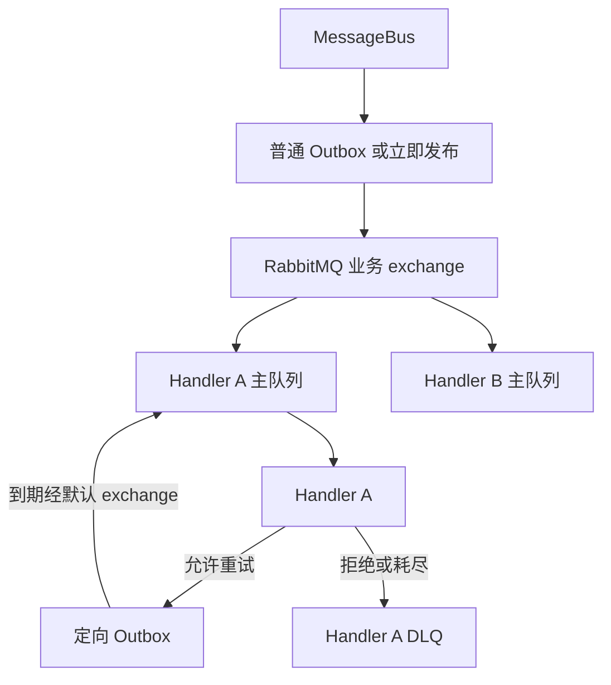

# Messaging 模块

Messaging 实现 `MessageBus` 的三种发布方式：立即发布、事务提交后发布和 Outbox 发布。Outbox 的状态与派发细节见 [Outbox 派发与清理](/capabilities/messaging-notification/outbox)。配置键见 [Messaging 配置](/capabilities/messaging-notification/configuration)。

Messaging 为 `EventHandler` 与 `MessageHandler` 声明 RabbitMQ 主队列和独立死信队列（DLQ）。消费重试与 `RetryRule` 共用同一模型，并通过定向 Outbox 记录下一次处理时间。

## 发布和消费

`MessageBus` 通过 `dispatch(message, policy)` 接受 `Message` 或 `Event`。

- `DispatchPolicy.immediate()` 等待 Broker 确认。
- `DispatchPolicy.afterCommit()` 在业务事务提交后尽力发送一次。
- `DispatchPolicy.outbox()` 与 `DispatchPolicy.outboxNotBefore(time)` 要求存在活跃事务。它们先保存信封，事务提交后再发布。

`DispatchReceipt` 只证明交接或发布，不表示消费者已经完成业务。

每个 Handler 的 `TreeCode` 在应用内唯一。主队列、业务 exchange 和 DLQ 使用应用隔离名称。同一 Handler 的多个实例竞争消费，不同 Handler 各自获得消息。业务消息通过持久 direct exchange 按消息编码路由。



Handler 的处理决定有三种结果：

- `HandlingDecision.acknowledge()` 结束消费。
- `HandlingDecision.reject(...)` 以 `requeue=false` 把消息送入该 Handler 的独立 DLQ。
- `HandlingDecision.retry(...)` 或 Handler 抛出异常时，由 `retryRule()` 决定继续重试或停止。

默认规则为 `RetryRule.once()`。固定、指数、序列退避和无限重试的含义见[重试规则与执行](/capabilities/foundation/retry)。

损坏的信封、无法解码的消息内容、消息身份不一致或无效的重试元数据会被直接拒绝。即使规则允许无限重试，也不登记新的投递。

## 消费重试交接

允许继续时，Messaging 在独立短事务中写入原信封、目标 Handler、下一次消费序号、规则快照和最早发布时间。

事务成功后，Messaging 才确认（ACK）原消息。到期派发使用 RabbitMQ 默认 exchange，直接路由到目标 Handler 主队列。它不重新广播，也不需要 TTL 重试队列。

首次成功登记重试链时冻结规则。之后部署修改 Handler 定义，不改变该链的次数和间隔。旧消息缺少快照时，使用当前声明的规则，但沿用已有尝试序号。损坏的次数不能重置为首次执行。

以下情况的结果如下：

- 登记失败时，原消息重新入队。
- 提交成功但 ACK 失败时，唯一索引阻止重复登记。
- 保留期内能找到下一次投递记录时，原消息重新交付后可直接确认。
- 并发交付和保留期外的迟到消息仍可能重复执行。因此 Handler 必须幂等。

## Outbox 记录与派发

`outbox_id` 标识一次 Broker 发布记录。`message_id` 保持原业务消息身份。

普通发布与定向重试共用 `messaging_outbox` 表。定向记录保存 `target_handler_code`、`handler_attempt` 和 `handler_retry_rule`。同一目标、消息和消费序号只登记一次。

`attempt_count` 是 Outbox 记录向 Broker 发布的次数。`handler_attempt` 是业务消费序号。发布失败不消耗业务消费次数。

Outbox 状态为 `PENDING`、`SENDING`、`FAILED`、`SENT`。发布失败后，按指数退避持续重试。源码中没有发布侧 `DEAD` 状态。

派发器通过状态、`version`、可用时间和租约条件的原子 `UPDATE RETURNING` 竞争领取记录。派发器在短事务外等待 mandatory 路由结果及关联的 publisher confirm。确认后，再写回 `SENT`。

租约过期后，其他实例可以接管。旧持有者和旧版本不能覆盖新领取结果。

Broker 已接收但 `SENT` 写回失败时，同一消息可能重复发布。主队列消费者必须使用原消息标识或稳定业务键去重。`SENT` 记录按配置的保留期清理。Outbox 不构成无限期 Inbox，也不保存完整业务消费历史。

Outbox 派发和清理使用无记录 `JobSchedule`，扫描时不创建 Job Run。Messaging 使用独立 `RabbitTemplate`，不修改应用共享模板。连接、租约和清理配置见 [Messaging 配置](/capabilities/messaging-notification/configuration)。

## 死信与升级

明确拒绝，或有限规则耗尽后，消息进入对应 Handler 的 DLQ。无限规则只有明确拒绝才会结束。需要人工判断时，业务返回拒绝。Messaging 不自动重放或删除 DLQ 中的消息。

已有数据库升级时，必须执行应用的向前迁移，并同时更新新应用使用的模块 schema。

升级前备份数据库。应向前修复。恢复旧队列和数据库时，需要一起核对原消息身份和待执行进度。

## 示例

以下示例为 Workspace 中 Member 加入事件的 Handler。省略 import 语句。`MemberJoined` 的定义见[业务消息与可靠发布](/capabilities/messaging-notification/domain-events)。

```java
// 由具体应用定义。处理 Member 加入 Workspace 的通知副作用。
class MemberJoinedHandler implements EventHandler<MemberJoined> {

    private final EventType<MemberJoined> type = MemberJoined.TYPE;
    private final MemberWelcomeService welcome;

    MemberJoinedHandler(MemberWelcomeService welcome) {
        this.welcome = welcome;
    }

    @Override
    public TreeCode code() {
        return TreeCode.of("WORKSPACE/MEMBER/JOINED/WELCOME");
    }

    @Override
    public EventType<MemberJoined> eventType() {
        return type;
    }

    @Override
    public RetryRule retryRule() {
        // 首次执行后最多再尝试 4 次，退避从 10 秒开始按 2 倍增长，上限 5 分钟。
        return RetryRule.atMost(5, Backoff.exponential(
                Duration.ofSeconds(10), 2, Duration.ofMinutes(5)));
    }

    @Override
    public void handleEvent(IncomingMessage<Event<MemberJoined>> message) throws Exception {
        MemberJoined payload = message.message().payload();
        // 副作用以 messageId 或 Workspace 与 Member 的业务键去重。
        welcome.sendOnce(message.messageId(), payload.workspaceId(), payload.memberId());
    }
}
```

## 扩展方式

应用提供 `EventHandler<T>` 或 `MessageHandler<M>` 的 Spring Bean。Messaging 自动配置通过 `List<EventHandler<?>>` 与 `List<MessageHandler<?>>` 接收全部实现。每个 Handler 声明自己的主队列、业务 exchange 绑定和 DLQ。消费侧按至少一次投递设计，Handler 必须使用 `messageId` 或稳定业务键保护副作用。

消息编解码由应用提供 `MessageCodec<?>` Bean。Messaging 通过 `List<MessageCodec<?>>` 收集 Codec，按消息编码分组，并按协议版本选择。

交换机、队列和 DLQ 由 `RabbitMessageTopology` 根据 Handler 声明登记，框架在启动时声明这些对象。业务代码不在发布或消费路径中临时创建交换机和队列。

## 相关页面

- [业务消息与可靠发布](/capabilities/messaging-notification/domain-events)
- [消息内容与投递结果](/capabilities/messaging-notification/message-content)
- [Outbox 派发与清理](/capabilities/messaging-notification/outbox)
- [Messaging 配置](/capabilities/messaging-notification/configuration)
- [消息开发规则](/capabilities/messaging-notification/development)
- [重试规则与执行](/capabilities/foundation/retry)
