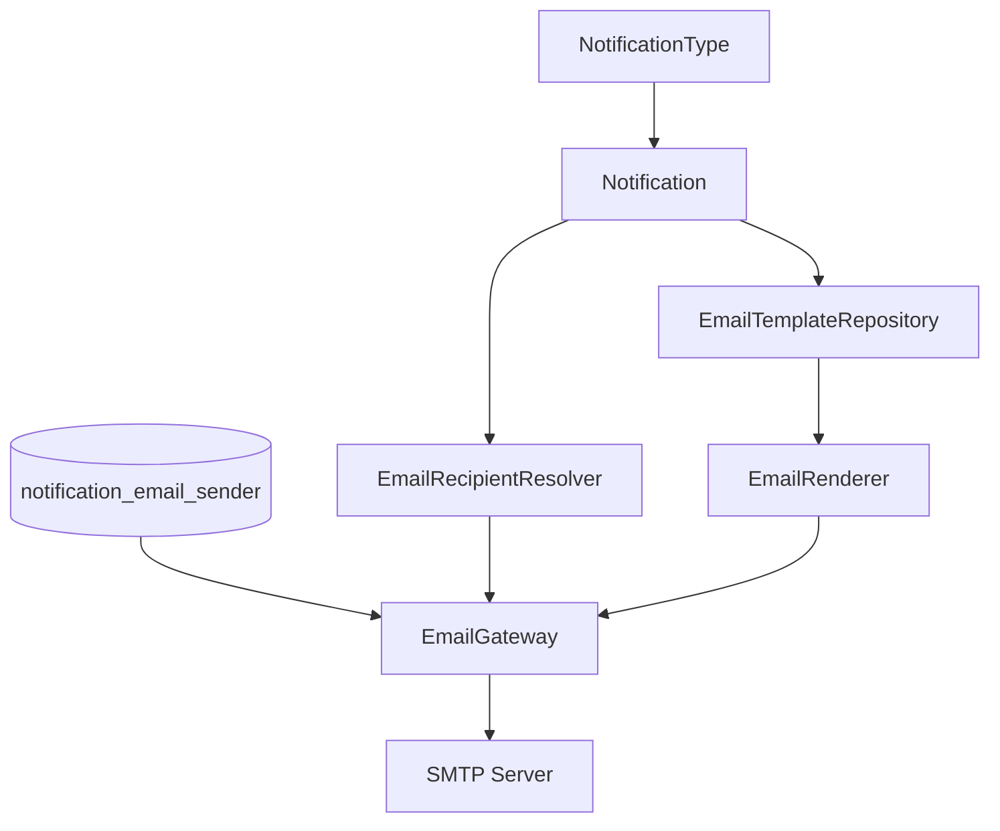

# Notification Email 模块

`modules/notification/sca4dj-notification-email` 把类型化通知转换为收件邮箱、主题、纯文本正文和安全 HTML 正文，并通过 SMTP 投递。



Email 渠道只有在以下条件同时满足时才可用：收件人可以解析，存在启用的 SMTP 配置，通知编码对应存在启用模板，并且通知不携带 `contents`。

数据库保证每个通知编码最多一份未删除模板。数据库也保证最多一份启用的 SMTP 配置。

SMTP 支持 `NONE`、`STARTTLS` 和 `TLS`。密码由 SecretKeyring 加密保存，管理接口不返回密码或密文。发送失败时，由 Notification 与 Messaging 的可靠消费和重试机制处理。

`EmailMessageService.sendNow` 是带附件的同步发送入口。它接收 `EmailAttachment` 列表，并检查附件总大小不超过构造参数 `maxAttachmentBytes`。超过上限时，抛出 `BusinessException`，错误码为 `EmailNotificationErrorCode.DELIVERY_UNAVAILABLE`。

`EmailTemplateRepository` 读取 Email 模板。通知模块只提供渠道无关的通知和变量。

`EmailRenderer` 根据模板的 `subject`、`text` 和 `html` 生成 `RenderedEmail`。HTML 正文经过安全清洗。`EmailGateway` 的 SMTP 实现 `SmtpEmailGateway` 把渲染结果编码为 MIME 后发送。模板渲染不接收 JSON 文本，JSON 只在 HTTP 接口和数据库读写的 Codec 中出现。

可靠 Email 投递的 ACK 是 SMTP 网关的接受结果。尽力投递在服务端完成发送调用后确认。可靠投递在失败时交给消息重试策略处理。

SMTP 接受不代表收件人已打开邮件。阅读状态不属于 Email 渠道的投递结果。

## 示例

以下示例直接发送一封不带附件的邮件，适用于同步触发的管理动作。省略 import 语句。模板的编码与变量需要与已启用模板的 `{{name}}` 变量一致。

```java
// 由具体应用定义的 Service。
@Service
class WorkspaceEmailService {

    private final EmailMessageService email;

    WorkspaceEmailService(EmailMessageService email) {
        this.email = email;
    }

    public void sendDigest(String recipient, String workspaceName) {
        email.sendNow(
                TreeCode.of("WORKSPACE/MEMBER/DIGEST"),
                recipient,
                Locale.forLanguageTag("en-US"),
                Map.of("workspaceName", workspaceName),
                List.of());
    }
}
```

`sendNow` 在发送前检查模板引用的变量均已提供。缺少变量时，发送失败，不调用 SMTP 网关。

发送可靠通知时，不直接调用 `sendNow`。通知经由 `Notifications.enqueue` 登记，由 Email 渠道在消费时发送，见 [Notification 模块](/capabilities/messaging-notification/notification)。

## 扩展方式

应用必须提供 `EmailRecipientResolver` Bean。它的 `resolve(NotificationRecipient)` 返回当前有效邮箱，结果为空时 Email 渠道不可用。接收人的数据归属由应用决定。

自动配置在没有其他 `EmailGateway` Bean 时提供 SMTP 实现。应用可以提供同类型 Bean 替换它，`EmailMessageService` 与渠道投递只依赖 `EmailGateway` 接口。

应用可以实现 `Renderer` 接口，从业务快照生成附件。生成的附件交给 `EmailMessageService.sendNow` 发送。

## 相关页面

- [Notification 模块](/capabilities/messaging-notification/notification)
- [通知模板](/capabilities/messaging-notification/notification-template)
- [邮件模板](/capabilities/messaging-notification/email-template)
- [消息内容与投递结果](/capabilities/messaging-notification/message-content)
- [Messaging 模块](/capabilities/messaging-notification/messaging)
