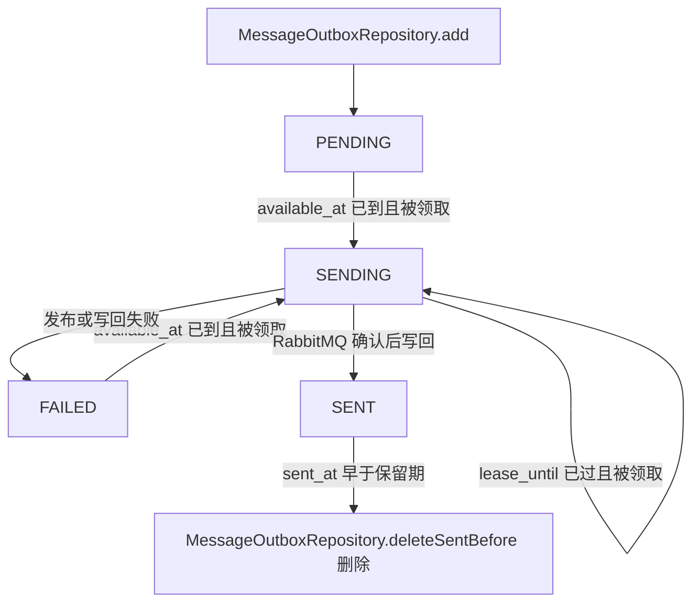
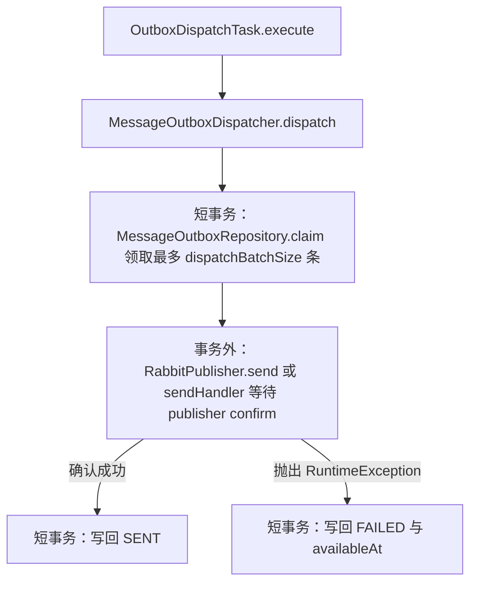

# Outbox 派发与清理

本页说明 `messaging_outbox` 表中的 Outbox 记录如何被领取、发布到 RabbitMQ、在失败后退避重试，以及已发送记录如何被清理。适合排查消息迟迟未发布、重复发布或 Outbox 表增长的开发者和运维人员阅读。

Outbox 的发布行为和消费行为见 [Messaging 模块](/capabilities/messaging-notification/messaging)。配置键的完整列表见 [Messaging 配置](/capabilities/messaging-notification/configuration)。

## 概念

Outbox 保存已经序列化、等待发布的业务消息信封。

业务代码在活跃数据库事务中调用 `MessageBus.dispatch(message, DispatchPolicy.outbox())` 时，`RabbitMessageBus` 通过 `MessageOutboxRepository.add` 在同一事务内新增一条 `PENDING` 记录。事务提交后，派发任务再把该记录发布到 RabbitMQ。业务事务回滚时，记录随之回滚，消息不会被发布。

例如，一个事务内登记了消息 `100`：

1. 事务内新增 `outbox_id` 与 `message_id` 均为 `100`、`status` 为 `PENDING` 的记录。
2. 事务提交。
3. 下一次派发扫描领取该记录，`status` 变为 `SENDING`。
4. RabbitMQ 确认发布后，`status` 变为 `SENT`，并写入 `sent_at`。

定向消费重试也使用同一张表。这类记录带有 `target_handler_code`、`handler_attempt` 和 `handler_retry_rule`，由 `MessageOutboxRepository.scheduleHandlerRetry` 登记。派发时，使用 `RabbitPublisher.sendHandler` 直接发送到目标 Handler 的主队列。

## 核心对象

| 对象 | 负责 | 不负责 |
|---|---|---|
| `MessageOutboxRepository` | 在调用方事务内新增记录，登记定向重试记录，执行领取和结果写回的条件更新，删除过期 `SENT` 记录 | 发布消息，计算退避时间 |
| `MessageOutboxDispatcher` | 执行一次派发批次（领取、发布、写回），计算失败后的 `availableAt`，执行一次清理批次 | 决定业务消费次数，这由 Handler 的 `retryRule()` 决定 |
| `OutboxClaim` | 保存一次领取到的记录快照、租约标识和版本，用于条件写回 | 访问数据库 |
| `OutboxDispatchTask` | 作为派发 Job 的入口，调用 `MessageOutboxDispatcher.dispatch` | 派发逻辑 |
| `OutboxCleanupTask` | 作为清理 Job 的入口，调用 `MessageOutboxDispatcher.cleanup` | 清理条件判断 |
| `OutboxStatus` | 定义 `PENDING`、`SENDING`、`FAILED`、`SENT` 四种状态 | 状态转换的 SQL 条件 |
| `MessagingProperties` | 绑定 `sca4dj.messaging` 下的派发、租约、退避和清理配置 | 运行时状态 |

`MessageOutboxDispatcher` 是 `@ApiStatus.Internal` 类型，业务代码不应直接调用它。

## 状态与流转

`OutboxStatus` 的四个值如下：

| 状态 | 含义 | 进入时写入的字段 |
|---|---|---|
| `PENDING` | 等待发布，等待 `available_at` 到达 | 新增记录时写入 `available_at`，`attempt_count` 为 `0` |
| `SENDING` | 已被一个派发批次领取，正在发布 | `lease_id`、`lease_until` 写入，`attempt_count` 加 1 |
| `FAILED` | 上次发布或写回失败，等待下一次重试 | `available_at` 写入退避后的时间，`last_error` 写入失败摘要 |
| `SENT` | RabbitMQ 已确认发布 | `sent_at` 写入确认时间，`lease_id` 与 `lease_until` 清空 |



源码中未定义 `DEAD` 或其他终止失败状态。发布失败的记录只会在 `PENDING`、`SENDING`、`FAILED` 之间流转，直到发布成功。

## 派发批次

`MessageOutboxDispatcher.dispatch` 每次执行一个批次。批次分为三段。只有第一段和第三段使用数据库事务，发布等待位于事务外：



领取时，候选记录满足以下任一条件：

- `status` 为 `PENDING` 或 `FAILED`，且 `available_at` 不晚于当前时间。
- `status` 为 `SENDING`，且 `lease_until` 不晚于当前时间。

候选按领取时间（`available_at` 或 `lease_until`）和 `outbox_id` 排序，数量不超过 `dispatchBatchSize`。

`OutboxMapper.updateClaimable` 在候选查询之后执行 `UPDATE ... RETURNING`。更新条件再次检查 `version` 以及上述时间或租约条件。只有仍然匹配的行，才会被改为 `SENDING`，同时 `version` 加 1、`attempt_count` 加 1、`last_error` 清空。

## 多实例并发

每个应用实例都会按 `dispatchInterval` 触发派发 Job。多个实例并发时，协调依据是数据库条件：

- 领取只更新仍满足状态、可用时间或租约条件，且 `version` 未变化的行。同一次候选查询结果被其他实例先领取后，本实例的更新匹配 0 行，该记录不会进入本实例的批次。
- 未过期的租约期间，其他实例不会领取该记录。
- 租约过期后，任一实例可以领取该记录。旧持有者随后的写回以 `lease_id` 与 `version` 作为条件，不匹配时写回影响 0 行。

写回影响 0 行时，`MessageOutboxRepository.saveProgress` 按 `ZeroRowPolicy.OPTIMISTIC_LOCK` 抛出 `OptimisticLockException`。

在 `dispatch` 的 `SENT` 写回中，该异常被归入发布失败分支，并尝试写回 `FAILED`。若该写回同样不匹配，`dispatch` 只记录 `ERROR` 日志，并保留当前租约。租约到期后，由任一实例重新领取。

`SKIP_IF_RUNNING` 是派发 Job 的重叠策略。同一 Job 的触发在上一次执行未结束时被跳过。Job 使用无记录的 `JobSchedule`，每次触发不创建 Job Run。

## 发布、失败与退避

普通记录通过 `RabbitPublisher.send` 发布，定向重试记录通过 `RabbitPublisher.sendHandler` 发布。发布调用等待 mandatory 路由结果和 publisher confirm，最长等待 `confirmTimeout`。

单条发布失败只影响该记录。`dispatch` 捕获 `RuntimeException`，不中断批次中的其他记录，也不向调用方抛出。失败时：

1. 计算 `availableAt`。退避初始值为 `min(initialBackoff, maximumBackoff)`，之后以 2 为倍数指数增长，上限为 `maximumBackoff`。
2. 生成失败摘要：异常的简单类名，有消息时追加 `: ` 与消息。摘要超过 512 个字符时截断，并写入 `last_error`。
3. 在独立事务中写回 `FAILED`、`availableAt` 和 `lastError`。

退避次数不设上限。`attempt_count` 每次领取都会加 1。`MessageOutboxDispatcher` 只用它计算退避时间，不用它判断停止发布。

## 限制与失败结果

| 情况 | 记录结果 | 调用方或运维应如何处理 |
|---|---|---|
| RabbitMQ 拒绝发布（`IllegalStateException`，消息为 `RabbitMQ 拒绝消息发布: ...`） | `FAILED`，按退避重试 | 查看 `last_error` 与 Broker 状态，修复后记录在退避时间到达后的下一次领取时重新发布 |
| 没有匹配的路由（`IllegalStateException`，消息为 `RabbitMQ 没有匹配消息路由`） | `FAILED`，按退避重试 | 检查 exchange、routing key 与队列绑定。源码中未定义自动停止发布的条件，记录会持续重试直到路由恢复 |
| publisher confirm 超时、被中断或执行失败（`MessagingException`） | `FAILED`，按退避重试 | 检查 Broker 连接和 `confirmTimeout` 设置 |
| Broker 已接收，但 `SENT` 写回失败 | 记录保持 `FAILED` 并会再次发布 | 同一消息可能被重复发布，主队列消费者必须按原消息标识或稳定业务键去重，见 [Messaging 模块](/capabilities/messaging-notification/messaging) |
| 派发期间实例崩溃或写回失败 | 租约过期后由任一实例重新领取 | 同一消息可能被重复发布，消费者需要去重 |

业务代码在事务内登记消息后，无需处理发布失败。发布失败不会回滚已经提交的业务事务，也不会消耗业务消费次数。

## 清理

`OutboxCleanupTask.execute` 调用 `MessageOutboxDispatcher.cleanup`。清理按以下条件删除记录：

- `status` 为 `SENT`。
- `sent_at` 早于当前时间减去 `sentRetention`。

每次清理最多删除 `cleanupBatchSize` 条，按 `sent_at` 与 `outbox_id` 排序。清理 Job 每 `cleanupInterval` 执行一次。

`PENDING`、`SENDING` 和 `FAILED` 记录不会被清理。`SENT` 记录的保留期同时限定消费侧登记重试的去重窗口，见 [Messaging 模块](/capabilities/messaging-notification/messaging)。

## Job 注册

`MessagingAutoConfiguration` 注册两个无记录 `JobSchedule`：

| ScheduleKey | 间隔属性 | 触发任务 |
|---|---|---|
| `MESSAGING/OUTBOX/DISPATCH` | `dispatchInterval` | `OutboxDispatchTask` |
| `MESSAGING/OUTBOX/CLEANUP` | `cleanupInterval` | `OutboxCleanupTask` |

两个计划都使用 `MisfirePolicy.FIRE_ONCE_NOW` 与 `OverlapPolicy.SKIP_IF_RUNNING`。派发使用独立的 `RabbitTemplate`，不修改应用共享的模板。

## 配置

以下属性绑定在 `MessagingProperties`，配置前缀为 `sca4dj.messaging`。所有时长和数量都必须为正数。`confirmTimeout`、`leaseDuration`、`initialBackoff`、`maximumBackoff` 和 `sentRetention` 还不能短于 1 毫秒，且毫秒值不能超过 `long` 的表示范围。

| 属性 | 默认值 | 作用 |
|---|---|---|
| `confirmTimeout` | `PT10S` | 等待 RabbitMQ publisher confirm 的最长时间 |
| `dispatchInterval` | `PT1S` | 相邻两次派发扫描之间的间隔 |
| `dispatchBatchSize` | `100` | 每个派发批次最多领取的记录数 |
| `leaseDuration` | `PT1M` | `SENDING` 记录的租约时长，租约到期后可被其他实例领取 |
| `initialBackoff` | `PT1S` | 第一次发布失败后的退避时长 |
| `maximumBackoff` | `PT5M` | 发布失败退避时长的上限 |
| `sentRetention` | `P7D` | `SENT` 记录的保留时长 |
| `cleanupInterval` | `PT1H` | 相邻两次清理之间的间隔 |
| `cleanupBatchSize` | `500` | 每次清理最多删除的 `SENT` 记录数 |

租约到期后，其他实例可以领取仍在发布中的记录。因此，当 `leaseDuration` 小于单条发布等待时间（最长为 `confirmTimeout`）时，同一消息可能被重复发布。源码中未定义两者的推荐比例。

## 示例

以下示例登记一条定时派发消息，并查询发布失败的记录。Workspace 的业务表由具体应用定义，示例省略 import 语句。

```java
// 由具体应用定义的 Service。登记消息与业务写入在同一事务中提交。
@Service
class WorkspaceArchiveService {

    private final WorkspaceRepository workspaces;
    private final MessageBus messageBus;
    private final Clock clock;

    WorkspaceArchiveService(WorkspaceRepository workspaces, MessageBus messageBus, Clock clock) {
        this.workspaces = workspaces;
        this.messageBus = messageBus;
        this.clock = clock;
    }

    @Transactional
    public void archive(long workspaceId, Instant notBefore) {
        workspaces.markArchived(workspaceId);
        Event<WorkspaceArchived> event = new Event<>(
                WorkspaceArchived.TYPE,
                String.valueOf(workspaceId),
                clock.instant(),
                new WorkspaceArchived(workspaceId));
        // 最早在 notBefore 之后派发；实际发布时间还受 dispatchInterval 与 Broker 可用性影响。
        messageBus.dispatch(event, DispatchPolicy.outboxNotBefore(notBefore));
    }
}
```

运维排查发布失败时，可以查询 `messaging_outbox`：

```sql
SELECT outbox_id, message_code, attempt_count, available_at, last_error
  FROM messaging_outbox
 WHERE status = 'FAILED'
 ORDER BY available_at
 LIMIT 50;
```

`WorkspaceArchived` 为 `Event` 子类，声明 `EventType` 的方式与[业务消息与可靠发布](/capabilities/messaging-notification/domain-events)中的 `MemberJoined` 相同。

## 相关页面

- [Messaging 模块](/capabilities/messaging-notification/messaging)
- [Messaging 配置](/capabilities/messaging-notification/configuration)
- [业务消息与可靠发布](/capabilities/messaging-notification/domain-events)
- [重试规则与执行](/capabilities/foundation/retry)
- [消息内容与投递结果](/capabilities/messaging-notification/message-content)
