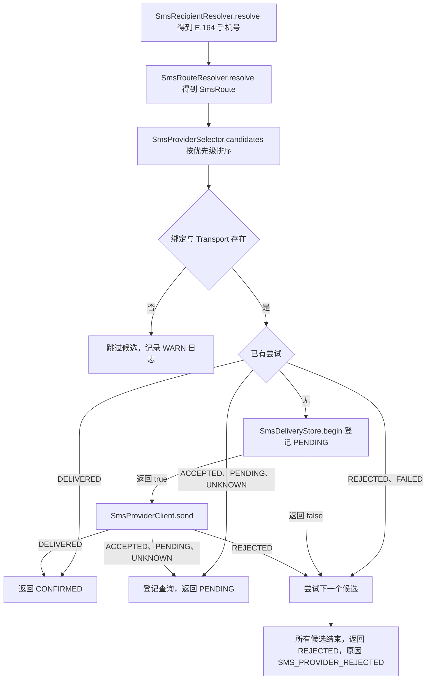

# 短信通知渠道

短信（SMS）通知渠道把通知解析为手机号、路由和 Provider 绑定，再通过已注册的 `SmsProviderClient` 提交短信请求。Provider 提交后，渠道登记延迟查询，并根据查询结果确认送达或标记拒绝。适合接入短信渠道、配置 Provider 与模板绑定的开发者阅读。

渠道实现位于 `modules/notification/sca4dj-notification-sms`，根构建已包含该模块。具体厂商的适配器见 [阿里云短信适配器](/capabilities/messaging-notification/sms-aliyun)。

## 概念

`SmsNotificationDelivery` 实现 `NotificationDelivery`，渠道常量为 `SmsChannels.SMS`，值为 `NOTIFICATION/CHANNEL/SMS`。投递时，它依次完成以下工作：

1. 通过 `SmsRecipientResolver` 把接收人解析为已验证的 E.164 手机号。
2. 通过 `RegionCatalog.standard().parse` 解析手机号，并要求结果为规范 E.164。
3. 通过 `SmsRouteResolver` 根据通知编码、业务区域、手机号和 Locale 选择 `SmsRoute`。
4. 通过 `SmsProviderSelector` 取得该路由下的候选 Provider，默认按优先级选择。
5. 对每个候选 Provider，查找与通知编码、路由和 Locale 匹配的 `SmsProviderBinding`，并找到同类型的 `SmsProviderClient`。
6. 提交短信请求，记录尝试结果，并按结果返回 `DeliveryOutcome`。

例如，具体应用的 `SmsRouteResolver` 可以对中国大陆手机号选择路由 `china-mainland`，对其他目的地选择路由 `international`。两个路由编码取自 `SmsRoute` 的 Javadoc 示例。

路由下有两个启用的 Provider 时，优先级数值较小的先被尝试。候选 Provider 明确拒绝后，才尝试下一个候选。

## 核心对象

| 对象 | 负责 | 不负责 |
|---|---|---|
| `SmsNotificationDelivery` | 解析接收人与路由，按候选顺序提交请求，记录尝试，登记查询，返回 `DeliveryOutcome` | 厂商协议细节 |
| `SmsRecipientResolver` | 由具体应用实现，把通知接收人解析为已验证的 E.164 手机号 | 校验手机号格式 |
| `SmsRouteResolver` | 由具体应用实现，选择 `SmsRoute` | 选择 Provider |
| `SmsProviderSelector` | 返回路由的候选 Provider。默认实现为 `PrioritySmsProviderSelector` | 检查绑定与 Transport |
| `SmsProvider` | 保存一个 Provider 实例的编码、类型、凭据引用、优先级和启用状态 | 保存凭据内容 |
| `SmsProviderBinding` | 保存 Provider 对某个通知编码、路由和 Locale 的签名、模板编码和参数映射 | 保存模板内容 |
| `SmsProviderClient` | 由厂商模块实现，提供 `send` 与 `query` | 决定路由和重试 |
| `SmsDeliveryStore` | 按消息与 Provider 记录一次尝试及其结果 | 调用厂商接口 |
| `SmsDeliveryCheck` | 延迟查询消息，编码为 `NOTIFICATION/SMS/DELIVERY_CHECK`，协议版本为 `1`，携带通知、消息标识、Provider 标识、请求标识、业务标识和查询次数 | 决定是否重新发送短信 |
| `SmsDeliveryCheckHandler` | 消费 `SmsDeliveryCheck`，调用 `SmsNotificationDelivery.check` | 发送短信 |
| `SmsConfigurationService` | 管理 Provider 与绑定的创建、修改、启用、停用和删除，并校验配置 | 投递短信 |

`SmsProvider` 的 `type()` 必须与已注册 `SmsProviderClient.providerType()` 相同。Provider 没有对应的 Transport 时，它不参与投递。



图中的 `UNKNOWN` 表示 Provider 结果无法确定。此时渠道不切换到其他 Provider，因为切换可能造成同一条短信重复发送。

## 投递与查询

每次提交会在 `notification_sms_delivery` 中登记一条尝试。唯一索引为 `(message_id, provider_id)`，同一消息对同一 Provider 只有一条尝试。

尝试的 `recipient_hash` 为手机号的 SHA-256 摘要。`recipient_masked` 为掩码。掩码规则如下：长度不超过 7 时整体替换为 `***`；否则保留前 4 位与后 4 位。

Provider 返回 `ACCEPTED`、`PENDING` 或 `UNKNOWN` 时，渠道不立即返回送达结果。它通过 `messages.dispatch(check, DispatchPolicy.outboxNotBefore(...))` 登记 `SmsDeliveryCheck`。查询消息最早在 30 秒后派发。

`SmsNotificationDelivery.check` 的处理如下：

1. 查询次数超过 10 次时，返回 `REJECTED`，原因 `SMS_DELIVERY_CHECK_EXHAUSTED`。
2. 按 `SmsDeliveryCheck` 中的 Provider 标识、请求标识和业务标识调用 `SmsProviderClient.query`，不重新发送短信。
3. 查询结果为 `DELIVERED` 时，返回 `CONFIRMED`。
4. 查询结果为 `ACCEPTED`、`PENDING` 或 `UNKNOWN` 时，登记 `attempt + 1` 的查询，返回 `PENDING`。
5. 其他结果返回 `REJECTED`，原因为 Provider 的失败码，缺省为 `SMS_DELIVERY_FAILED`。

`SmsDeliveryCheckHandler` 把 `CONFIRMED` 与 `PENDING` 确认为已消费。它把 `REJECTED`、`RETRYABLE_FAILURE` 和 `UNKNOWN` 拒绝，拒绝的消息进入死信队列。`SmsDeliveryCheckHandler` 使用 `MessageHandler` 的默认 `RetryRule.once()`。

短信通知的 `NotificationMessageHandler` 使用 `SmsNotificationDelivery.retryRule()`，值为 `RetryRule.atMost(11, Backoff.fixed(Duration.ofSeconds(5)))`。次数与间隔的含义见[重试规则与执行](/capabilities/foundation/retry)。

## 收件人与 Region

`SmsRecipientResolver` 返回 `Optional<String>`。接收人对应的手机号来源由具体应用决定，渠道不读取账号或联系人数据。返回值为空时：

- `available` 返回 `false`，`NotificationDeliveryRouter` 抛出 `NotificationException`。
- `deliver` 与 `check` 抛出 `IllegalStateException`，消息为「SMS 接收人没有已验证手机号」。

`RegionCatalog.standard().parse` 只接受有效且与 E.164 表示一致的号码。

不符合时，`parse` 返回 `null`。`ParsedPhoneNumber.region()` 可以为空，表示 libphonenumber 无法给出地区。

`SmsRouteResolver` 收到的 `destination` 是已经解析的号码。`region` 参数是通知的业务区域。两者如何组合，由具体应用决定。

## Provider 与绑定的配置

短信模块没有 `@ConfigurationProperties` 配置类。Provider 与绑定保存在数据库中，由 `SmsConfigurationService` 管理：

- `notification_sms_provider`：保存 `code`、`provider_type`、`credential_ref`、`priority`、`enabled`、`deleted` 和 `version`。`priority` 的数据库默认值为 `100`，数值越小优先级越高。表注释说明该表不保存密钥。
- `notification_sms_binding`：保存 `provider_id`、`notification_code`、`route`、`language_tag`、`sign_name`、`provider_template_code`、`parameter_mapping` 和 `enabled`。`parameter_mapping` 的键为 Provider 参数名，值为通知变量名。

`SmsConfigurationService` 的规则如下：

| 操作 | 规则 | 违反时的错误 |
|---|---|---|
| `createProvider` | 新建 Provider 默认停用。`type` 必须有已注册的 Transport | 类型无效时 `PROVIDER_INVALID` |
| `replaceProvider` | 只能替换停用的 Provider | 启用中时 `PROVIDER_CONFLICT` |
| `setProviderEnabled(true)` | 启用前至少需要一个启用的绑定 | 没有启用绑定时 `PROVIDER_CONFLICT` |
| `deleteProvider` | 只能删除停用且没有绑定的 Provider | 启用或仍有绑定时 `PROVIDER_CONFLICT` |
| `createBinding` | 新建绑定默认停用。`parameterMapping` 引用的变量必须由通知类型声明 | 变量未声明或字段无效时 `BINDING_INVALID` |
| `replaceBinding` | 只能替换停用的绑定 | 启用中时 `BINDING_CONFLICT` |

`credential_ref` 只保存引用名。`SmsConfigurationService` 保存 Provider 时，不检查该引用是否存在于部署配置中。引用指向的凭据由 Transport 模块读取，见[阿里云短信适配器](/capabilities/messaging-notification/sms-aliyun)。

以下参数在源码中是常量，没有配置键：查询间隔 30 秒，最多查询 10 次，短信通知 Handler 的重试规则为 `atMost(11, fixed 5 秒)`。

## 示例

以下示例为 Account 的手机号解析、路由选择和一个厂商适配器的骨架。省略 import 语句。账号的手机号数据由具体应用保存。

```java
@Configuration
class SmsRoutingConfiguration {

    // 只返回已验证的手机号。未验证或不存在时返回空。
    @Bean
    SmsRecipientResolver smsRecipientResolver(AccountPhoneDirectory phones) {
        return recipient -> phones.verifiedPhone(Long.parseLong(recipient.id()));
    }

    // 中国大陆号码走 china-mainland，其他号码走 international。
    @Bean
    SmsRouteResolver smsRouteResolver() {
        return (code, region, destination, locale) -> {
            boolean mainland = destination.region() != null
                    && "CN".equals(destination.region().code());
            return new SmsRoute(mainland ? "china-mainland" : "international");
        };
    }
}

// 厂商适配器骨架。send 提交请求，query 只查询，不重新发送。
@Component
class ExampleSmsProviderClient implements SmsProviderClient {

    @Override
    public String providerType() {
        return "EXAMPLE";
    }

    @Override
    public SmsProviderResult send(
            SmsProvider provider,
            SmsProviderBinding binding,
            ParsedPhoneNumber destination,
            Map<String, String> parameters) {
        // 调用厂商接口。确定的结果返回 ACCEPTED、REJECTED 或 DELIVERED；无法确定时返回 UNKNOWN。
        String requestId = vendorSend(provider.credentialRef(), destination.value(), parameters);
        return new SmsProviderResult(SmsDeliveryStatus.ACCEPTED, requestId, null, null);
    }

    @Override
    public SmsProviderResult query(
            SmsProvider provider,
            SmsProviderBinding binding,
            ParsedPhoneNumber destination,
            String requestId,
            String bizId) {
        return new SmsProviderResult(SmsDeliveryStatus.PENDING, requestId, bizId, null);
    }

    private String vendorSend(String credentialRef, String phone, Map<String, String> parameters) {
        // 由厂商 SDK 实现。
        throw new UnsupportedOperationException("由具体厂商实现");
    }
}
```

Provider 与绑定的数据通过 `SmsConfigurationService` 写入。下面的调用创建一个停用的 Provider，示例中的凭据引用 `primary` 必须在部署配置中存在。

```java
SmsProvider provider = smsConfigurationService.createProvider(
        "PRIMARY_SMS",
        "EXAMPLE",
        "primary",
        100);
```

新建的 Provider 默认停用。启用前，需要先为它创建至少一个启用的绑定，否则 `setProviderEnabled(true)` 抛出 `PROVIDER_CONFLICT`。

## 扩展方式

应用提供以下 Bean：

- `SmsRecipientResolver`：解析接收人的手机号。
- `SmsRouteResolver`：选择路由。
- `SmsProviderClient`：至少一个，由厂商模块提供。

`SmsNotificationDelivery` 与 `SmsConfigurationService` 通过 `List<SmsProviderClient>` 收集全部厂商实现。`SmsProvider` 的 `type()` 与 `SmsProviderClient.providerType()` 相同时，该 Provider 参与投递。

`SmsProviderSelector` 是可选 Bean。自动配置在没有其他同类型 Bean 时使用 `PrioritySmsProviderSelector`。

## 错误码

`SmsNotificationErrorCode` 的错误码范围为 `3200` 到 `3299`，只用于 Provider 与绑定的管理操作。

| 错误码 | 类别 | 含义 |
|---|---|---|
| `3200` | `NOT_FOUND` | Provider 不存在 |
| `3201` | `VALIDATION` | Provider 字段、类型或凭据引用无效 |
| `3202` | `CONFLICT` | Provider 编码、启用状态或绑定关系冲突 |
| `3203` | `NOT_FOUND` | 绑定不存在 |
| `3204` | `VALIDATION` | 绑定的路由、Locale 或参数映射无效 |
| `3205` | `CONFLICT` | 绑定与已有绑定或当前状态冲突 |

## 限制与失败结果

| 位置 | 条件 | 结果 |
|---|---|---|
| 候选 Provider | 没有匹配的绑定，或没有同类型 Transport | 跳过该候选，记录 WARN 日志，继续下一个候选 |
| 候选 Provider | 已有尝试为 `REJECTED` 或 `FAILED` | 跳过该候选 |
| 投递 | 所有候选都被拒绝或跳过 | `REJECTED`，原因 `SMS_PROVIDER_REJECTED` |
| 投递 | Provider 结果为 `ACCEPTED`、`PENDING` 或 `UNKNOWN` | `PENDING`，登记查询，不切换 Provider |
| 查询 | 超过 10 次仍未得到确定结果 | `REJECTED`，原因 `SMS_DELIVERY_CHECK_EXHAUSTED` |
| 查询 | Provider 已不在当前路由中，或绑定已不存在，或 Transport 未注册 | `IllegalStateException`，由 Messaging 按 `RetryRule.once()` 处理 |
| 投递 | 通知变量缺失 | `IllegalArgumentException`，见下文 |

变量缺失时，`SmsDeliveryStore.begin` 已经登记 `PENDING` 尝试。随后，`parameters` 抛出 `IllegalArgumentException`，没有调用 Transport。

源码中，变量缺失发生在 Transport 调用之前，`SmsDeliveryStore.finish` 不会被调用，因此该尝试保持 `PENDING`。之后的投递会把 `PENDING` 尝试视为已提交的尝试，直接登记查询，不会再次发送短信。源码中未定义修复该状态的操作。具体应用需要保证通知变量完整，并在绑定配置中只引用通知类型声明的变量。

手机号无效或不是规范 E.164 时，`available` 返回 `false`。`deliver` 抛出 `NullPointerException`，消息为「SMS 接收手机号不是规范 E.164」。

## 相关页面

- [阿里云短信适配器](/capabilities/messaging-notification/sms-aliyun)
- [消息内容与投递结果](/capabilities/messaging-notification/message-content)
- [Notification 模块](/capabilities/messaging-notification/notification)
- [Outbox 派发与清理](/capabilities/messaging-notification/outbox)
- [重试规则与执行](/capabilities/foundation/retry)
