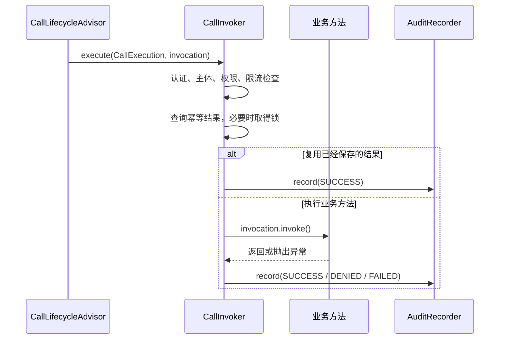

# 操作审计模型

操作审计记录已经发生的安全或业务操作，使开发者和运维人员能够回答：谁使用哪个身份，在什么时间执行了什么操作，目标对象是什么，最终成功、被拒绝还是执行失败。

审计记录与普通运行日志用途不同。日志主要帮助定位程序运行问题，可以包含调用阶段、耗时和异常堆栈。审计记录使用稳定字段描述行为主体、业务操作、目标和结果，通常需要独立保存、查询和控制访问权限。[NIST SP 800-92](https://csrc.nist.gov/pubs/sp/800/92/final) 说明了安全日志管理需要考虑采集、保存、分析和长期维护。该文件不规定 Sca4d-J 的 Java 接口或数据格式。

## Sca4d-J 记录什么

Sca4d-J 使用 [AuditRecord](/javadoc/core/sca4dj-core-api/com/sca4d/core/api/audit/AuditRecord.html) 表示一次操作。记录包含：

- 审计记录标识、追溯链标识和直接父记录标识；
- `requestId`：关联同一次请求的调用标识；
- [AuditActor](/javadoc/core/sca4dj-core-api/com/sca4d/core/api/audit/AuditActor.html)：当时使用的 `subjectId` 、 `principalId` 和可选 `accountId`；
- [AuditOperation](/javadoc/core/sca4dj-core-api/com/sca4d/core/api/audit/AuditOperation.html)：独立于权限 `Operation` 的稳定业务操作键，例如 `workspace/member/role/change`；
- 可选目标 Resource：被修改或访问的业务对象；
- [AuditResult](/javadoc/core/sca4dj-core-api/com/sca4d/core/api/audit/AuditResult.html)：`SUCCESS` 、 `DENIED` 或 `FAILED`；
- 可选 [AuditPayload](/javadoc/core/sca4dj-core-api/com/sca4d/core/api/audit/AuditPayload.html)：业务模块定义的结构化补充信息；
- 可选 [HttpCall](/javadoc/core/sca4dj-core-api/com/sca4d/core/api/audit/HttpCall.html)：不含查询参数的 HTTP 路径、方法、直连客户端地址和已清理 User-Agent；
- `occurredAt`：创建记录时由 AuditCallInterceptor 的 Clock 取得的时间。

AuditPayload 没有统一字段，因为修改角色、重发验证码和删除附件需要记录的信息不同。业务模块必须为自己的载荷定义可长期理解的类型，并排除密码、 Token 、验证码和其他敏感值。

审计发生在调用生命周期的固定顺序中。正常返回和复用幂等结果记录 `SUCCESS`；BusinessException 记录 `DENIED`；其他异常记录 `FAILED`。匿名调用不能声明 [@Audit](/javadoc/core/sca4dj-core-api/com/sca4d/core/api/annotation/Audit.html)，因为 AuditActor 至少需要 Subject 和 Principal 。拒绝或失败发生在主体选择之前时没有完整 AuditActor，执行器不会创建残缺记录。

## 为什么使用 AuditRecorder

Core 只定义记录内容，不决定保存方式。不同应用可能把审计写入关系数据库、只追加存储或消息系统，也可能需要不同的保留期限和查询权限。因此 [AuditRecorder](/javadoc/core/sca4dj-core-api/com/sca4d/core/api/audit/AuditRecorder.html) 只接收完整记录。

通用数据库实现、 Raw JSON 与可选 [AuditPayloadCodec](/javadoc/core/sca4dj-core-api/com/sca4d/core/api/audit/AuditPayloadCodec.html) 位于 [sca4dj-audit](/capabilities/operations-observability/audit)。应用仍负责决定哪些业务方法需要审计，以及谁可以查询记录。

AuditCallInterceptor 在生命周期结果确定后调用 AuditRecorder 。 DatabaseAuditRecorder 使用 Spring `REQUIRED` 事务：调用方仍有活动事务时加入该事务，否则打开自己的事务。方法自身声明的事务通常在业务方法返回时已经提交，随后审计会使用独立事务。更外层事务仍然活动时，审计才会与业务写入一起提交。

记录失败会让当前调用以异常结束，但不能自动撤销已经提交的业务修改。 QueuedAuditRecorder 等待独立事务提交 Outbox 消息，再由消费者写库和重试。 AfterCommitAuditRecorder 在主事务提交后尽力把冻结记录交给有界进程队列。拒绝入队、进程退出或后台失败时，记录可能丢失。三种方式都不能把已经提交的业务修改回滚。

## 使用方式

接口入口的声明、目标解析、载荷类型和示例见[Audit 模块](/capabilities/operations-observability/audit)。执行模式的选择见[审计配置](/capabilities/operations-observability/audit-configuration)。

## 当前接入情况

`core-spring` 装配 CallLifecycleAdvisor 和 CallInvoker 。 Audit 模块装配默认的 `DIRECT` 、 `AFTER_COMMIT` 记录器，在 Messaging 可用时还装配 `QUEUED` 记录器。没有 Audit 模块时，应用必须为使用 `@Audit` 的调用注册相应声明和记录器。未注册的审计方式会在执行目标方法前失败。