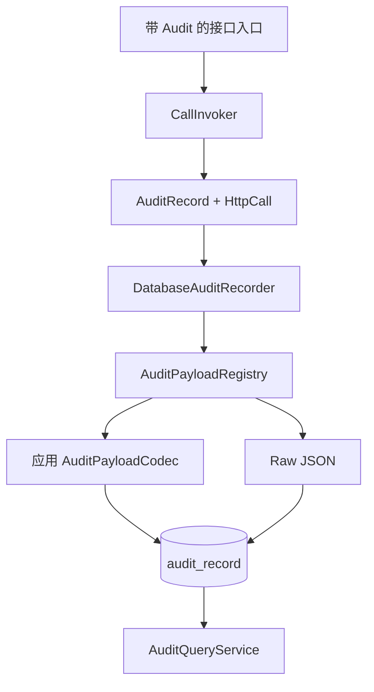

# Audit 模块

普通业务日志会随格式、级别和保留策略变化，不能可靠回答「谁在何时以哪个身份对什么对象执行了什么动作，结果如何」。审计记录还必须在账号或业务对象删除后保留当时事实，并避免把密码、 Token 或完整敏感请求体写进历史。

`sca4dj-audit` 实现 Core [AuditRecorder](/javadoc/core/sca4dj-core-api/com/sca4d/core/api/audit/AuditRecorder.html)。它根据 `@Audit.mode`，把 CallInvoker 已经采集的身份、[AuditOperation](/javadoc/core/sca4dj-core-api/com/sca4d/core/api/audit/AuditOperation.html)、目标 Resource 、结果、可选 payload 和 HTTP 快照写入 `audit_record`，或交给 Outbox，或在提交后交给进程队列。模块同时提供 [AuditQueryService](/capabilities/operations-observability/audit-query) Java API 。

模块不定义 HTTP Controller 、查询权限、菜单或管理页面。选择 `sca4dj-audit` 的应用负责这些入口。应用的 `@Audit` 声明在 Controller 等接口入口上。应用通过资源收集器把同一条记录关联到业务对象。

## 包结构

| 包 | 职责 |
|---|---|
| `com.sca4d.audit.config` | 绑定配置并装配 payload 、记录和查询组件 |
| `com.sca4d.audit.payload` | 注册 payload 类型，执行编码和敏感字段掩码 |
| `com.sca4d.audit.recording` | 把审计事件写入 Audit 表 |
| `com.sca4d.audit.recording.mapper` | 执行审计记录写入和查询所需的 SQL 映射 |
| `com.sca4d.audit.query` | 提供查询条件、结果类型和查询服务 |

记录、 payload 和查询各自保留连续流程；跨包调用所需的实现类型不因此成为模块公开接口。每条记录还保存逻辑审计标识、追溯链标识和直接父记录标识，用于展开同一调用链。



Core 负责调用顺序和 AuditRecord，不依赖 Audit 模块。 DatabaseAuditRecorder 和 AuditQueryService 只通过 AuditRepository 的领域接口访问数据。 AuditRepository 在领域记录与 Mapper 的 EncodedAuditEntry 之间完成编码、解码、 ID 生成和影响行数解释，EncodedAuditEntry 不进入 Service 。

Audit 模块只直接依赖 Core API 与 Core Spring，并使用后者提供的 `@Sca4djJson` ObjectMapper 、 IdGenerator 、事务和 MyBatis 装配。 `audit_record` 、 `audit_record_resource` 及其索引由模块维护，应用通过自己的数据库迁移创建这些结构。应用只在需要稳定强类型历史读取时注册 [AuditPayloadCodec](/javadoc/core/sca4dj-core-api/com/sca4d/core/api/audit/AuditPayloadCodec.html)。没有 Codec 的 AuditPayload 直接按 Raw JSON 保存。

模块写入 JSON 前递归掩码敏感字段，并按 UTF-8 字节数限制 payload 。 `audit_record` 直接保存 AuditRecord 的身份快照和 Resource 类型、标识，不关联 IAM 或业务表外键，避免身份或业务对象删除后破坏历史记录。 payload 同时保存稳定类型、正整数版本和 JSONB 。历史 Codec 不再注册时，查询仍返回原始 JSON 。 HTTP 调用另外保存方法、不含查询参数的路径、直连客户端地址和可选 User-Agent 。消息或任务调用的这些列全部为空。

查询可以按精确 `requestId` 、 Account 、 Principal 、 AuditOperation 、结果、完整目标 Resource 和半开时间区间组合筛选。 `request_id` 、 Account 时间、 Principal 时间、 AuditOperation 时间和目标时间索引支持常用追溯条件。查询仍按 `occurred_at DESC, id DESC` 返回稳定顺序。

DatabaseAuditRecorder 使用调用线程中的 Spring 事务。 CallInvoker 在方法结果确定后才调用它，因此业务方法已经自行提交时，审计写入失败不能自动撤销先前结果。需要业务数据与审计一起提交或一起回滚时，Spring 事务必须同时包住业务方法和审计写入。

QueuedAuditRecorder 在独立事务中提交 Outbox，交接后不等待消费。 AfterCommitAuditRecorder 在事务提交后尽力排入有界进程队列；进程退出或后台写入失败时，记录不会恢复。三种方式的配置和适用条件见[审计配置](/capabilities/operations-observability/audit-configuration)。

模块不决定哪些业务动作必须审计，也不授权审计查询。应用在 Controller 等接口入口上声明 `@Audit`，并在公开查询入口外层声明自己的 Operation 或 Resource 权限。应用可以使用 `system:audit:read` 等权限保护查询路由，并在应用 Service 中补充 Principal 展示名称。这些规则属于应用，不进入 Audit 模块。

## 关联资源快照

一次操作可以关联多个资源。应用在已授权的业务处理中向 `CallExecution.relateAuditResources` 登记已经确认的资源引用，也可以实现 `AuditResourceCollector`，从调用结果和有效期明确的业务历史补充引用。每个调用执行各自持有集合。嵌套审计应选择负责这一动作的执行，不能把请求输入当作可变共享容器。

记录器在交接前复制关联资源。同步记录、队列消费和提交后写入都在同一数据库事务中保存审计行及关联行。队列重投使用消息标识去重，关联表以审计标识、资源类型和资源标识唯一约束去重。关联引用不外键关联业务表，资源移动和删除不改变已经保存的关联。

收集器在结果确定后运行，可能收到拒绝、失败或幂等重放结果。应用必须区分已授权业务事实与未授权请求参数，不能假设成功已经提交，也不能在历史补齐时用当前资源归属代替当时事实。 Audit 模块只保存资源类型和标识，不解释资源的业务含义。

## 示例

下面的 Service 修改 Workspace 成员角色，并声明审计。 `Workspace.RESOURCE_TYPE_VALUE` 是应用定义的资源类型常量。

```java
import com.sca4d.core.api.annotation.Audit;
import org.springframework.stereotype.Service;

@Service
public class WorkspaceMemberService {

    @Audit(
            operation = "workspace/member/role/change",
            target = "#workspaceId",
            resourceType = Workspace.RESOURCE_TYPE_VALUE)
    public void changeRole(long workspaceId, long memberId, String role) {
        // 检查权限、修改成员角色并返回。审计在方法结果确定后记录。
    }
}

final class Workspace {

    static final String RESOURCE_TYPE_VALUE = "WORKSPACE/WORKSPACE";

    private Workspace() {
    }
}
```

`target` 表达式读取参数 `workspaceId`，`resourceType` 与目标标识组成 Resource.Ref 。审计记录的目标不需要重新加载 Workspace 。拒绝或失败时没有成功返回值，目标仍可以由参数确定。

当目标或载荷需要复杂解析时，使用 `targetResolver` 、 `payloadFactory` 或 `@AuditTarget` 、 `@AuditPayload`，见下方使用方式。

## 使用方式

接口入口使用 `@Audit` 声明稳定的操作键：

```java
@Audit(operation = "workspace/member/role/change")
public String updateMemberRole() {
    return "updated";
}
```

目标可以直接从参数或返回值读取。以下声明使用返回值中的 `id` 作为目标标识：

```java
@Audit(
        operation = "workspace/create",
        target = "#result?.id",
        resourceType = Workspace.RESOURCE_TYPE_VALUE)
```

表达式返回完整 Resource 时可以省略类型。 `payload = "#details"` 要求参数或返回值中的 `details` 已经是应用定义的 AuditPayload，不能直接记录整个请求对象。

简单参数也可以使用参数标记，复杂目标和载荷使用 Audit 专用解析器：

```java
@Audit(operation = "workspace/member/role/change", payloadFactory = MemberRolePayloadFactory.class)
public void change(
        @AuditTarget(resourceType = Workspace.RESOURCE_TYPE_VALUE) long workspaceId,
        @AuditPayload MemberRoleRequest request) {
}
```

`@AuditTarget` 和 `@AuditPayload` 只从 `AuditInvocation` 取得运行时输入，不负责序列化和反序列化。[AuditPayloadCodec](/javadoc/core/sca4dj-core-api/com/sca4d/core/api/audit/AuditPayloadCodec.html) 负责 JSON 历史数据。复杂目标实现 [AuditTargetResolver](/javadoc/core/sca4dj-core-api/com/sca4d/core/api/audit/AuditTargetResolver.html)，复杂载荷实现 [AuditPayloadFactory](/javadoc/core/sca4dj-core-api/com/sca4d/core/api/audit/AuditPayloadFactory.html)。

表达式由 SPICallValueResolver 解析。 `target` 与 `targetResolver` 、 `@AuditTarget` 互斥，`payload` 与 `payloadFactory` 互斥。参数、原始返回值和异常变量的准确含义见调用生命周期的「注解表达式」。

## 当前接入情况

`core-spring` 装配 CallLifecycleAdvisor 和 CallInvoker 。 Audit 模块装配默认的 `DIRECT` 、 `AFTER_COMMIT` 记录器，在 Messaging 可用时还装配 `QUEUED` 记录器。没有 Audit 模块时，应用必须为使用 `@Audit` 的调用注册相应声明和记录器。未注册的审计方式会在执行目标方法前失败。

应用通常为账号、角色、资料、认证设置和文件写操作的接口入口声明 `@Audit`。参数中可直接取得的目标使用表达式读取，例如上传完成时读取 `#fileId`。创建新业务资源时从返回值读取新资源 ID 。需要先查询目标对象才能确定资源时，使用业务目标解析器。

应用可以提供需要 `system:audit:read` 等权限的管理查询路由，并由管理端显示列表和详情。 `sca4dj-audit` 本身只提供记录实现和 Java 查询 API 。

相关规格：[@Audit](/javadoc/core/sca4dj-core-api/com/sca4d/core/api/annotation/Audit.html)、[AuditRecord](/javadoc/core/sca4dj-core-api/com/sca4d/core/api/audit/AuditRecord.html)、[AuditRecorder](/javadoc/core/sca4dj-core-api/com/sca4d/core/api/audit/AuditRecorder.html) 和 [CallLifecycle](/javadoc/core/sca4dj-core-api/com/sca4d/core/api/call/CallLifecycle.html)。

## 明确限制

- 审计不是业务日志、指标、分布式追踪或事件溯源，不能替代这些数据。
- 只有通过 Spring 代理进入 CallLifecycle 的声明式调用会自动记录。同类内部调用、未经代理的对象和绕过公开 Service 的代码不会产生记录。
- 敏感字段掩码依赖稳定字段名与已登记 payload 结构。应用仍不能把凭据、 Token 、私钥或不必要的完整正文放入 AuditPayload 。
- 同步写入提高了调用方立即发现失败的可能，但不会跨越已经提前提交的业务事务，也不提供数据库之外副作用的原子回滚。
- 历史记录保存当时快照，不外键关联当前 IAM 和业务表。后续展示名称变化或对象删除不会改写旧记录，查询方需要自行补充当前展示信息。
- 模块不内置保留期清理、归档、导出审批或防篡改外部存证。应用有这些合规要求时必须另行实现，同时保持 AuditRecorder 的写入参数和 AuditQueryService 的查询结果不变。

## 扩展方式

应用可以通过以下方式扩展审计：

- **记录方式**：注册自己的 AuditRecorder Bean，`mode()` 返回对应的 `Audit.Mode`。 Audit 模块的默认记录器使用固定 Bean 名称（例如 `databaseAuditRecorder` 、 `queuedAuditRecorder` 、 `afterCommitAuditRecorder`），只有对应名称的 Bean 不存在时才注册默认实现。
- **历史载荷**：实现 AuditPayloadCodec 并注册为 Bean 。模块收集全部 Codec，按 `payloadType()` 与 `version()` 保存和查询。
- **关联资源**：实现 AuditResourceCollector 并注册为 Bean 。模块收集全部收集器，在结果确定后调用。
- **目标与载荷解析**：在 `@Audit` 中声明 `targetResolver` 与 `payloadFactory`，实现类型分别为 AuditTargetResolver 和 AuditPayloadFactory 。