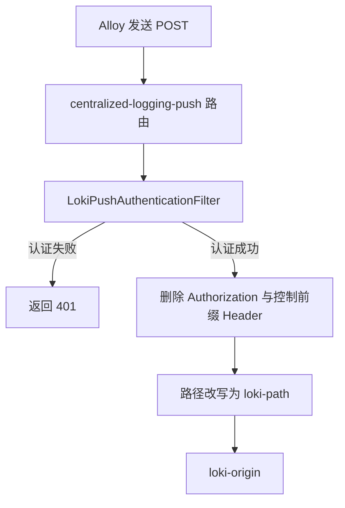

# Loki 日志写入代理

Loki 日志写入代理是 Gateway 的可选附加模块。启用后，它在 Gateway 上注册一条 POST 路由，把 Alloy 提交的日志转发到 Loki 的写入接口，并使用独立的 Basic Auth 凭据保护该路由。适用读者为部署 Gateway 并需要通过 Gateway 接收日志的运维人员，以及维护 Gateway 配置的开发者。

模块位于 `gateway/sca4dj-gateway-loki`，根构建的 `settings.gradle.kts` 已包含该模块。 `gateway/sca4d-gateway` 把它声明为 `runtimeOnly` 依赖。 Gateway 的整体运行方式见 [Gateway 运行时](/capabilities/realtime-gateway/gateway-runtime)，本页只说明日志写入代理。

## 概念

Loki 是日志存储服务，Alloy 是提交日志的采集组件。 Alloy 不直接访问 Loki，而是访问 Gateway 上的写入路径。 Gateway 验证 Alloy 的凭据，删除认证与控制 Header，再把请求转发到 Loki 。

例如，Gateway 配置 `sca4dj.gateway.logging.enabled` 为 `true`，`loki-origin` 为 `https://loki.internal.example`（示例地址，具体部署地址由部署方决定），`push-path` 为默认值 `/internal/logging/push`。 Alloy 向 `/internal/logging/push` 发送 `POST` 请求，并携带 Basic Auth 。 Gateway 验证通过后，把请求发送到 `https://loki.internal.example/loki/api/v1/push`。

该模块只注册写入路由。源码中没有为 Loki 注册查询、删除、管理或就绪检查接口。

## 核心对象

| 对象 | 负责 | 不负责 |
|---|---|---|
| `LokiGatewayAutoConfiguration` | 在类路径存在 `RouteLocator` 且 `sca4dj.gateway.logging.enabled` 为 `true` 时，校验配置并注册 `lokiPushRouteLocator` | 处理请求 |
| `LokiGatewayProperties` | 绑定 `sca4dj.gateway.logging` 下的配置，并校验 Origin 、路径、用户名、密码 | 保存日志数据 |
| `LokiPushAuthenticationFilter` | 验证 `Authorization` Header，删除认证与控制 Header | 检查日志内容 |
| `GatewayLokiException` | 表示 `loki-origin` 不是有效 URI 时抛出的配置异常 | 请求处理 |

路由 ID 为 `centralized-logging-push`。它只匹配 `push-path` 路径和 `POST` 方法，匹配后经过 `LokiPushAuthenticationFilter`，再把路径改写为 `loki-path`，并把请求发送到校验后的 `loki-origin`。

`lokiPushRouteLocator` 带有 `@ConditionalOnMissingBean(name = "lokiPushRouteLocator")`。具体 Gateway 组装工程可以用同名 Bean 替换该路由。



## 认证

Alloy 使用的 Basic Auth 凭据是 `sca4dj.gateway.logging.username` 与 `sca4dj.gateway.logging.password`。它与 Gateway Secret（`sca4dj.gateway.secret`）是两组独立的值。

`LokiPushAuthenticationFilter` 按以下规则验证请求：

1. `Authorization` Header 必须只出现一次。
2. 认证方案必须是 `Basic`，大小写不敏感。
3. 凭据部分经过 Base64 解码，结果必须与 `username:password` 的 UTF-8 字节相同。比较使用 `MessageDigest.isEqual`，比较耗时与内容无关。

验证失败时，过滤器返回 `401`，并设置 `WWW-Authenticate` 为 `Basic realm="Loki push"`。日志记录路径，不记录凭据。

验证通过后，过滤器删除 `Authorization` Header，并删除所有以 `GatewayConstants.HEADER_PREFIX` 开头的 Header（忽略大小写）。该前缀默认值为 `X-Gateway-`，可通过 `sca4dj.gateway.protocol.header-prefix` 修改。删除后的请求才被转发到 Loki，因此 Loki 不接收 Basic Auth 凭据或 Gateway 控制 Header 。

## 配置

以下配置位于 `sca4dj.gateway.logging`。 `sca4d-gateway` 的 `application.yml` 把这些键映射到环境变量。模块内的 `username` 与 `password` 没有默认值，凭据需要由部署配置提供。

| 配置键 | 默认值 | 环境变量（仅 `sca4d-gateway` 的 `application.yml`） | 作用 |
|---|---|---|---|
| `enabled` | `false` | `SCA4DJ_GATEWAY_LOGGING_ENABLED` | 为 `true` 时校验配置并注册路由 |
| `loki-origin` | 无 | `SCA4DJ_GATEWAY_LOKI_ORIGIN` | Gateway 可访问的 Loki HTTP(S) Origin |
| `push-path` | `/internal/logging/push` | `SCA4DJ_GATEWAY_LOGGING_PUSH_PATH` | Alloy 提交日志时访问的 Gateway 路径 |
| `loki-path` | `/loki/api/v1/push` | `SCA4DJ_GATEWAY_LOKI_PATH` | Loki 接收写入请求的路径 |
| `username` | 库内无默认值 | `SCA4DJ_LOKI_PUSH_USERNAME`，默认 `alloy` | Basic Auth 用户名 |
| `password` | 库内无默认值 | `SCA4DJ_LOKI_PUSH_PASSWORD`，默认为空 | Basic Auth 密码 |

`enabled` 为 `false` 时，模块不注册属性 Bean 或路由，也不校验其他配置。

```yaml
sca4dj:
  gateway:
    logging:
      enabled: true
      loki-origin: https://loki.internal.example
      push-path: /internal/logging/push
      loki-path: /loki/api/v1/push
      username: alloy
      password: ${SCA4DJ_LOKI_PUSH_PASSWORD}
```

### 启用时的校验

`LokiGatewayProperties.validate` 在创建 `lokiPushRouteLocator` 时运行。校验失败时，Bean 创建失败，应用启动失败。校验规则如下：

- `loki-origin` 必须存在，并且是有效的 URI 。 URI 语法错误时抛出 `GatewayLokiException`，消息为「 sca4dj.gateway.logging.loki-origin 必须是有效 URI 」。
- `loki-origin` 的 scheme 必须是 `http` 或 `https`，必须有主机名，不能包含用户信息、查询或 fragment，路径只能为空或 `/`。不满足时抛出 `IllegalStateException`。通过校验后，结尾的 `/` 被去除。
- `push-path` 与 `loki-path` 必须以 `/` 开头，不能包含 `?` 、 `#` 、 `*` 、 `{` 、 `}` 或控制字符。
- `username` 必须存在，去除首尾空白后不能包含 `:` 或控制字符。
- `password` 不能为空白，不能包含控制字符。
- `password` 不能与 `sca4dj.gateway.secret` 去除首尾空白后的值相同。

## 示例：Alloy 提交请求

下面的命令模拟 Alloy 向 Gateway 提交一条日志。 `GATEWAY_HOST` 与 `LOKI_PUSH_PASSWORD` 由部署方提供。 Loki 的 JSON 请求体格式由 Loki 定义，本模块原样转发。

```bash
curl -i -X POST "https://${GATEWAY_HOST}/internal/logging/push" \
  -u "alloy:${LOKI_PUSH_PASSWORD}" \
  -H "Content-Type: application/json" \
  --data @push.json
```

认证通过时，Gateway 删除 `Authorization` 与 `X-Gateway-` 前缀的 Header，再把请求体发送到 `loki-origin` 的 `loki-path`。认证失败时返回 `401` 和 `WWW-Authenticate: Basic realm="Loki push"`。

## 限制与失败结果

| 条件 | 结果 | 处理方式 |
|---|---|---|
| 请求没有 `Authorization`，或有多个 `Authorization` | `401`，并返回 `WWW-Authenticate` | 检查 Alloy 的认证配置 |
| 认证方案不是 `Basic`，或凭据无法 Base64 解码，或与配置不一致 | `401` | 检查用户名、密码和 Alloy 的 Basic Auth 设置 |
| 请求方法不是 `POST`，或路径不是 `push-path` | 不进入本路由 | 源码中未定义这类请求的响应，由 Gateway 的其他路由或默认处理决定 |
| `enabled` 为 `true` 时配置无效 | 应用启动失败，抛出 `IllegalStateException` 或 `GatewayLokiException` | 按消息修正配置 |
| Loki 返回错误或不可访问 | 由 Spring Cloud Gateway 处理，源码中未定义对 Loki 错误码的转换 | 检查 `loki-origin` 、网络连通性和 Loki 的状态 |

Loki 写入密码不能与 Gateway Secret 相同。若两者相同，应用启动失败。该规则使两组凭据互不相同。

本模块不记录日志内容，也不解析 Loki 请求体。请求体原样转发。

## 扩展方式

Gateway 组装工程可以注册同名的 `lokiPushRouteLocator` Bean，替换默认路由。替换后，默认路由定义及其中的认证过滤器不再注册。替换方必须自行保证 Basic Auth 验证和 Header 清理。
## 相关页面

- [Gateway 运行时](/capabilities/realtime-gateway/gateway-runtime)
- [Gateway 配置](/capabilities/realtime-gateway/configuration)
- [运行与可观测性](/capabilities/operations-observability/index)
- [应用日志规范](/capabilities/operations-observability/logging-development)
