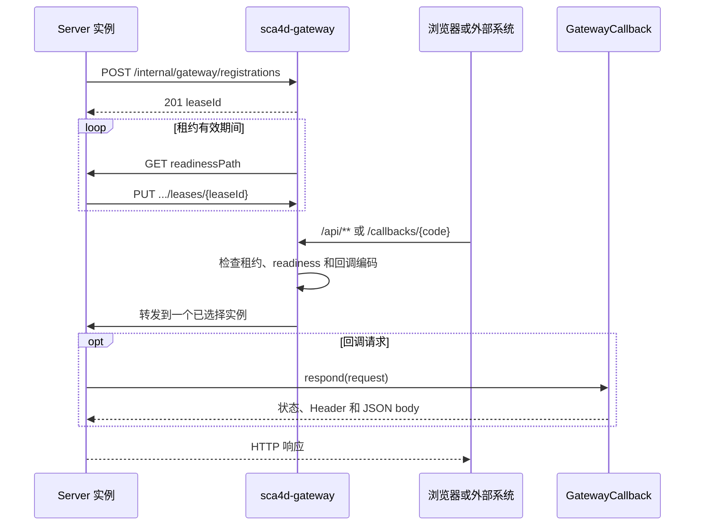

# 负载均衡 Gateway

Sca4d-J 把外部 HTTP 入口和具体应用分开。独立 Gradle 模块 `gateway:sca4d-gateway` 接收公开 API、SSE、WebSocket 和外部系统回调，再从当前可用的 Server 实例中选择一个目标。一个 Gateway 进程只管理一个应用集群，不提供多应用 namespace。具体应用不需要为 EMQX 等调用方公开某个固定 Server 节点。外部系统也不需要理解 Server 集群拓扑。

## 参与对象

- 独立 Gateway 保存 Server 租约，主动检查 readiness，并执行轮询选择和 HTTP 转发。
- Core 回调接口（[GatewayCallback](/javadoc/core/sca4dj-core-api/com/sca4d/core/api/gateway/GatewayCallback.html)）让应用用稳定编码声明一个 JSON 回调，不依赖 Gateway 的 Spring Cloud 实现。
- Core Spring 的 [GatewayCallbackDispatcher](/javadoc/core/sca4dj-core-spring/com/sca4d/core/spring/gateway/GatewayCallbackDispatcher.html) 把 `/callbacks/{code}` 转换成应用声明的回调调用。
- Core Spring 的 [GatewayRegistrationLifecycle](/javadoc/core/sca4dj-core-spring/com/sca4d/core/spring/gateway/GatewayRegistrationLifecycle.html) 在 Server 启动后建立租约并持续续租。注册失败只影响 Gateway 路由，不阻止 Server 启动。
- 具体应用决定回调编码、请求类型、认证规则和实际动作。Core 和 Gateway 不包含 EMQX 业务名称。



Server 注册实例标识、Gateway 可访问的 HTTP(S) Origin、readiness 路径、协议配置摘要和当前实例实际声明的回调编码。Origin 不能包含基础路径，因为 Spring Cloud LoadBalancer 只替换目标 scheme、host 和 port。

协议摘要不一致时，Gateway 返回 409 且不建立租约。新租约初始不可路由。Gateway 至少完成一次成功的 readiness 请求后，才会选择它。相同实例标识重新注册会获得新租约 ID，旧租约不能续租或删除替换后的注册。

## 路由与外部路径

默认 `/api/**` 是普通应用入口。Gateway 在转发前移除配置的 `sca4dj.gateway.protocol.api-prefix`，默认值为 `/api`，并通过 [GatewayConstants](/javadoc/core/sca4dj-core-api/com/sca4d/core/api/gateway/GatewayConstants.html) 声明的 Header 告知 Server。SSE `/api/events` 和 WebSocket `/api/events/ws` 是默认专用路由。应用内路径分别由 `sca4dj.gateway.routes.sse-path` 和 `websocket-path` 配置。默认路由通过 `spring.cloud.gateway.server.webflux.routes` 声明，外部 YAML 可以替换这些路由。Gateway 不托管前端文件。

`/callbacks/{code}` 保留完整路径转发，并且只选择注册了该回调编码的健康实例。回调编码由 [GatewayCallbackCode](/javadoc/core/sca4dj-core-api/com/sca4d/core/api/gateway/GatewayCallbackCode.html) 限制为不含通配符 `*`、格式化后不超过 128 字符的固定编码。一个实例没有装配某项可选功能时，不登记对应回调编码，也不会收到对应类型的回调。

转发到动态注册 Server 的路由必须声明 `RegisteredServer` Filter。Filter 负责校验 backend service ID、写入可信 Header，以及按配置的外部前缀改写请求路径和响应 `Location`。未声明 `RegisteredServer` Filter 的普通代理路由不会得到 Gateway Secret。

## 可信转发

注册控制 API 和 Gateway 到 Server 的可信转发默认使用 `X-Gateway-Secret`。Gateway 对全部路由删除调用方提交的配置控制前缀 Header。`RegisteredServer` 进一步删除转发 Header，再写入配置指定的 Secret、客户端地址和公开路径前缀 Header。Server 只有在 Secret 通过固定时间比较后，才采用这些值。Core Spring 随后对 Controller 隐藏控制 Header。准确配置键和默认值见 [Gateway 运行规格](/capabilities/realtime-gateway/gateway-runtime#配置)。

Gateway Secret 只证明请求经过配置相同 Secret 的 Gateway，不代替回调自己的认证。EMQX 回调继续校验独立的 `X-Iot-Emqx-Secret`，设备 HMAC 请求继续校验各 Device 自己的凭据。Gateway 不读取或改写这些应用协议 Header。

## 失败与集群限制

没有实例同时满足租约有效、readiness 成功和支持指定回调编码时，Gateway 返回 503。已经选中实例但 TCP 连接失败时，Gateway 返回 502。Gateway 不自动改选其他实例重试，因为回调、创建和其他写请求可能已经被目标 Server 接收。调用方必须按自身协议决定是否重试，以及怎样确认结果。

租约注册表只存在于单个 Gateway 进程内，不写数据库或 Redis。一个 Gateway 进程可以把请求分配给多个 Server 实例。多个 Gateway 副本之间不会复制注册状态。部署多个 Gateway 副本时，外部负载均衡器负责选择 Gateway。Server 必须向每个可能接收请求的 Gateway 建立租约，或由部署环境增加独立的共享注册方案。当前实现不处理这部分复制。

Gateway 进程不可用时，已经启动的 Server 仍可直接处理内部任务和明确直连的请求，但统一外部入口不可用。Server 注册或续租失败会继续重试，不会使 Spring 应用退出。租约过期后，Gateway 停止选择该实例。

## 示例

以下示例对应工作区文档协作应用。合作方文档平台在文档入库后向应用发送 JSON 回调，应用返回 `202` 表示已接收。

```java
import com.sca4d.core.api.gateway.GatewayCallback;
import com.sca4d.core.api.gateway.GatewayCallbackCode;
import com.sca4d.core.api.gateway.GatewayCallbackRequest;
import com.sca4d.core.api.gateway.GatewayCallbackResponse;
import org.springframework.stereotype.Component;

@Component
public class PartnerDocumentCallback
        implements GatewayCallback<PartnerDocumentCallback.Request, PartnerDocumentCallback.Response> {

    private static final GatewayCallbackCode CODE =
            new GatewayCallbackCode("partner.document.received");

    @Override
    public GatewayCallbackCode code() {
        return CODE;
    }

    @Override
    public Class<Request> requestType() {
        return Request.class;
    }

    @Override
    public GatewayCallbackResponse<Response> respond(GatewayCallbackRequest<Request> request) {
        Request body = request.body();
        // 应用在此校验 body，并把文档登记到对应工作区。
        return new GatewayCallbackResponse<>(202, new Response(body.getDocumentId()));
    }

    public static final class Request {

        private String documentId;

        public Request() {
        }

        public String getDocumentId() {
            return documentId;
        }

        public void setDocumentId(String documentId) {
            this.documentId = documentId;
        }
    }

    public static final class Response {

        private final String documentId;

        public Response(String documentId) {
            this.documentId = documentId;
        }

        public String documentId() {
            return documentId;
        }
    }
}
```

回调的 HTTP 路径为 `/callbacks/partner.document.received`。合作方平台的请求必须携带应用自己的认证材料，Gateway Secret 不能代替它。

启动 Gateway 时，从部署环境注入 Secret：

```bash
export SCA4DJ_GATEWAY_SECRET='<由部署环境注入>'
export SCA4DJ_GATEWAY_BACKEND_SERVICE_ID=sca4d-server
./gradlew :gateway:sca4d-gateway:bootRun
```
## 扩展方式

具体应用通过 Spring Bean 提供回调。每个回调类型实现 `GatewayCallback<I, O>`，并声明 `code()`、`requestType()` 和 `respond(...)`。`GatewayCallbackDispatcher` 通过 `List<GatewayCallback<?, ?>>` 注入全部回调 Bean，并按回调编码建立索引。两个回调登记了相同编码时，分发器启动失败并报告重复编码。Server 只登记自己实际注册的回调编码，Gateway 据此选择实例。
