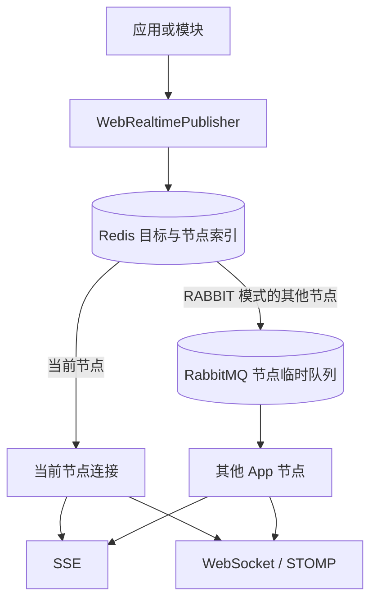
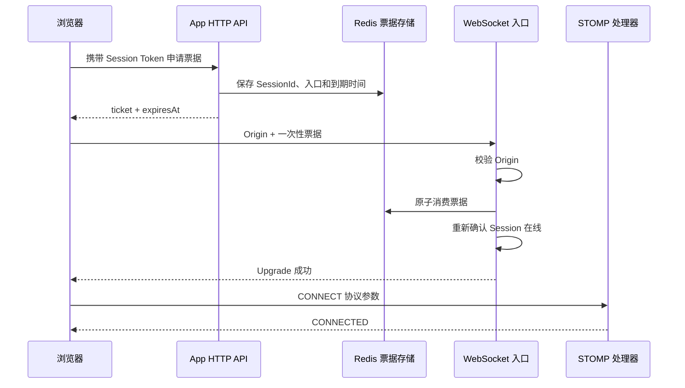

# Web Realtime

Web Realtime 向当前在线浏览器发送短暂通知。数据库、Session 存储和 HTTP API 保存权威状态。浏览器收到消息后重新读取完整数据。断线、节点退出、缓冲溢出或路由失败都不回滚业务事务，也不会触发消息回放。

Web Realtime 支持 SSE，以及在原生 WebSocket 连接中交换 STOMP 帧。两种协议共用 [WebRealtimeTarget](/javadoc/core/sca4dj-core-api/com/sca4d/core/api/webrealtime/WebRealtimeTarget.html)、共享连接索引和节点路由，不暴露 RabbitMQ exchange、Redis key 或本地连接对象。

## 连接和发布路径



Redis 保存 Account、Subject、Principal、Resource、Topic、Session、Connection 与节点之间的共享索引。应用节点只保存本机连接和有界写出队列。发布时先解析目标连接，本节点连接直接投递。`LOCAL` 模式只支持单个应用实例。`RABBIT` 模式把其他节点的连接分批发送到独占、自动删除且带短 TTL 的 RabbitMQ 队列。

这些 RabbitMQ 队列不持久化消息，Web Realtime 也不使用 Outbox。浏览器通知允许丢失，与 RabbitMQ 持久业务消息的投递保证无关。节点传输模式由配置键 `sca4dj.web-realtime.node-transport` 决定，取值类型为 `NodeRouterMode`，可选 `LOCAL` 或 `RABBIT`。

## 自动目标与动态订阅

连接建立后，自动登记当前 Account、Subject、Session 中的 Principal 和当前 Connection。Resource 与 Topic 必须由具体应用实现 [WebRealtimeSubscriptionPolicy](/capabilities/realtime-gateway/subscription-policy)。每个 `SUBSCRIBE` 使用独立的 Call 完成授权后才能登记。

连接租约默认每 30 秒续期、90 秒失效。断开、写出失败、缓冲溢出或租约到期会删除共享索引。相同消息匹配同一连接的多个目标时只投递一次。

## SSE

具体应用通过 [WebRealtimeSseConnector](/javadoc/modules/web-realtime/sca4dj-web-realtime/com/sca4d/web/realtime/sse/WebRealtimeSseConnector.html) 显式注册 HTTP 路由。示例应用使用 `GET /events` 和 Bearer Session Token 建立连接。默认每 25 秒发送心跳，连接最长 30 分钟，每个连接最多等待 64 条消息。慢连接队列溢出时直接断开并清理索引。

## WebSocket 票据和 STOMP

浏览器不能把 access Token 或 Session Token 放入 WebSocket URL。浏览器先通过已认证的 HTTP 请求向具体应用申请随机票据。票据默认 10 秒有效，且只能消费一次。随后，浏览器把票据用于 `/events/ws` Upgrade。



Origin 在票据消费前检查。票据无效、重复、过期、入口不匹配或对应 Session 已离线时拒绝 Upgrade。入口不匹配也会消费票据，避免同一凭据探测多个端点。反向代理和应用访问日志必须隐藏票据查询参数。

STOMP `CONNECT` 不认证身份，只确认协议参数，并使用握手阶段绑定的权威 `Session`。Spring 拒绝重复命令和连接前命令。模块拒绝非 STOMP 1.2、过期 Session 和超过限额的 CONNECT。入站命令检查失败时，Spring 返回 `ERROR` 帧。WebSocket transport 在 Upgrade 后超过配置时间仍未收到第一条消息时关闭连接。

每个 `SUBSCRIBE` 和 `/app/**` `SEND` 都新建并清理各自的 Call。动态订阅策略在当前 `SUBSCRIBE` 的 Call 中执行。具体应用的消息处理方法在当前 `SEND` 的 Call 中执行。业务 destination 由具体应用显式提供。

默认限额为 `CONNECT` 每 IP 10 秒 20 次、`SUBSCRIBE` 每 Subject 和 Connection 10 秒 120 次、`SEND` 每 Subject 和 Connection 10 秒 60 次。限额由 Redis 共享令牌桶执行，各维度的判断方式见 [Web Realtime 模块](/capabilities/realtime-gateway/web-realtime)。单个入站帧默认不超过 64 KiB。

STOMP 帧解析、命令状态机、`ERROR` 帧、用户 destination 和 broker 转发全部由 Spring Messaging 与 Spring WebSocket 处理。Web Realtime 只实现 Spring 拦截器、握手扩展、连接生命周期和消息发布。模块不自行解析或编码 STOMP 帧。

## Web Realtime 不处理设备连接

Web Realtime 只处理浏览器连接。MQTT、TCP、设备 WebSocket、设备心跳、设备命令确认和 EMQX 属于 IoT 模块的职责范围，不能通过 STOMP destination 或浏览器连接注册表实现。

完整配置与类型见 [Web Realtime 模块](/capabilities/realtime-gateway/web-realtime)。

## 示例

以下示例对应工作区文档协作应用。成员在浏览器中打开某个工作区后，前端通过 SSE 接收文档变化通知。需要 WebSocket 的页面先申请票据，再用票据建立 STOMP 连接。

```java
import com.sca4d.core.api.authentication.Session;
import com.sca4d.web.realtime.sse.WebRealtimeSseConnector;
import com.sca4d.web.realtime.ticket.WebRealtimeTicket;
import com.sca4d.web.realtime.ticket.WebRealtimeTicketService;
import org.springframework.web.bind.annotation.GetMapping;
import org.springframework.web.bind.annotation.PostMapping;
import org.springframework.web.bind.annotation.RestController;
import org.springframework.web.servlet.mvc.method.annotation.SseEmitter;

@RestController
public class WorkspaceRealtimeController {

    private final WebRealtimeSseConnector sseConnector;
    private final WebRealtimeTicketService ticketService;

    public WorkspaceRealtimeController(
            WebRealtimeSseConnector sseConnector,
            WebRealtimeTicketService ticketService) {
        this.sseConnector = sseConnector;
        this.ticketService = ticketService;
    }

    @GetMapping("/events")
    public SseEmitter events(Session session) {
        return sseConnector.connect(session);
    }

    @PostMapping("/events/tickets")
    public WebRealtimeTicket ticket(Session session) {
        return ticketService.issue(session, "/events/ws");
    }
}
```

`Session` 参数由应用的认证链提供。示例没有处理认证失败，认证失败的结果由应用的 HTTP 认证规则决定。`/events` 与 `/events/tickets` 的路径由应用声明。`/events` 与 Gateway 的 SSE 路由保持一致时，才能通过 Gateway 访问。
## 扩展方式

具体应用通过 Spring Bean 接入 Web Realtime。HTTP 路由调用 `WebRealtimeSseConnector.connect(session)` 建立 SSE 连接。认证路由调用 `WebRealtimeTicketService.issue(session, endpointPath)` 签发票据。订阅授权通过实现 `WebRealtimeSubscriptionPolicy` 完成。模块注入全部策略 Bean，并使用 `supports(destination)` 选择负责该 destination 的策略。
