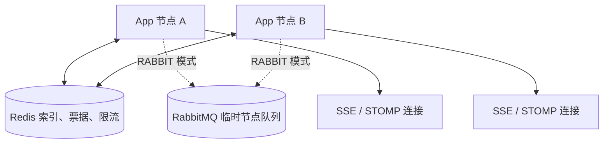
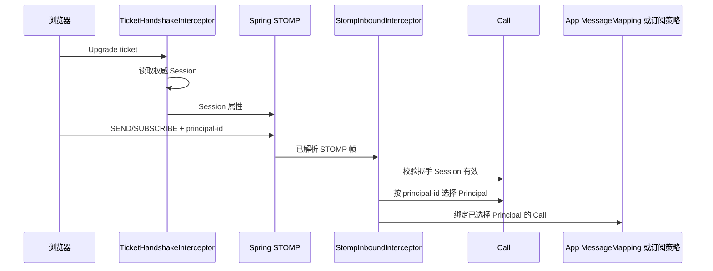

# Web Realtime 模块

`modules/web-realtime/sca4dj-web-realtime` 在一个 Gradle 模块内实现 SSE 与原生 WebSocket/STOMP。模块使用 Redis 保存共享连接索引和一次性票据，使用 [RateLimiter](/javadoc/core/sca4dj-core-api/com/sca4d/core/api/concurrent/RateLimiter.html) 执行跨节点限流，并在应用节点内维护连接和有界写出缓冲。本节点连接始终直接投递。配置键 `sca4dj.web-realtime.node-transport`（类型为 `NodeRouterMode`）可以只允许单实例本地投递，或使用 RabbitMQ 临时节点队列投递其他应用实例的连接。

模块不注册 HTTP Controller。具体应用调用 WebRealtimeSseConnector 建立自己的 SSE 路由，并通过 WebRealtimeTicketService 签发 Upgrade 票据。模块使用 Spring `@EnableWebSocketMessageBroker` 固定注册 `/events/ws` 原生 STOMP 入口，不启用 SockJS。模块不注册具体业务 destination。具体应用使用 Spring `@MessageMapping("/invoices")` 之类的方法，处理浏览器发往 `/app/invoices` 的消息。

STOMP 的两个消息通道使用 StompChannelDispatcher，同时作为首个通道拦截器和执行器。分派器先预留消息数量与载荷预算，再收集 Spring 为该消息创建的处理任务，最后按连接串行执行。Spring 的 `preserveReceiveOrder` 和 `preservePublishOrder` 保持关闭，避免消息先进入框架的无界顺序队列。正常消息仍按同连接的接收顺序执行。超限、断连和关闭时释放未执行任务。

## 包结构

| 包 | 职责 |
|---|---|
| `com.sca4d.web.realtime.connection` | 登记本地与 Redis 连接、解析目标，并选择本地或跨节点投递 |
| `com.sca4d.web.realtime.rabbit` | 通过 RabbitMQ 临时节点队列传递跨实例消息 |
| `com.sca4d.web.realtime.sse` | 建立、写入和关闭 SSE 连接 |
| `com.sca4d.web.realtime.stomp` | 配置 Spring STOMP，检查帧、限流、订阅授权和 Broker Relay |
| `com.sca4d.web.realtime.ticket` | 签发一次性 Ticket，并在 WebSocket 握手时校验 |
| `com.sca4d.web.realtime.config` | 绑定配置并装配上述组件 |

这些包仍属于一个可删除的 Web Realtime Gradle 模块，不形成第二层模块 API。RabbitMQ 节点传输、连接注册和协议拦截器因跨包协作开放的类型，仍是模块内部实现。

## 运行结构



`LOCAL` 模式只装配本地投递实现，适用于单个应用实例。`RABBIT` 模式装配 RabbitMQ 节点传输实现。本节点连接仍直接投递，只有其他节点的连接进入 RabbitMQ。节点队列独占、自动删除、消息非持久，并带短 TTL。Web Realtime 不使用业务消息 exchange、Consumer durable queue、Outbox 或 DLQ。节点不可用时通知可以丢失，浏览器通过重连和 HTTP 读取恢复权威状态。

## Spring 与 Web Realtime 各自负责什么

| 对象 | 负责内容 | 不负责 |
|---|---|---|
| Spring WebSocket | Upgrade 后连接、首消息等待时间、入站帧大小、写出时间和缓冲限制 | 票据签发、业务身份恢复 |
| Spring Messaging STOMP | 帧解析、命令状态机、`ERROR`、用户 destination、simple broker 或 broker relay | 业务订阅授权、共享限流 |
| Web Realtime 握手扩展 | Origin、一次性票据、重新读取 Session，并把 Session 保存到 WebSocket Session 属性 | 创建 Spring Principal、解析 STOMP `CONNECT` 登录信息 |
| Web Realtime 入站拦截器 | STOMP 1.2、`CONNECT`/`SUBSCRIBE`/`SEND` 限流、按 `principal-id` 选择业务 Principal、动态订阅策略和每帧 Call | 手写 STOMP 帧或调用具体业务 Service |
| StompConnections | 把 Spring STOMP Session 登记到 Redis 共享索引，并通过 SimpMessagingTemplate 向该 Session 发送 BrowserEnvelope | 持久化消息、回放或业务 Consumer |
| 本地投递实现 | 把通知直接交给当前 JVM 的 LocalConnectionRegistry | 跨实例投递、持久化或回放 |
| RabbitMQ 节点传输实现 | 直接投递本机连接，并使用临时 RabbitMQ exchange 和节点队列投递其他应用实例 | RabbitMQ STOMP relay、业务消息 exchange 或 Outbox |

NodeMessageCodec 只编解码跨节点临时消息，不参与本机连接投递。这些类型都不是公开 Node 模型。消息编解码使用脚手架固定的 [@Sca4djJson](/javadoc/core/sca4dj-core-spring/com/sca4d/core/spring/json/Sca4djJson.html) ObjectMapper。Spring Messaging 解析并执行 STOMP 帧，模块没有另一套 STOMP Handler。

Java 的 java.security.Principal 是 Spring 可以从 HTTP Upgrade 请求继承的连接用户，不是 Sca4d-J 的[业务身份（Principal）](/capabilities/identity-access/principal)。Web Realtime 不创建自定义 java.security.Principal，也不把 [Session](/javadoc/core/sca4dj-core-api/com/sca4d/core/api/authentication/Session.html) 或 [ConnectionId](/javadoc/core/sca4dj-core-api/com/sca4d/core/api/connection/ConnectionId.html) 包装成 Spring 用户。`/user/queue/events` 使用 Spring STOMP Session ID 定向，因此一个 Account 的多条浏览器连接仍然分别投递。



握手只证明 Subject 和 Account 已通过认证，并提供当前 Account 可选择的 Principal 集合。`SEND`、`SUBSCRIBE` 必须恰好提供一个正整数 `principal-id`。提供的值不属于握手 Session 时，当前帧在进入 App 或登记订阅前失败。`CONNECT`、`DISCONNECT` 和 `UNSUBSCRIBE` 不选择业务 Principal。

`NODE_ROUTED` 使用每个应用实例内的 Spring simple broker。`RABBIT` 节点传输模式下，跨实例通知先由 Redis 找到连接所在节点，再通过 RabbitMQ 节点传输定向投递。simple broker 只处理已经到达本机的 STOMP 连接。`BROKER_RELAY` 把 `/queue` 和 `/topic` broker destination 交给 RabbitMQ STOMP plugin。Web Realtime 的节点传输模式及允许丢失的规则不变。

`/events/ws`、`/app`、`/user`、`/queue`、`/topic`、`/user/queue/events` 和 `principal-id` 都由 WebRealtimeProtocol 集中声明。STOMP 标准定义命令和帧格式，不规定这些 destination 或业务 header。`/app` 与 `/user` 是 Spring 配置约定，`/queue` 与 `/topic` 是本模块选择的 broker 前缀，`/events/ws` 和 `principal-id` 是 Sca4d-J 固定协议。

## 基础设施命名

RabbitMQ 和 Redis 名称由应用运行时名称（`AppName`）加上以 `WEB_REALTIME` 开头的 `Key` 段生成，例如 `WEB_REALTIME:NODE`、`WEB_REALTIME:CONNECTION`、`WEB_REALTIME:TICKET`。节点 ID、ConnectionId、目标和票据等动态文本进入名称前以 UTF-8 十六进制（`V_` 前缀）编码，业务原文不会改变名称段结构。

Web Realtime 的 Redis Lua 会在一次调用中同时修改连接、订阅和目标 key。这些 key 带同一应用级 Redis Cluster hash tag，确保脚本使用的 key 位于同一槽位。限流 key 不由 Web Realtime 自行拼接。`StompRateLimits` 只声明 `CONNECT`、`SUBSCRIBE`、`SEND` 的额度和维度。限流器根据 `RateLimitKey` 与额度生成 Redis key。

## 限流判断

`StompRateLimits` 对每个维度各调用一次 `RateLimiter.tryAcquire`。每个维度的令牌都会被消耗，全部维度判断完成后才返回结果。任一维度拒绝时，当前帧被拒绝。不得在调用方逐个维度判断并提前返回，否则已消耗的额度与拒绝结果不一致。
## 示例

以下示例对应工作区文档协作应用，说明在应用模块中接入 Web Realtime。

应用模块的 Gradle Kotlin DSL 依赖该模块：

```kotlin
dependencies {
    implementation(project(":modules:web-realtime:sca4dj-web-realtime"))
}
```

执行该模块的测试：

```bash
./gradlew :modules:web-realtime:sca4dj-web-realtime:test
```

应用需要提供的 Bean 与其用途如下：

| 应用代码 | 用途 |
|---|---|
| 调用 `WebRealtimeSseConnector.connect(session)` 的 HTTP 路由 | 返回 SSE 响应 |
| 调用 `WebRealtimeTicketService.issue(session, endpointPath)` 的认证路由 | 签发 WebSocket 票据 |
| 实现 `WebRealtimeSubscriptionPolicy` 的 Bean | 每个订阅 destination 的授权和目标解析 |
| `@MessageMapping` 方法 | 处理 `/app/**` 发送的业务消息 |

具体代码示例见 [实时通信规则](/capabilities/realtime-gateway/development) 与 [WebRealtimeSubscriptionPolicy](/capabilities/realtime-gateway/subscription-policy)。

## 配置

节点传输、连接租约、路由批量、SSE、一次性票据、STOMP 限制、Origin 和 broker relay 的全部配置键、默认值与范围见 [WebRealtimeProperties](/capabilities/realtime-gateway/configuration)。生产环境必须显式设置实际管理端 Origin。broker relay 凭据不能写入版本库。

## 扩展点

- `WebRealtimeTicketService` 由具体应用的认证 HTTP 路由调用，签发绑定 Session 与 WebSocket 路径的短期一次性票据。
- `WebRealtimeSseConnector` 使用已认证 Session 建立 SSE 连接。
- `WebRealtimeSubscriptionPolicy` 授权 Resource 或 Topic 动态订阅。
- WebSocket Upgrade 固定进入 `/events/ws`。浏览器先从具体应用的 HTTP 路由取得票据。握手阶段完成 Origin、票据和 Session 检查。STOMP 帧由 Spring 处理。
- 具体应用使用 Spring `@MessageMapping` 声明去掉 `/app` 前缀后的处理路径。浏览器仍向 `/app/**` 发送，并用 `principal-id` 选择本次业务调用代表的 Principal。每个 `SEND` 的 Call 由模块入站拦截器创建、绑定和清理。

## 扩展方式

具体应用通过三种方式接入：

1. 调用 `WebRealtimeSseConnector` 和 `WebRealtimeTicketService`，在应用自己的 HTTP 路由中暴露 SSE 与票据接口。
2. 实现 `WebRealtimeSubscriptionPolicy` 并注册为 Bean。模块注入全部策略 Bean，并按 `supports(destination)` 选择策略。
3. 编写 `@MessageMapping` 方法处理 `/app/**` 消息。

每个 `SUBSCRIBE` 和 `SEND` 都使用独立 Call，并且已经绑定该帧选择的 Principal。Spring 负责解析帧并按 Session 发送 user destination。模块负责连接状态、限流、业务身份选择和订阅授权。具体业务规则由应用的订阅策略或 `@MessageMapping` 方法执行。
