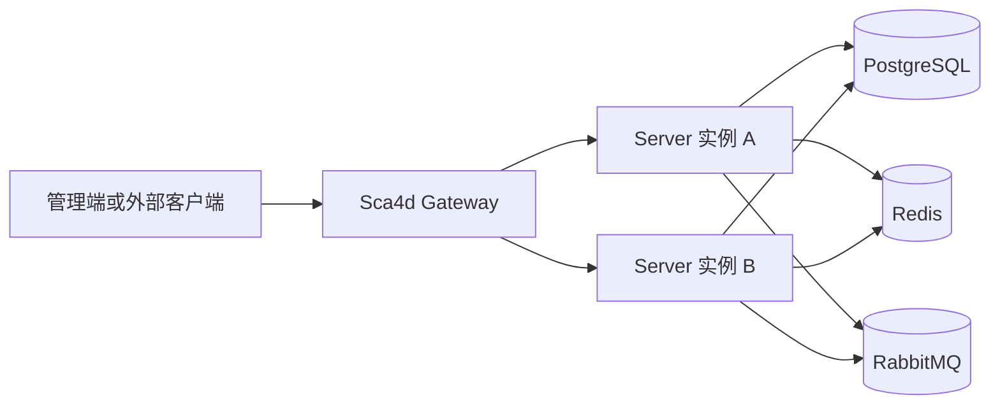

# 架构与运行

Sca4d-J 采用分布式单体。一个 App 包含完整的业务体系，身份、认证和具体业务在同一进程中通过 Java 接口协作。需要高可用或增加处理容量时，部署同一 App 的多个实例，由 Gateway 分配请求。

单实例与集群使用同一套业务方法、数据约束和失败处理。需要互斥的操作使用 Redis 分布式锁或数据库原子条件；Session、任务租约、消息、连接索引和调度状态由多个实例共享。任务和消息按各自的租约、重试规则恢复，外部操作仍需处理重复执行。

`core/`、`modules/` 和 `apps/` 分别组织公共接口、功能实现和应用代码。App 在编译时选择模块，运行时作为一个 Spring Boot 应用启动。

图中的两个 Server 运行同一应用，使用相同的应用名称并连接同一组基础设施。代码依赖始终从 App 指向 Module，再指向 Core，具体目录见[项目结构](/home/project-structure)。

## 运行组成

PostgreSQL 保存账号、角色关系、设备、文件记录、任务、配置和 App 业务数据。Redis 保存多个实例共同使用的 Session、认证 attempt、锁、限流计数和连接索引。RabbitMQ 传递业务消息和多节点投递消息。本地环境还可启动 MinIO、Mailpit、EMQX 和 TimescaleDB，分别用于对象存储、查看测试邮件、设备接入和 IoT 历史数据。

Gateway 保存已注册 Server 实例的路由信息，转发 `/api/**`，并处理 SSE、WebSocket 和外部回调的统一入口。Server 直连端口用于单实例检查；浏览器和外部系统使用 Gateway 地址。

## 多实例部署条件

| 配置或组件 | 多实例要求 |
|---|---|
| 应用名称 | 同一 App 使用相同 `SCA4DJ_APPLICATION_NAME`，共享任务和消息命名空间 |
| 实例标识 | 同时运行的 Server 使用不同 `SCA4DJ_SERVER_INSTANCE_ID` |
| Web Realtime | `node transport` 使用 `RABBIT`，将事件投递到连接所在实例 |
| 文件存储 | 使用 MinIO 或共享目录，保证每个实例都能访问已上传文件 |
| Gateway | 注册表保存在当前进程内，多个 Gateway 副本不会同步 Server 租约 |

Server 增加实例后的注册、实时消息和文件访问配置见[运行配置](/reference/runtime/sca4d-server)。Gateway 的部署限制见[Gateway 与回调](/tutorials/gateway-and-callbacks#失败与集群限制)。

## 模块裁切

功能是否可删除由 Gradle 依赖、Spring 装配、数据库结构片段和 App 调用关系共同决定。删除模块时需要同时删除 App 中的装配、配置、迁移和前端入口。具体操作见[组成应用](/tutorials/assemble-application)。

## 外部边界

Controller 是 HTTP 输入边界，Gateway 是流量边界，Mapper 是 SQL 边界，消息处理器是 RabbitMQ 边界，协议适配器是设备或外部系统边界。这些位置负责把外部数据转成应用能理解的调用，业务状态变化由 Service 完成。
