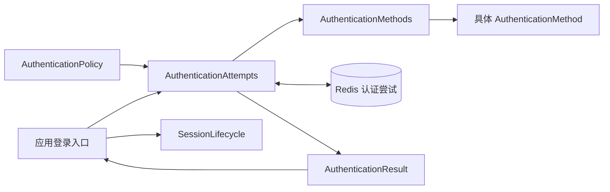
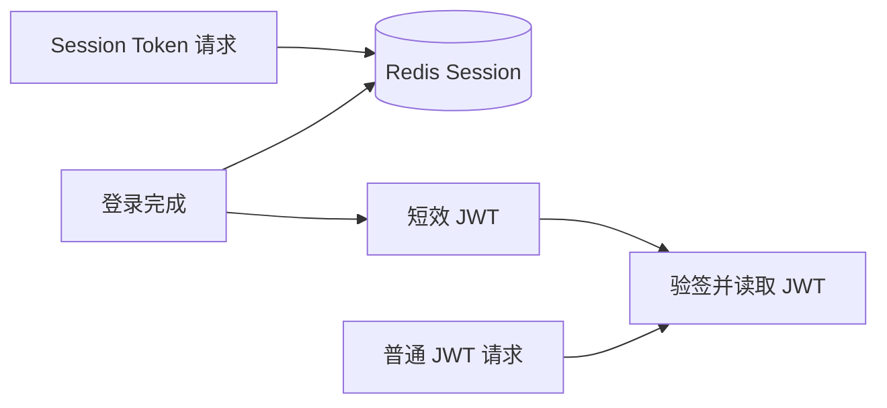

# 认证与会话

认证验证调用者能否使用某个 Account，Session 保存登录结果，Token 用于后续请求恢复这份结果。接入登录时，用 `AuthenticationAttempts` 完成所需验证，再用 `SessionLifecycle` 建立 Session；业务请求仍须选择 Principal 并检查权限。

修改密码等敏感操作可以再次要求认证。认证通过只证明满足验证要求，目标业务动作仍由应用执行；实际请求顺序见[认证与 Session 教程](/tutorials/authentication-and-session)。

## 认证组件怎样协作

应用通过 AuthenticationPolicy 决定需要哪些认证因素；`sca4dj-auth` 组织认证尝试并管理 Session；Password、TOTP、Passkey、验证码和联邦登录等模块验证各自的认证材料。

具体应用提供 [AuthenticationPolicy](/javadoc/core/sca4dj-core-api/com/sca4d/core/api/authentication/AuthenticationPolicy.html)，并调用 [AuthenticationAttempts](/javadoc/core/sca4dj-core-api/com/sca4d/core/api/authentication/AuthenticationAttempts.html)。登录满足后，应用消费 AuthenticationResult，再调用 SessionLifecycle 建立通用 Session；普通动作认证只消费对应动作的结果，不建立新 Session。

AuthenticationMethod 校验一种认证材料，Credential 保存 Account 对应的凭据，例如密码摘要、TOTP 密钥或 Passkey 公钥。AuthenticationFactorKind 判断已经完成的方法是否属于独立因素，使用多个方法不一定满足多因素要求。

## 认证尝试

[AuthenticationMethods](/javadoc/modules/auth/sca4dj-auth/com/sca4d/auth/engine/AuthenticationMethods.html) 索引应用安装的 AuthenticationMethod Bean。调用方已知 Account 时调用 `authenticate(account, submission)`，需要方法从 Proof 识别 Account 时调用 `authenticate(submission)`。两条入口都检查 Proof 精确类型、方法是否能从 Proof 识别 Account、方法是否可用，以及返回的编码和因素是否符合声明。应用组合根只在签发、轮换或撤销 Credential 时按公开方法类型取得已安装实例；Proof 验证不绕过 AuthenticationMethods。

[RedisAuthenticationAttempts](/javadoc/modules/auth/sca4dj-auth/com/sca4d/auth/engine/RedisAuthenticationAttempts.html) 实现 AuthenticationAttempts。它按 AuthenticationFactorKind 去重，执行零到三因素要求，并在每次开始、提交或消费时重新读取当前策略和时间。开始登录时，首个认证方法先验证材料并识别 Account，然后仍要通过应用策略检查；不能识别账号的方法只能用于已知 Account。

Redis attempt 只保存 Account、动作编码、可复用 Authentication、VerifiedAuthentication 的非秘密引用、版本、可选最晚有效时间、过期时间及满足状态。完成结果只能消费一次；消费前每个认证方法重新确认 Credential 或外部身份仍有效。任何 Proof 都不会写入 Redis attempt 或 Session。

## 登录与 Session

具体应用先使用能够识别账号的方法开始认证，或为已知 Account 开始认证，再向同一 attempt 补充因素。要求满足后，应用消费 AuthenticationResult，并把其中的 Account 与 Authentication 列表交给 SessionLifecycle。

Session 建立时重新装载 Subject、Account、完整 Principal、按类型分组的紧凑 Principal ID，以及完整或数字 ID 形式的静态 Resource。没有 Principal 的 Device 仍可以建立空 Principal、空 Resource 的 Session；业务调用在 Call 阶段因缺少 Principal 而失败。身份装载或 Token 签发失败时不能留下可用 Token 或半成品 Session。

PrincipalIdLoader 只返回建立 Session 时已经确认存在且有效的正数 ID，PrincipalIdLoaders 按具体 Principal Java 类型合并。请求期选择器可以解析紧凑集合中的当前 Principal 对象，但 `Call.selectPrincipal(...)` 仍校验精确类型和 ID。ResourceIdLoader 只为完整 Principal 提供按 Resource 类型分组的数字 ID；动态角色、Permission 和数据范围不进入这些集合。

Session 保存登录时完成的 Authentication。动作策略可以按最大年龄复用这些记录；Session 自身和权限集合都不算认证因素。

## Token 与 JWT

Session 保存在 Sa-Token 的 Redis Token-Session 中。SESSION 模式的请求在线读取它；JWT 模式通过 [JwtSessionProjection](/javadoc/modules/auth/sca4dj-auth/com/sca4d/auth/jwt/JwtSessionProjection.html) 将同一份 Session 数据签名为短效 JWS，普通请求验签后读取其中的登录信息。JWT 载荷没有加密。

`sca4dj.auth.token-mode` 默认为 `SESSION`。JWT 模式需要具体应用提供 issuer、audience 和独立 HS256 密钥。普通 JWT 请求不在线检查注销、账号停用、权限变化或 Operation 目录变化；旧 JWT 最多继续有效到自身过期。要求在线状态的接口使用 [RequireSessionToken](/javadoc/core/sca4dj-core-api/com/sca4d/core/api/authentication/RequireSessionToken.html)。

## Session 生命周期与账号控制

[SessionLifecycle](/javadoc/core/sca4dj-core-api/com/sca4d/core/api/authentication/SessionLifecycle.html) 建立、按 Session ID 或 Token 读取并终止单个 Session。登录、HTTP 认证恢复和 Web Realtime 票据校验依赖它。

[SessionControl](/javadoc/core/sca4dj-core-api/com/sca4d/core/api/authentication/SessionControl.html) 只控制指定 Account 的全部 Session，不读取身份、Principal 或 Resource。IAM、Credential 模块和具体应用在账号状态、权限或认证材料变化时调用它。这样，账号级控制不会反向依赖 SessionLifecycle 使用的 Loader。

Auth 为每个 Account 保存非负失效代次，并在 Token-Session 中保存建立或刷新 Session 时使用的 Operation 目录指纹。指纹只包含排序后的具体 Operation 编码；显示名称、翻译键、排序值和模块登记顺序不影响它。SESSION 模式在线读取发现代次或目录指纹变化时重新装载一次身份、Principal 和 Resource，并在刷新成功后保存新指纹；刷新失败的请求直接失败且下次继续重试，只有身份不可用时才终止 Session。部署新增、删除或重命名 Operation 不需要清空整个 Redis。

`terminateAccount(...)` 终止指定 Account 的全部权威 Session，`terminateOtherSessions(...)` 保留指定的当前 Session 并终止同一 Account 的其他权威 Session，`invalidateAccount(...)` 保留登录并要求已有 Session 在下次在线读取时刷新身份。事务中调用这些控制方法时，失效和终止动作在事务提交后执行；事务回滚不改变在线 Session。批量权限或 Principal 变化使用 `invalidateAccounts(...)`，Auth 通过一次 Redis pipeline 增加全部目标 Account 的失效代次。

Session 变化后，Auth 调用 [SessionInvalidationListener](/javadoc/core/sca4dj-core-api/com/sca4d/core/api/authentication/SessionInvalidationListener.html)。Web Realtime 可以通知浏览器刷新；Sca4d Server 的 IoT 组合可以终止绑定该 Session 的协议连接。监听器不能反向修改 Auth 的内部状态。

## Session JSON

[SessionCodec](/javadoc/modules/auth/sca4dj-auth/com/sca4d/auth/session/codec/SessionCodec.html) 保存 V1 格式版本、Session 标识、Subject、Account、Authentication、时间和每个完整 Principal/Resource 的 type、payload version 与 Base64 payload。紧凑 Principal ID 按 Principal Codec type 和 version 保存，数字 Resource ID 按 Resource type 和 version 保存；两者都使用 V1 的 Base64 包装 Roaring64 portable payload。未来结构变化由版本 Codec 和手工迁移链处理，正常读取不会改写旧数据。开放类型字段由各模块 Codec 或业务 Resource 类型负责，Auth 不依赖 IAM 或 IoT 实现类。

解码失败时不返回部分 Session。HTTP View、前端字段或本地化不能直接改变 Session wire。

## 源码位置

| 包 | 职责 |
|---|---|
| `com.sca4d.auth.engine` | 索引认证方法，执行动作策略、因素去重和 attempt 消费 |
| `com.sca4d.auth.engine.attempt` | 编解码并原子读写 Redis attempt |
| `com.sca4d.auth.session` | 建立、读取、刷新和终止 Session，维护 Session ID 到 Token 的索引 |
| `com.sca4d.auth.session.codec` | 编解码 Session 及开放 Principal、Resource 类型 |
| `com.sca4d.auth.jwt` | 将 Session 数据签名为短效 JWT，并验证请求 JWT |
| `com.sca4d.auth.web` | 从 HTTP 请求恢复 Session 并绑定当前调用 |
| `com.sca4d.auth.config` | 绑定配置并装配认证尝试、方法目录与 Session 组件 |

接入步骤见[认证与 Session 教程](/tutorials/authentication-and-session)，路由与请求字段见[登录接口](/reference/http/sca4d-server#登录与敏感-verification)，配置见 [AuthProperties](/reference/runtime/sca4d-server#authproperties)。
