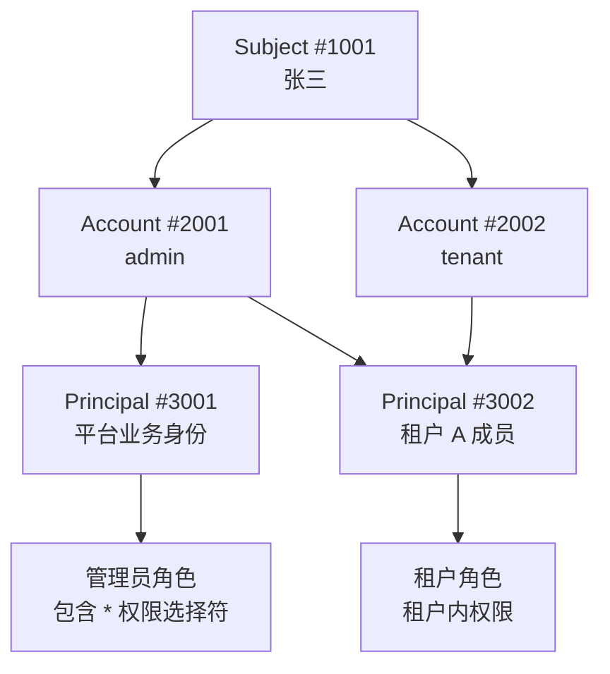
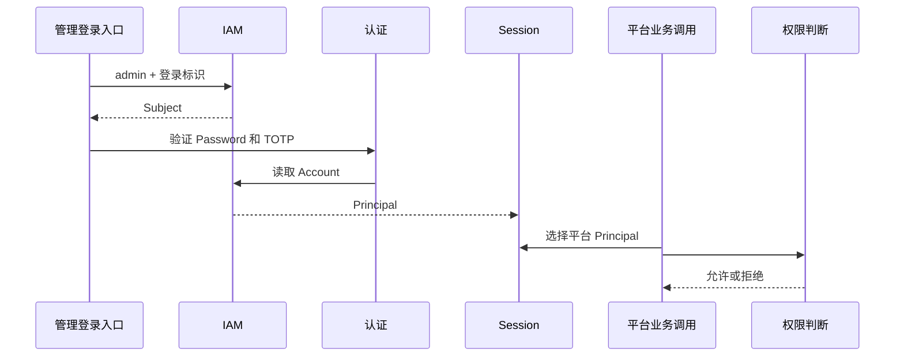
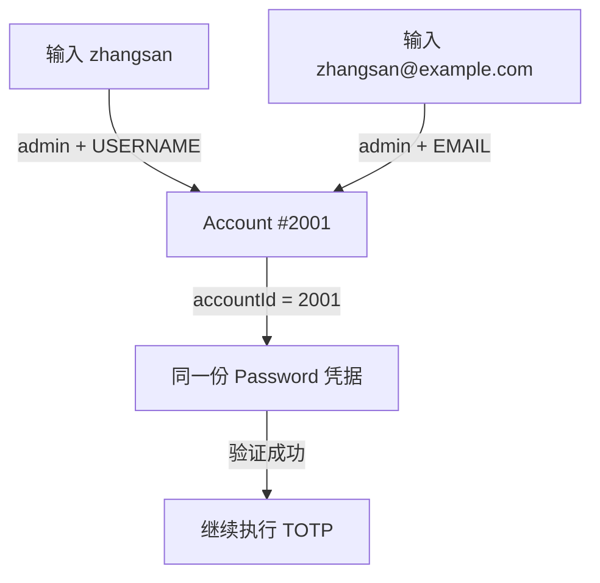
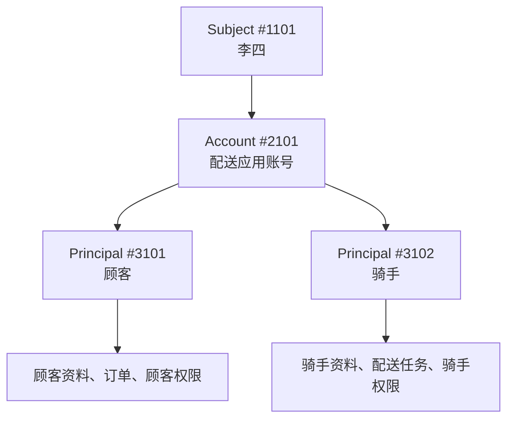
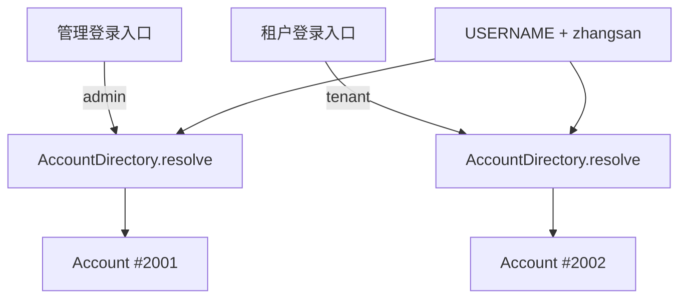
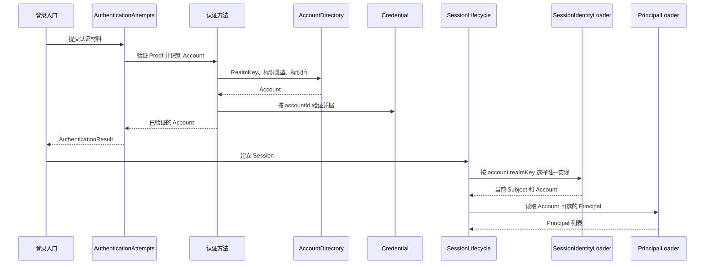

# 身份与访问

Subject 表示实际接入的人、设备、外部程序或系统自身，Account 表示认证账号，Principal 表示这次操作采用的业务身份。一个人可以有多个账号和业务身份：密码关联 Account，顾客订单关联顾客 Principal，跨账号识别同一个人时才使用 Subject；系统自主调用不需要登录 Account。

接入业务时，先为 Account 关联可选 Principal，登录后从 Session 中选择本次使用的 Principal，再检查它对目标的权限。具体步骤见[接入身份与权限](/tutorials/identity-and-permission)；下面用同一个人的管理账号和租户账号说明三者关系。

## Sca4d-J 的三个核心对象

Sca4d-J 使用三个对象分别确定接入者、认证账号和业务身份：

| 对象 | 回答的问题 | 发生变化的例子 |
|---|---|---|
| [Subject](#主体) | 实际接入的是谁？ | 同一个自然人增加企业 SSO 账号时，Subject 不变 |
| [Account](#账号) | 通过哪个账号完成认证？ | 停用管理账号时，其他 Account 不受影响 |
| [Principal](#业务身份) | 当前以什么业务身份工作？ | 租户成员退出时，只停用对应 Principal |

一个 Subject 可以拥有多个 Account。一个 Account 可以进入多个 Principal，多个 Account 也可以进入同一个 Principal。认证确认 Subject 和 Account，Session 保存认证结果和可选 Principal；每次业务调用再确定一个当前 Principal，并使用它进行权限判断、数据关联和审计。

对于「一个自然人、一个 Platform 账号、一个 Platform Principal」的简单场景，IAM 仍提供 [User](/javadoc/modules/iam/sca4dj-iam/com/sca4d/iam/base/user/User.html) 组合这三个对象。User 没有独立持久化标识，`subjectId`、`accountId` 和 `principalId` 仍然各自表达不同含义。

三个对象分开管理，是为了让账号和业务身份能够独立变化：同一个人增加企业 SSO 账号时可以继续使用原员工资料；顾客同时成为骑手时可以分别管理两种身份的状态；同一个人在多个租户任职时，每段成员关系可以有独立权限和数据范围。设备、外部程序和自然人的接入类型由 Subject 区分。审计同时记录三个标识，能够说明谁通过哪个账号、以什么身份完成了操作。

RBAC 按角色授予权限。Principal 确定当前业务身份后，权限策略再结合角色、ACL、资源归属和业务规则判断操作是否允许，详见[权限与调用](/home/permission)。

## 贯穿示例

下面以一个同时提供平台管理和租户业务的应用为例。`admin` 和 `tenant` 是这个示例应用定义的 RealmKey，不是 Sca4d-J 的内置值。

| 数据 | 表示的内容 |
|---|---|
| Subject #1001 | 张三这个自然人 |
| Account #2001 | 张三的管理账号，`realmKey = admin` |
| Account #2002 | 张三的租户账号，`realmKey = tenant` |
| Principal #3001 | 张三的平台业务身份 |
| Principal #3002 | 张三在租户 A 中的成员身份 |



两个 Account 都属于 Subject #1001，所以系统知道两条认证路径对应同一个自然人。管理账号可以进入两个 Principal；租户账号只能进入租户成员 Principal #3002。无论通过哪个 Account 进入 #3002，使用的都是同一份租户成员资料和权限。

管理员角色和 `*` 权限选择符属于 Principal #3001，不属于 Account #2001。管理账号只是让认证后的 Session 可以选择 #3001；真正执行平台管理操作时，权限判断使用当前选择的 Principal #3001。

## 从登录到业务调用

管理账号和租户账号使用不同的认证规则，也会得到不同的可选业务身份：

| 登录入口 | 找到的 Account | 认证要求 | Session 中的 Principal |
|---|---|---|---|
| 管理入口，`realmKey = admin` | Account #2001 | Password + TOTP | #3001、#3002 |
| 租户入口，`realmKey = tenant` | Account #2002 | Password | 只有 #3002 |

以管理账号执行平台操作为例，一次调用按下面的顺序完成：



RealmKey 先确定账号查找、认证和业务身份读取规则，登录标识再找到具体 Account。认证成功后，Session 同时记录 Subject、Account 和可选 Principal。本次调用只能从 Session 中选择一个 Principal，权限规则再结合目标资源和操作作出判断。

如果张三改用租户账号登录，认证得到 Account #2002，Session 中只有 Principal #3002，因此不能选择平台 Principal #3001。两个登录结果的差异来自 Account 所属 Realm 的认证规则和 Account-Principal 关系，不是账号本身拥有不同权限。

允许执行后，业务数据记录实际参与业务的 `principalId`。审计同时保留 Subject、Account、当前 Principal 和权限结果，因此可以说明谁通过哪个账号、以什么业务身份完成了操作。

## 主体

主体表示实际完成认证，或由系统直接建立受控调用的接入者。自然人、设备和应用都可以是主体；系统任务使用固定的系统主体。

Sca4d-J 使用 [Subject](/javadoc/core/sca4dj-core-api/com/sca4d/core/api/identity/Subject.html) 表达主体。它为一个实际存在的接入者分配稳定标识，使账号、Session 和审计可以长期指向同一个对象。

### 为什么需要主体

以概览中的张三为例，Account #2001 是管理账号，Account #2002 是租户账号。两个账号的登录标识、认证要求和可选业务身份都不同，但它们属于同一个自然人。

如果系统只保存 Account，两条认证路径看起来就是两个互不相关的人；更换登录方式或增加企业 SSO 账号时，也无法说明新旧账号属于同一个接入者。如果只保存 Principal，张三的平台身份和租户成员身份又会被当成两个现实中的人。

Subject #1001 只确认这些账号背后是同一个自然人。停用一个 Account、增加一个 Principal 或结束一段租户成员关系，都不需要重新创建 Subject。需要跨账号、跨业务身份识别同一个接入者的审计、隐私请求和风控规则，也可以使用同一个 `subjectId`。

多个账号指向同一个 Subject，只表示 IAM 已经建立了归属关系。创建账号、增加归属关系或合并重复主体前，具体应用必须完成相应核验，不能只因为姓名、手机号或邮箱相同就自动合并。

### 主体保存什么

Subject 将同一接入者的多个 Account 关联起来，用于统一停用、Session 管理和审计。登录标识与凭据由 Account 管理，业务资料与权限关联 Principal。

因此，Subject 只保存两个值：

- 正数且稳定的 `subjectId`，用于指向这个接入者；
- 创建时确定的 [SubjectType](/javadoc/core/sca4dj-core-api/com/sca4d/core/api/identity/SubjectType.html)，用于区分自然人、设备、应用和系统。

IAM 在 `iam_subject` 中另外保存主体状态、创建时间、修改时间和删除标记。这些持久化信息用于管理主体生命周期，不进入 Core 的 Subject 对象。

### 主体类型

SubjectType 固定提供四种类型。这四种类型已经覆盖 Sca4d-J 直接处理的接入者，不由具体应用继续增加顾客、骑手、员工或合作方等业务分类。

| 类型 | 表示的接入者 | 使用位置 |
|---|---|---|
| `HUMAN` | 实际操作系统的自然人 | 密码、Passkey、企业登录等自然人认证 |
| `DEVICE` | 直接接入 Sca4d-J 的设备 | IoT 设备认证、设备 Session 和设备调用 |
| `APPLICATION` | 通过 OpenAPI 接入的外部程序 | OpenAPI Client、程序凭据和外部调用 |
| `SYSTEM` | 一个完整业务系统，包括其代码、组件、数据和部署共同体 | 定时、自动化和系统自主操作 |

顾客、骑手、员工和租户成员都是自然人在具体业务中的身份，它们使用 `HUMAN` Subject 和不同的 Principal。ERP、支付平台和合作方服务通过 OpenAPI 接入时使用 `APPLICATION`；设备直连 IoT 模块时使用 `DEVICE`；系统任务使用固定的 `SYSTEM`。

### 业务数据什么时候关联 Subject

普通业务数据通常关联 Principal。只有数据确实属于跨账号、跨业务身份的同一个接入者时，才关联 `subject_id`。判断时同时检查三个条件：

1. 数据描述自然人、设备或应用本身；
2. 更换账号或切换业务身份后，这份数据仍然是同一份；
3. 业务规则需要跨多个账号或业务身份查询、限制或修改这份数据。

| 数据 | 应该关联的对象 |
|---|---|
| 用于登录的手机号、邮箱或外部账号标识 | Account 的登录标识 |
| Password、Passkey、TOTP 等凭据 | Account |
| 顾客联系方式、骑手资格、员工资料 | 对应的 Principal |
| 订单收件信息、签约信息 | 产生它的业务记录 |
| 设备型号、位置和运行状态 | IoT 设备业务表 |
| 跨顾客和骑手身份共用的自然人证件主档 | Subject |
| 跨多个业务身份执行的隐私查询或风控限制 | Subject |

字段内容不能单独决定归属。手机号用于登录时属于账号标识，用于联系顾客时属于顾客资料，作为收件号码时属于订单快照。

### 创建与状态

IAM 创建主体时分配新的全局标识并确定 SubjectType。`subjectId` 和 SubjectType 创建后不再修改；建立多个账号或业务身份时继续引用原来的主体。

停用 Subject 表示这个接入者整体不能继续认证或参与受控调用。它的 Account、Principal 和历史业务数据仍然保持原有含义。停用主体后还需要终止受影响的已有 Session，不能只修改数据库状态。

## 账号

账号表示主体进入系统时采用的一条认证路径。它连接登录标识、凭据（Credential）、认证规则和认证成功后可以选择的业务身份。

Sca4d-J 使用 [Account](/javadoc/core/sca4dj-core-api/com/sca4d/core/api/identity/Account.html) 表达账号。同一个 Subject 可以在不同 Realm 中拥有多个 Account，每个 Account 分别管理自己的认证数据和业务身份关系。

### 为什么一个主体可以有多个账号

账号分别管理登录标识、凭据、认证要求和可选业务身份，因此可以独立停用。在[贯穿示例](#贯穿示例)中，管理账号和租户账号都属于张三，但只有管理账号能选择平台 Principal。

两个账号进入同一个租户 Principal 时，使用相同的成员资料和权限；Session 与审计保留各自的 `accountId`。Account 决定认证后能选择哪些身份，角色和 `*` 权限选择符仍属于 Principal。

### RealmKey

[RealmKey](/javadoc/core/sca4dj-core-api/com/sca4d/core/api/identity/RealmKey.html) 标识账号所属的认证域，通常由登录入口确定。它选择账号查找、认证和身份读取规则，`accountId` 定位具体账号；RealmKey 本身不执行这些规则，也不授予权限。

Sca4d-J 当前直接使用三个 Realm：

| RealmKey | 对应接入方式 | 认证成功后的结果 |
|---|---|---|
| `platform` | 管理端等自然人登录入口 | 读取 Account 关联的 Platform Principal |
| `openapi` | OpenAPI Client 调用 | 读取 Client 关联的业务身份和 OpenAPI 操作范围 |
| `iot-device` | IoT 设备直接接入 | 确认 Device Subject 并建立设备 Session |

RealmKey 是开放字符串，具体应用可以定义自己的 Realm。新增字符串本身不会产生认证行为；应用还要同时定义登录入口、账号查找、认证规则和 Principal 读取规则。

### 用户名、邮箱和密码怎样关联账号

登录标识负责找到 Account，凭据负责证明调用者可以使用这个 Account。用户名、邮箱和手机号是登录标识；Password、Passkey、TOTP、Shared Secret、HMAC 和 X.509 都可以作为凭据。

假设管理账号 #2001 同时支持用户名密码和邮箱密码登录：

| 数据 | 保存的内容 |
|---|---|
| Account #2001 | `subjectId = 1001`，`realmKey = admin` |
| 用户名标识 | `admin + USERNAME + zhangsan -> Account #2001` |
| 邮箱标识 | `admin + EMAIL + zhangsan@example.com -> Account #2001` |
| Password 凭据 | Account #2001 的密码摘要 |



用户名和邮箱是两条查找记录，但都指向 Account #2001。密码摘要只关联这个 Account，不分别绑定用户名和邮箱。修改邮箱不会改变密码和业务身份；修改密码后，两种登录方式都会使用新密码。

如果同一个输入值按用户名和邮箱分别找到不同 Account，登录入口必须拒绝认证，不能自行选择其中一个。认证流程确定 Account 后，后续认证因素也必须属于同一个 `accountId`。

### 账号保存什么

Account 保存三个值：

| 值 | 作用 |
|---|---|
| `accountId` | 定位这条认证路径上的具体账号 |
| `subjectId` | 说明实际使用这个账号接入的是哪个 Subject |
| `realmKey` | 选择账号查找、认证和 Principal 读取规则 |

IAM 在 `iam_account` 中另外保存账号状态、创建时间、修改时间和删除标记。用户名、邮箱、密码摘要、Passkey 公钥、TOTP secret、角色、权限和个人资料不保存在 Account 中，负责这些数据的模块通过 `accountId` 建立关系。

Account 创建后不修改 `subjectId` 和 `realmKey`，否则已有登录标识、凭据、认证记录和审计数据会改变含义。需要另一条认证路径时创建新的 Account。

### Account 与 Principal 的关系

Account 与 Principal 是多对多关系。`iam_account_principal` 中的关系只表示「这个账号认证成功后可以选择这个业务身份」，不直接授予角色或权限。

认证成功后，Session 保存本次使用的 Subject、Account 和可选 Principal。具体调用再从 Session 中确定一个当前 Principal。新增或删除 Account-Principal 关系时，需要刷新或终止受影响的 Session，避免旧 Session 继续使用已经变化的关系。

### 状态变化

Account、登录标识和凭据分别管理自己的状态：

| 发生的变化 | 直接结果 |
|---|---|
| 停用一个登录标识 | 不能再通过这个值找到 Account，其他登录标识不受影响 |
| 停用 Account | 不能再通过这条认证路径建立 Session，Subject 的其他 Account 不受影响 |
| 修改或删除一种凭据 | 只影响对应认证方法，Account 和其他凭据不变 |
| 删除 Account 与 Principal 的关系 | 后续 Session 不再包含该 Principal，其他关系不受影响 |

已有 Session 保存建立时的结果。停用账号、删除 Principal 关系或修改关键凭据时，还需要按对应规则终止或刷新受影响的 Session。

## 业务身份

业务身份（Principal）表示一次业务操作中的顾客、骑手、员工或租户成员。每种业务身份可以有独立的资料、状态、数据关系和权限。

Sca4d-J 使用 [Principal](/javadoc/core/sca4dj-core-api/com/sca4d/core/api/identity/Principal.html) 表达业务身份。具体应用只定义自己确实需要的 Principal，例如顾客、骑手、员工或租户成员。

### 顾客和骑手是两种业务身份

再看一个同城配送应用。这里使用另一组编号：李四既可以下单，也可以接单。

| 数据 | 表示的内容 |
|---|---|
| Subject #1101 | 李四这个自然人 |
| Account #2101 | 李四在配送应用中的账号，`realmKey = delivery` |
| Principal #3101 | 李四的顾客身份 |
| Principal #3102 | 李四的骑手身份 |



李四以 Principal #3101 下单时，订单和顾客资料使用 #3101；切换到 Principal #3102 接单时，骑手资格和配送任务使用 #3102。两次操作的 Subject 和 Account 相同，但业务身份、业务数据和权限不同。

停用骑手身份只禁止李四继续接单，不影响顾客订单，也不需要停用配送账号或 Subject。顾客和骑手因此不能只用同一个 `subjectId` 或 `accountId` 表示。

### Subject、Account 和 Principal 分别表示什么

Subject 让系统确认李四始终是同一个实际接入者。Account 保存李四通过配送应用完成认证的路径。Principal 则让订单、骑手资格、配送任务和权限明确关联当前业务身份。

登录方式可能变化，但业务身份通常保持不变。例如，员工增加企业 SSO 账号后，新旧 Account 可以进入同一个员工 Principal，员工资料和工作记录不需要复制。反过来，同一个配送 Account 可以进入顾客和骑手两个 Principal，因为两种身份需要独立的资料、状态和业务流程。

### 什么时候创建新的 Principal

当下面的内容需要独立变化时，创建新的 Principal：

- 业务资料；
- 启用、停用和删除条件；
- 角色、ACL 和其他权限关系；
- 资源所有者、成员、创建者等业务关系；
- 一次调用必须明确选择的业务流程。

| 场景 | 建模结果 |
|---|---|
| 同一个自然人既是顾客又是骑手 | 两个 Principal，分别管理两套资料和流程 |
| 同一个人在租户 A 和租户 B 分别任职 | 两个租户成员 Principal，各自管理成员状态和数据范围 |
| 同一个平台员工既是管理员又是审核员 | 一个 Platform Principal 关联两个角色 |
| 顾客从普通会员升级为高级会员 | 修改顾客资料或角色，不创建新 Principal |
| 员工改用 Passkey 或企业登录 | 保留 Principal，增加凭据或关联新的 Account |

页面入口、登录方式、昵称、等级、职位或权限多少不同，通常不构成新的 Principal。

### 权限属于 Principal

角色、ACL 和业务规则都把 Principal 作为授权对象。完整判断还会结合目标资源和操作。

RBAC 适合区分同一种 Principal 可以做什么。例如，同一个员工 Principal 可以同时拥有管理员和审核员角色。顾客和骑手的差异不只是权限多少，它们会进入不同业务流程、读取不同资料并关联不同数据。

如果只给同一个对象增加「顾客角色」和「骑手角色」，Controller、Service、Repository 和页面都要先判断角色，再决定读取哪套资料和执行哪段流程。继续增加商户、调度员或租户成员后，每一处业务代码都要重新解释角色组合。

Principal 确定当前是顾客还是骑手，RBAC 再根据角色授予权限。权限策略还可以结合 ACL、资源关系和业务规则。

### Principal 类型与数据

Core 中的 Principal 只要求返回正数 `principalId`。这个标识在 Session、权限判断、业务数据和审计之间保持一致。具体类型说明由哪一套业务模型解释它，例如 Platform Principal、顾客 Principal、骑手 Principal 或租户成员 Principal。

同一种类型可以有很多实例。例如，租户 A 成员和租户 B 成员使用相同的租户成员模型，但拥有不同的 `principalId`、成员状态、角色和数据范围。

IAM 在 `iam_principal` 中保存 `principal_type`、状态、创建时间、修改时间、角色集合修订值和删除标记。具体业务资料由对应模块保存，并通过 `principal_id` 关联：

```text
platform_user_profile(principal_id, display_name, ...)
customer_profile(principal_id, nickname, ...)
rider_profile(principal_id, qualification_status, ...)
tenant_member(principal_id, tenant_id, member_status, ...)
```

Principal 不保存 `subjectId` 或 `accountId`。登录 Account 与 Principal 的可选关系由 `iam_account_principal` 保存；角色和 ACL 也通过各自的关系表关联 `principal_id`。系统自主身份由 `iam_system_identity` 直接关联唯一 SYSTEM Subject，不建立登录 Account。

Sca4d-J 内置 Platform Principal，供管理端和 Platform 接口使用。具体应用可以增加自己的 Principal 类型，并为其提供稳定的 Session 编码和读取方式。Core 还固定提供 [SystemPrincipal](/javadoc/core/sca4dj-core-api/com/sca4d/core/api/identity/SystemPrincipal.html)，供系统任务参与权限判断和审计；它不自动拥有管理员权限。

### 系统、领域身份和实例

SYSTEM 表示整个业务系统。一个进程是这个系统的一次运行实例，IoT、用户管理等职责可以使用系统的不同 Principal；它们共同属于 `Subject.SYSTEM`。系统身份的稳定编码由 Java 常量声明，数字 ID 由 `sca4dj.iam.system-principal-ids` 配置。MAIN 默认使用 1，其他身份显式指定正数 ID，通常选择 2、3、4 等小编号。

| 数据 | 含义 | 多实例关系 |
|---|---|---|
| `Subject.SYSTEM` | 业务系统唯一的 SYSTEM Subject，持久化 Subject ID 为 1 | 同一业务系统共享 |
| MAIN、IOT 等 `SystemPrincipal` | 系统自主执行时采用的稳定领域身份 | 编码和 Principal ID 都共享 |
| `sca4dj.instance.id` | 本次进程的执行位置 | 每个运行实例唯一 |
| `InstanceCapability` | 当前实例启用了哪些入口或工作线程 | 各实例可以选择不同集合 |

IAM 在启动事务中登记 Subject、Principal 和固定编码绑定。ID 已被占用时拒绝启动，要求配置其他 ID；同一编码与历史 ID 不一致时拒绝启动，要求人工迁移。初始化提交后，SystemPrincipals 一次性发布完整的不可变身份表，消息消费者和任务随后启动。初始化前读取身份会失败。

Spring 自主入口使用 `@SystemExecution("IOT")` 声明系统身份。通过 Spring 代理调用且没有已有 Call 时，脚手架建立 SYSTEM Call；已有用户、设备或外部应用 Call 时保留原身份。普通 Java 入口可以显式调用 `Call.system(callId, startedAt, SystemPrincipals.require(code))`。声明系统身份不授予业务权限。

能力选择决定入口和工作线程是否启用，不选择数据库，也不改变调用者 Principal。审计分别保存 Subject、Principal 和实际 `instanceId`；历史审计的实例字段允许为空。系统 Principal 不授予登录 Account，也不通过普通身份 API 创建、停用或删除。

### 从 Session 选择当前业务身份

认证成功后，Session 保存 Account 当前可以选择的 Principal。配送账号 #2101 建立的 Session 同时包含顾客 #3101 和骑手 #3102，一次调用必须从中确定一个当前 Principal。

如果当前请求是下单，应用选择顾客 Principal #3101；如果当前请求是接单，应用选择骑手 Principal #3102。客户端提交的 Principal 必须属于当前 Session，不能通过提交任意 `principalId` 获得新的业务身份。

同一次调用只能使用一个当前 Principal。选定后，权限判断、数据范围、业务 Service、Repository 和审计都使用它，不能在处理中途切换。下一次调用可以根据入口和请求内容重新选择。

Session 保存建立时的 Principal 快照。新增或删除 Account-Principal 关系、停用 Principal 或修改关键权限关系时，需要刷新或终止受影响的 Session。

### 业务数据与状态

业务数据需要记录执行者、所有者或成员时，通常保存对应的 `principalId`：

| 数据 | 关联方式 |
|---|---|
| 订单的顾客 | 顾客 Principal |
| 配送任务的骑手 | 骑手 Principal |
| 租户成员资料 | 该租户成员 Principal |
| 平台操作的执行者 | 当前 Platform Principal |
| Password、Passkey 和 TOTP | Account，不关联 Principal |
| 跨多个业务身份共用的接入者主档 | Subject，不关联 Principal |

停用 Principal 只禁止这个业务身份继续进入新的 Session 或参与新的业务调用，不停用 Subject、Account 或同一接入者的其他 Principal。业务身份的创建、停用和删除条件由拥有对应业务资料的模块决定。

## 认证域

认证域把一套登录入口、账号查找规则、认证要求和 Session 身份装载规则关联在一起。登录入口先确定认证域，再在这个范围内查找 Account；Account 创建后会一直保存所属认证域。

Sca4d-J 使用 [RealmKey](/javadoc/core/sca4dj-core-api/com/sca4d/core/api/identity/RealmKey.html) 表示认证域的稳定键。RealmKey 是非空白字符串，具体应用按照自己的登录入口和认证流程定义需要的值。

### 为什么账号查找需要认证域

同一个登录标识可以出现在不同的登录入口，而且每个入口可以使用不同的 Account、凭据和认证要求。只按用户名、邮箱或手机号查询，无法确定调用者要进入哪一套认证流程。

继续使用[贯穿示例](#贯穿示例)中的张三。管理入口和租户入口都允许输入用户名 `zhangsan`，分别查找不同的 Account：

| 登录入口 | RealmKey | 查找条件 | 结果 |
|---|---|---|---|
| 管理入口 | `admin` | `admin + USERNAME + zhangsan` | 管理 Account #2001 |
| 租户入口 | `tenant` | `tenant + USERNAME + zhangsan` | 租户 Account #2002 |



两个入口收到相同文本，但各自使用已经确定的 RealmKey 调用 [AccountDirectory](/javadoc/core/sca4dj-core-api/com/sca4d/core/api/identity/AccountDirectory.html)。账号目录再结合登录标识类型和规范化后的值查找 Account，不会跨认证域尝试其他结果。

登录页面通常已经代表一个确定的认证域，不需要让用户额外选择。在这个示例中，管理登录接口固定使用 `admin`，租户登录接口固定使用 `tenant`；页面上的用户名只是该认证域内的账号标识。

### 认证域内的数据约束

IAM 把 RealmKey 同时保存在 Account 和 AccountIdentifier 中。通过 [IdentityService](/javadoc/modules/iam/sca4dj-iam/com/sca4d/iam/identity/IdentityService.html) 为 Account 增加登录标识时，标识会直接使用 Account 已有的 RealmKey，调用方不能把它登记到另一个认证域。

IAM 使用下面的数据库约束保持查询结果明确：

- 同一个 Subject 在同一个认证域内最多保留一个未删除的 Account；
- 同一个认证域内，登录标识类型和规范化值的组合只能指向一个未删除的 Account；
- 相同的规范化值可以在不同认证域中分别使用，也可以作为不同类型的登录标识使用。

因此，`admin + USERNAME + zhangsan` 和 `tenant + USERNAME + zhangsan` 可以同时存在，`admin + USERNAME + zhangsan` 不能再指向第二个未删除 Account。Account 的 RealmKey 创建后不修改；需要进入另一套认证流程时，应在对应认证域创建新的 Account。

### 从认证域到 Session

RealmKey 本身不执行认证。登录入口、认证方法和身份 Loader 使用同一个键，分别完成账号定位、凭据验证和 Session 身份装载。



以 Password 为例，具体应用为 PasswordAuthenticationMethod 配置账号所属的 RealmKey。认证方法用这个键和用户输入查找 Account，再按 `accountId` 读取 Password Credential。后续认证因素必须继续使用同一个 Account，不能切换到另一认证域中的账号。

认证完成后，SessionIdentityLoadService 要求恰好一个 SessionIdentityLoader 认领这个 Account。内置 PlatformSessionIdentityLoader 只认领 `platform` Account；具体应用增加其他认证域时，需要提供相应 Loader，重新读取当前可用的 Subject 和 Account。PrincipalLoader 随后读取这个 Account 可以选择的 Principal。

没有 SessionIdentityLoader 认领 Account，或多个 Loader 同时认领时，Session 建立失败。Account 或 Subject 已经停用、Loader 返回了另一个 Account，或者身份装载期间发生失败时，也不能留下可用 Session。

### 什么时候增加认证域

只有一组接入规则需要独立查找和管理 Account 时，才增加认证域。判断重点是账号入口和认证过程是否需要分开，而不是页面数量。

| 变化 | 是否增加认证域 | 原因 |
|---|---|---|
| 同一账号同时支持用户名和邮箱登录 | 否 | 在原 Account 下增加不同类型的 AccountIdentifier |
| 同一账号增加 Password、Passkey 或 TOTP | 否 | 在原 Account 下增加 Credential 或调整认证策略 |
| 管理入口与租户入口分别管理账号和认证要求 | 是 | 两个入口需要独立查找 Account，并可以分别停用和建立 Session |
| 新增一套设备接入认证 | 是 | 设备 Account 需要独立入口、凭据规则和 Session 身份装载 |

一个可用的认证域至少需要确定稳定 RealmKey、账号创建方式、登录标识查找入口、认证方法与认证要求，以及负责该 Account 的 SessionIdentityLoader。需要在 Session 中加入业务身份时，还要提供对应的 PrincipalLoader。只创建一个新的 RealmKey 不会自动产生这些行为。

Account 的字段见[账号](#账号)，认证与身份装载的顺序见[认证与 Session](/home/authentication-session)。实际接入见[身份与权限教程](/tutorials/identity-and-permission)。

## 常见问题

### 为什么 SubjectType 固定提供四种类型？

SubjectType 只区分实际接入者属于自然人、设备、外部程序还是当前系统。`HUMAN`、`DEVICE`、`APPLICATION` 和 `SYSTEM` 已经覆盖 Sca4d-J 直接处理的接入方式；顾客、骑手、员工、租户成员和合作方等差异由 Principal 或具体业务关系表达。

从抽象分类看，设备也可以视为运行程序。如果设备先连接独立设备服务，再由设备服务调用 Sca4d-J，那么 Sca4d-J 只需要把设备服务作为 `APPLICATION`，具体设备由设备服务管理。

Sca4d-J 自身提供 IoT 模块，采用分布式单体，单实例与集群使用同一套业务实现。设备可以直接认证、建立设备 Session 并参与调用。Core 因此固定提供 `DEVICE`，让 IoT 模块直接识别设备接入者，不要求每个应用再从 `APPLICATION` 中判断哪些对象实际是设备。

`APPLICATION` 留给 OpenAPI 模块。ERP、支付平台、合作方服务和自动化程序通过 OpenAPI 接入时，都可以使用这一类型，不需要继续增加 `PARTNER_SYSTEM`、`ERP` 或其他 SubjectType。

### 为什么 SYSTEM 不使用 APPLICATION？

`APPLICATION` 表示使用 OpenAPI Client、Account 和程序凭据完成认证的外部程序。系统任务和内部调用由当前应用直接建立，不需要经过 OpenAPI 认证。

如果内部任务也使用 `APPLICATION`，没有启用 OpenAPI 的应用也要创建 Client、Account 和凭据，只为表示应用自身。Core 因此提供固定的 `Subject.SYSTEM` 和 System Principal。它们不表示管理员，权限规则仍然要明确允许或拒绝目标操作。

### 为什么 SubjectType 没有法人？

法人、公司、租户和商户不会亲自提交凭据或发送请求。实际执行操作的是自然人或程序：员工代表公司操作时使用 `HUMAN`，公司的信息系统通过 OpenAPI 调用时使用 `APPLICATION`。公司、租户和任职关系由具体业务模型记录。

页面写「公司登录」时，仍要确认是公司员工登录，还是公司程序调用。增加法人 SubjectType 会隐藏真正完成认证的对象，审计也无法说明操作由哪个人或程序发起。

### 为什么 RealmKey 不使用枚举或 Realm 主表？

登录入口、账号查找、认证方法和身份 Loader 使用同一个 RealmKey 识别认证域。具体应用可以定义新的认证域，因此 Core 使用开放字符串。

单独建立 Realm 主表也只能保存键和说明，不能自动产生认证行为。一个可用 Realm 必须同时有入口、标识查找、认证规则和 Principal 读取实现。Sca4d-J 直接使用稳定字符串作为这些实现共同声明的键；只有 RealmKey、没有对应实现时，认证仍然无法完成。

### 停用 Subject、Account、Principal 分别影响什么？

| 停用对象 | 直接影响 | 不直接影响 |
|---|---|---|
| Subject | 这个接入者的全部 Account 不能继续建立新 Session | 不删除 Account、Principal 和历史业务数据 |
| Account | 不能再通过这条认证路径建立新 Session | Subject 的其他 Account 和该账号关联的 Principal 仍然存在 |
| Principal | 这个业务身份不能进入新 Session 或参与新的业务调用 | Subject、Account 和同一接入者的其他 Principal 不受影响 |

Session 保存建立时的身份和权限快照。停用任一对象后，还需要终止或刷新受影响的已有 Session，不能只更新 IAM 表中的状态。
