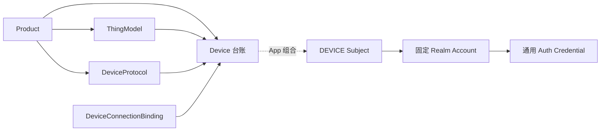
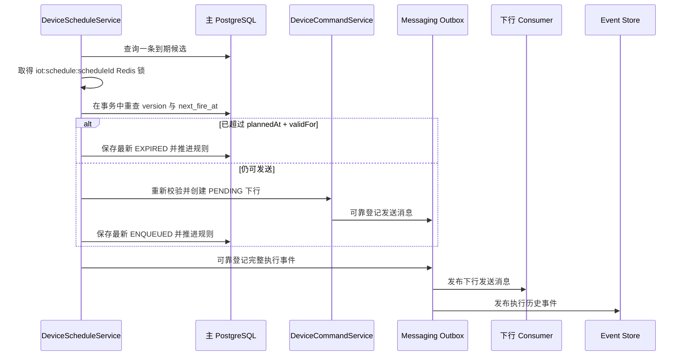
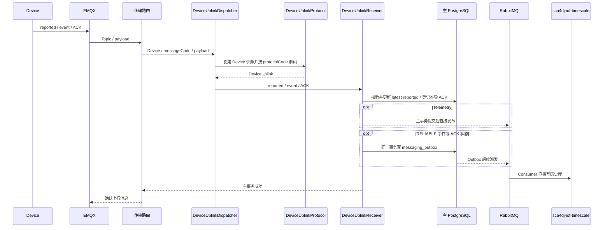

# IoT 对象模型

Sca4d-J 用 Product 定义产品，用 ThingModel 定义属性、事件和命令，用 Device 登记具体设备。设备上报值保存在 reported 中，平台期望值保存在 desired 中，一次性操作通过 command 下发。

设备接入从[产品定义与设备登记](#从产品定义到设备实例)开始；判断设备是否在线，查看 [Connection](#device、account、session-与-connection)；确认指令执行结果，查看 [ACK](#ack)。实际接入步骤见[接入第一台设备](/tutorials/iot-device-access)。

## 从产品定义到设备实例

Product 定义一类设备允许使用的认证接入方式和设备协议 code，不保存 MQTT、TCP 等连接协议白名单。Product 可以来自数据库，也可以由具体应用通过代码目录提供。数据库 Product 使用 `LocalizedFields` 保存展示名称；默认 Locale 必须提供 `displayName`，其他 Locale 可以省略并逐字段回退到默认 Locale。

一个 Product 可以连续发布多个不可修改的 ThingModel 技术版本。格式 2 的技术 JSON 只定义属性、事件、命令以及值类型、确认、重试和事件投递策略，不包含模型、字段或枚举标签。ThingModelPresentation 使用稳定 JSON Pointer 路径关联展示文本；修改翻译不改变技术版本或内容摘要。

Device 显式绑定一个已发布物模型版本、一个 DeviceProtocol code 和 `bindingGeneration`。直接连接的 Device 还保存 DeviceConnectionBinding 和认证接入方式，例如 MQTT Client ID 绑定；网关中继等间接 Device 的这两项都为空。Device 不保存 Account、Secret、HMAC Key 或证书。



DeviceService 校验 Product、物模型版本、设备协议和连接绑定。Sca4d Server 在同一应用事务中创建 DEVICE Subject、可选固定 Realm Account、Device 台账和通用 Credential。重新绑定只允许在 App 已停用 Device 且旧 `bindingGeneration` 没有活动下行消息时执行；成功后 `bindingGeneration` 递增，并清除上一代绑定的当前 reported 与 desired。

### 查询 Device

DeviceService 使用 [DeviceQuery](/javadoc/modules/iot/sca4dj-iot/com/sca4d/iot/device/DeviceQuery.html) 查询自己负责的完整 Device 台账。有明确候选标识时使用 `forIds(...)`，缺失对象不会进入结果；没有候选标识时必须使用 `list(...)` 提供分页和安全排序。Product、文本、协议和是否直接连接可以继续作为领域条件组合，调用方不能传入表名、数据库列或任意 SQL 条件。

```java
Page<Device> knownDevices = devices.find(
        DeviceQuery.forIds(deviceIds)
                .protocol("mqtt-v1")
                .build());

Page<Device> firstPage = devices.find(
        DeviceQuery.list(new ListRequest(
                        new PageRequest(1, 50),
                        List.of(Sort.CREATED_AT.desc(), Sort.SERIAL.asc())))
                .product(productBinding)
                .directConnection(true)
                .build());
```

单个 Device 读取复用同一有界查询。业务资料和状态仍由具体应用自己的 Repository 查询；应用可以先取得符合业务条件的 Device ID，再交给 DeviceQuery 装载公共台账，不能直接读取 IoT Mapper 或公共表。

## Device、Account、Session 与 Connection

四个对象分别解决不同问题：

- **Device** 是产品、物模型和设备协议组成的设备台账；只有直接连接时才包含 DeviceConnectionBinding 和 DeviceAccessMethod。
- **Account** 是 Device Subject 在 `iot-device` Realm 中使用的认证账号。`anonymous` 可以没有 Account；`session` 或 `account:<method>` 必须有 Account。
- **Session** 保存 HMAC 等登录认证的结果。Shared Secret 和 X.509 可以直接验证连接，无需建立 Session。
- **Connection** 是 Broker 当前观测到的一代协议连接，包含不透明连接代次、Device、协议、接入方式和可选 Session ID。

Shared Secret、HMAC 与 X.509 都实现通用 AuthenticationMethod。Sca4d Server 的 Sca4dEmqxDeviceConnectionRequestFactory 把 EMQX 字段转换为 DeviceConnectionRequest；Sca4dDeviceConnectionAdmission 查找 Device，并把 Account 认证交给 AuthenticationMethods，把 `session` 交给 SessionLifecycle。

DeviceCredentialService 管理 Credential，DeviceSessionService 使用 HMAC AuthenticationSubmission 建立 Session。IotDeviceSessionIdentityLoader 读取设备身份，IotDeviceSessionInvalidationListener 登记 Session 失效后的可靠断连消息。设备数据与认证数据分别由 IoT 和 Auth 模块管理。

当前 Connection 保存在 Redis，并带 TTL。EMQX 适配器订阅 `$SYS` 连接和断线消息作为实时触发，每次只使用事件中的 Client ID 查询 Management API 当前连接，再登记或删除准确的连接代次；启动和周期完整快照负责修复服务停机或订阅中断期间的遗漏。Session 或 Credential 失效时，App 在主事务中写通用 Messaging Outbox 的断连消息；Consumer 按连接代次调用协议适配器，重复消息不能断开新连接。

## 传输路由与设备协议

上行消息按以下分工解析：

- 传输路由从 MQTT Topic、TCP 端口、网关报文或其他传输输入中定位 `deviceId`，然后创建 DeviceProtocolMessage；
- 传输路由读取一次完整 Device，并把该快照放入 DeviceProtocolMessage；StandardDeviceUplinkDispatcher 直接使用同一快照的 `protocolCode` 选择 DeviceUplinkProtocol，不再按同一上行重复查询 Device；
- DeviceUplinkReceiver 接收协议产出的 reported、事件或业务 ACK。具体应用可以替换默认 Receiver，在同一事务中更新 IoT 当前事实和应用业务表；
- ThingModel 只定义属性、事件、命令和业务策略，不负责 Topic、报文格式或连接认证。

因此 MQTT 直连设备可以直接使用 MqttDeviceProtocol；经 MQTT 网关进入的中继设备报文仍可以使用独立 DeviceUplinkProtocol。中继设备协议不属于 MQTT 协议，MQTT 路由也不决定中继 Device 的 `protocolCode`。

## reported、desired 与 command

设备状态有三个方向：

- **reported**：设备实际报告的当前值。ReportedStateStore 按 Device、`bindingGeneration` 和字段组保存 latest 投影，并按协议顺序拒绝旧报文、识别重复报文和同序不同内容冲突。默认实现保存到 PostgreSQL；应用也可以选择 Redis 实现。
- **desired**：平台持续期望的属性值。一次修改原子处理 set 与 clear；服务使用一次批量查询读取请求涉及的全部当前属性，只有实际变化的可写属性才生成可靠下行。
- **command**：要求设备执行的一次性动作。输入必须与当前物模型命令定义一致，然后创建独立可靠下行。

代码物模型通过同一个 `ThingCommand` 和 `DataKey<T>` 同时完成模型登记与 Java 调用。调用方使用 `DataValues` 提供完整输入，字段遗漏、额外字段和 Java 类型错误在写入下行前失败；范围、字符串长度和完整匹配 `pattern` 仍以 Device 当前绑定的物模型版本为准。只有 command code 来自数据库、HTTP 输入或设备定时规则时才使用动态字符串入口。

单条 reported 覆盖属性、单次 desired 修改属性和单条上行携带事件都有独立数量上限，默认都是 100，可配置范围为 1 到 1000。服务在读取物模型和状态前拒绝超限输入，避免一个报文放大成无界数据库、Redis 或消息写入。reported 只用轻量绑定代次查询确认传输路由读取的 Device 快照仍然有效；desired 收敛由一条批量 SQL 返回全部匹配属性和下行消息，不按属性逐条查询。

`iot_downlink_message` 统一保存 desired 与 command 的可靠状态，但不合并两者的业务含义。消息保存创建时的 `bindingGeneration`、确认策略、ACK 等待时间和重试策略快照。发送 Consumer 取得消息级 Redis 分布式锁，在短事务中把 `PENDING` 推进为 `SENDING`，事务提交后通过当前协议发送，再用新事务保存 PUBACK 后的状态。重复派发可以在同一锁内继续处理进程中断留下的 `SENDING`。业务 ACK 和超时也使用同一消息锁推进状态。

## ACK

PUBACK 只说明 Broker 接受 MQTT publish，不等于设备执行业务动作。需要业务确认的下行在传输成功后进入 `WAITING_ACK`：

1. 设备显式上报 ACK，或 reported 与 desired 相等时在 reported 主事务内登记可靠 ACK 请求。
2. Outbox 派发后，ACK Consumer 按 messageId 锁定下行并校验 Device 归属。
3. 同一 ACK 事实重复到达时不重复执行策略。
4. 确认策略决定继续等待、成功或交给重试策略。
5. 下行行内保存最新 ACK，完整 ACK 阶段可靠发布为 IoT 事件。

当前业务判断读取 `iot_downlink_message` 中的最新 ACK，历史查询从事件存储还原 ACK 事件。传输失败、ACK 超时、设备拒绝和重试停止都保存稳定失败 code，具体应用在 HTTP 或页面边界按请求 Locale 生成消息。

## 设备定时

设备定时用于在未来时间向 Device 提交物模型 command。规则可以是一次绝对时间，也可以是带 IANA 时区的六字段 Cron；`validFor` 限制系统延迟恢复后是否仍允许生成下行。



PostgreSQL 的 `iot_device_schedule` 保存规则、下一次触发时间、乐观版本、最新执行结果和可空稳定失败 code。服务按 `sca4dj.iot.device-schedule-batch-size` 配置的批次扫描索引，每条候选先取得规则级 Redis 分布式锁，再在事务中重查并用 version 条件推进。完整执行历史写入通用事件流，安装 TimescaleDB 时保存到 `iot_event`。

预约半年后生成报表、结算订单或执行其他业务流程不属于设备定时。这类业务计划使用普通 Job/Quartz；IoT 定时只负责到期生成可靠设备下行。

## 上行与历史写入



Telemetry 是 reported 中标记为历史样本的属性。它在主事务提交后调用 `publishAfterCommit(...)`，不写 Outbox。消息代理或 TimescaleDB 失败不会回滚 latest reported，但提交后发布失败可能丢失历史样本。

物模型事件按 delivery 声明处理。`RELIABLE` 事件要求来源事件 ID 和来源发生时间，并在主事务写通用 `messaging_outbox`；普通事件提交后直接发布。reported 推导 ACK 先写 Outbox，再由独立 Consumer 执行消息级状态转换，因此来源事务回滚时不会留下已经确认的下行。ACK 阶段、设备定时执行和断连属于必须恢复的状态变化，始终使用通用 Outbox。

## 数据存储

| 位置 | 保存内容 | 不保存内容 |
|---|---|---|
| 主 PostgreSQL | Product、ThingModel、Device、可选 latest reported、current desired、可靠下行、最新 ACK、设备定时规则与最新结果、通用 Messaging Outbox | 遥测样本、完整事件历史、IoT 私有 Credential、连接流水 |
| Auth 表 | Shared Secret 摘要、加密 HMAC Key、X.509 公钥证书及其他 Credential | Device 台账、设备状态、私钥 |
| Redis | Session、认证 attempt、当前 Connection、reported 平台序号、可选 latest reported | 权威设备台账、可靠下行、长期历史 |
| TimescaleDB | `iot_telemetry_sample`、`iot_event` | Product、Device、desired、下行状态、Credential、Outbox |

`sca4dj-iot-timescale` 使用独立的 DataSource、Flyway、MyBatis 和事务管理器。`iot_telemetry_sample` 保存遥测样本，`iot_event` 保存事件；ACK 与设备定时执行历史也使用 `iot_event`，通过事件编码和结构化数据区分。

## 保留与增长控制

- Telemetry 和事件按各自保留期使用 TimescaleDB `drop_chunks` 清理完整 chunk。
- `iot_downlink_message` 只保留活动状态和保留期内终态，分批清理全部终态，包括 `SUPERSEDED`。
- `messaging_outbox` 由 Messaging 模块清理已发送记录。
- Redis attempt、Session、连接和去重状态必须有有效期或可重建规则。
- Product、ThingModel、Device、desired 与设备定时规则由业务操作管理，不按高频历史策略自动删除。

具体应用可以选择 PostgreSQL 或 Redis 保存 latest reported，消息代理与 TimescaleDB 可以独立扩容。存储和保留期配置见[运行配置](/reference/runtime/sca4d-server#可选-timescaledb)。

设备接入的实际操作见 [接入 IoT 设备](/tutorials/iot-device-access)，状态、命令和确认见[处理设备状态与命令](/tutorials/iot-state-and-commands)。
