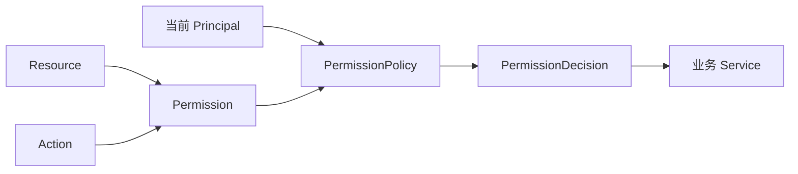
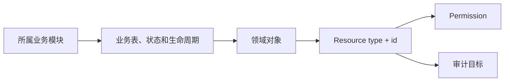
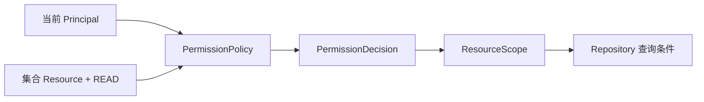
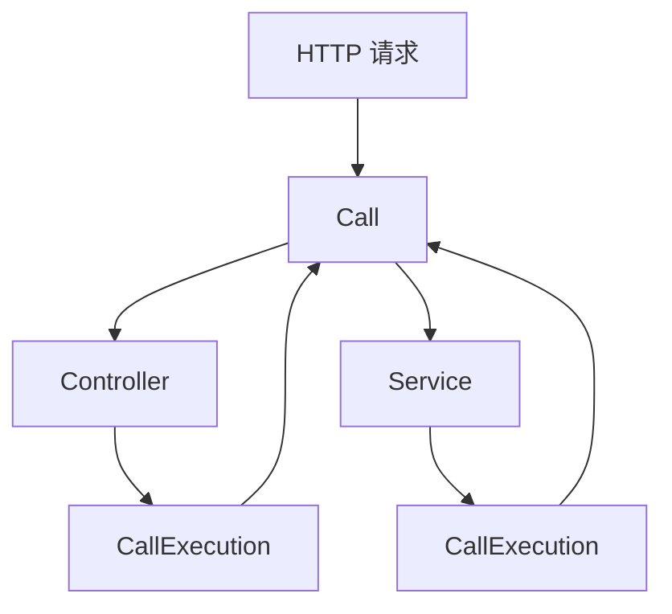
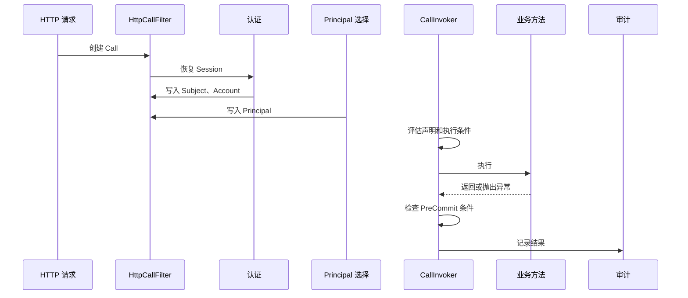

# 权限与调用

权限检查用 Principal 确定谁在操作，用 Resource 确定操作目标，用 Action 确定要做什么。接入接口时，先选择当前 Principal，再用 `@RequirePermission` 声明要检查的权限；只有 PermissionPolicy 允许后，业务方法才执行。

Permission 将 Resource 与 Action 组成待检查的权限，PermissionPolicy 读取当前 Call 中的身份并返回 PermissionDecision。

```text
Permission = Resource + Action
授权判断 = 当前 Principal + Permission
```

平台角色读取接口检查 `operation + platform:roles:read + invoke`；订单读取接口检查 `order + orderId + read`。Operation 管固定入口，对象权限管具体数据，两者可以同时检查，接入步骤见[身份与权限教程](/tutorials/identity-and-permission)。

## 两类权限

| 对象 | 授权依据 | 典型结果 |
|---|---|---|
| 固定入口 | Principal 已获得的 Operation | 允许或拒绝进入接口 |
| 业务对象 | 对象状态、归属关系和当前 Principal | 允许、拒绝或返回数据范围 |

角色适合保存稳定职责。对象所属模块负责解释对象状态、组织关系和数据范围。两类权限可以同时作用于一次调用。



## 固定入口

角色获得 `platform:roles:read` 后，Session 保存对应的 Operation。请求选择 Platform Principal 后，权限判断构造：

```java
new Permission(new Operation("platform:roles:read"), Action.INVOKE)
```

PermissionPolicy 在 Session 静态资源中找到目标 Operation 时返回允许；找不到时返回 `PERMISSION_DENIED`，业务方法不执行。角色关系变化通过 Session 失效或刷新生效。

## 业务对象

文件下载请求包含 `fileId` 时，文件模块建立 `file + fileId` Resource。策略读取 StoredFile 的状态、用途和关联资料，再判断当前 Principal 是否可以执行 `read`。

业务模块接入对象权限需要定义稳定的 Resource type 和 id，提供 ResourceResolver 和 PermissionPolicy，并让 Repository 消费允许结果中的 ResourceScope。ResourceScope 保存组织、区域或对象条件；Repository 将这些条件加入查询或写入条件。

```text
解析 Resource
→ PermissionPolicy 读取授权关系和对象状态
→ 返回 allow(ResourceScope) 或 deny
→ Repository 消费 ResourceScope
→ Service 返回业务结果
```

同一次调用中的同一项 Permission 只判断一次。目标 Resource 没有唯一策略、策略装配重复或策略返回非法范围时，调用在业务方法之前失败。

## 资源

资源（Resource）是权限判断和审计所指向的对象。一次调用选定当前 [Principal](/home/identity) 后，还要明确这个业务身份准备操作什么，以及要执行什么动作。

Sca4d-J 使用 [Resource](/javadoc/core/sca4dj-core-api/com/sca4d/core/api/resource/Resource.html) 表示资源。每个 Resource 都由稳定的资源类型和该类型内唯一的资源标识共同确定：

```text
Resource = type + id
Permission = Resource + Action
```

例如，Principal #3001 读取文件 #9001 时，三个对象分别表达执行者、目标和动作：

| 对象 | 当前值 | 回答的问题 |
|---|---|---|
| Principal | #3001 | 谁在执行这次业务调用？ |
| Resource | `file + 9001` | 操作的目标是什么？ |
| Action | `read` | 准备对目标做什么？ |

[Permission](/javadoc/core/sca4dj-core-api/com/sca4d/core/api/permission/Permission.html) 只把 Resource 和 Action 组成待判断权限。当前 Principal、Session 身份和已经装载的静态资源保存在 Call 中，PermissionPolicy 结合它们作出允许或拒绝结果。

### 资源由类型和标识共同确定

资源标识只需要在同一个资源类型内唯一。文件 #42、账号 #42 和角色 #42 可以同时存在，因为它们的资源类型不同。

| 业务对象 | Resource type | Resource id |
|---|---|---|
| Account #2001 | `account` | `2001` |
| StoredFile #9001 | `file` | `9001` |
| PlatformUserProfile #3001 | `platform:user:profile` | `3001` |
| 角色管理读取接口 | `operation` | `platform:roles:read` |

Resource type 是所属模块维护的稳定业务名称。类名、数据库表名和 HTTP 路由可以随实现调整，不能据此改变已经保存的权限和审计含义。例如，文件无论通过下载路由、头像路由还是内部任务读取，仍然是 `file + fileId`。

Resource id 必须在同一 type 内稳定且无歧义。数值主键通常使用十进制字符串；已有稳定业务编码时也可以直接使用。角色同时存在于多个 DomainScope 中，因此 Role 使用 `DomainScope:roleId` 作为资源标识，避免不同范围内的同号角色变成同一个 Resource。

Resource 的身份只取决于 `type()` 和 `id()`，不取决于具体 Java 类或对象实例。Session 和 Call 判断静态授权时也只比较这两个值，因此完整领域对象和只保存同一组 `type + id` 的引用可以表示同一个资源。

### 资源数据仍由业务模块管理

业务对象通过 Resource 向权限判断和审计暴露稳定身份，原有业务模型继续负责对象的数据和生命周期。文件、账号、角色、设备和订单可以使用不同的表、Repository 和领域类型；Core 只约定怎样通过 `type + id` 指向目标。



文件模块负责 StoredFile 的用途、大小、状态和存储位置；IAM 负责 Account 和 Role；具体应用负责 PlatformUserProfile。它们可以使用不同的表、Repository 和生命周期，只要在需要权限判断或审计时提供稳定的 Resource 身份。

动态判断业务资源时，所属模块根据 `type + id` 读取对象当前是否存在、状态是否允许目标 Action，以及当前 Principal 与对象之间的业务关系。进入 Session 的静态 Resource 是建立或刷新 Session 时的快照；对应授权发生变化时，负责修改授权的模块需要使相关 Session 失效或刷新。

业务数据是否实现 Resource，取决于它是否会成为一个需要明确命名的操作目标。一个订单可以同时关联顾客 Principal、门店和创建人，但只有权限或审计需要表达「正在读取订单 #8842」时，订单本身才需要作为 `order + 8842` Resource 参与调用。

权限声明和审计声明分别确定各自的目标 Resource。两者使用相同的 `type + id` 时，表示权限判断和审计记录指向同一个业务对象；一个业务过程涉及文件及其绑定的用户资料时，也可以分别指向两个 Resource。

### 领域对象与 Resource.Ref

领域对象已经包含稳定标识，而且对象本身就是操作目标时，可以直接实现 Resource。当前 Account、StoredFile、Role 和 PlatformUserProfile 都采用这种方式。调用方取得完整对象后，可以直接把它交给权限判断或审计，不需要再创建一个只转发相同标识的包装类型。

调用方只有资源类型和标识，而且没有必要为了构造权限目标查询完整对象时，使用 [Resource.Ref](/javadoc/core/sca4dj-core-api/com/sca4d/core/api/resource/Resource.html)：

```java
Resource file = new Resource.Ref("file", "9001");
Permission read = new Permission(file, Action.READ);
```

Resource.Ref 不保存领域字段，也不确认目标当前是否存在。负责该资源的 PermissionPolicy 或业务 Service 仍要从所属模块读取当前状态，再决定允许、拒绝或返回不存在结果。

同一个业务流程中还可能同时出现多个 Resource。StoredFile 本身使用 `file + fileId` 表示正在读写的文件；FileUse 另外保存文件场景 `profile-avatar` 和目标 Resource `platform:user:profile + 3001`。文件、文件用途和用户资料因此保持各自含义，权限与审计可以准确说明本次处理的是哪个对象。

### 接口也是资源

固定业务入口使用 [Operation](#操作) 参与权限判断和审计。Operation 实现 Resource，使用 `operation` type，并把稳定的 Operation code 作为 id。

```java
Resource operation = new Operation("platform:roles:read");
Permission invoke = new Permission(operation, Action.INVOKE);
```

接口和具体业务对象使用同一种 Permission 结构。接口通常判断 `operation + code + invoke`，具体业务对象可以判断 `file + fileId + read`、`account + accountId + update`，或者业务模块定义的其他 Action。这样，权限判断、Call 记录和审计都可以直接使用 Resource 和 Action。

Operation 数量有限，而且角色变化后可以按 Principal 预先计算。ResourceLoader 在 Session 建立或刷新时把当前 Principal 获得的 Operation 装入静态资源快照；调用选择 Principal 后，SessionOperationPermissionPolicy 直接判断快照中是否存在目标 Operation。

文件、设备、订单等业务资源数量可能很大，状态也会持续变化，通常不应全部放入 Session。调用根据当前参数确定具体 Resource，再由所属模块的 PermissionPolicy 读取最新授权数据并作出判断。

### 集合资源与 ResourceScope

有些调用保护的不是一个固定实例，而是一组业务对象，例如「读取当前 Principal 可以查看的设备集合」。模块可以为这组对象定义一个集合 Resource，再让权限策略返回 [ResourceScope](/javadoc/core/sca4dj-core-api/com/sca4d/core/api/permission/ResourceScope.html)。

ResourceScope 保存 PermissionPolicy 在这次权限判断中批准的数据访问条件，例如当前 Principal 可以访问的组织、区域或设备集合。Repository 消费这些条件并转换成查询限制，使查询只返回本次调用允许访问的数据。



ResourceScope 的 `resourceType()` 与 Permission 中 Resource 的 type 保持一致。Repository 在当前调用中取得对应范围，再把组织、区域或设备等业务条件加入查询。

### 两个完整场景

#### 读取角色管理接口

PlatformRoleController 的角色读取接口声明 Operation `platform:roles:read` 和 Action `invoke`。Platform 角色把这个 Operation 授予 Principal，PlatformRbacResourceLoader 在 Session 建立或刷新时把它装入该 Principal 的静态 Resource 快照。

请求进入后先选择当前 Platform Principal，Call 同时取得这个 Principal 的静态 Resource。PermissionCallInterceptor 为接口建立 `operation + platform:roles:read + invoke` Permission，SessionOperationPermissionPolicy 检查 Call 是否持有目标 Operation。存在时执行接口；不存在时返回权限拒绝，Controller 不会开始读取角色。

#### 完成头像文件上传

文件上传完成接口收到文件 ID 后，FileResourceResolver 建立 `file + fileId` Resource。PermissionCallInterceptor 再建立目标 Resource 与 Action `write` 组成的 Permission，并交给 PlatformFilePermissionPolicy。

PlatformFilePermissionPolicy 读取 StoredFile，确认它属于头像场景，并取得 FileUse 中的目标 PlatformUserProfile Resource。创建文件的 Principal 必须是当前 Principal，同时当前 Principal 必须是资料本人，或者拥有账号管理接口 Operation。两个条件都满足后，业务方法才确认文件已经上传完成。

这个接口同时使用 `@AuditTarget` 把方法参数中的文件 ID 解析为同一个 `file + fileId` Resource。AuditCallInterceptor 在方法得到成功、拒绝或失败结果后，以当前 Subject、Account 和 Principal 作为执行者，以文件 Resource 作为目标写入审计记录。

Operation 与 Action 的区别见[操作](#操作)，Resource 的解析、判断和消费顺序见[调用生命周期](#调用生命周期)。具体接入步骤见[身份与权限教程](/tutorials/identity-and-permission)。

## 操作

操作（Operation）是可授予角色的固定业务入口。`platform:roles:read` 表示平台角色读取入口，编码同时作为资源类型为 `operation` 的 Resource 标识。

```text
Resource = operation + platform:roles:read
Action   = invoke
```

角色获得这个 Operation 后，关联的 Principal 才能通过该入口的权限检查。接口内部仍然可以检查文件、订单或其他业务 Resource。

### 操作目录

操作目录由功能模块声明，系统用它检查编码冲突，并向管理端提供可授予的动作节点。

| 层级 | 示例 | 含义 |
|---|---|---|
| 模块 | `platform` | 声明功能边界 |
| 资源 | `roles` | 声明入口处理的对象类别 |
| 动作 | `read`、`manage` | 声明可授予的操作 |
| 完整编码 | `platform:roles:read` | Operation 的稳定 id |

只有动作节点可以授予角色。模块和资源节点用于组织目录，不单独形成权限。

操作编码写入角色关系、权限数据和审计记录后，继续表示同一个入口。类名、数据库表名、页面路径和 HTTP 路由不参与编码。

### Session 和请求

角色关系保存 Operation。Session 建立或刷新时，IAM 将 Principal 获得的 Operation 写入静态资源快照。请求选择当前 Principal 后，调用生命周期检查对应的 `operation + code + invoke` Permission。

角色关系变化后，IAM 使受影响的 Session 失效或刷新。新的请求重新装载操作快照。


### Operation 和业务 Resource

Operation 表示固定入口，业务 Resource 表示入口内部处理的具体对象。例如角色列表接口检查 `platform:roles:read + invoke`，读取某个文件时再检查 `file + fileId + read`。Operation 通常随 Session 装载，业务 Resource 按请求中的标识读取当前状态。

需要独立授予、审计或撤销的入口应声明独立 Operation。页面菜单、按钮和 URL 可以引用 Operation 目录，但后端仍以 Permission 检查为准。

Resource 的身份设计见[资源](#资源)。

## 调用生命周期

`Call` 表示入口界定的一次往返，保存类型化输入快照、可选主要 Resource、Session、当前 Principal 和已经完成的权限判断。HTTP、STOMP 和任务分别采集自己的输入；Core Call 不声明 HTTP 专用字段。`CallExecution` 保存其中一次方法执行的声明、参数、预提交条件和结果。

一个 HTTP 请求只有一个 Call。Controller、Service 等被声明式规则拦截的方法分别建立 CallExecution，并共享该 Call 中的 Session、Principal 和权限判定。

| 对象 | 职责 |
|---|---|
| `CallLifecycle` | 定义 `BEFORE`、`AROUND`、结果回调、`PRE_COMMIT`、`AFTER_COMMIT` 和 `COMPLETION` 阶段 |
| `CallLifecycleConfiguration` | 收集参与者编码、阶段、节点依赖和优先级，并接受模块或应用的依赖配置 |
| `CallInvoker` | 排序并执行适用的参与者，保存实际结果和完成失败 |
| `CallExecution` | 保存通用注解声明、预提交条件和结果，不解析审计、限流或权限专用规则 |
| `PermissionCallInterceptor`、`AuditCallInterceptor` | 在各自功能包内解释声明并执行权限或审计动作 |
| `CallLifecycleAdvisor`、`CallHolder` | 把 Spring 方法入口接入生命周期，管理线程绑定与嵌套执行 |
| `HttpCallFilter` | 采集 HTTP 快照并建立请求 Call，HTTP 行为留在 `core.spring.web` |

`CallInvoker.execute(...)` 是唯一的生命周期执行核心。`Call` 绑定一个 `CallInvoker` 后，可以通过 `call.invoke(...)` 调用 Java 方法或使用 `TreeCode` 标识的纯函数；同步和异步重载都只转发到同一个执行器。Spring AOP、HTTP、STOMP、任务和插件入口都不能各自实现另一套调用流程。字符串入口只通过 `TreeCode.ofColon(...)` 校验后转发。



Session 保存跨调用的登录状态；每个 Call 对应入口界定的一次往返，独立任务使用自己的 Call。

### HTTP 执行顺序

```text
HttpCallFilter 创建 Call
→ 认证拦截器恢复 Session
→ MVC 参数绑定前的 Principal 选择器写入当前 Principal
→ CallLifecycleAdvisor 根据模块注册的注解创建 CallExecution
→ 检查认证、权限、限流、幂等和锁
→ 执行业务方法
→ 检查 PreCommit 条件
→ 保存幂等结果并记录或可靠交接审计
→ 返回响应并清理 Call
```

匿名请求同样建立 Call，因此仍然具有调用标识和开始时间。需要 Session 的方法在认证未完成时返回 `AUTHENTICATION_REQUIRED`。需要权限或审计的接口必须先选择当前 Principal。



### 方法声明

| 声明 | 作用 |
|---|---|
| `@RequirePermission` | 在方法执行前判断 Operation 或业务 Resource |
| `@RateLimited` | 在方法执行前取得共享限流额度 |
| `@Idempotent` | 保存首次成功结果，并重放相同请求 |
| `@Locked` | 在业务方法前取得分布式锁 |
| `@IfMatch` | 要求 Repository 消费请求版本条件 |
| `@AuditTarget` | 指定审计记录中的目标 Resource |

ResourceScope、版本条件和幂等结果绑定到声明它们的方法。嵌套方法不能代替外层方法消费这些条件。

### 结果

| 条件 | CallExecution 结果 | 后续动作 |
|---|---|---|
| 方法和预提交条件全部通过 | `SUCCESS` | 保存幂等结果、记录审计；事务按其实际范围提交 |
| 命中已保存的幂等结果 | `REPLAYED` | 返回原结果，不执行方法 |
| 业务规则拒绝 | `DENIED` | 不保存成功结果，记录拒绝 |
| 异常或预提交条件未满足 | `FAILED` | 调用失败，按事务规则回滚或恢复 |

`DIRECT` 写入和 `QUEUED` 可靠交接属于调用成功条件，失败时调用方收到异常。`AFTER_COMMIT` 的进程内任务可能丢失，不作为调用成功条件。CallOutcome 保留原执行状态、结果和 `completionFailure`，不能把已经提交的数据或已保存的幂等结果描述为回滚。原业务异常存在时仍作为主异常，完成阶段失败附在 suppressed 中。

### 注解与环绕处理

各模块注册 `CallLifecycleAdvisor.AnnotationBinding<A>` 说明自己负责的注解，注册对象只保存注解类型、Call 身份创建和声明附着规则，不注入 Repository、业务服务或其他运行依赖。Advisor 根据注册匹配实现方法、接口方法、类型和参数，不维护固定注解列表；非注解规则使用 `CallLifecycleAdvisor.MethodBinding`。绑定只建立自主入口身份或附着预提交条件，实际行为由所属模块正常装配的生命周期参与者执行。绑定匹配结果按具体方法和目标类型缓存，`MethodBinding.matches(...)` 只能读取方法元数据。

功能注解使用 `@CallLifecycle.Intercepted` 标记。Advisor 实际按已注册的 `AnnotationBinding` 匹配方法；标记用于在功能注解缺少对应绑定时拒绝匹配。没有标记的注解只要注册了 `AnnotationBinding`，同样可以进入生命周期。非注解规则使用 `MethodBinding`。功能行为另由 `Participant` 提供；当前注册检查只验证绑定，不能证明参与者已经安装。单值声明的方法值优先于类型值；`declarations(type)` 保留方法和类型的全部声明，权限要求累加并去重。

`CallLifecycle` 是阶段枚举，不包含权限、限流、幂等、锁或审计编码。`CallLifecycle.Around` 取得一次性 `Next`，可以继续或明确短路；`Before` 只接收 `CallExecution` 并在目标执行前校验；`AfterReturning`、`AfterThrowing`、`After` 和 `Completion` 读取最终 `CallOutcome`。`PreCommit` 条件在方法正常返回后检查，已登记的 Spring 事务还会在提交前检查。`AfterCommit` 在真实事务成功提交时运行，提交可能早于方法结果产生，因此该回调只接收 `CallExecution`，不读取最终结果。

`CallLifecycleConfiguration` 根据参与者实现的回调接口确定阶段。每个模块公开自己的稳定 `CODE`；配置使用 `after(code, dependency)`、`before(code, dependency)` 或阶段重载声明依赖。模块或应用注册 `CallLifecycleConfiguration.Customizer` Bean 补充依赖，不修改中央 Advisor。内置节点固定为 Audit、Identity、Principal 选择、Principal 前置校验、Permission、RateLimit、Idempotency、Lock；缺少可选节点时保留其余顺序。依赖先于优先级，未关联节点再按阶段、优先级和编码稳定排序；重复编码、缺失依赖和依赖环在构建执行器时失败，扩展依赖不能颠倒内置顺序。

`ResourceScopeRequirement` 和 HTTP 版本状态是 `PreCommit` 条件，不是生命周期阶段。Repository 消费已批准的范围或版本条件；未消费时拒绝方法成功和适用事务提交。幂等重放没有进入实际方法，不重新要求 Repository 消费。

`VersionConditions.capture()` 可以在 HTTP 入口线程冻结当前 `If-Match`，再把返回的 `VersionConditions` 显式传给独立异步工作。工作线程调用 `resolve(currentVersion)` 时不读取 Servlet ThreadLocal；同一请求条件仍只能由一个根资源写入消费。工作线程必须另开事务，不能延用原 HTTP 事务。

`Next.proceed()` 返回内层 CallOutcome，最多在当前回调线程中执行一次；回调结束后失效。幂等可以不调用 Next 而返回 REPLAYED，普通处理继续 Next 后返回结果。业务异常与 Error 均由执行器转换为结果，外层不得吞掉失败或完成异常。权限和限流继续使用各自的类型化判定，不转换成没有结果的通用 Check。

### 异步任务与连接

从已有调用发起独立工作时，在发起端使用 `Call.fork` 复制已确认身份和明确输入，获得独立标识与 `parentCallId`；权限判定和方法执行栈不复制。`fork()` 默认生成独立标识和当前时间，输入与主要资源均为空；`fork(inputs)` 和 `fork(inputs, resource)` 用于明确任务输入，指定时钟的入口使用 `fork(callId, startedAt)` 或完整重载。

工作入口通过 `CallHolder.run` 绑定任务 Call，结束或失败后恢复该线程原绑定和 MDC。此方法不调度线程、不复制或挂起事务；同线程调用仍遵循该线程已有事务。自主任务没有父 Call 时使用 `Call.system` 或 `@SystemExecution`。普通 HTTP 方法无需手写 fork/run。每项并行工作独立使用一个 Call，输入保持不可变；等待、超时和兄弟任务取消由发起代码明确安排，不等待的工作先完成其公开契约要求的交接。

返回 `CompletionStage<T>` 的方法由 `CallInvoker.executeAsync` 等待实际完成值，再保存幂等结果、释放异步锁并记录最终审计。`@Locked` 的 Redis 实现在入口线程等待取得锁并启动目标，随后使用独立逻辑 owner ID 和 watchdog 持锁到目标阶段终止；取消返回值不会提前释放仍在运行的目标。异步幂等处理权在目标完成前按 token 续期，续期或最终保存失败会使调用失败。Spring 事务和 `CallHolder` 仍只属于原线程；异步工作若需访问 Repository，必须建立自己的事务，并显式传入所需数据。`Around` 没有实现 `aroundAsync` 时直接失败，不会隐式 `join` 阻塞入口线程。

`Call.fork` 与 `CallHolder.run` 用于独立后台任务，不是 `CompletionStage` 的隐式上下文传播。持久化与重试的并行任务使用 `PipelineJobPlan`；无共享状态的独立读取使用 `DataGraphExecutor.executeAsync(graph, inputs, executor)`，它按数据依赖并行计算和汇合，不传播 CallHolder 或事务。`Pipeline.runAsync` 只处理前后相接的顺序转换，不负责并行汇合。

SSE 建连方法返回 SseEmitter 后本次调用结束；持续连接、心跳及写出由 SSE 模块管理。STOMP 每条入站帧建立独立 Call，并在对应处理线程绑定与清理。

### 审计等待方式

`@Audit.mode` 按方法显式值、类型显式值、`sca4dj.audit.mode` 的顺序选择方式。注解默认 `DEFAULT` 表示继续继承，应用配置可选 `DIRECT`、`QUEUED` 或 `AFTER_COMMIT`，默认是 `DIRECT`。操作、目标解析器和 payload 工厂按有效审计声明解释，不隐式拼接方法和类型的属性。

`DIRECT` 等待数据库写入，参与已有事务，没有事务时由记录器建立事务。`QUEUED` 在独立短事务内先冻结并脱敏审计字段，再加入 MessageBus Outbox；交接提交后返回，不等待 Broker 发布和消费。Messaging 可用时同时安装队列记录器、编码器和消费者，因此默认同步的应用也能局部声明队列方式。默认方式没有实现时启动失败，局部方式没有实现时在业务执行前失败，交接失败立即报告。消费者以消息 ID 作为审计主键去重，技术失败按 Messaging 策略重试后进入 DLQ；不得回头改写已经结束的 Call。

`AFTER_COMMIT` 在调用线程冻结和脱敏审计字段；存在真实事务时，事务提交成功后才把写入任务交给容量为 1024 的进程内队列，没有事务时立即入队。任务使用独立 Call 写入单条审计记录。队列拒绝、进程退出和后台数据库失败都可能丢失记录，只记录告警或错误，不让调用方误认为它提供可靠交付。需要恢复和重试时使用 `QUEUED`。

自定义 AuditRecorder 声明自己的 `mode()`，默认实现只补齐未提供的方式。同一方式注册多个自定义实现时启动失败，不按容器顺序选择。

队列模式不参与原业务事务，保留被拒绝和失败的调用事实；SUCCESS 表示方法及要求正常完成，不声称原业务外层事务已经提交。事务提交后动作继续使用 TransactionCallbacks；没有事务的 Call 不产生虚构的 afterCommit 阶段。

排查一次失败时，按 Call 标识检查 Session、Principal、Permission、幂等与锁、Repository 对 ResourceScope 和版本条件的消费，以及事务、幂等结果和审计写入。

调用接口见 [CallLifecycle](/javadoc/core/sca4dj-core-api/com/sca4d/core/api/call/CallLifecycle.html)，代码接入见[身份与权限教程](/tutorials/identity-and-permission)。
