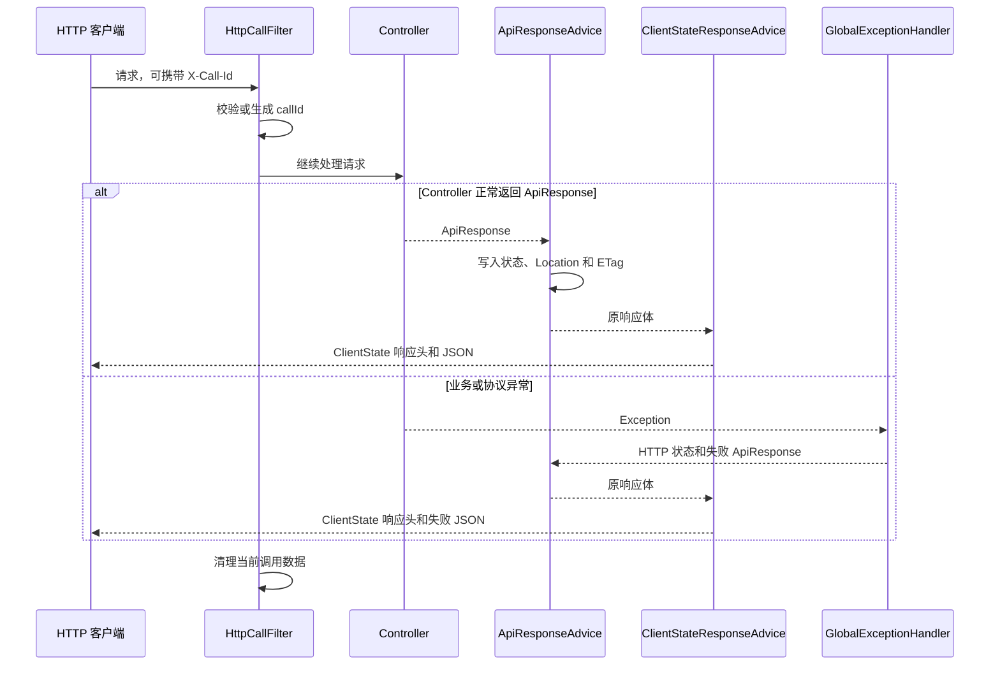

# HTTP API 通用约定

使用 Core Spring 的 HTTP 接口共同遵守以下请求和响应规则：固定响应字段、错误转换、调用标识、分页、强 ETag 与 `If-Match`，以及客户端状态响应头。具体应用自己声明路由、身份和 permission。

## 一次请求怎样得到响应



[HttpCallFilter](/javadoc/core/sca4dj-core-spring/com/sca4d/core/spring/web/HttpCallFilter.html) 在 Controller 之前确定 `callId` 并写入当前请求的 `X-Call-Id` 响应头。[ApiResponse](/javadoc/core/sca4dj-core-spring/com/sca4d/core/spring/web/ApiResponse.html) 保存固定 JSON 字段和 HTTP 元数据。[GlobalExceptionHandler](/javadoc/core/sca4dj-core-spring/com/sca4d/core/spring/web/GlobalExceptionHandler.html) 把已知异常转换成失败响应。ApiResponseAdvice 写出状态和 Location，并从响应数据的 `@ETag` 方法生成可选强 ETag；ClientStateResponseAdvice 只写出当前请求登记的客户端状态响应头。

这套固定 JSON 只适用于返回 ApiResponse 或被 GlobalExceptionHandler 转换的请求。文件下载、SSE 流和应用明确返回的其他媒体类型不自动套用这组字段。

[CoreJacksonAutoConfiguration](/javadoc/core/sca4dj-core-spring/com/sca4d/core/spring/config/CoreJacksonAutoConfiguration.html) 把 Spring Boot 通用 ObjectMapper 处理的 Java `long` 和 `Long` 输出为十进制 JSON 字符串，并把输入字符串恢复为 Java 64 位整数。该规则避免 Snowflake ID 等大整数在 JavaScript 客户端中被舍入，也同样适用于 Java 类型为 `long` 或 `Long` 的计数。客户端应把这些字段保留为字符串，不能先转成 JavaScript `number` 再拼接 URL 或请求体。HTTP 资源 Version 通过强 ETag 传递；具体 View 是否同时返回 `version` 由接口约定决定。

## 固定 JSON 字段

普通成功响应如下：

```json
{
  "code": "0",
  "messageKey": null,
  "messageArgs": [],
  "message": null,
  "data": {
    "id": "9007199254740993",
    "name": "Example"
  },
  "callId": "f34a7f0c-cdea-47f7-b68a-a1c7018fa2f0",
  "timestamp": "2026-07-24T10:15:30Z"
}
```

| 字段 | 含义 |
|---|---|
| `code` | 稳定响应码。成功固定为字符串 `"0"`；失败时为 ErrorCode 声明的字符串编码。 |
| `messageKey` | 可由客户端识别的消息键。没有消息的成功响应为 `null`。 |
| `messageArgs` | 按顺序代入消息模板的参数；没有参数时为空数组。 |
| `message` | 服务端按当前 Locale 生成、可以直接展示的安全文案；没有消息的成功响应为 `null`。 |
| `data` | 当前路由的业务数据或安全错误详情；没有数据时为 `null`。 |
| `callId` | 当前请求的调用标识。只在 HTTP 请求外创建响应，或当前成功响应发布强 ETag 时省略。 |
| `timestamp` | ApiResponse 创建时刻，使用 ISO 8601 时间。它不是业务对象的创建或修改时间；当前成功响应发布强 ETag 时省略。 |

客户端先用 HTTP 状态判断协议结果，再用 `code` 区分稳定的业务失败。`message` 会随语言变化，不能作为程序判断条件；需要自行翻译时使用 `messageKey` 和 `messageArgs`。

响应数据声明 `@ETag` 时，成功 JSON 省略每次请求都会变化的 `callId` 和 `timestamp`，调用标识改从 `X-Call-Id` 读取，响应时间使用标准 `Date` 头。这样相同强 ETag 不会对应仅因响应外壳时间不同而变化的内容。普通成功响应和失败响应继续返回上述完整字段。

成功工厂方法使用以下 HTTP 结果：

| ApiResponse 创建方式 | HTTP 状态 | 可附加的响应头 |
|---|---:|---|
| `ok(...)` | 200 | 可选 ETag |
| `created(...)` | 201 | 可选 Location、ETag |
| `accepted(...)` | 202 | 可选 Location、ETag |
| `noContent()` | 204 | 可选 ETag |

`noContent()` 不写 JSON 响应体；客户端不能在 204 后继续解析 `ApiResponse.data`。

`responseStatus` 和 `responseHeaders` 只用于生成 HTTP 响应，不进入 JSON。幂等存储同时保存成功结果的 HTTP 状态和响应头；重放时恢复首次执行的状态、Location 和 ETag，不把这些元数据退化成默认 200。`HttpCallFilter` 始终为当前请求写入 `X-Call-Id`，重放结果不能用首次执行的 `callId` 覆盖它。Controller 只返回 `ApiResponse`；稳定 View 的 `@ETag` 方法决定是否发布强 ETag，`ApiResponse` 不再提供手工传入 Version 的正文重载。

响应包含随当前 Session、Principal 或权限变化的数据时，Controller 对 `ApiResponse` 调用 `noStore()`。它只增加 `Cache-Control: no-store`，不改变 JSON、权限判断、Session 或服务端缓存，也不能把动态响应变成合法的版本化表示。在线状态、短期 URL、账号展示资料和权限结果不得仅凭另一个业务行 Version 发布强 ETag；角色自身 i18n、permission 等稳定子资源分别发布自己的 ETag。

`no-store` 只约束浏览器和 HTTP 中间缓存。前端状态容器仍须在 Session 切换时删除旧数据；Redis 等服务端缓存仍按各自的失效规则处理。

反向代理必须保持 API 响应的强 ETag。代理压缩响应后把 `ETag: "3"` 改成 `ETag: W/"3"` 时，客户端不能把该弱 ETag 用于 `If-Match`，写入会得到 412。使用 Nginx 代理 API 时，应关闭该 location 的 gzip，并清除发往应用的 `Accept-Encoding`；静态页面和资源可以继续压缩：

```nginx
location /api/ {
    gzip off;
    proxy_set_header Accept-Encoding "";
    proxy_pass http://application;
}
```

Spring MVC 请求参数中的 Java 日期时间类型默认按 ISO 8601 文本解析。具体应用需要其他格式时，必须在自己的 MVC 配置中显式覆盖该默认格式；JSON 日期时间字段继续遵守 HTTP ObjectMapper 的配置。

ApiResponse 不是 [RFC 9457 Problem Details](https://www.rfc-editor.org/rfc/rfc9457)；失败响应使用 `application/json`，不使用 `application/problem+json`。

## 失败响应与 HTTP 状态

BusinessException 保留原 ErrorCode、消息键和消息参数。没有专用 HTTP 状态的错误按照 ErrorCategory 转换：

| ErrorCategory | HTTP 状态 |
|---|---:|
| `VALIDATION` | 400 |
| `AUTHENTICATION` | 401 |
| `PERMISSION` | 403 |
| `NOT_FOUND` | 404 |
| `CONFLICT` | 409 |
| `RATE_LIMIT` | 429 |
| `UNAVAILABLE` | 503 |
| `INTERNAL` | 500 |

Core Spring 自己声明的 HTTP 错误如下：

| `code` | HTTP 状态 | 发生条件 |
|---|---:|---|
| `1100` | 400 | 请求参数、请求体、字段约束或类型转换不正确 |
| `1101` | 405 | 路由不支持当前 HTTP 方法 |
| 无响应体 | 406 | 服务端不能生成客户端接受的媒体类型；仅返回状态码，不包含 JSON 错误体 |
| `1103` | 415 | 服务端不支持请求使用的媒体类型 |
| `1104` | 413 | 请求体或上传文件超过服务端限制 |
| `1105` | 428 | 修改接口要求 `If-Match`，但请求没有提供 |
| `1106` | 412 | `If-Match` 不是单个有效强 ETag，或资源 Version 已经变化 |

路由不存在和静态资源不存在使用 Core 的 `NOT_FOUND`。未分类服务端异常使用 Core 的 `INTERNAL`，响应中只保留固定安全文案，原始异常写入服务端日志。

`@RateLimited` 拒绝的请求使用 Core 错误码 `1005` 和 HTTP 429，并返回 `Retry-After: <seconds>`。秒数是 Bucket4j 当前令牌桶补充出一个可用令牌所需时间向上取整后的正整数；客户端应至少等待该秒数再发起新的尝试。限流维度和令牌补充规则见[并发规则](/capabilities/data-configuration/concurrency-development)。

`@Idempotent` 请求仍由另一个执行者处理时使用 Core 错误码 `1006`、HTTP 409 和 `Retry-After: <seconds>`。同一幂等键已经绑定不同方法参数时使用 Core 错误码 `1007` 和 HTTP 409，不返回等待时间。两种情况都不会进入业务方法。

### 字段校验失败

请求体字段、查询参数或方法约束失败时，`data` 可以包含 FieldViolation 数组：

```json
{
  "code": "1100",
  "messageKey": "error.web.bad-request",
  "messageArgs": [],
  "message": "请求内容不正确",
  "data": [
    {
      "field": "username",
      "message": "username不能为空"
    }
  ],
  "callId": "f34a7f0c-cdea-47f7-b68a-a1c7018fa2f0",
  "timestamp": "2026-07-24T10:15:30Z"
}
```

`field` 是 Spring 提供的字段或属性路径，`message` 是当前 Locale 下的拒绝原因。[HttpInputValidationAspect](/javadoc/core/sca4dj-core-spring/com/sca4d/core/spring/web/HttpInputValidationAspect.html) 还会按外部输入的 Java 类型检查正整数、字符串长度和容器数量；其失败使用相同的 FieldViolation 结构。无法读取整个请求体、缺少查询参数或方法级校验失败时，`data` 可能为 `null`，调用方不能假设每个 400 都有字段数组。

## Locale 与错误文案

[RequestLocaleResolver](/javadoc/core/sca4dj-core-spring/com/sca4d/core/spring/i18n/RequestLocaleResolver.html) 保留 `Accept-Language` 中优先级最高的合法 Locale。[TextLocalizer](/javadoc/core/sca4dj-core-api/com/sca4d/core/api/i18n/TextLocalizer.html) 用准确请求 Locale 解析动态 View 字段；CatalogMessageSource 把同一个请求 Locale 转换为静态消息目录支持的 Locale，再解析错误和 Bean Validation 文案。

响应同时返回稳定消息键和已经本地化的文案，是为了同时满足程序处理与直接展示。客户端可以直接展示 `message`，也可以使用 `messageKey` 和 `messageArgs` 接管翻译；不能根据中文或英文句子判断错误类型。

## X-Call-Id

`X-Call-Id`、`Idempotency-Key` 和 `X-Client-State-Refresh` 是 Core Spring 的默认自定义 Header 名称。部署可分别通过 `sca4dj.http.headers.call-id`、`sca4dj.http.headers.idempotency-key` 和 `sca4dj.http.headers.client-state-refresh` 覆盖；Server 启动后名称不再改变，客户端必须使用同一组有效名称。

客户端可以发送 `X-Call-Id`。只有匹配 `[A-Za-z0-9._-]{1,128}` 的值才会被保留；缺失或格式不正确时，HttpCallFilter 生成 UUID。最终值同时写入：

- HTTP 响应头 `X-Call-Id`；
- ApiResponse 的 `callId`；
- 当前请求日志的 MDC `callId`。

无效调用标识不会使请求失败。客户端排查一次调用时应记录响应头中的最终值，而不是假设请求值一定被接受。

## 分页

Controller 参数使用 PageRequest 时，Core Spring 读取查询参数 `page` 和 `size`：

| 参数 | 默认值 | 限制 |
|---|---:|---|
| `page` | `1` | 必须是不小于 1 的整数 |
| `size` | `sca4dj.core.pagination.default-size`，默认 20 | 必须是不小于 1 且不大于 `sca4dj.core.pagination.max-size` 的整数；最大值默认 200 |

非法数字、非正数或超过最大值时返回 Core 的 `VALIDATION_FAILED`，HTTP 状态为 400。PageRequest 的 `offset()` 使用 `(page - 1) * size`，因此页码从 1 开始。

PageResponse 的 JSON 结构如下：

```json
{
  "records": [],
  "page": 1,
  "size": 20,
  "total": "0"
}
```

`page` 和 `size` 是 Java `int`，在 JSON 中保持数字；`total` 是 Java `long`，因此使用十进制字符串。`total` 表示满足查询条件的总记录数，不是当前页数量。当前页没有记录时仍保留请求使用的 `page` 和 `size`。

## 列表查询

分页接口接受 `page` 和 `size`。页码从 1 开始，默认页大小为 `sca4dj.core.pagination.default-size`（默认 20），全局最大值由 `sca4dj.core.pagination.max-size` 控制（默认 200）；具体接口可以声明更小上限。

支持动态排序的接口接受可以重复的 `sort=FIELD,DIRECTION`，并按出现顺序应用。例如：

```http
GET /projects?page=2&size=20&status=ACTIVE&sort=STATUS,ASC&sort=UPDATED_AT,DESC
```

字段名和方向区分大小写，方向只能是 `ASC` 或 `DESC`。没有提交 `sort` 时使用接口默认排序；未知字段、重复字段、非法格式、超过字段数量上限，或者继续提交 `sortBy`、`sortDirection` 时返回 400。

响应统一使用 `{ items, page, size, total }`。`total` 是满足完整筛选条件的记录总数，并按 Java `long` 规则输出为十进制字符串。业务筛选字段仍由具体接口显式声明，客户端提交的排序字段不会直接进入 SQL。

## ETag、If-Match 与修改冲突

ETag 和 `If-Match` 不是所有资源和写入接口的默认组成。只有客户端根据旧资源快照编辑、现实中存在有意义的并发覆盖风险，并且客户端能够处理 412 时才采用；状态命令、字段级 Patch、列表和动态派生数据通常不采用。具体判断标准见[并发规则](/capabilities/data-configuration/concurrency-development)。

只有当一个稳定响应的全部字段都由同一个数据库 `Version` 覆盖时，View 才在一个公开、无参数、返回 `Version` 的方法上声明 [`@ETag`](/javadoc/core/sca4dj-core-spring/com/sca4d/core/spring/web/annotation/ETag.html)。一个 View 最多声明一个该方法；Core Spring 在应用启动时检查 Controller 的顶层具体响应类型，错误声明会阻止启动。同一个 View 类型同时用于稳定资源和动态派生数据时，动态实例可以返回 `null`，此时不发布 ETag，不需要为相同 JSON 结构再建立 `*ResourceView`。ApiResponseAdvice 从 Controller 已经返回的同一个对象读取版本，不重新查询数据库。例如 Version 3 对应：

```http
ETag: "3"
```

确实需要防止完整资源丢失更新的方法声明 [`@IfMatch`](/javadoc/core/sca4dj-core-spring/com/sca4d/core/spring/web/annotation/IfMatch.html) 后，请求必须提交：

```http
If-Match: "3"
```

[RFC 9110 的 If-Match](https://www.rfc-editor.org/rfc/rfc9110.html#section-13.1.1) 用于避免客户端根据过期内容覆盖较新的修改。[IfMatchInterceptor](/javadoc/core/sca4dj-core-spring/com/sca4d/core/spring/web/IfMatchInterceptor.html) 把一个强 ETag 绑定到 RequestVersionConditions，CallLifecycleAdvisor 再把它登记为对应方法执行的成功要求。根资源 Repository 读取当前对象后调用 `VersionConditions.resolve(currentVersion)`；Controller 和 Service 不声明 HTTP Version 参数。写入事务提交前会检查版本条件已经消费，业务方法正常返回后也会再次检查。成功返回的稳定 View 由 `@ETag` 发布新版本；没有正文时使用 `ApiResponse.noContent(version)` 返回修改后的版本。

| 结果 | HTTP 状态 | 含义 |
|---|---:|---|
| 缺少或空白 `If-Match` | 428 | 调用方没有提供修改所需的当前 Version |
| 弱 ETag、通配符、多个值、非数字或非法格式 | 412 | 请求提供的前置条件不能用于当前修改 |
| ETag 格式有效，但数据库 Version 已经变化 | 412 | 请求基于旧内容，当前写入没有执行 |

412 不表示重新发送原请求就一定成功。客户端应重新读取资源及其新 ETag，重新展示或计算修改内容，再由用户或业务流程决定是否提交。409 留给唯一性、保护规则、内部状态 CAS 和状态组合等业务冲突。动态派生数据、短期 URL、当前状态命令和能够接受覆盖的修改不声明 `@IfMatch`；即使客户端额外发送请求头也不会启用条件更新。

## 客户端状态响应头

业务处理可以通过 ClientState 登记客户端需要重新读取的本地状态：

| 响应头 | 值 | 客户端动作 |
|---|---|---|
| `X-Client-State-Refresh` | 逗号分隔、去重且保持登记顺序的目标编码 | 重新读取列出的状态目标 |

`authentication.session` 表示当前 Session、权限和相关资料需要重新读取。受保护 Handler 无法从请求 Token 恢复有效 Session 时，[AuthRequestInterceptor](/javadoc/modules/auth/sca4dj-auth/com/sca4d/auth/web/AuthRequestInterceptor.html) 登记该目标；管理端收到后使用 backing Session Token 刷新 Token 并重新读取当前 Session，刷新失败后才清除本地 Session。密码、TOTP、Passkey 和敏感操作验证等认证方法失败也可以返回 401，但这类失败不会登记该目标，客户端不能根据 HTTP 状态、错误码或请求路由推断登录 Session 已经失效。

管理端的普通请求、AdminApiClient 和 SSE 握手都会解析该响应头，并把重复通知合并到同一次 Session 刷新；未知目标被忽略。响应头可以随成功或失败响应返回，客户端必须在转换响应正文或抛出请求错误前读取。使用 backing Session Token 的 SSE 握手直接返回 401 或 403 时，可以确认该连接使用的 Session 已经失效，因此管理端会直接清除本地 Session。

ClientStateResponseAdvice 在序列化响应前写入该响应头；请求结束后由过滤器清理线程数据。

## SSE 的失败响应

映射到 `text/event-stream` Handler 的请求在建连前失败时，只返回 HTTP 状态和必要响应头，不返回 ApiResponse JSON。这避免在尚未建立的 SSE 连接中混入普通 JSON 文档，或让 JSON Converter 尝试写入事件流。业务异常、输入校验、限流和未分类服务端异常都遵守该规则；例如无效 Realtime Token 返回 401 和空响应体，限流拒绝返回 429、`Retry-After` 和空响应体。`ClientStateFilter` 仍会为尚未提交的空响应写入 `X-Client-State-Refresh`。

异常处理器优先读取 Handler 声明的可生产媒体类型。Handler 信息不存在时，只有 `Accept` 明确包含 `text/event-stream` 且没有其他具体响应类型，才按事件流返回空错误体；普通 JSON Handler 不会因为 `Accept` 同时列出多个格式而丢失错误内容。

SSE 连接建立后的事件、心跳、超时和断开方式由具体 SSE 路由说明。不能用普通 JSON 错误结构解释已经开始输出的事件流。

## OpenAPI

安装 `sca4dj-openapi` 外部调用模块时，`/openapi/**` 请求体会在认证前缓存，供 MAC 校验和 Controller 重复读取。单次请求体最多 8 MiB：声明长度超限时立即返回 HTTP 413；未声明长度或实际长度超过声明值时，读取过程最多消耗 8 MiB 加 1 字节后返回 413，不进入认证或 Controller。该限制只适用于外部调用模块的路径，不替代其他 HTTP 入口的上传和请求体限制。

存在 springdoc 时，[CoreOpenApiConfiguration](/javadoc/core/sca4dj-core-spring/com/sca4d/core/spring/openapi/CoreOpenApiConfiguration.html) 默认创建标题为 `${spring.application.name} API`、版本为 `0.0.1-alpha` 的 OpenAPI 定义，并注册名为 `bearerAuth` 的 HTTP Bearer 安全方案，`bearerFormat` 为 `Opaque`。应用名称没有公共回退值；`spring.application.name` 缺失时 RuntimeNamespace 自动配置会使应用启动失败。该配置还把 Java `long` 和 `Long` schema 声明为十进制字符串，与运行时 Jackson 输出保持一致。[HttpInputOpenApiCustomizer](/javadoc/core/sca4dj-core-spring/com/sca4d/core/spring/openapi/HttpInputOpenApiCustomizer.html) 只向参数和请求体 Schema 添加当前启用的类型默认限制，并遵守显式约束和 `@NoDefaultValidation` 的替代规则。

`sca4dj.core.openapi.enabled=false` 会关闭这项 Core 基础配置。应用还需要同时配置 springdoc 是否开放 `/v3/api-docs` 和 Swagger UI。注册安全方案不等于自动标记每条路由的认证要求；具体路由仍以应用 HTTP API 规格和 Controller 声明为准。

模块依赖和自动配置不会开放业务 Controller。具体应用必须在自己的源码中定义 Controller、HTTP Request/View 和 OpenAPI 声明，路由才会出现在 Spring MVC 和 OpenAPI 中。
