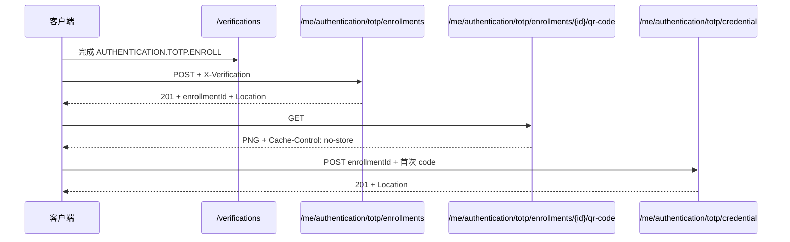

# Sca4d Server HTTP API

调用接口先在路由表确认方法、认证与权限，再查对应章节的请求字段和失败结果。表中的普通 API 路径使用 Server 内部路径；通过 Gateway 访问时加 `/api`，例如 `/sessions/current` 对应 `/api/sessions/current`。EMQX 回调使用独立的 `/callbacks/{code}` 入口。

普通 JSON 响应、错误、分页和条件请求遵守 [HTTP 通用契约](/reference/http/common)。文件流、SSE 和 EMQX 回调使用各自的响应格式。

| 要查的内容 | 位置 |
|---|---|
| 请求方法、路径、权限和成功状态 | [路由总表](#路由总表) |
| Bearer Token、JWT 与语言 | [Token 与语言](#token-与语言) |
| 登录与敏感操作验证 | [登录与敏感 verification](#登录与敏感-verification) |
| 当前资料与头像 | [当前 Session 与账号](#当前-session-与账号) |
| 账号管理与角色授权 | [Platform Account](#platform-account)、[角色与 permission](#角色与-permission) |
| 产品、设备、状态、命令与定时 | [IoT Product 与 Device](#iot-product-与-device) |
| 浏览器事件与 WebSocket | [Web Realtime](#web-realtime) |
| 第三方程序调用 | [开放 API 路由](#开放-api-路由) |

HTTP 使用 account、role 和 permission 命名公开资源。其中 permission 编码对应 Java API 的 Operation；业务身份仍由 Principal 表示。Controller 绑定请求、声明权限并转换响应，App Service 通过模块公开 API 修改账号和授权数据，资料保存在应用的 `platform_user_profile`。

## 怎样读认证要求

先按路由选择认证材料，再满足表中列出的权限、verification 和版本条件：

- **匿名 App 路由**：不要求已有 Session，按接口提交密码、验证码或 Passkey proof 等材料。
- **Session**：提交当前 Token 模式允许的 Bearer Token；标明「强制 Session Token」的路由只接受在线不透明 Session Token。
- **permission**：恢复 Session 并选择唯一 Platform Principal 后，检查表中列出的权限编码。这是授权条件。
- **verification**：先完成对应动作的认证要求，再通过 `X-Verification` 提交一次性验证标识；它与当前 Session、Account 和动作绑定。
- **If-Match**：提交最近读取的强 ETag，详细规则见[条件请求与失败](#条件请求与失败)。
- **EMQX 共享 Secret**：EMQX 在 `X-Iot-Emqx-Secret` 中提交独立回调 Secret，不是用户 Session、Gateway Secret、设备 Secret 或 Management API Secret。GatewayCallbackDispatcher 允许匿名 HTTP 访问，具体 EMQX 回调仍校验该 Secret。
- **短期文件 token**：只用于一个本地 backend PUT 或 GET，由 FileService 签发并放在 `token` 查询参数中；它不能调用其他文件路由。

## 路由总表

### 登录、verification 与 Session

| 方法与路由 | 认证与授权 | 成功结果 |
|---|---|---|
| `POST /login/attempts` | 匿名 App | 201；密码登录进度、可选 Session、Location |
| `POST /login/attempts/passkey` | 匿名 App | 201；Passkey 登录进度、可选 Session、Location |
| `POST /login/attempts/{attemptId}/password/proofs` | 匿名 App | 200；继续登录 attempt |
| `POST /login/attempts/{attemptId}/totp/proofs` | 匿名 App | 200；继续登录 attempt |
| `POST /login/attempts/{attemptId}/passkey/proofs` | 匿名 App | 200；继续登录 attempt |
| `POST /login/email-code/challenges` | 匿名 App | 200；匿名一致的 Email Code Challenge |
| `POST /login/email-code/proofs` | 匿名 App | 201；使用已消费 Challenge 开始登录、Location |
| `POST /login/attempts/{attemptId}/email-code/challenges` | 匿名 App | 200；为已确定账号的登录 attempt 签发 Challenge |
| `POST /login/attempts/{attemptId}/email-code/proofs` | 匿名 App | 200；继续登录 attempt |
| `POST /login/sms-code/challenges` | 匿名 App | 200；匿名一致的 SMS Code Challenge |
| `POST /login/sms-code/proofs` | 匿名 App | 201；使用已消费 Challenge 开始登录、Location |
| `POST /login/attempts/{attemptId}/sms-code/challenges` | 匿名 App | 200；为已确定账号的登录 attempt 签发 Challenge |
| `POST /login/attempts/{attemptId}/sms-code/proofs` | 匿名 App | 200；继续登录 attempt |
| `POST /passkey/assertions/options` | 匿名 App | 200；discoverable assertion options |
| `POST /verifications` | Session | 201；敏感 verification、Location |
| `POST /verifications/{verificationId}/password/proofs` | Session | 200；继续 verification |
| `POST /verifications/{verificationId}/totp/proofs` | Session | 200；继续 verification |
| `POST /verifications/{verificationId}/passkey/proofs` | Session | 200；继续 verification |
| `POST /verifications/{verificationId}/email-code/challenges` | Session | 200；为当前 Session Account 签发 Challenge |
| `POST /verifications/{verificationId}/email-code/proofs` | Session | 200；继续 verification |
| `POST /verifications/{verificationId}/sms-code/challenges` | Session | 200；为当前 Session Account 签发 Challenge |
| `POST /verifications/{verificationId}/sms-code/proofs` | Session | 200；继续 verification |
| `GET /sessions/current` | Session | 200；当前 Session 与生效 permission |
| `POST /sessions/current/tokens` | 强制 Session Token | 200；签发 access Token，不延长 Session |
| `DELETE /sessions/current` | 强制 Session Token | 204；注销当前 Session |

### 当前账号、Credential 与头像文件

| 方法与路由 | 认证与授权 | 成功结果 |
|---|---|---|
| `GET /me/profile` | Session | 200；当前资料 |
| `PUT /me/profile` | Session | 200；替换资料 |
| `GET /me/preferences/{key}` | Session | 200；当前 Principal 完整偏好、ETag |
| `PUT /me/preferences/{key}` | Session、If-Match | 200；完整替换偏好、新 ETag |
| `DELETE /me/preferences/{key}` | Session、If-Match | 200；恢复偏好默认值、新 ETag |
| `GET /me/notification-settings` | Session | 200；语言、业务区域、可选渠道覆盖值和各自 Version |
| `PUT /me/notification-settings/language` | Session、If-Match | 200；替换通知语言 |
| `PUT /me/notification-settings/region` | Session、If-Match | 200；替换通知业务区域 |
| `PUT /me/notification-settings/channels` | Session、If-Match | 200；替换可选渠道覆盖值 |
| `GET /me/notifications?beforeId={id}&limit={n}` | Session | 200；站内信页和未读数量 |
| `POST /me/notifications/{messageId}/read` | Session | 204；按 Version 标记单条已读 |
| `POST /me/notifications/read-all` | Session | 204；全部标记已读 |
| `PUT /me/phone-identifier` | 强制 Session Token、`AUTHENTICATION.PHONE.VERIFY` verification | 204；验证 Profile 手机号并绑定 PHONE Identifier |
| `PUT /me/profile/avatar` | Session | 200；绑定已完成上传的头像 |
| `DELETE /me/profile/avatar` | Session | 200；删除当前头像 |
| `POST /files/uploads` | Session、目标资料 `WRITE` | 201；头像上传请求 |
| `POST /files/uploads/{fileId}/completion` | Session、文件 `WRITE` | 204；确认上传完成 |
| `POST /files/access-urls` | Session、每个文件 `READ` | 200；短期读取地址列表 |
| `PUT /files/transfers/uploads?token=...` | 匿名、短期文件 PUT token；OpenAPI 隐藏 | 204；本地 backend 接收原始字节 |
| `GET /files/transfers/objects?token=...` | 匿名、短期文件 GET token；OpenAPI 隐藏 | 200；本地文件流、`no-store` |
| `GET /me/password` | Session | 200；密码凭据状态 |
| `PUT /me/password` | 强制 Session Token、verification | 204；改密并注销该账号全部 Session |
| `GET /me/authentication/settings` | Session | 200；账号认证设置、ETag |
| `PUT /me/authentication/settings` | Session、verification、If-Match | 200；完整替换认证设置、新 ETag |
| `POST /me/authentication/totp/enrollments` | Session、verification | 201；enrollment 与 Location |
| `GET /me/authentication/totp/enrollments/{enrollmentId}` | Session | 200；enrollment 元数据 |
| `DELETE /me/authentication/totp/enrollments/{enrollmentId}` | Session | 204；取消 enrollment |
| `GET /me/authentication/totp/enrollments/{enrollmentId}/qr-code` | Session；`Accept: image/png` | 200；PNG、`no-store` |
| `GET /me/authentication/totp/credential` | Session | 200；TOTP Credential 状态 |
| `POST /me/authentication/totp/credential` | Session | 201；激活 TOTP、Location |
| `PUT /me/authentication/totp/credential` | Session、verification | 200；替换 TOTP |
| `DELETE /me/authentication/totp/credential` | 强制 Session Token、verification | 204；删除 TOTP |
| `GET /me/passkeys` | Session | 200；Passkey 列表 |
| `POST /me/passkeys/registrations/options` | Session | 200；registration options |
| `POST /me/passkeys` | Session、verification | 201；新增 Passkey、Location |
| `DELETE /me/passkeys/{credentialId}` | Session、verification | 204；删除 Passkey |

### Platform Account、Role 与 permission

| 方法与路由 | 认证与授权 | 成功结果 |
|---|---|---|
| `GET /platform/accounts` | Session、`platform:accounts:read` | 200；账号分页 |
| `POST /platform/accounts` | Session、`platform:accounts:manage` | 201；完整账号、Location |
| `GET /platform/accounts/{accountId}` | Session、`platform:accounts:read` | 200；账号详情 |
| `PATCH /platform/accounts/{accountId}` | Session、`platform:accounts:manage` | 200；修改状态 |
| `DELETE /platform/accounts/{accountId}` | 强制 Session Token、`platform:accounts:manage`、verification | 204；删除账号及关联认证和授权数据 |
| `GET /platform/accounts/{accountId}/roles` | Session、`platform:accounts:read` | 200；账号角色、ETag |
| `PUT /platform/accounts/{accountId}/roles` | Session、`platform:accounts:manage`、If-Match | 200；替换角色、新 ETag |
| `PUT /platform/accounts/{accountId}/profile/avatar` | Session、`platform:accounts:manage` | 200；绑定目标账号头像 |
| `DELETE /platform/accounts/{accountId}/profile/avatar` | Session、`platform:accounts:manage` | 200；删除目标账号头像 |
| `GET /platform/roles` | Session、`platform:roles:read` | 200；全部角色 |
| `POST /platform/roles` | Session、`platform:roles:manage` | 201；本地化角色、ETag、Location |
| `GET /platform/roles/{roleId}` | Session、`platform:roles:read` | 200；本地化角色、ETag |
| `GET /platform/roles/{roleId}/accounts` | Session、`platform:roles:read`、`platform:accounts:read` | 200；已分配或候选账号分页 |
| `PATCH /platform/roles/{roleId}/accounts` | Session、`platform:roles:read`、`platform:accounts:manage` | 204；批量增加或移除角色账号 |
| `GET /platform/roles/{roleId}/i18n` | Session、`platform:roles:read` | 200；完整多语言字段、ETag |
| `PUT /platform/roles/{roleId}/i18n` | Session、`platform:roles:manage`、If-Match | 200；替换完整多语言字段、新 ETag |
| `PUT /platform/roles/{roleId}/status` | Session、`platform:roles:manage`、If-Match | 200；修改状态、新 ETag |
| `DELETE /platform/roles/{roleId}` | 强制 Session Token、`platform:roles:manage`、If-Match | 204；删除角色 |
| `GET /platform/roles/{roleId}/permissions` | Session、`platform:roles:read` | 200；角色 permission、共享 ETag |
| `PUT /platform/roles/{roleId}/permissions` | Session、`platform:roles:manage`、If-Match | 200；替换 permission、新共享 ETag |
| `GET /system/locales` | Session；无业务 permission | 200；支持和默认 Locale |
| `GET /system/permissions` | Session；无业务 permission | 200；本地化 permission 目录 |

### 审计、字典、Setting 与 Email

| 方法与路由 | 认证与授权 | 成功结果 |
|---|---|---|
| `GET /system/audit/records` | Session、`system:audit:read` | 200；操作日志分页 |
| `GET /system/audit/records/{id}` | Session、`system:audit:read` | 200；操作日志详情 |
| `GET /system/dictionaries` | Session、`system:dictionaries:read` | 200；字典管理结果 |
| `GET /system/dictionaries/{key}/options` | Session、`system:dictionaries:read` | 200；聚合选择项 |
| `POST /system/dictionaries` | Session、`system:dictionaries:manage` | 200；创建后的字典 |
| `PUT /system/dictionaries/{key}` | Session、`system:dictionaries:manage` | 200；修改后的字典 |
| `DELETE /system/dictionaries/{key}?version={version}` | Session、`system:dictionaries:manage` | 204；删除动态字典 |
| `POST /system/dictionaries/{key}/options` | Session、`system:dictionaries:manage` | 200；创建后的字典 |
| `PUT /system/dictionaries/{key}/options/{value}` | Session、`system:dictionaries:manage` | 200；修改后的字典 |
| `DELETE /system/dictionaries/{key}/options/{value}?version={version}` | Session、`system:dictionaries:manage` | 204；删除数据库字典项 |
| `GET /system/settings` | Session、`system:settings:read` | 200；设置分组与当前来源 |
| `PUT /system/settings/{key}` | Session、`system:settings:manage`、If-Match | 200；修改后的设置分组 |
| `DELETE /system/settings/{key}` | Session、`system:settings:manage`、If-Match | 200；恢复默认值后的设置分组 |
| `GET /system/email/senders` | Session、`system:email:read` | 200；不包含密码的 SMTP 配置列表 |
| `POST /system/email/senders` | Session、`system:email:manage` | 201；默认停用 SMTP 配置、Location |
| `GET /system/email/senders/{senderId}` | Session、`system:email:read` | 200；SMTP 配置、ETag |
| `PUT /system/email/senders/{senderId}` | Session、`system:email:manage`、If-Match | 200；完整替换 SMTP 配置、新 ETag |
| `PATCH /system/email/senders/{senderId}/status` | Session、`system:email:manage`、If-Match | 200；启停 SMTP 配置、新 ETag |
| `POST /system/email/senders/{senderId}/connection-tests` | Session、`system:email:manage` | 204；只测试连接 |
| `DELETE /system/email/senders/{senderId}` | Session、`system:email:manage`、If-Match | 204；删除停用 SMTP 配置 |
| `GET /system/email/templates` | Session、`system:email:read` | 200；按 `page`、`size`、`sort` 返回 Email 模板分页与变量集合 |
| `POST /system/email/templates` | Session、`system:email:manage` | 201；默认停用模板、Location |
| `GET /system/email/templates/{templateId}` | Session、`system:email:read` | 200；模板、变量集合、ETag |
| `PUT /system/email/templates/{templateId}` | Session、`system:email:manage`、If-Match | 200；替换完整多语言 Email 源码、新 ETag |
| `PATCH /system/email/templates/{templateId}/status` | Session、`system:email:manage`、If-Match | 200；启停模板、新 ETag |
| `POST /system/email/templates/previews` | Session、`system:email:manage` | 200；安全渲染结果 |
| `DELETE /system/email/templates/{templateId}` | Session、`system:email:manage`、If-Match | 204；删除停用模板 |
| `GET /system/sms/providers` | Session、`system:sms:read` | 200；不含 AccessKey 的 Provider 列表 |
| `POST /system/sms/providers` | Session、`system:sms:manage` | 201；默认停用 Provider、Location |
| `GET /system/sms/providers/{providerId}` | Session、`system:sms:read` | 200；Provider、ETag |
| `PUT /system/sms/providers/{providerId}` | Session、`system:sms:manage`、If-Match | 200；替换停用 Provider、新 ETag |
| `PATCH /system/sms/providers/{providerId}/status` | Session、`system:sms:manage`、If-Match | 200；启停 Provider、新 ETag |
| `DELETE /system/sms/providers/{providerId}` | Session、`system:sms:manage`、If-Match | 204；删除停用且没有绑定的 Provider |
| `GET /system/sms/providers/{providerId}/bindings` | Session、`system:sms:read` | 200；Provider 的模板绑定列表 |
| `POST /system/sms/providers/{providerId}/bindings` | Session、`system:sms:manage` | 201；默认停用绑定、Location |
| `GET /system/sms/providers/{providerId}/bindings/{bindingId}` | Session、`system:sms:read` | 200；绑定、ETag |
| `PUT /system/sms/providers/{providerId}/bindings/{bindingId}` | Session、`system:sms:manage`、If-Match | 200；替换停用绑定、新 ETag |
| `PATCH /system/sms/providers/{providerId}/bindings/{bindingId}/status` | Session、`system:sms:manage`、If-Match | 200；启停绑定、新 ETag |
| `DELETE /system/sms/providers/{providerId}/bindings/{bindingId}` | Session、`system:sms:manage`、If-Match | 204；删除停用绑定 |

### 通知模板、设置与站内信契约

`GET /system/email/templates` 使用公共列表参数：

| 参数 | 规则 |
|---|---|
| `page` | 从 1 开始，默认 1 |
| `size` | 默认 20，范围 1..100 |
| `sort` | 可以重复；格式为 `FIELD,DIRECTION` |

模板列表只允许 `NOTIFICATION_CODE` 和 `SERIAL`，方向为 `ASC` 或 `DESC`。没有 `sort` 时按 `NOTIFICATION_CODE,ASC`、`SERIAL,ASC` 排列。响应 `items` 返回当前页模板，`page` 和 `size` 返回实际分页条件，`total` 返回完整模板数量。每项包含 `templateId`、`notificationCode`、完整 `locales`、模板使用的 `variables`、`enabled` 和 `version`。

`POST` 和 `PUT /system/email/templates` 接受以下字段：

| 字段 | 规则 |
|---|---|
| `notificationCode` | 已注册 `NotificationType` 的稳定编码，最长 128 个字符 |
| `locales` | 1..100 个 Locale 到 Email 源码的完整映射；每项包含 `subject`、`text`、`html` 字符串 |

`locales` 必须包含应用默认 Locale，所有 Locale 都须在应用支持列表中。每项的 `subject` 最长 998 个字符，`text` 与 `html` 各最多 1,000,000 个字符；三个字段均须提供。源码中的变量必须由对应 NotificationType 声明，使用双花括号引用。

`POST /system/email/templates/previews` 接受 `source`、BCP 47 `languageTag` 和字符串 `variables` object。`source` 是单个 Locale 的 `subject`、`text`、`html` 源码；响应返回渲染后的 `subject`、`text` 和清洗后的 `html`，不保存模板。完整请求见[创建并启用 Email 模板](/tutorials/messaging-and-notification#创建并启用-email-模板)。

Email 模板接口不管理 Inbox 或 SMS 模板。站内信由 Inbox 模块读取自己的 Tiptap JSON，SMS 使用供应商模板绑定。

`GET /me/notification-settings` 返回以下字段：

| 字段 | 含义 |
|---|---|
| `languageTag` | 当前 Account 的 BCP 47 通知语言 |
| `regionCode` | 具体应用定义的业务 `Region` 编码 |
| `channels` | 通知编码到可选渠道布尔覆盖值的 object |
| `definitions` | 已注册通知类型的必发/可选渠道及 Java 初值 |
| `languageVersion`、`regionVersion`、`channelsVersion` | 三项设置各自的乐观锁版本 |

三个 `PUT` 接口都接受 `{"value":...}`，并要求 `If-Match` 使用对应 Version。语言值必须包含有效语言，区域值必须能构造具体应用的 `Region`，渠道值必须是完整 JSON object。渠道 object 只能引用已注册通知类型的可选渠道；未知通知编码、必发渠道和非布尔值返回输入错误。

当前渠道键按单节点 `TreeCode.ofSegment(...)` 解析，与内置渠道的多节点编码不匹配，所以非空的内置渠道偏好写入会失败。可用 `{"value":{}}` 清除个人覆盖值；不能把 `email` 或 `inbox` 当作完整内置编码的替代值。

`GET /me/notifications` 的 `beforeId` 可选，`limit` 默认 20、范围 1..100。响应 `messages` 按 `id` 倒序排列，`unreadCount` 返回当前 Account 的完整未读数量。每条消息包含 `id`、`notificationType`、`languageTag`、`title`、`text`、`html`、`createdAt`、可空 `readAt` 和 `version`。`POST /me/notifications/{messageId}/read` 接受 `{"version":<当前版本>}`；`POST /me/notifications/read-all` 没有请求体。

### SMS Code 契约

`POST /login/sms-code/challenges` 接受 `{"phoneNumber":"<E.164>"}`。响应包含 `challengeId`、`maskedRecipient`、`expiresAt` 和 `resendAt`，不返回验证码或完整手机号。匿名签发对未知或不可投递手机号保持相同响应形状。

`POST /login/sms-code/proofs`、`POST /login/attempts/{attemptId}/sms-code/proofs` 和 `POST /verifications/{verificationId}/sms-code/proofs` 接受相同请求：

```json
{
  "challengeId": "<最多 64 个字符>",
  "code": "123456"
}
```

`code` 必须是六位数字。Challenge 只能成功消费一次；不存在、过期、已消费、验证码错误或超过最大错误次数时 proof 被拒绝。带 `attemptId` 或 `verificationId` 的 Challenge 接口不接收手机号，服务端从已经确定的 Account 解析接收人。verification 路由还要求当前 Session Account 与 verification Account 相同。

### SMS Provider 与绑定契约

Provider 请求包含 `code`、已安装 `SmsProviderClient` 的 `type`、部署配置引用 `credentialRef` 和整数 `priority`。阿里云 Transport 类型是 `ALIYUN`。HTTP 不接收或返回 AccessKey；运行配置见[阿里云 SMS](/reference/runtime/sca4d-server#阿里云-sms)。

绑定请求包含 `notificationCode`、具体应用声明的 `route`、BCP 47 `languageTag`、`signName`、`providerTemplateCode` 和 `parameterMapping`。`parameterMapping` 的键是供应商模板参数名，值是 `NotificationType` 变量名。通知类型未注册、变量未声明或 Locale 不合法时，创建、替换和启用绑定都会失败。

Provider 和绑定创建后默认停用。绑定可以在 Provider 停用时启用；Provider 启用前至少需要一个启用绑定。启用中的 Provider 或绑定不能替换或删除。Provider 删除还要求不存在未删除绑定。详情、替换、状态修改和删除均使用各自 `version` 对应的强 `ETag`/`If-Match`。

### IoT Product、Device 与 EMQX

| 方法与路由 | 认证与授权 | 成功结果 |
|---|---|---|
| `GET /iot/products?page={page}&size={size}` | Session、`iot:products:read` | 200；数据库 Product 页 |
| `GET /iot/products/catalog?page={page}&size={size}` | Session、`iot:products:read` | 200；数据库与代码 Product 统一目录页 |
| `GET /iot/products/{productId}` | Session、`iot:products:read` | 200；Product 详情 |
| `GET /iot/products/{productId}/i18n` | Session、`iot:products:read` | 200；Product 的全部 Locale 展示字段 |
| `POST /iot/products` | Session、`iot:products:manage` | 201；默认停用的 Product、Location |
| `PUT /iot/products/{productId}` | Session、`iot:products:manage` | 200；修改技术定义后的停用 Product |
| `PUT /iot/products/{productId}/i18n` | Session、`iot:products:manage` | 200；完整替换后的 Product 多语言字段 |
| `POST /iot/products/{productId}/thing-models` | Session、`iot:products:manage` | 200；发布后的 ThingModel |
| `GET /iot/products/{productId}/thing-models` | Session、`iot:products:read` | 200；按版本递增的 ThingModel 列表 |
| `GET /iot/products/{productId}/thing-models/{version}` | Session、`iot:products:read` | 200；指定版本 ThingModel |
| `GET /iot/products/{productId}/thing-models/{version}/i18n` | Session、`iot:products:read` | 200；指定版本的全部 Locale 展示路径 |
| `PUT /iot/products/{productId}/thing-models/{version}/i18n` | Session、`iot:products:manage` | 200；完整替换后的 ThingModel 多语言字段 |
| `PATCH /iot/products/{productId}/status` | Session、`iot:products:manage` | 200；启停后的 Product |
| `GET /iot/devices?page={page}&size={size}` | Session、`iot:devices:read` | 200；Device 页 |
| `GET /iot/devices/{deviceId}` | Session、`iot:devices:read` | 200；Device 详情 |
| `POST /iot/devices` | Session、`iot:devices:manage`、Idempotency-Key | 201；Device、可选 Account 与一次性 secret、Location |
| `PUT /iot/devices/{deviceId}/details` | Session、`iot:devices:manage` | 200；修改展示资料后的 Device |
| `PUT /iot/devices/{deviceId}/binding` | Session、`iot:devices:manage` | 200；切换物模型与协议后的 Device |
| `PUT /iot/devices/{deviceId}/connection` | Session、`iot:devices:manage` | 200；直接连接绑定、接入方式与可选新 secret |
| `POST /iot/devices/{deviceId}/shared-secret/reset` | Session、`iot:devices:manage` | 200；新 Credential version 与一次性 Shared Secret |
| `POST /iot/devices/{deviceId}/hmac-key/reset` | Session、`iot:devices:manage` | 200；新 Credential version 与一次性 HMAC Key |
| `PATCH /iot/devices/{deviceId}/status` | Session、`iot:devices:manage` | 200；启停后的 Device |
| `PUT /iot/devices/{deviceId}/desired` | Session、`iot:devices:operate` | 200；desired sequence 与下行消息 |
| `POST /iot/devices/{deviceId}/commands/{commandCode}` | Session、`iot:devices:operate` | 200；下行 command 消息 |
| `POST /iot/device-sessions` | Device HMAC | 200；MQTT Token、Session ID 与过期时间 |
| `GET /iot/devices/{deviceId}/runtime` | Session、`iot:devices:read` | 200；当前 Connection、reported 与 desired |
| `GET /iot/devices/{deviceId}/downlinks` | Session、`iot:devices:read` | 200；可靠下行消息页 |
| `GET /iot/devices/{deviceId}/acknowledgements` | Session、`iot:devices:read` | 200；业务 ACK 页 |
| `GET /iot/devices/{deviceId}/events` | Session、`iot:devices:read` | 200；离散设备事件页 |
| `GET /iot/devices/{deviceId}/telemetry` | Session、`iot:devices:read` | 200；时间范围内 Telemetry 样本 |
| `POST /iot/devices/{deviceId}/schedules` | Session、`iot:devices:operate` | 201；ACTIVE 设备定时规则 |
| `GET /iot/devices/{deviceId}/schedules` | Session、`iot:devices:read` | 200；设备定时规则页 |
| `GET /iot/devices/{deviceId}/schedules/{scheduleId}` | Session、`iot:devices:read` | 200；设备定时规则详情 |
| `PUT /iot/devices/{deviceId}/schedules/{scheduleId}` | Session、`iot:devices:operate` | 200；按 version 替换并恢复 ACTIVE 的规则 |
| `PATCH /iot/devices/{deviceId}/schedules/{scheduleId}/status` | Session、`iot:devices:operate` | 200；按 version 暂停或恢复的规则 |
| `DELETE /iot/devices/{deviceId}/schedules/{scheduleId}?version={version}` | Session、`iot:devices:operate` | 200；取消规则 |
| `GET /iot/devices/{deviceId}/schedules/{scheduleId}/executions` | Session、`iot:devices:read` | 200；每个计划时间的处理结果页 |
| `POST /callbacks/IOT.EMQX.AUTHENTICATE` | EMQX 共享 Secret | 200；EMQX `allow` 或 `deny` JSON |

该回调仅在 `sca4dj.iot.emqx.enabled=true` 时登记，不使用 `ApiResponse`，也不属于对管理端公开的 IoT API。正常部署由 EMQX 调用 Gateway；Server 只执行分发后的内部路径。

### 浏览器实时连接

| 方法与路由 | 认证与授权 | 成功结果 |
|---|---|---|
| `GET /events` | 强制 Session Token | 200；`text/event-stream` |
| `POST /events/ws/tickets` | 强制 Session Token | 200；一次性 WebSocket 票据 |

Platform、系统管理和 IoT 管理路由都要求当前 Session 能选择唯一 Platform Principal。没有 Session 返回 401，缺少权限返回 403。审计查询见[操作日志](#操作日志)；系统管理请求的字段类型和必填约束可通过[运行时 OpenAPI](#openapi-可用环境与排除项)查询。

## 操作日志

`GET /system/audit/records` 接受以下查询参数；没有提供筛选参数时返回全部允许查看的记录：

| 参数 | 规则 |
|---|---|
| `requestId` | 可选精确调用标识；空白值按未提供处理 |
| `accountId` | 可选正数 Account 标识 |
| `actorPrincipalId` | 可选正数操作 Principal 标识；该名称避免与当前 Principal 选择参数冲突 |
| `operation` | 可选精确审计操作编码；空白值按未提供处理 |
| `result` | 可选 `SUCCESS`、`DENIED` 或 `FAILED` |
| `targetType`、`targetId` | 可选完整目标 Resource；必须同时提供或同时省略 |
| `occurredFrom`、`occurredTo` | 可选 ISO 8601 时间；下界包含，上界不包含，同时提供时下界必须早于上界 |
| `page` | 从 1 开始，默认 1 |
| `size` | 1..100，默认 20 |

结果按 `occurredAt DESC, id DESC` 排列。分页响应中的 `items` 是操作日志列表，`page` 和 `size` 返回实际分页条件，`total` 返回完整命中数量。`GET /system/audit/records/{id}` 接受正数记录标识并返回同一字段形状；记录不存在时返回 404。参数不满足上述范围或组合要求时返回 400。

```json
{
  "items": [
    {
      "id": "2081571083508514816",
      "requestId": "01J8Y9KZJ6V2Q8Q2D6TXQ7N5XP",
      "subjectId": "2081571083508514700",
      "accountId": "2081571083508514710",
      "principalId": "2081571083508514720",
      "principalDisplayName": "System Administrator",
      "operation": "platform/account/status/change",
      "targetType": "account",
      "targetId": "2081571083508514730",
      "result": "SUCCESS",
      "payloadType": "raw",
      "payloadVersion": 1,
      "payloadJson": "{\"status\":\"DISABLED\"}",
      "httpMethod": "PATCH",
      "httpPath": "/platform/accounts/2081571083508514730",
      "clientIp": "127.0.0.1",
      "userAgent": "Mozilla/5.0",
      "occurredAt": "2026-08-02T08:30:00Z"
    }
  ],
  "page": 1,
  "size": 20,
  "total": "1"
}
```

`principalDisplayName` 来自仍然存在的 PlatformUserProfile；资料已经删除时为 `null`，历史身份标识仍保留。目标、payload 和 HTTP 快照都是可选字段。payload 已经过 Audit 模块的敏感字段掩码和长度限制；接口不会恢复密码、验证码、Passkey proof、文件原名或资料修改前后的实际值。查询接口本身不写新的审计记录，避免浏览操作日志时递归产生操作日志。

## Token 与语言

登录满足策略后，`data.session` 一次性返回：

```json
{
  "tokenMode": "JWT",
  "tokenType": "Bearer",
  "accessToken": "<short-lived-jws>",
  "accessTokenExpiresAt": "2026-07-27T10:05:00Z",
  "sessionToken": "<opaque-session-token>",
  "sessionId": "4dc616ba-54a2-4fd3-9376-1e8ca8045ce8",
  "sessionExpiresAt": "2026-08-26T10:00:00Z"
}
```

SESSION 模式下 `accessToken` 就是不透明 Session Token，`sessionToken` 为 `null`，两个过期时间相同。JWT 模式下普通请求使用短效 `accessToken`；标记「强制 Session Token」的接口使用不透明 `sessionToken`。所有 Token 都按标准 Bearer 格式发送：

```http
Authorization: Bearer <token>
Accept-Language: zh-CN
```

Sca4d Server 默认使用 SESSION。启用 JWT 至少设置 `SCA4DJ_AUTH_TOKEN_MODE=JWT` 和 `SCA4DJ_AUTH_JWT_PRIMARY_KEY=<Base64 key>`；密钥解码后不能少于 32 字节。其他 active key 和历史验证 key 可以通过外部 `sca4dj.auth.jwt` 配置提供。

应用支持 `zh-CN` 和 `en-US`。`Accept-Language` 影响错误 `message`、角色 `name` 和 permission 目录的 `name`；稳定判断使用 HTTP 状态、`code`、`messageKey` 和资源字段，不比较翻译文案。客户端通过 `GET /system/locales` 读取支持列表和默认 Locale，不把这两个值写死在角色编辑页面。

Token 类型必须符合路由要求。JWT access Token 默认五分钟过期；普通请求只验签和解码，不检查 Redis。注销、停用或权限变化后，旧 JWT 可能继续有效至自身过期。

登录响应不写 Cookie。应用没有 CSRF Token 检查，客户端不能自行把 Token 改存为 Cookie 认证。

## Email Code 登录与 verification

匿名客户端先向 `POST /login/email-code/challenges` 提交 `{ "email": "alice@example.com" }`。已存在与未知邮箱返回相同字段：

```json
{
  "challengeId": "82cf9052-2a71-4aed-a0d1-f2ac6956a25a",
  "maskedRecipient": "a***@e***.com",
  "expiresAt": "2026-08-07T10:05:00Z",
  "resendAt": "2026-08-07T10:01:00Z"
}
```

未知邮箱和不可投递账号不产生邮件，但客户端不能从响应字段判断该结果。重发间隔内再次请求返回错误码 `2402` 和 409。客户端提交 `{ "challengeId": "...", "code": "123456" }`；Challenge 不存在、过期、耗尽、已经消费或验证码错误统一返回认证失败 `2401`。

`POST /login/email-code/proofs` 消费 Challenge 后使用 `email-code` 开始登录，成功结果与其他登录起点相同。登录 attempt 或 verification 已经确定 Account 时，先调用对应 `.../email-code/challenges` 路由，再向同一路径下的 `proofs` 提交验证码。verification 路由要求当前 Session Account 与 attempt Account 相同，不同账号返回 403。

## 登录与敏感 verification

### 登录 attempt

`POST /login/attempts` 请求体：

```json
{
  "identifier": "admin@example.com",
  "password": "a-raw-password"
}
```

Sca4d Server 把 Password 登录标识类型配置为 `USERNAME,EMAIL`，所以 `identifier` 可以提交用户名或已绑定邮箱。两种类型没有命中、命中不可用 Account，或同一文本分别命中不同 Account 时都返回认证失败，不暴露具体原因。

成功返回 201，`Location` 指向 `/login/attempts/{attemptId}`。`data` 包含：

```json
{
  "authentication": {
    "attemptId": "opaque-attempt-id",
    "status": "FACTOR_REQUIRED",
    "remainingFactorCount": 1,
    "availableMethods": ["AUTHENTICATION/TOTP"],
    "expiresAt": "2026-08-23T10:20:30Z"
  },
  "session": null
}
```

登录要求满足时，`authentication.status` 为 `SATISFIED`，`session` 包含 Token 模式、access Token、可选 Session Token、Session 标识和两个过期时间。仍需因素时，客户端按 `availableMethods` 返回的 `AUTHENTICATION/PASSWORD`、`AUTHENTICATION/TOTP`、`AUTHENTICATION/PASSKEY`、`AUTHENTICATION/EMAIL_CODE` 等 TreeCode 选择方法，并向同一 attempt 的对应 proofs 路由提交。attempt 过期、Proof 无效、方法不可用或提交方法不能贡献新的因素时不建立 Session。

Passkey 登录先调用 `POST /passkey/assertions/options`，浏览器完成 WebAuthn assertion 后，把 `ceremonyId` 与 `responseJson` 提交到 `POST /login/attempts/passkey`。后续因素使用 Passkey 时提交到当前 attempt 的 passkey proofs 路由。

### 敏感 verification

`POST /verifications` 使用 `{ "actionCode": "AUTHENTICATION.PASSWORD.REPLACE" }` 为当前 Session 和 Account 创建 verification。当前动作编码包括：

- `AUTHENTICATION.PASSWORD.REPLACE`；
- `AUTHENTICATION.SETTINGS.REPLACE`；
- `AUTHENTICATION.TOTP.ENROLL`；
- `AUTHENTICATION.TOTP.REPLACE`；
- `AUTHENTICATION.PASSKEY.REGISTER`；
- `AUTHENTICATION.PASSKEY.DELETE`；
- `AUTHENTICATION.PHONE.VERIFY`；
- `AUTHENTICATION.FEDERATED.LINK`；
- `AUTHENTICATION.FEDERATED.UNLINK`；
- `ACCOUNT.DELETE`。

创建成功返回 201 与 `Location: /verifications/{verificationId}`。密码 proof 提交 `{ "password": "..." }`，TOTP proof 提交 `{ "code": "123456" }`。响应字段使用 `verificationId`，不把内部 attempt 名称暴露给客户端。

最终敏感请求使用：

```http
X-Verification: <verificationId>
```

verification 必须已经满足动作要求，并且只能由绑定的 Session、Account 和动作编码消费一次。只完成 Proof 不会自动执行改密、认证设置修改或 Credential 操作。

## 当前 Session 与账号

`GET /sessions/current` 返回：

```json
{
  "sessionId": "4dc616ba-54a2-4fd3-9376-1e8ca8045ce8",
  "issuedAt": "2026-07-24T10:15:30Z",
  "expiresAt": "2026-08-23T10:15:30Z",
  "subject": { "subjectId": "2081571083508514816", "type": "HUMAN" },
  "account": { "accountId": "2081571083525292032", "realmKey": "platform" },
  "permissions": ["PLATFORM:ACCOUNTS:READ"]
}
```

响应不包含 Principal 明细、角色、凭据、Token 或认证证据。

`POST /sessions/current/tokens` 必须使用不透明 Session Token。JWT 模式返回新的五分钟 access Token 和原 Session Token；SESSION 模式幂等返回原 Token。该调用不延长 `sessionExpiresAt`，也不轮换 Session Token。

`DELETE /sessions/current` 也必须使用不透明 Session Token，只注销对应 backing Session，成功返回 204。已签发 JWT 不执行每请求撤销检查，因此可能继续使用到自身过期。

`GET /me/profile` 返回 `displayName`、可空 `email`、可空 E.164 `phoneNumber` 和 `updatedAt`。资料保存在 App 拥有的 `platform_user_profile`，以 `principal_id` 关联 IAM Principal；IAM 表不保存这些字段。`PUT /me/profile` 使用同名资料字段完整替换，连续修改采用后写覆盖，不要求 ETag。

### 头像文件

头像上传申请只接收目标 Account 和文件内容信息，客户端不提交内部 scene 或 Resource 类型：

```json
{
  "targetAccountId": "2081571083525292032",
  "filename": "avatar.png",
  "contentType": "image/png",
  "sizeBytes": 12345
}
```

`targetAccountId` 使用十进制字符串也能按 Java `long` 读取。文件名最长 255 字符；`sizeBytes` 必须为正数；媒体类型只允许 `image/jpeg`、`image/png` 或 `image/webp`；文件不能超过 5 MiB。当前 Principal 只能为自己的资料申请上传，具有 `platform:accounts:manage` 时可以为其他 Platform Account 申请。文件记录保存当前 Principal，不把 Account 当作文件创建者。

服务端分别保存并使用文件 Resource、scene 和目标 Resource：StoredFile 直接使用 `type=file` 和生成的 `fileId`；scene 固定为 `platform:user:profile:avatar`；目标 Resource 使用 `type=platform:user:profile` 和目标 Platform Principal 标识。创建申请以 `storage/file/upload/create` 写入审计记录。`POST /files/uploads/{fileId}/completion` 对 StoredFile 执行 `Action.WRITE` 权限判断，同时要求当前 Principal 是创建文件的 Principal，并以 `storage/file/upload/complete` 写入审计记录。

`POST /files/access-urls` 请求 `{ "fileIds": ["..."] }`，接受 1..100 个文件标识并去重。每个 StoredFile 分别执行 `Action.READ` 权限判断；目标资料本人或具有 `platform:accounts:read` 的 Principal 可以读取。任一文件不存在、不是头像场景或无权读取时，整个 HTTP 请求返回同一个文件不存在结果，不暴露具体失败文件。生成临时读取地址属于读取和展示动作，不写操作日志。

客户端先按响应中的 method、URL 和 headers 原样上传，再调用 completion。例如本地 backend 会返回：

```json
{
  "fileId": "2081571083525292032",
  "method": "PUT",
  "url": "http://localhost:8088/api/files/transfers/uploads?token=<short-lived-token>",
  "headers": { "Content-Type": "image/png" },
  "expiresAt": "2026-08-05T10:10:00Z"
}
```

MinIO backend 则返回 MinIO 预签名 URL。`PUT /files/transfers/uploads` 和 `GET /files/transfers/objects` 是本地 backend 对这两个短期 token 的传输入口：Controller 标记为 `@Hidden` 和 `@AnonymousAccess`，所以它们不会出现在 OpenAPI；匿名只表示不使用 Session，token 仍绑定方法、文件、内容条件、运行命名空间和有效期。它们不接受 fileId 来任意读写文件，也不能替代 `/files/uploads`、completion、`/files/access-urls` 或头像绑定路由。

完成后的文件只有通过 `PUT /me/profile/avatar` 或管理员头像路由绑定后才成为当前头像；替换或删除头像会把旧文件改为等待删除状态。读取地址有有效期，客户端不能把对象存储地址当作永久头像字段保存。

`GET /me/password` 只返回：

```json
{
  "status": "ACTIVE",
  "updatedAt": "2026-07-24T10:15:30Z"
}
```

`status` 使用 Password Credential 的状态编码：`ACTIVE` 表示可以登录，`RESET_REQUIRED` 表示必须重新设置密码，`DISABLED` 不会出现在当前账号查询结果中。接口不返回摘要或内部凭据 Version。`PUT /me/password` 提交 `{ "password": "new-password" }`，要求满足 `AUTHENTICATION.PASSWORD.REPLACE` 的 `X-Verification`。成功返回 204，PasswordAuthenticationMethod 通过 `SessionControl.terminateAccount(...)` 注销该账号全部 Session。模块内部仍使用 Credential Version 拒绝已经过期的 VerifiedAuthentication，并通过 CAS 避免覆盖刚刚变化的 Credential。

## 认证设置与 Credential

`GET /me/authentication/settings` 返回 `loginFactorCount`、`sensitiveActionFactorCount`、`reusableAuthenticationMaximumAgeSeconds` 和方法列表，并发布当前 Account owner 设置行的强 ETag。每个方法包含 `methodCode`、`loginStartEnabled`、`loginAdditionalEnabled` 与 `sensitiveActionEnabled`。

`PUT /me/authentication/settings` 要求 `AUTHENTICATION.SETTINGS.REPLACE` verification 和最近读取的 `If-Match`，并完整替换因素数量与方法开关。登录因素数量范围为一到三，敏感动作因素数量范围为零到三。设置必须至少保留一种能够识别账号的登录方法，并由账号当前 Credential 提供足够多的不同 AuthenticationFactorKind；TOTP 与 Passkey 都是 `POSSESSION`，不能合计为两个因素。无法满足时返回 409，版本已经变化时返回 412，两种结果都不写入数据。

## 当前 Principal 偏好

`GET /me/preferences/{key}` 只允许读取应用已经注册的 PreferenceSetting。owner 固定为当前 Session 选择的 Platform Principal，客户端不能在路径或正文中切换 Principal。响应包含 `key`、`schemaVersion`、完整 JSON `value` 和 `stored`，并发布强 ETag。

`PUT /me/preferences/{key}` 提交 `{ "value": <完整 JSON> }`，`DELETE` 恢复定义的 Java 默认值；两者都要求最近读取的 `If-Match` 并返回新 ETag。未知 key、非 PreferenceSetting 或 Codec 不能读取的 JSON 不会保存，版本已经变化时返回 412。通用偏好接口不访问 LogicSetting，也不解释 UI JSON 中的字段含义。

## TOTP 与 Passkey

### TOTP 注册、替换与删除

TOTP 创建顺序：



`GET /me/authentication/totp/credential` 返回启用状态，不返回 secret 或内部 Version。没有凭据时返回 404。激活与替换请求都包含 `enrollmentId` 和 `code`；二维码、JSON、日志和数据库明文都不返回 secret 或 provisioning URI。替换和删除要求 `AUTHENTICATION.TOTP.REPLACE` verification。Credential Version 用于复核 VerifiedAuthentication、推进验证码时间步和执行写入 CAS。

首次激活只创建 TOTP Credential，不修改认证设置，也不注销当前 Session。替换或删除 TOTP 会注销该账号全部 Session。删除前 Sca4d Server 检查剩余方法仍能满足认证设置；取消 enrollment 不修改 Credential、认证设置或 Session。

### Passkey 注册与删除

先通过 Session 调用 Passkey registration options 路由。浏览器创建 Credential 后，客户端完成 `AUTHENTICATION.PASSKEY.REGISTER` verification，再把 `ceremonyId`、`responseJson` 和最长 100 字符的 `name` 提交到 `POST /me/passkeys`。每个账号默认最多五个 Passkey；达到上限返回冲突。

`GET /me/passkeys` 返回模块标识、名称、transport、备份状态、创建时间、最近使用时间和 Version，不返回公钥或 user handle。删除要求 `AUTHENTICATION.PASSKEY.DELETE` verification。删除最后一个 Passkey 前 Sca4d Server 检查认证设置；模块使用账号锚点版本 CAS 同时检查最小保留数量，避免并发删除绕过规则。Passkey 删除不注销现有 Session。

## Platform Account

### 查询、创建与资料同步

账号分页使用 `page`、`size`、可选 `search` 和可选 `status`。`page` 从 1 开始，`size` 范围是 1..100，`status` 是 `ACTIVE` 或 `DISABLED`。响应：

```json
{
  "items": [],
  "page": 1,
  "size": 20,
  "total": "0"
}
```

创建请求同时包含 IAM 身份和 App 资料：

```json
{
  "username": "alice",
  "initialPassword": "a-raw-password",
  "displayName": "Alice",
  "email": "alice@example.com",
  "phoneNumber": "+8613800138000"
}
```

App 在一个事务中创建 Subject、Account、Principal、用户名标识、初始密码、DEFAULT 角色和 `platform_user_profile`。提供邮箱时，同一事务还创建模块定义的 `EMAIL` Account Identifier；邮箱先校验并规范为小写查询值。任一步失败时不保留部分账号，用户名或规范邮箱冲突返回 409。

`PUT /me/profile` 替换邮箱时同时增改删该 Account 唯一的 `EMAIL` Identifier，Profile 或 IAM 任一写入失败都会回滚。应用启动会复核已有非空 Profile 的 EMAIL Identifier；同一规范邮箱属于多个 Account 或一个 Profile 关联多个启用 Account 时，应用拒绝启动，没有启用 Account 的 Profile 暂不复核。Email 通知把 Profile 邮箱作为 `ACCOUNT` 接收人的当前地址，不从认证 Challenge 或 IAM 内部表读取收件地址。

账号详情包含 `id`、`username`、`status`、资料字段、`protectedRoot` 和时间。`id` 与分页 `total` 是 Java 64 位整数，JSON 使用十进制字符串；`page` 和 `size` 保持数字。

### 停用与删除

`PATCH /platform/accounts/{accountId}` 接受 `status` 字段，值为 `ACTIVE` 或 `DISABLED`，采用后写覆盖。停用后注销目标账号全部 Session；不能停用当前账号或受保护 ROOT Account，违反时返回 409。

`DELETE /platform/accounts/{accountId}` 只接受在线 Session Token，并消费绑定当前管理员 Session、Account 与 `ACCOUNT.DELETE` 的一次性 verification。客户端从 verification 的 `availableMethods` 选择 Password、TOTP 或 Passkey，直到满足账号的敏感动作因素数量。应用按目标 Account 取得分布式锁后再开启删除事务，不使用数据库显式行锁。

删除不能用于当前管理员自己的 Account 或受保护 ROOT Account。IAM 完成这些保护规则后才首次终止目标 Session 并修改数据；失败时 Password、TOTP、Passkey、认证设置和资料保持不变。Account、登录标识和认证 Credential 元数据改为 `DISABLED + deleted = 1`；Account-Principal 关系、认证设置、Password/TOTP secret、Passkey 模块账号数据和未完成 TOTP enrollment 物理删除。未删除记录的局部唯一索引使原用户名可以重新注册。

Subject 还有其他未删除 Account 时保留 Subject；删除最后一个 Account 时逻辑删除 Subject。Principal 还有其他未删除 Account 时保留 Principal、资料、角色和 ACL；否则 Principal 与 `platform_user_profile` 逻辑删除，资料邮箱与手机号清空，展示名称改为「已删除账号」，角色关系和 ACL 物理删除。事务提交后再次终止目标 Account Session。在线 Session 立即失效；已经签发的普通离线 JWT 仍按最长五分钟 TTL 到期。

### 分配角色

账号角色资源返回 `accountId` 和 `roleIds`，当前 `Version` 只通过强 ETag 返回。`PUT /platform/accounts/{accountId}/roles` 使用 `{ "roleIds": ["2081571083542069248"] }` 原子替换关系并递增角色集合版本；Jackson 在 Controller Request 中恢复为 `Long`。成功后相关 Session 在下次读取时重新装载生效权限。

## 角色与 permission

`GET /system/locales` 返回应用按回退顺序支持的 BCP 47 标签和默认 Locale：

```json
{
  "supportedLocales": ["zh-CN", "en-US"],
  "defaultLocale": "zh-CN"
}
```

角色公开视图包含 `id`、`code`、当前请求语言的 `name`、`status`、`builtIn` 和时间。`id` 使用十进制 JSON 字符串。列表、详情和创建响应都不返回完整 `i18n` 或 JSON `version` 字段；客户端显示列表时不需要再按角色查询翻译。`GET /platform/roles/{roleId}` 和创建响应返回当前角色 ETag，角色列表不返回单一 ETag。

创建请求一次提交完整多语言字段和初始 permission：

```json
{
  "code": "SUPPORT",
  "i18n": {
    "zh-CN": { "name": "支持人员" },
    "en-US": { "name": "Support" }
  },
  "permissionCodes": ["platform:accounts:read"]
}
```

`i18n` 第一层接受任意合法 BCP 47 Locale，不受 `supportedLocales` 静态消息列表限制；第二层当前只允许并要求 `name`，最大 128 字符。默认 Locale 必须存在；其他 Locale 可以整体省略，但一旦出现就必须包含非空白 `name`。包含非法 Locale、未知字段、空 Locale 对象或超长名称时整个请求返回角色校验失败，不保存部分内容。

完整多语言内容只通过 `GET /platform/roles/{roleId}/i18n` 返回：

```json
{
  "roleId": "2081571083542069248",
  "i18n": {
    "zh-CN": { "name": "支持人员" },
    "en-US": { "name": "Support" }
  }
}
```

`PUT /platform/roles/{roleId}/i18n` 使用同形状的 `{ "i18n": { ... } }` 请求体原子替换完整映射，不执行字段合并。提交时必须携带当前角色 ETag；成功返回完整映射和新 ETag。随后普通角色详情根据 `Accept-Language` 选择目标 Locale 的 `name`，该 Locale 缺失时回退到应用默认 Locale。查询和序列化期间不会为翻译执行 JOIN、额外数据库查询或阻塞 IO。

状态使用独立路由 `PUT /platform/roles/{roleId}/status`，请求体为 `{ "status": "ACTIVE|DISABLED" }`，并要求同一个角色 ETag。`code` 创建后不能修改。内置角色的多语言名称可以修改，但不能停用或删除；仍被使用的非内置角色在锁定角色并检查 Principal 关系后返回 409。删除只接受在线 Session Token 和当前角色 ETag；成功后 permission 关系与角色主记录都物理删除并返回 204，原 `code` 可以重新创建。

`GET /platform/roles/{roleId}/accounts` 使用 `assigned=true|false` 选择已分配账号或候选账号，并接受账号列表相同的 `search`、`status`、`page` 和 `size`。`PATCH` 请求体使用 `addAccountIds` 和 `removeAccountIds` 两个数组；同一 Account 不能同时添加和移除。服务端一次批量读取 Account 与 PlatformPrincipal 关系，并原子修改目标角色，不覆盖这些 Principal 的其他角色。受保护关系不能移除；没有实际变化的关系不递增角色集合版本。

角色 permission 资源返回 `roleId` 和 `permissionCodes`，当前 `Version` 只通过强 ETag 返回。替换请求使用同名数组；只有目录中的可授予 ACTION 可以保存，未知编码、分组节点和内部通配值使整个请求失败。`ROOT` 固定使用内部全量选择符，不能替换 permission；`DEFAULT` 的初始 permission 为空，管理员可以替换为具体 ACTION。

一个角色的多语言字段、状态、permission 和删除共同使用 `platform_role.version`。任一修改成功都把这个值加一，所以从角色详情、完整 i18n 或 permission 资源取得的 ETag 可以用于下一次角色修改，但其中任一资源先发生变化都会使旧 ETag 失效。Principal 的角色集合使用独立 `Version`，不与角色自身的 `Version` 混用。

`GET /system/permissions` 返回 `tree`、扁平可授予 `items` 和 `total`。每个节点包含 `code`、`parentCode`、本地化 `name`、`nameKey`、`type`、`grantable`、`sortOrder` 和 `children`。`MODULE` 与 `RESOURCE` 只用于分组，只有 `ACTION` 可以授予角色。

## IoT Product 与 Device

### 产品与物模型

Product 响应包含 `id`、不可修改的 `code`、按请求 Locale 生成的 `displayName`、排序后的 `accessMethods` 与 `protocolCodes`、App `status` 和时间。只包含间接 Device 的 Product 可以使用空 `accessMethods`。创建直连设备 Product 的最小请求为：

```json
{
  "code": "standard-climate-controller",
  "i18n": {
    "zh-CN": { "displayName": "规范温控器" },
    "en-US": { "displayName": "Standard climate controller" }
  },
  "accessMethods": ["ACCOUNT:AUTHENTICATION:SHARED_SECRET"],
  "protocolCodes": ["standard-climate-json-v1"]
}
```

Product `i18n` 第一层是 BCP 47 Locale，第二层只允许 `displayName`。默认 `zh-CN` 必须提供该字段，文本最大 128 字符；其他 Locale 可以省略。列表和详情按请求 Locale 查找字段，缺失时逐字段回退到 `zh-CN`。`GET /{productId}/i18n` 返回保存的完整值，`PUT /{productId}/i18n` 使用 `{ "i18n": { ... } }` 完整替换，并允许 Product 处于启用状态。

Product、双来源 Product Catalog 和 Device 列表都使用从 1 开始的 `page` 与 `size`，默认分别为 1 和 20，`size` 最大 100。响应包含 `items`、`page`、`size` 和 `total`；超过末页返回空 `items` 和不变的总数。Catalog 以稳定 Product code 统一排序数据库与代码定义，不要求服务端全量读取数据库 Product。

新 Product 为 `DISABLED`。只有停用 Product 能通过 `PUT /{productId}` 完整替换接入方式和协议，或向 `/{productId}/thing-models` 发布最大 1 MiB 的完整请求。发布正文由 `model` 和 `i18n` 组成：`model.formatVersion` 必须为 `1`，只包含技术定义，不包含模型、属性、字段或枚举的 `displayName`；`model.productCode` 必须等于 Product code。

ThingModel `i18n` 的字段键是服务端返回结构使用的稳定 JSON Pointer 路径，例如 `/displayName`、`/properties/power/displayName` 和 `/commands/set-mode/inputs/mode/displayName`。默认 `zh-CN` 必须完整且仅覆盖模型要求的全部路径，其他 Locale 可以只提供覆盖项；未知路径和超过 128 字符的文本使整个请求失败。列表和详情返回技术定义与按请求 Locale 生成的嵌套 `displayName`，`GET /{productId}/thing-models/{version}/i18n` 返回完整原值。翻译使用对应 `PUT .../i18n` 完整替换，采用后写覆盖，不改变 ThingModel 版本或技术内容摘要，也不要求停用 Product。

物模型 JSON 语法错误返回 `2910`，不支持的格式版本返回 `2911`，字段错误返回 `2912` 并在消息参数中携带 RFC 6901 路径。启用 Product 前，服务端要求协议和已发布模型非空，并让每个已安装协议验证模型；不满足返回冲突且保持停用。

### 设备登记与凭据

Device 创建必须发送一个非空、去除首尾空白后不超过 128 字符的 `Idempotency-Key`：

```http
POST /iot/devices
Authorization: Bearer <session-token>
Idempotency-Key: provision-freezer-001
Content-Type: application/json

{
  "productId": "2081571083508514816",
  "code": "freezer-001",
  "displayName": "一号冷柜",
  "thingModelVersion": 1,
  "protocolCode": "legacy-freezer-chaotic-v1",
  "connectionProtocol": "mqtt",
  "connectionIdentityType": "mqtt-client-id",
  "connectionIdentity": "freezer-001",
  "accessMethods": ["ACCOUNT:AUTHENTICATION:SHARED_SECRET"]
}
```

响应中的 `device` 默认 `DISABLED`，`accountId`、`sharedSecret` 和 `hmacKey` 按接入方式可空；原始凭据只在创建、连接修改新签发或对应重置响应中显示。十分钟内相同 key 和相同请求重放同一加密保存的创建结果；相同 key 配不同请求返回 409。Device 停用时才允许修改 details、binding 和 connection。直接连接 Device 的三个连接字段必须全有且 `accessMethods` 非空；间接 Device 的三个连接字段必须全空且 `accessMethods` 为空。启用要求 Product 已启用且物模型、协议、连接绑定和接入方式有效。Sca4d Server 支持 `ANONYMOUS`、`SESSION`、`ACCOUNT:AUTHENTICATION:SHARED_SECRET` 和 `ACCOUNT:AUTHENTICATION:X509`；`ANONYMOUS` 不能与其他方式混用。

### 属性修改与命令

`PUT /iot/devices/{deviceId}/desired` 的正文由 `set` 对象和 `clear` code 集合组成，只修改本次明确列出的属性。`set` 与 `clear` 合计不能超过 `SCA4DJ_IOT_MAX_DESIRED_PROPERTIES`，默认 100。响应返回最新 `desiredSequence` 和本次实际生成的下行消息；每条消息包含创建时快照的 ACK 等待时间；没有实际变化时消息数组可以为空。command 路由的正文是最多 64 个输入项的 JSON 对象，`commandCode` 与输入必须符合当前绑定物模型。停用 Device 的 desired 与 command 请求返回状态冲突。

### 设备 HMAC 登录

声明 `SESSION` 的 Device 通过匿名 `POST /iot/device-sessions` 提交以下请求头。Controller 只转换 HTTP 输入；DeviceSessionService 把请求转换为 HmacProof，并通过 AuthenticationMethods 使用通用 HmacAuthenticationMethod 校验 Credential version、签名、时间偏差和 nonce 防重放，再通过 SessionLifecycle 建立 Device Account 的通用 Session：

```http
X-Iot-Device-Id: 2081571083508514816
X-Iot-Timestamp: 1786000000
X-Iot-Nonce: 0123456789abcdef
X-Iot-Signature: <unpadded Base64URL HMAC-SHA256>
```

签名输入使用 UTF-8，固定格式为：

```text
IOT-HMAC-SHA256
<deviceId>
<uppercase HTTP method>
<request path>
<RFC 3986 canonical query>
<lowercase SHA-256 hex of body>
<Unix timestamp seconds>
<nonce>
```

当前路由不接受 query，body 最大 65536 字节。任一头格式、签名、时间窗、nonce、Device 状态或凭据不合法都返回统一设备认证失败，不暴露具体原因。成功响应只包含 `mqttToken`、`sessionId` 和 `expiresAt`，不返回 Device secret。

### 运行状态与历史查询

运行查询把 PostgreSQL 当前 reported/desired 与 Redis Connection 组合为一次响应。downlink、ACK、事件和设备定时执行结果使用从 1 开始的分页，`size` 最大 100；Telemetry 使用半开时间范围 `[from, to)`，单次 `limit` 最大 1000。没有安装 TimescaleDB 时，事件、Telemetry 和设备定时执行历史返回依赖不可用；ACK 查询退回主库下行消息保存的最新 ACK，当前运行状态、下行和设备定时规则仍可读取。

### 设备定时

设备定时创建和替换请求必须完整提交 command 与一种触发方式：

```json
{
  "version": 0,
  "commandCode": "power",
  "inputs": { "on": true },
  "executeAt": "2026-08-05T10:30:00Z",
  "validForMillis": 30000
}
```

单次规则只提供 `executeAt`；周期规则改为同时提供六字段 `cronExpression` 和 IANA `zoneId`。创建和替换时下一次触发必须晚于服务器当前时间，`validForMillis` 必须为正数。替换、暂停、恢复和取消按响应中的 `version` 使用乐观锁；暂停或恢复只接受 `PAUSED`、`ACTIVE`，取消后不能恢复。执行结果状态为 `ENQUEUED`、`EXPIRED` 或 `FAILED`；`ENQUEUED` 的 `messageId` 指向后续由普通下行 Worker 异步发送的消息，不代表 Broker PUBACK 或 Device 业务 ACK。失败结果的 `failure` 是可空 `{ "code": "2908", "message": "..." }`，其中 `code` 可持久化且稳定，`message` 按请求 Locale 生成；无法识别的旧值返回 `LEGACY_FAILURE`。

### EMQX 认证回调

EMQX 认证回调只在 `SCA4DJ_IOT_EMQX_ENABLED=true` 时注册。它比较 `X-Iot-Emqx-Secret` 与 `SCA4DJ_IOT_EMQX_WEBHOOK_SECRET`；错误共享 Secret 返回 401。`@AnonymousAccess` 只取消用户 Session 恢复，不能跳过这项独立校验。`IOT.EMQX.AUTHENTICATE` 返回 EMQX 规定的 `allow` 或 `deny` JSON，以及允许连接时的 `client_attrs` 和 ACL。

## 条件请求与失败

路由表标注 `If-Match` 的接口要求版本条件。先读取对应资源的 ETag，再原样提交，例如 `ETag: "3"` 对应 `If-Match: "3"`：

| 结果 | HTTP 状态 | 客户端处理 |
|---|---:|---|
| 缺少 `If-Match` | 428 | 先读取资源和 ETag |
| ETag 非法或对应资源 `Version` 已变化 | 412 | 重新读取并让用户确认新修改 |
| 唯一性、保护规则或状态冲突 | 409 | 展示具体业务冲突，不自动重试 |

角色详情、完整 i18n 和 permission 查询都返回同一角色 ETag；创建角色从 `Version` 0 开始并返回 `ETag: "0"`。账号角色集合、认证设置、偏好、通知设置、系统设置、SMTP 配置、通知模板、SMS Provider 和模板绑定分别使用各自的版本条件。

声明 `@IfMatch` 的接口才检查该请求头。部分接口在正文或查询参数中接收 `version`，按各自规则处理并发。成功状态以路由表为准；返回 204 时没有 JSON 响应体，客户端应跳过 JSON 解析。

## Web Realtime

`GET /events` 只使用不透明 Session Token 建立连接。响应设置 `Cache-Control: no-cache, no-transform` 和 `X-Accel-Buffering: no`，并立即发送首个 SSE 注释，使浏览器和反向代理确认流已经开始。Session 状态发生变化时发送：

```text
event:AUTHENTICATION.SESSION.CHANGED
data:{}
```

事件不携带新的 Session 或 permission。JWT 模式客户端收到后先调用 `POST /sessions/current/tokens`，再使用新 access Token 读取 `GET /sessions/current`；并发事件合并为一次 refresh。Web Realtime 不保存离线事件，断线重连后也不会补发；普通 HTTP 资源始终是权威结果。

订阅 `/topic/iot.device.<deviceId>` 需要 `iot:devices:read`。Device 数据提交后发布 `iot.device.changed`，payload 只包含 `deviceId`、`areas` 和 `occurredAt`；`areas` 可以是 `DEVICE`、`CONNECTION`、`REPORTED`、`DESIRED`、`DOWNLINK`、`EVENT` 或 `SCHEDULE`。其中 `DEVICE` 表示 Device 基础资料、绑定、接入方式或 App Device Profile 状态发生变化，不表示某一种通用 Profile 类型。客户端合并短时间内的失效区域后重新读取对应 HTTP 数据，不能把 Realtime payload 当作 reported、desired、Telemetry 或下行权威状态。

`POST /events/ws/tickets` 只接受在线 Session Token，普通 JSON 外层遵守统一 `ApiResponse` 契约，响应 `data` 包含：

```json
{
  "value": "一次性随机票据",
  "expiresAt": "2026-07-29T00:00:10Z"
}
```

票据默认 10 秒有效，只能用于 `/events/ws` 原生 WebSocket Upgrade 并原子消费一次。Upgrade 按以下顺序检查：

1. `Origin` 必须出现在 `sca4dj.web-realtime.allowed-origins`；
2. 票据必须存在、未过期并绑定 `/events/ws`；
3. 票据对应的 Session 必须仍在线。

Origin 不允许时不会消费票据；入口不匹配时票据会被消费，不能再试其他入口。成功响应设置 `Cache-Control: no-store`。浏览器不得把 access Token 或 Session Token 放入 WebSocket URL，反向代理和应用访问日志必须隐藏票据查询参数。

Upgrade 完成后，STOMP `CONNECT` 只提交协议参数并沿用握手绑定的 Session。Spring 拒绝重复命令和连接前命令；模块拒绝非 STOMP 1.2、过期 Session 和超过限额的 CONNECT。入站命令检查失败时，Spring 返回 STOMP `ERROR`；模块不承诺统一的 WebSocket 关闭状态。超过 10 秒仍未收到第一条消息时，Spring WebSocket transport 关闭连接。

每个 `SUBSCRIBE` 和 `/app/**` `SEND` 必须用 STOMP native header `principal-id` 提交当前 Session 中的正整数业务身份标识。header 缺失、重复、格式错误或 Principal 不属于 Session 时，当前帧在进入 App 或登记订阅前失败。

订阅目标与 `/app/**` SEND 由 App 显式扩展。浏览器发送到 `/app/invoices` 时，App 使用 `@MessageMapping("/invoices")` 接收；本示例 App 当前没有业务 STOMP destination。默认 Vben 前端在登录或恢复 Session 后会使用 backing Session Token 连接 `/events` SSE，收到 `AUTHENTICATION.SESSION.CHANGED` 后刷新 Session、permission、菜单和动态路由；它不申请票据，也不连接 `/events/ws` WebSocket。

## 开放 API 路由

具体应用声明的第三方路由以 `/openapi/` 开头，当前示例 App 提供：

| 方法与路由 | 认证与授权 | 成功结果 |
| --- | --- | --- |
| `POST /openapi/oauth/token` | 匿名入口；`client_secret_basic` 的 Client Credentials | Bearer Token、过期秒数和 Operation scope |
| `GET /openapi/iot/devices/{deviceId}` | OpenAPI Bearer 或 OpenAPI HMAC；Client Operation `iot:devices:read` 与同名 permission | 独立的开放 API IoT Device 资料和状态；ID 与 `bindingGeneration` 为十进制字符串 |

具体应用通过 `OpenApiAuthenticationEndpoint` Bean 选择认证路径，Token Controller 逻辑由 OpenAPI 模块实现。路由声明、独立请求与响应类型、Client 创建、Token 交换和 HMAC canonical request 见 [开放 API](/tutorials/external-api)。OpenAPI Bearer Token 不等同于浏览器默认 Token；启用 `sca4dj.openapi.jwt.enabled=true` 时由独立 HS256 密钥签发。

## OpenAPI 可用环境与排除项

`local` 和 `dev` profile 启用 Springdoc，并把 `/v3/api-docs`、`/swagger-ui.html` 和 `/swagger-ui/**` 排除在认证拦截器之外，因此开发环境可以直接读取运行时 OpenAPI 或打开 Swagger UI。基础配置默认关闭 Core OpenAPI、Springdoc API docs 和 Swagger UI，生产环境不开放这些端点。

Swagger UI 位于 `/swagger-ui/index.html`。文档选择器中的「开放 API」分组只包含应用明确声明的 `@OpenApiRoute` 方法和 `OpenApiAuthenticationEndpoint` Bean 配置的认证端点；Swagger UI 从 `/v3/api-docs/openapi` 读取该分组的运行时数据。应用不生成或提交静态 OpenAPI 文件。

标记 `@Hidden` 的 `/files/transfers/uploads` 与 `/files/transfers/objects` 不出现在 OpenAPI 中。条件装配的 EMQX 回调是 Broker 专用协议，管理端使用上表中的 IoT 管理接口。
