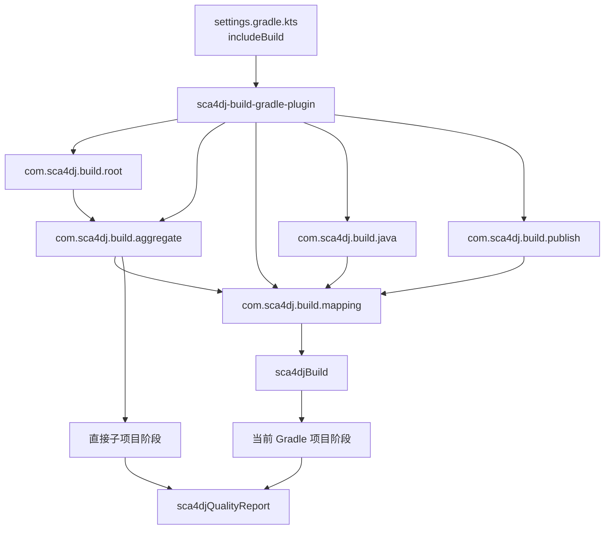
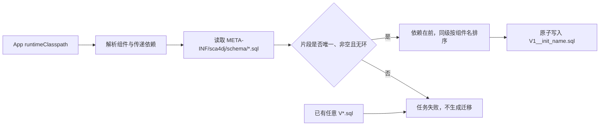

# 10 Sca4d-J 构建 Gradle 插件

源码：`tools/sca4dj-build-gradle-plugin`

`sca4dj-build-gradle-plugin` 是 Sca4d-J 仓库自己的 Gradle Included Build。它把 Java、前端、构建工具和目录项目各自已有的任务登记到同一组构建阶段，再从实际执行任务的项目逐级连接到仓库根任务。它不替代 Gradle 的 `compileJava`、`test`、`assemble`、Spotless、Checkstyle、SpotBugs 或前端脚本，而是明确这些任务在 Sca4d-J 构建中分别属于编译、测试、装配、格式化、审计还是发布。

这层映射让使用不同技术栈的项目参加同一次仓库构建：根项目不需要知道每个项目使用 Java、pnpm 还是另一个 Included Build，也不需要递归扫描目录寻找任务。每个项目声明自己参加哪些阶段，目录项目只汇总直接子项目，根项目最后给出统一命令和质量报告。

## 组成



插件构件包含五个 Gradle 插件、一个构建映射扩展、一个质量报告任务和三份 Java 检查资源。

| 目录或文件 | 内容 |
|---|---|
| `settings.gradle.kts` | Included Build 的插件仓库、依赖仓库和根版本目录接入 |
| `build.gradle.kts` | 插件自身构建、五个插件描述符、依赖、Java 21 和插件源码检查 |
| `src/main/java/com/sca4dj/build` | 阶段映射、Java 约定、逐级聚合、根任务、发布和质量报告实现 |
| `src/main/resources/com/sca4dj/quality` | Checkstyle、SpotBugs 排除项和 Eclipse Java formatter 规则 |
| `src/test/java/com/sca4dj/build` | Gradle TestKit 聚合测试和质量报告解析测试 |

| 插件 ID | 应用位置 | 具体行为 |
|---|---|---|
| `com.sca4dj.build.mapping` | 任何需要参加统一构建的项目 | 注册 `sca4djBuild` 扩展、本地阶段、聚合阶段、`sca4djBuild` 和 `sca4djQualityReport`；不假设项目使用哪种技术栈 |
| `com.sca4dj.build.java` | Java 或 Java Library 项目 | 应用 Mapping；发现 `java` 或 `java-library` 后配置 Java 21、测试、集成测试、格式化、Javadoc、Checkstyle 和 SpotBugs |
| `com.sca4dj.build.aggregate` | `core`、`modules` 等目录项目 | 应用 Mapping，只连接已经应用 Mapping 的直接子项目 |
| `com.sca4dj.build.publish` | 需要发布的 Java 构件 | 应用 Mapping 和 `maven-publish`，创建 `mavenJava` 并把发布任务映射到统一发布阶段 |
| `com.sca4dj.build.root` | Gradle 根项目 | 应用 Aggregate，注册仓库公开任务、构建元数据、最终失败检查和统一发布入口 |

其余类型各自处理一件事：

- `Sca4djBuildMapping` 保存当前 Gradle 项目的阶段任务、报告输入和最低质量级别。
- `QualityLevel` 定义 `SHIT`、`AGILE`、`ELEGANT` 和 `OBSESSIVE` 四个检查深度。
- `QualityGateTask` 读取项目 JSON、Checkstyle XML、SpotBugs XML 和子项目统一报告，写出 JSON、SARIF 与 HTML。
- `AuditFinding` 保存一条结果的项目、质量级别、规则、严重程度、文件、行号和消息。
- `checkstyle.xml`、`spotbugs-exclude.xml` 与 `eclipse-java-format.xml` 随插件构件发布，Java 项目不从自己的目录复制这些规则。

## 为什么使用 Included Build

主构建在 `settings.gradle.kts` 的 `pluginManagement` 中加载插件：

```kotlin
pluginManagement {
    includeBuild("tools/sca4dj-build-gradle-plugin")
}
```

Gradle 在配置主构建之前就必须解析插件，因此构建插件不能先作为主构建中的普通子项目完成编译。Included Build 让插件先独立构建，再通过插件 ID 供主构建使用；主构建中的 `plugins` 块不需要声明插件版本。

该 Included Build 的 `settings.gradle.kts` 从 `../../gradle/libs.versions.toml` 读取版本目录，所以它属于 Sca4d-J 仓库结构，不是可以移动到任意目录后独立发布的通用插件。Spotless、SpotBugs、Jackson 和测试依赖仍由根版本目录统一确定。

Included Build 也不属于主构建的项目树。根 `settings.gradle.kts` 另行执行 `include("tools")`，使 `tools/build.gradle.kts` 成为主构建中的 `:tools` 聚合项目。该项目用 `gradle.includedBuild(...).task(...)` 把两个构建插件的 `classes`、`test`、`assemble`、格式和审计任务显式映射进主构建阶段。`includeBuild(...)` 负责加载插件，`include("tools")` 负责让根生命周期和质量报告覆盖插件源码；两者不能相互替代。

## 阶段映射怎样工作

Mapping 为每个阶段注册两类任务：

- `sca4djLocalCompile`、`sca4djLocalTest` 等 `sca4djLocal*` 任务只执行当前 Gradle 项目通过 `sca4djBuild` 登记的任务。
- `sca4djCompile`、`sca4djTest` 等不带 `Local` 的任务先执行当前 Gradle 项目阶段；应用 Aggregate 后，它们还连接已登记的直接子项目同名阶段。

技术栈项目通过扩展登记自己的任务：

```kotlin
plugins {
    id("com.sca4dj.build.mapping")
}

sca4djBuild {
    minimumLevel.set(com.sca4dj.build.QualityLevel.ELEGANT)
    compile(tasks.named("typecheck"))
    test(tasks.named("unitTest"))
    integrationTest(tasks.named("e2e"))
    assemble(tasks.named("bundle"))
    format(tasks.named("format"))
    formatCheck(tasks.named("formatCheck"))
    audit(tasks.named("lintReport"))
    projectReports.from(layout.buildDirectory.file("reports/quality.json"))
}
```

`compile(...)`、`test(...)`、`integrationTest(...)`、`assemble(...)`、`format(...)`、`formatCheck(...)`、`audit(...)`、`fullAudit(...)` 与 `publish(...)` 只给当前 Gradle 项目对应的本地阶段增加依赖。`projectReports`、`checkstyleReports` 和 `spotBugsReports` 是当前 Gradle 项目的原始报告；`importedReports` 接受其他构建或子项目已经转换成统一格式的 `quality-report.json`。

Aggregate 只观察直接子项目是否应用 Mapping。未应用 Mapping 的项目不会进入任何阶段；孙项目必须先由中间项目应用 Aggregate，才能继续传到父项目。父项目的 `minimumLevel` 作为子项目的默认值，子项目显式设置后不会被父项目覆盖。

这种逐级关系让 `modules`、`core`、`apps` 和 `tools` 可以声明不同最低级别，也让一个目录是否参加仓库构建直接体现在它的 `build.gradle.kts` 中。

## Java 项目得到什么

Java 项目通常同时应用 Gradle Java 插件和 Sca4d-J Java 插件：

```kotlin
plugins {
    `java-library`
    id("com.sca4dj.build.java")
}
```

`com.sca4dj.build.java` 立即应用 Mapping，但只有项目应用 `java` 或 `java-library` 后才配置下列行为：

- Java Toolchain 使用 Java 21，所有 `JavaCompile` 增加 `-parameters`。
- 所有 `Test` 使用 JUnit Platform；Javadoc 允许省略项目规则明确不要求的重复注释，其他文档警告仍作为错误。
- 创建 `integrationTest` SourceSet 和同名 Test 任务。它复用测试依赖，并可读取 main 与 test 输出，但不会自动成为普通 `test` 的依赖。
- Spotless 格式化所有 SourceSet 的 Java、SQL 和 XML，以及当前 Gradle 项目的 `build.gradle.kts`。Java 规则删除未使用 import，并读取插件内置 Eclipse formatter 配置。
- Checkstyle 10.26.1 对全部 Checkstyle 任务生成 XML、HTML 和 SARIF；任务本身不立即让构建失败。
- SpotBugs 引擎固定为 4.10.3，应用共享排除文件并生成 XML、SARIF；普通 Java 项目的完整审计默认执行 `spotbugsMain`，不自动执行 `spotbugsTest`。
- `classes`、`test`、`integrationTest`、`assemble`、`spotlessApply` 和 `spotlessCheck` 分别映射到对应构建阶段；Checkstyle 与 `spotbugsMain` 映射到完整审计。

Checkstyle 和 SpotBugs 设置 `ignoreFailures`，是为了先生成完整报告，再由 QualityGateTask 按当前 Gradle 项目质量级别统一判断，而不是让第一个分析器发现问题后立即中断。分析器无法执行、配置文件缺失或报告无法解析仍会使任务失败。

## 质量级别

每个项目的有效级别按下式计算：

```text
effective = stricter(-Pquality.level, sca4djBuild.minimumLevel)
```

未传 `-Pquality.level` 时，请求级别是 `ELEGANT`。属性值忽略大小写和首尾空白；其他值在 Gradle 配置阶段失败。命令行只能提高检查深度，不能把项目降到它声明的最低级别以下。

| 有效级别 | `sca4djBuild` 在装配和报告之外增加的阶段 | 当前 Gradle 项目结果怎样记录 |
|---|---|---|
| `SHIT` | 无 | 使用下面的共同映射规则 |
| `AGILE` | 单元测试、格式检查、基础审计 | 使用下面的共同映射规则 |
| `ELEGANT` | `AGILE` 的阶段，再加集成测试和完整审计 | 使用下面的共同映射规则 |
| `OBSESSIVE` | 与 `ELEGANT` 执行相同阶段 | 当前 Gradle 项目全部非 `ERROR` 结果提升为 `ERROR` |

`SHIT`、`AGILE` 和 `ELEGANT` 使用同一套结果映射：项目 JSON 保留自己声明的严重程度；Checkstyle 结果记为 `WARNING`；高优先级的正确性、并发正确性、安全和恶意代码 SpotBugs 结果记为 `ERROR`，其他 SpotBugs 结果记为 `WARNING`。只要报告被登记为输入，这套映射就会执行。质量级别之间的主要差异是构建会自动执行哪些阶段；`OBSESSIVE` 再把当前 Gradle 项目的非 `ERROR` 结果提升为 `ERROR`。

阶段是否有实际工作取决于项目登记的任务。例如 Java 插件把 Checkstyle 和 SpotBugs 登记为 `fullAudit`，没有把它们登记为 `audit`；前端项目则可以把 ESLint 报告登记为 `audit`。

子项目先按自己的有效级别确定每条结果的严重程度，父项目导入时保留这个结果。父项目是 `OBSESSIVE` 不会把一个 `ELEGANT` 子项目已经确定的 `WARNING` 再提升为 `ERROR`。这样，最终报告不会改变子项目明确声明的最低质量策略。

## 质量报告与最终失败

每个应用 Mapping 的项目都有 `sca4djQualityReport`。普通项目把报告写到 `build/reports/sca4dj/quality/`，包含：

- `quality-report.json`：供父项目继续导入的稳定结果；
- `quality-report.sarif.json`：供支持 SARIF 2.1.0 的工具读取；
- `quality-report.html`：供本地直接查看。

项目自定义 JSON 报告使用审计结果数组。每条结果应给出规则、严重程度、位置和消息：

```json
[
  {
    "ruleId": "ARCH-MODULE-DEPENDENCY",
    "severity": "ERROR",
    "path": "modules/example/build.gradle.kts",
    "line": 12,
    "message": "模块不能依赖 App"
  }
]
```

`severity` 缺失时按 `WARNING` 读取，`line` 缺失时为 `0`，其他缺失字符串按空值读取；QualityGateTask 不对这些字段执行额外业务校验。无法解析的 JSON 会使报告任务失败。

QualityGateTask 给 Checkstyle 规则增加 `DOC-*` 前缀，给 SpotBugs 规则增加 `SPOTBUGS-*` 前缀，把绝对路径改为仓库相对路径，删除内容完全相同的重复项，然后按严重程度、项目、规则、文件和行号稳定排序。

普通项目报告只记录结果，不因报告中的 `ERROR` 自行失败。Root 让自己的 `sca4djQualityReport` 执行最终失败检查，输出目录是 `build/reports/quality/`，在控制台打印全部审计结果，并在所有报告写完后因任意 `ERROR` 失败。这样可以一次看到全部阻断问题，同时保留每个子项目自己的级别和来源。

## 根项目怎样使用

根项目应用 Root，并登记根项目自己的格式任务和最低级别：

```kotlin
plugins {
    id("com.sca4dj.build.root")
}

sca4djBuild {
    minimumLevel.set(com.sca4dj.build.QualityLevel.OBSESSIVE)
    format(tasks.named("spotlessApply"))
    formatCheck(tasks.named("spotlessCheck"))
}
```

Root 注册以下仓库公开入口：

| 命令 | 结果 |
|---|---|
| `./gradlew compile` | 执行全部已映射项目的编译阶段 |
| `./gradlew test` | 执行全部已映射项目的单元测试阶段 |
| `./gradlew integrationTest` | 执行全部已映射项目的集成测试阶段 |
| `./gradlew format` | 执行全部已映射项目的写入式格式化 |
| `./gradlew formatCheck` | 执行全部已映射项目的只读格式检查 |
| `./gradlew audit` | 按各项目有效级别执行已登记审计并生成最终报告；不运行单元测试或集成测试 |
| `./gradlew build` | 对每个已映射项目执行装配、适用的测试与审计，并执行根项目的最终失败检查 |
| `./gradlew publishSca4djArtifacts` | 执行全部已映射项目的发布阶段 |

这些是仓库级入口，不代替开发时的局部检查。只修改一个 Java 项目时仍应运行该项目的 `compileJava` 或相关测试；只有改动确实跨越多个项目时才使用根任务。

## 典型项目怎样映射

下面的示例分别处理实际执行任务的 Java 项目、只汇总子项目的目录项目、非 Java 项目和 Included Build。每个项目只声明自己实际拥有的任务，不需要为了填满阶段创建空任务。

### 可发布 Java 模块

新的 Java Library 同时应用 Java、Sca4d-J Java 和发布插件：

```kotlin
plugins {
    `java-library`
    id("com.sca4dj.build.java")
    id("com.sca4dj.build.publish")
}
```

Java 插件会自动映射 `classes`、`test`、`integrationTest`、`assemble`、`spotlessApply`、`spotlessCheck`、Checkstyle 和 `spotbugsMain`。发布插件把 `mavenJava` 的发布任务映射到发布阶段。只在仓库内部使用、不需要发布 Maven 构件的 App 或工具项目不应用 Publish。

### 目录聚合项目

`modules` 或 `modules/example` 这类只用于组织子项目的目录应用 Aggregate：

```kotlin
plugins {
    id("com.sca4dj.build.aggregate")
}

sca4djBuild {
    minimumLevel.set(com.sca4dj.build.QualityLevel.ELEGANT)
}
```

这个项目没有自己的编译产物，只把已经应用 Mapping 的直接子项目连接到自己的阶段。更深层实际执行任务的项目必须由每一层目录继续应用 Aggregate；少一层时，根任务不会越过该目录扫描孙项目。

### 前端或其他非 Java 项目

非 Java 项目先创建真实技术栈任务，再用 Mapping 登记阶段：

```kotlin
plugins {
    id("com.sca4dj.build.mapping")
}

val frontendTypecheck = tasks.register<Exec>("frontendTypecheck") {
    workingDir(layout.projectDirectory)
    commandLine("pnpm", "run", "typecheck")
}
val frontendTest = tasks.register<Exec>("frontendTest") {
    workingDir(layout.projectDirectory)
    commandLine("pnpm", "run", "test")
}
val frontendBuild = tasks.register<Exec>("frontendBuild") {
    workingDir(layout.projectDirectory)
    commandLine("pnpm", "run", "build")
}

sca4djBuild {
    compile(frontendTypecheck)
    test(frontendTest)
    assemble(frontendBuild)
}
```

Mapping 不解释 pnpm 的脚本含义，只让仓库根 `compile`、`test` 和 `build` 能调用这些任务。项目有 ESLint、E2E、格式化或发布任务时，再分别登记 `audit(...)`、`integrationTest(...)`、`format(...)`、`formatCheck(...)` 或 `publish(...)`；没有的阶段保持为空。

### 连接另一个 Included Build

Included Build 不在主构建项目树中，Aggregate 无法自动发现。承接它的主构建项目必须显式取得任务引用：

```kotlin
plugins {
    id("com.sca4dj.build.aggregate")
}

val pluginBuild = gradle.includedBuild("example-gradle-plugin")

sca4djBuild {
    compile(pluginBuild.task(":classes"))
    test(pluginBuild.task(":test"))
    assemble(pluginBuild.task(":assemble"))
    formatCheck(pluginBuild.task(":spotlessCheck"))
}
```

这里的任务路径属于 Included Build 自己的根项目。主构建只持有 Gradle 的任务引用，不把 Included Build 假装成 `:tools:example-gradle-plugin` 子项目。Included Build 生成的统一质量报告还应通过 `importedReports` 登记，原始 Checkstyle 或 SpotBugs 报告则使用各自的报告集合。

### 命令行不能降低模块下限

假设一个实际执行任务的项目声明：

```kotlin
sca4djBuild {
    minimumLevel.set(com.sca4dj.build.QualityLevel.ELEGANT)
}
```

执行 `./gradlew :modules:example:build -Pquality.level=SHIT` 时，该项目仍输出并采用：

```text
Sca4d-J quality | project=:modules:example requested=SHIT minimum=ELEGANT effective=ELEGANT
```

因此它仍运行单元测试、格式检查、基础审计、集成测试和完整审计。命令行的 `SHIT` 只会降低那些最低级别确实允许 `SHIT` 的项目；它不是跳过模块质量要求的开关。

## 构建元数据与发布

Root 配置所有主构建项目的 `group=com.sca4dj` 与 `version=0.0.1-alpha`，并在根扩展属性中写入：

- `sca4dBuildTime`：Asia/Shanghai 时区的 `yyyyMMdd-HHmm`；
- `sca4dBuildCommit`：当前 Git 短提交；
- `sca4dBuildBranch`：当前分支，detached HEAD 时使用 `detached`；
- `sca4dBuildAuthor`：当前提交作者；
- `sca4dBuildMode`：存在 `-Prelease` 时为 `release`，否则为 `dev`；
- `sca4dBuildVersion`：开发构建为 `<commit>-<time>`，发布构建为 `<releaseBase>-<commit>`。

发布模式的 `releaseBase` 优先读取 `-Prelease.version`，否则使用最近 Git tag；没有 tag 时使用 `untagged`。Git 查询没有结果时使用固定回退值，构建元数据不会因为仓库处于 detached HEAD 而为空。

`com.sca4dj.build.publish` 为 Java 组件创建 `mavenJava`。仓库名固定为 `sca4dj`；`-Psca4dj.repository=<uri>` 指定发布位置，未指定时写入根项目 `build/repository`。插件只发布应用它的项目，目录聚合项目和 App 不会因为 Root 存在就自动成为 Maven 构件。

## 限制与失败结果

- Root 只能应用到 Gradle 根项目，应用到子项目立即失败。
- Java 插件不会自动应用 `java`；没有 Java 或 Java Library 插件时，它只让项目参加 Mapping。
- Aggregate 不递归扫描项目树，也不根据文件目录推断任务。中间项目未应用 Aggregate 时，其孙项目不会出现在父项目结果中。
- `audit` 只执行审计和报告，不隐式执行测试；`format` 会修改文件，`formatCheck` 才是只读检查。
- `-Pquality.level` 不能降低项目最低级别。非法值会在执行任务前失败。
- 项目 JSON、Checkstyle XML 或 SpotBugs XML 无法读取时，QualityGateTask 失败，不把损坏报告当成零问题。
- OBSESSIVE 只提升当前 Gradle 项目的原始审计结果；从子项目导入的结果保留子项目已经确定的严重程度。
- 当前插件不注册 Qodana 或依赖漏洞审计任务。需要这类检查时，项目必须显式创建任务和报告，再通过 `fullAudit(...)`、`projectReports` 或 `importedReports` 接入。

## App Gradle 插件

`com.sca4dj.app` 为使用数据库的 Sca4d-J App 注册 `sca4djApp` 扩展和 `initFlyway` 任务。插件只生成 App 的第一份 Flyway 迁移，不执行迁移，也不负责 V2 及后续数据库变化。

### 配置与任务

应用插件后，`sca4djApp.migrationName` 默认把 Gradle 项目名转换为小写下划线名称：连续的非字母数字字符变成 `_`，首尾 `_` 被移除。最终名称只能包含小写字母和数字，并使用单个下划线分隔各段。App 可以显式设置稳定名称：

```kotlin
plugins {
    id("com.sca4dj.app") version "<sca4dj-version>"
}

sca4djApp {
    migrationName.set("sample_app")
    schemaFragment.set(layout.projectDirectory.file("src/main/resources/schema/app.sql"))
}
```

`schemaFragment` 可选。它指向 App 自己拥有的 `.sql` 文件；未配置时只写运行依赖提供的结构。配置后，文件必须存在、非空且使用 `.sql` 后缀。

插件在 Java 插件存在时注册 `initFlyway`。任务读取 App 的 `runtimeClasspath`，把结果写入 `src/main/resources/db/migration/V1__init_<migrationName>.sql`。正常开发应显式运行 `initFlyway`；提供 `-Psca4dj.init` 时，`processResources` 会先运行该任务，适合第一次构建尚无迁移的 App。

### 结构片段与顺序

模块把当前数据库结构放在自己的 `META-INF/sca4dj/schema/<name>.sql`。`initFlyway` 可以从依赖 JAR 或类目录读取片段，并按提供片段的 Gradle 组件之间的传递依赖关系排序。



每个依赖组件最多提供一个结构片段，片段名称在整个运行类路径中必须唯一，内容不能为空。依赖片段总是排在引用它的组件片段之前；互不依赖的组件按组件显示名称排序，因此相同依赖图会得到稳定结果。`schemaFragment` 不参与模块排序，始终在所有依赖片段之后写入，让 App 表可以引用模块已经建立的表。输出保留每个片段的组件和片段名称注释，并统一使用 LF 换行。

### 文件所有权与失败结果

`initFlyway` 只允许在没有任何 `V*.sql` 的迁移目录中运行。它不会覆盖 V1，也不会在已有 V2 等迁移时补写 V1。输出使用同目录临时文件和原子移动；文件系统不支持原子移动时任务失败，不留下部分迁移。

以下情况会使任务失败：

- `runtimeClasspath` 中没有任何结构片段；
- `sca4djApp.migrationName` 为空或不符合小写下划线名称格式；
- 一个组件提供多个片段、片段为空或不同组件使用同一片段名；
- `sca4djApp.schemaFragment` 不存在、不是 `.sql` 文件或内容为空；
- 提供片段的组件之间存在依赖环；
- App 已有任意 Flyway 迁移；
- 依赖无法解析、片段无法读取或迁移无法原子写入。

生成成功后，V1 由 App 自己维护。模块结构以后发生变化时，已经创建的 App 应新增 V2、V3 等迁移，不能重新运行 `initFlyway` 改写已经使用的 V1。模块与 App 的职责关系见[系统组成](/tutorials/build-deploy-troubleshoot)，完整示例见[Sca4d Server 应用](/tutorials/assemble-application)。
