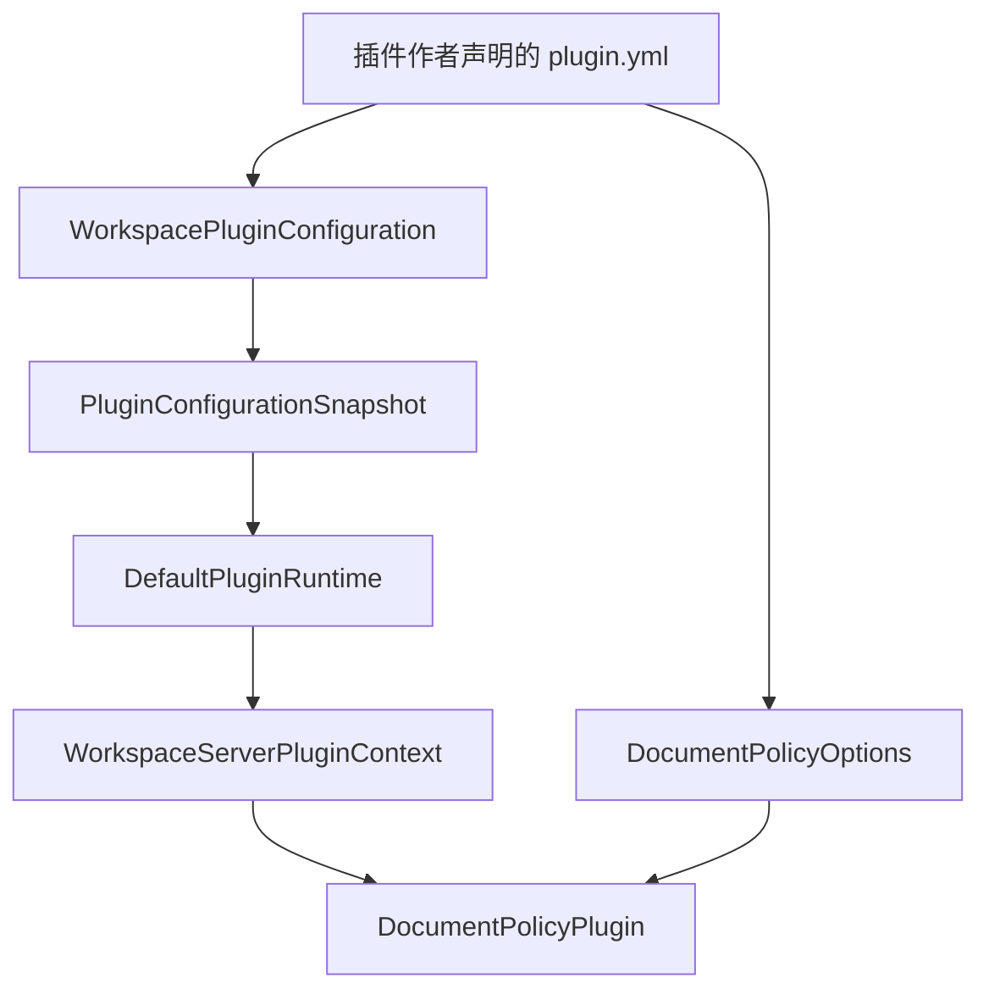

# 为 App 开放插件 API

本页以 Workspace 应用为例。
不同客户对「Document 能否发布」有不同规则，例如必须附带至少一个 Attachment，或必须有第二位 Member 审核。
这些规则不应写进主程序，也不应每次修改都重新部署整个应用。

App 声明宿主服务、扩展接口约定和公开配置类型后，脚手架在构建时生成类型安全客户端、直接调用分发器和可发布的 API JAR。
插件作者在资源目录中声明元信息和私有配置。
App 映射元信息并提供额外配置。

读完本页后，可以完成以下工作：

- 为 App 声明一个宿主服务和一个必需扩展，并生成 API JAR；
- 编写、构建并加载一个 `DocumentPolicy` 插件；
- 配置加载、热替换、配置重载和停止。

插件针对 App 生成的 API 编程。
认证、IAM 和 IoT 等业务模块继续使用普通接口。
App 把生成客户端挂到自己的业务位置。

## 实现步骤

### 步骤 1：声明宿主服务与扩展

`@PluginService` 声明宿主服务，`@PluginExtension` 声明插件可以提供的实现。
每个公开方法通过 `@PluginOperation` 指定稳定的操作编码。
运行时的服务、操作、扩展和插件编码，都使用 TreeCode。

```java
/** 宿主向插件开放的只读事实，由具体应用定义。 */
@PluginService("WORKSPACE:DOCUMENT:FACTS")
public interface DocumentFacts {

    @PluginOperation("COUNT_ATTACHMENTS")
    int countAttachments(long documentId);
}

/** 插件必须提供的发布策略，由具体应用定义。 */
@PluginExtension(value = "WORKSPACE:DOCUMENT:POLICY", required = true)
public interface DocumentPolicy {

    @PluginOperation("CAN_PUBLISH")
    boolean canPublish(long documentId, int attachmentCount);
}
```

`@PluginExtension` 的 `selection` 默认是 `SINGLE`，也可以是 `KEYED`。
`required` 默认是 `false`，设为 `true` 时启动必须存在实现。
扩展必须声明为接口，每个约定接口的方法必须声明 `@PluginOperation`，约定接口至少有一个操作。

已有类也可以声明 `@PluginService`，只公开带 `@PluginOperation` 的 public 实例方法。
构建会生成独立接口及宿主绑定类。

需要隐藏内部类型或改变签名时，由 App 编写适配对象，再通过 `@PluginBinding` 绑定接口：

```java
/** 把宿主 Repository 绑定到 DocumentFacts，由具体应用定义。 */
@Service
@PluginBinding(DocumentFacts.class)
public class WorkspaceDocumentFacts implements DocumentFacts {

    private final AttachmentRepository attachments;

    public WorkspaceDocumentFacts(AttachmentRepository attachments) {
        this.attachments = attachments;
    }

    @Override
    public int countAttachments(long documentId) {
        return attachments.countByDocument(documentId);
    }
}
```

App 数据类型通过 `@PluginApiType` 导出。
它们的字段及公开方法引用的外部类型，必须来自明确的共享构件。
生成器拒绝任意 Object、没有具体类型的泛型、Future、流和函数对象等公开签名。

### 步骤 2：生成 App API

App 使用 `com.sca4dj.plugin-api` 配置生成入口：

```kotlin
appPluginApi {
    id.set("WORKSPACE:SERVER")
    version.set("1.1.0")
    generatedPackage.set("com.example.workspace.plugin.api")
    entryName.set("WorkspaceServerPlugin")
    configurationType.set("com.example.workspace.plugin.WorkspaceServerPluginSettings")
}
```

`version` 的默认值是 `1.0.0`。
包名和类名由具体应用定义。

`pluginShared` 明确选择共享构件。
例如共享整个 `sca4dj-core-api` 和 SLF4J API，插件就可以使用 TreeCode、Plugin 公共接口约定和宿主日志。
共享范围不从宿主全部依赖推断，也不会自动包含 Core Spring 或具体认证模块。

`configurationType` 必须是声明了 `@PluginApiType` 的公开、无类型参数的具体类型。
生成上下文的 `configuration()` 返回这个准确类型。
配置及其引用类型进入 API 导出清单。
Spring 在插件启动前，校验 App 配置提供者使用同一份类型。

`pluginProcessor` 配置注解处理器。
仓库内的 App 将它绑定到 Included Build 的 `pluginProcessorJar`。
独立工程使用发布的 `com.sca4dj:sca4dj-plugin-processor`。

构建 App API 并生成 JAR 与源码包：

```bash
nice -n 10 ./gradlew --max-workers=1 -Dorg.gradle.jvmargs="-Xmx1g -XX:MaxMetaspaceSize=384m" :apps:<应用名>-server:pluginApiJar :apps:<应用名>-server:pluginApiSourcesJar
```

输出位于 App 的 `build/libs`。
输出只包含公开接口、显式数据类型、生成客户端、App 插件入口和接口约定描述，不包含宿主 Service、Repository、Mapper 或 Controller。

生成源码位于 `build/generated/sources/annotationProcessor/java/main`。
Gradle 向 IDEA 声明该目录。
修改声明后重新编译，不手工编辑生成文件。

`publishPluginApiPublicationToSca4djRepository` 把 API、源码和共享依赖 POM 发布到根 `build/repository`。
API 版本独立于 App 构建版本。

生成的入口有以下成员：

- 抽象基类 `WorkspaceServerPlugin`（名称来自 `entryName`），插件继承它并实现 `onLoad`。
- 上下文类 `WorkspaceServerPluginContext`。
- `configuration()` 返回 App 公开配置。
- 对每个 `@PluginService`，生成以接口名首字母小写命名的方法，例如 `documentFacts()`。
- 对每个 `@PluginExtension`，生成 `registerDocumentPolicy(...)`。`KEYED` 扩展额外接收一个 `TreeCode key`。

### 步骤 3：编写插件

插件使用 `com.sca4dj.plugin`，通过 `pluginApi` 依赖生成的 API。
仓库内选择 App 的 `pluginApiElements`，独立工程使用发布坐标。
该配置用于编译和测试，不打入插件运行 JAR。

```kotlin
dependencies {
    add("pluginApi", project(path = ":apps:<应用名>-server", configuration = "pluginApiElements"))
    implementation("com.fasterxml.jackson.dataformat:jackson-dataformat-yaml:${libs.versions.jackson.asProvider().get()}")
}
```

插件作者维护 `src/main/resources/plugin.yml`。
构建任务按资源原样打包，不生成或覆盖元信息。
下例中的键由具体应用定义：

```yaml
plugin:
  name: WORKSPACE:SERVER:DOCUMENT_POLICY
  version: 1.0.0
  main: com.example.workspace.policy.DocumentPolicyPlugin
  api: WORKSPACE:SERVER
  requires: ">=1.1.0 & <2.0.0"
policy:
  min-attachments: 1
```

文件路径、`plugin` 分组及其中的键由 App 的配置提供者定义。
其他 App 可以选择不同的资源、格式和键，通过自己的配置提供者映射 `PluginDescriptor`。
运行时不解析 `policy` 中的字段，`min-attachments` 只由插件自己解释。

插件继承 App 生成的基类，通过类型安全上下文取得宿主配置、服务并登记扩展。
私有配置使用当前插件的类加载器读取。
同名资源不会读取宿主或其他插件的文件：

```java
/** 从自身 YAML 读取策略选项，并向 Workspace 应用登记发布策略。 */
public final class DocumentPolicyPlugin extends WorkspaceServerPlugin {

    @Override
    public void onLoad(WorkspaceServerPluginContext context) throws Exception {
        DocumentPolicyOptions options;
        try (var input = Objects.requireNonNull(getClass().getResourceAsStream("/plugin.yml"))) {
            options = DocumentPolicyOptions.read(input);
        }
        context.registerDocumentPolicy(new MinAttachmentsPolicy(context.documentFacts(), options));
    }
}
```

`DocumentPolicyOptions` 和 `MinAttachmentsPolicy` 由插件作者定义。
`MinAttachmentsPolicy` 实现 `DocumentPolicy`，用 `documentFacts().countAttachments(documentId)` 读取事实。

`onLoad` 准备候选实现。
初始化、版本校验和绑定冲突检查成功后，运行时一次发布全部登记结果。
候选失败时，运行时尝试停止候选并关闭加载资源，旧版继续接受调用。
初始化期间不要执行无法撤销的外部业务动作。

私有依赖放入 `implementation`。
`pluginJar` 生成普通 JAR，拒绝重复私有类或重复打包共享类型。
服务描述文件冲突也会使构建失败。
插件作者需要明确处理资源，不能依赖覆盖顺序。
Boot 可执行 JAR 和多版本类不作为插件交付形式。

### 步骤 4：提供 App 配置提供者

App 启用插件时注册一个 [PluginConfiguration](/javadoc/core/sca4dj-core-api/com/sca4d/core/api/plugin/PluginConfiguration.html) Bean。
它从候选 JAR 的 `plugin.yml` 读取 `name`、`version`、`main`、`api` 和 `requires`，映射为 `PluginDescriptor`，并创建 App 公开配置。

```java
/** 把候选 JAR 的 plugin.yml 映射为描述与公开配置，由具体应用定义。 */
@Component
class WorkspacePluginConfiguration implements PluginConfiguration<WorkspaceServerPluginSettings> {

    private final PluginMetadataReader metadata;

    private final String applicationName;

    WorkspacePluginConfiguration(
            PluginMetadataReader metadata,
            @Value("${spring.application.name}") String applicationName) {
        this.metadata = metadata;
        this.applicationName = applicationName;
    }

    @Override
    public Class<WorkspaceServerPluginSettings> type() {
        return WorkspaceServerPluginSettings.class;
    }

    @Override
    public PluginConfigurationSnapshot<WorkspaceServerPluginSettings> load(Path artifact) throws Exception {
        PluginDescriptor descriptor = metadata.descriptor(artifact);
        return new PluginConfigurationSnapshot<>(
                descriptor, new WorkspaceServerPluginSettings(applicationName));
    }

    @Override
    public PluginConfigurationSnapshot<WorkspaceServerPluginSettings> reload(Path artifact) throws Exception {
        return load(artifact);
    }

    @Override
    public void unload(PluginConfigurationSnapshot<WorkspaceServerPluginSettings> snapshot) {
        // 只有不可变值，无需释放资源。
    }
}
```

`PluginMetadataReader` 和 `WorkspaceServerPluginSettings` 由具体应用定义。
`PluginDescriptor` 的构造参数依次是插件编码、版本、App API 编码、API 版本要求和入口类名。
插件通过 `context.configuration().applicationName()` 读取 `WorkspaceServerPluginSettings` 中的值。
其他 App 可以组合已有的 Setting、文件、数据库或部署配置，公开自己需要的不可变类型。
配置提供者和 Spring 对象不会交给插件。

App 可以通过 Core Spring 的 `JarSettingReader` 和 `YamlCodec` 读取指定构件中的资源。
插件通过私有 YAML 依赖解释自己的字段。
两者都拒绝超过 1 MiB 的配置和重复 YAML 键，并在读取资源后关闭输入。



`PluginConfiguration` 的生命周期如下：

| 生命周期 | 输入与结果 |
|---|---|
| `type()` | 返回 App API 声明的准确共享配置类型 |
| `load(Path)` | 为首次加载或更新构件读取配置，返回描述与独立快照 |
| `reload(Path)` | 从活动构件的副本重读配置，为新实例创建快照，插件编码不能改变 |
| `unload(snapshot)` | 候选失败或旧代次无活动租用后释放该快照的资源，每个快照调用一次 |

`load` 或 `reload` 在返回前失败时，提供者自行释放已经创建的资源。
返回后的快照由运行时管理。
App 不得修改活动快照。
`unload` 可能与新代次的加载并发执行，不能释放 App 共享服务或其他代次的资源。

### 步骤 5：挂载并调用

App 在构造参数或字段上声明 `@PluginMount`，并在需要固定插件代次的方法上声明 `@PluginScope`：

```java
/** 发布前调用插件策略，由具体应用定义。 */
@Service
class DocumentPublishService {

    private final DocumentPolicy policy;

    private final DocumentFacts facts;

    DocumentPublishService(
            @PluginMount("WORKSPACE:DOCUMENT:POLICY") DocumentPolicy policy,
            DocumentFacts facts) {
        this.policy = policy;
        this.facts = facts;
    }

    @PluginScope
    boolean publishable(long documentId) {
        return policy.canPublish(documentId, facts.countAttachments(documentId));
    }
}
```

`KEYED` 扩展同时指定 `key`。
挂载得到的生成客户端对象不变，插件替换时客户端对象也不变。

客户端通过 `ApiInvoker` 调用已登记的操作，分发器直接调用实际对象。
宿主绑定使用 Spring 代理后的 Bean，保持当前线程和 Call，不自动改变身份、事务管理器或数据源。
动态入口继续检查目标、参数、结果和共享类型身份。

`@PluginScope` 标记 App 类、方法或 `@Bean` 方法，作用如下：

- 业务方法上的 `@PluginScope` 由 `CallLifecycleAdvisor.MethodBinding` 接入 `CallLifecycle`，在 `Around` 阶段保存进入时的绑定快照。`@Bean` 方法仍由 Bean 工厂适配器包装。
- 嵌套范围复用同一组插件代次。外层 Spring 事务已开启事务同步时，租用延续至提交或回滚完成。
- 租用表示旧代次仍被调用持有。使用数量归零后，才能释放。
- 没有父 Call 的方法入口使用 System Call。已有 HTTP、消息或任务 Call 时，复用当前身份。

首版只管理同步调用。
插件实现对象、私有依赖对象和私有 Class 不得逃出调用范围。
后台线程、订阅和异步结果需要另外管理，不能依靠普通方法返回自动释放。

### 步骤 6：部署

启用插件机制，并列出启动时加载的构件：

```yaml
sca4dj:
  plugin:
    enabled: true
    api: WORKSPACE:SERVER
    artifacts:
      - plugins/document-policy-1.0.0.jar
    cache-directory: build/plugin-cache
    drain-timeout: PT30S
```

| 配置 | 作用与默认值 |
|---|---|
| `sca4dj.plugin.enabled` | 设为 true 时启用 Spring 适配；未设置时不启用 |
| `sca4dj.plugin.api` | 启用时必须指定，与生成描述中的 App API 编码一致 |
| `sca4dj.plugin.artifacts` | 启动时加载的本地 JAR 路径列表，默认空列表；必需扩展仍须有实现 |
| `sca4dj.plugin.cache-directory` | 保存构件不可变副本，默认 `build/plugin-cache` |
| `sca4dj.plugin.drain-timeout` | 等待旧代次操作结束的非负时长，默认 `PT30S`；零表示不等待 |

发行包的任务名、插件路径环境变量和缓存目录环境变量由具体应用的构建与部署配置定义。
Spring 在单例、数据库迁移和系统身份准备完成后加载插件，再开放正常业务。
配置提供者缺失、类型不一致、必需扩展缺失、API 不兼容或初始化失败时，启动失败。
启动不会回退到较弱的策略。

### 步骤 7：重载、热替换与停止

App 注入 Core 的 `PluginRuntime`，通过 `replace(Path, Duration)` 加载同编码的新版本：

```java
PluginUpdate update = runtime.replace(Path.of("plugins/document-policy-1.1.0.jar"), Duration.ofSeconds(30));
PluginStatus current = update.current();
PluginStatus previous = update.previous();
```

`PluginUpdate` 分别报告新旧代次的状态。
首次加载时，`previous()` 为 `null`。

App 提供的额外配置发生变化时，显式调用配置重载：

```java
runtime.reload(TreeCode.of("WORKSPACE:SERVER:DOCUMENT_POLICY"), Duration.ofSeconds(30));
```

`reload` 复制活动代次保存的构件，调用 App 提供者的 `reload`，并初始化新实例。
它不重新读取原部署文件，也不修改已有实例。
新配置或初始化失败时，活动代次继续使用已有配置。

示例不把私有 YAML 保存到磁盘。
修改内嵌元信息或私有配置后，必须重新构建 JAR 并调用 `replace`。

新代次发布后接受新调用。
已有作用域继续使用旧实例和旧配置。
等待超时或线程中断时，新版已经生效。
旧版保留 DRAINING 状态，并在最后一个租用归还后尝试释放。
替换只影响之后的调用；进行中的调用通过租用继续使用旧代次，因此替换不会中断这些调用。

插件卸载和配置卸载分别执行。
任一回调失败时，仍尝试关闭加载器。
释放失败时记录 FAILED，不强行终止线程。

状态查询 `statuses()` 包含版本、代次、构件摘要、使用数量和阶段。
状态查询不持有实际插件对象。

普通 `stop` 不允许移除必需扩展。
必需扩展通过替换更新或随 App 关闭。
回退通过重新加载上一份构件完成。

## 扩展方式

应用向框架提供三类实现，框架在启动时发现并校验：

| 要接入的内容 | 应用实现 | 声明方式 | 框架发现与校验 |
|---|---|---|---|
| 宿主服务 | 带 `@PluginService` 的接口或类，以及实现它的 Bean | `@PluginBinding` 绑定的 Spring Bean | `PluginBindingsLifecycle` 在启动阶段绑定带 `@PluginBinding` 的 Bean |
| 扩展点 | 带 `@PluginExtension` 的接口 | 插件在 `onLoad` 中登记实现 | `PluginMountResolver` 把 `@PluginMount` 注入点解析为生成客户端。`required = true` 的扩展缺失时，`verifyRequired()` 失败，启动失败 |
| 配置提供者 | `PluginConfiguration<C>` | Spring Bean | `PluginAutoConfiguration` 在 `sca4dj.plugin.enabled` 为 `true` 时读取该 Bean，并校验 `type()` 与公开配置类型一致 |

接入一个新扩展点的步骤：

1. 声明带 `@PluginExtension` 的接口，每个方法加 `@PluginOperation`。
2. 重新构建 API JAR，确认生成了 `register<扩展接口名>(...)` 方法。
3. 在使用方用 `@PluginMount("<扩展编码>")` 注入，并在入口方法上声明 `@PluginScope`。
4. 在插件的 `onLoad` 中调用 `register...` 登记实现，重新构建插件 JAR。
5. 加入 `sca4dj.plugin.artifacts` 并启动，确认启动成功。

## 验证

- 启动应用，确认没有 `verifyRequired()` 失败。
- 调用 `publishable(documentId)`，对没有 Attachment 的 Document 返回 `false`，对有 Attachment 的 Document 返回 `true`。
- 调用 `runtime.statuses()`，确认插件处于激活阶段。
- 调用 `runtime.replace(...)`，确认 `current()` 是新代次，`previous()` 在排空后变为停止。替换期间正在执行的调用继续使用旧实例。
- 调用 `runtime.reload(...)`，确认新配置生效；让新配置非法，确认活动代次不变。

## 失败结果与限制

| 条件 | 结果 |
|---|---|
| 配置提供者缺失、公开配置类型与 `type()` 不一致 | 启动失败，抛出 `IllegalStateException`：App 插件配置提供者与公开配置类型不一致 |
| App API 描述或共享清单缺失、重复 | 启动失败，抛出 `IllegalStateException` |
| 必需扩展缺失、API 不兼容或插件初始化失败 | 启动失败，抛出 `PluginSpringException`：App 必需插件装配失败 |
| `@PluginMount` 的扩展种类或注入类型不一致 | `IllegalArgumentException`：插件挂载类型与扩展声明不一致 |
| 接口约定编码或操作编码重复 | 构建失败 |
| 扩展不是接口，约定接口的方法缺少 `@PluginOperation`，或约定接口没有操作 | 构建失败 |
| 公开签名使用任意 Object、没有具体类型的泛型、Future、流或函数对象 | 构建失败 |
| 约定使用的类型没有 `@PluginApiType` 且不在共享构件中 | 构建失败 |
| `configurationType` 不是无类型参数的 public `@PluginApiType` | 构建失败：App 插件配置必须声明无类型参数的 public PluginApiType |
| 资源缺失、元信息非法、公开配置类型不一致或私有配置非法 | 候选不发布，旧版继续使用 |
| 插件私有 YAML 超过 1 MiB，或包含重复键 | 读取失败，候选不发布 |
| 重复私有类、重复打包共享类型或服务描述文件冲突 | `pluginJar` 构建失败 |

- 管理操作只作用于接收调用的 App 实例，不自动监听文件，也不广播到其他实例。多实例部署时，由 App 的部署或管理流程向各实例发布同一构件和配置。每个实例独立维护自己的加载器、快照和排空状态。业务数据仍使用原有共享存储。
- 宿主共享明确的 API 类。每个插件代次独立加载实现与私有依赖。私有类缺失时，不借用宿主或其他插件的依赖。
- 类加载隔离不是恶意代码的安全沙箱。关闭加载器可以释放文件资源。类卸载由 JVM 在引用消失后执行。
- 管理类调用（`replace`、`reload`、`stop`）必须在调用作用域外执行，等待时间不得为负。
- 目标插件不可用时，调用抛出 `PluginUnavailableException`，错误码为 `1098`。详见[插件能力](/capabilities/foundation/plugin)。

## 相关页面

- [插件能力](/capabilities/foundation/plugin)
- [组装应用](/tutorials/assemble-application)
- [构建、部署与排障](/tutorials/build-deploy-troubleshoot)
- [App Gradle 插件](/reference/build-plugins#app-gradle-插件)
- [调用生命周期](/capabilities/identity-access/call-lifecycle)
