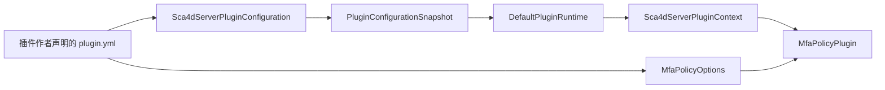

# 为 App 开放插件 API

App 声明宿主服务、扩展契约和公开配置类型后，脚手架在构建时生成类型安全客户端、直接调用分发器和可发布的 API JAR。插件作者在资源目录中声明元信息和私有配置，App 映射元信息并提供额外配置。本教程以 Sca4d Server 的多因素认证（MFA）策略插件说明构建、加载、配置重载和热替换。

插件针对 App 生成的 API 编程。认证、IAM 和 IoT 等业务模块继续使用普通接口；App 把生成客户端挂到自己的业务位置。

## 声明与绑定

`@PluginService` 声明宿主服务，`@PluginExtension` 声明插件可以提供的实现。每个公开方法通过 `@PluginOperation` 指定稳定操作编码。运行时服务、操作、扩展和插件编码使用 TreeCode。

Sca4d Server 的 `MfaFacts` 使用 `AUTH:MFA:FACTS`，提供账号设置、已安装方法元数据和可用方法，不提供 Credential、Proof 或 Secret。`MfaPolicy` 使用必需的单实现扩展 `AUTH:MFA:POLICY`，决定因素要求、允许的方法、设置合法性和凭据移除保护。

已有类也可以声明 `@PluginService`，只公开带 `@PluginOperation` 的 public 实例方法。构建生成独立接口及宿主绑定类。需要隐藏内部类型或改变签名时，由 App 编写适配对象，再通过 `@PluginBinding` 绑定接口。

```java
@Service
@PluginBinding(MfaFacts.class)
public class MfaFactsService implements MfaFacts {
    // 使用宿主已有 Settings 和认证方法读取事实。
}
```

App 数据类型通过 `@PluginApiType` 导出。它们的字段及公开方法引用的外部类型必须来自明确的共享构件。生成器拒绝任意 Object、没有具体类型的泛型、Future、流和函数对象等公开签名。

## 构建 App API

App 使用 `com.sca4dj.plugin-api` 配置生成入口：

```kotlin
appPluginApi {
    id.set("SCA4D:SERVER")
    version.set("1.1.0")
    generatedPackage.set("com.sca4d.app.server.plugin.api")
    entryName.set("Sca4dServerPlugin")
    configurationType.set("com.sca4d.app.server.plugin.Sca4dServerPluginSettings")
}
```

`pluginShared` 明确选择共享构件。示例共享整个 `sca4dj-core-api` 和 SLF4J API，因此插件可以使用 TreeCode、认证因素、Plugin 公共契约和宿主日志。共享范围不从宿主全部依赖推断，也不自动包含 Core Spring 或具体认证模块。

`configurationType` 必须是声明 `@PluginApiType` 的公开具体类型。生成上下文的 `configuration()` 返回这个准确类型，配置及其引用类型进入 API 导出清单；Spring 在插件启动前校验 App 配置提供者使用同一份类型。

`pluginProcessor` 配置注解处理器。仓库内 App 将它绑定到 Included Build 的 `pluginProcessorJar`；独立工程使用发布的 `com.sca4dj:sca4dj-plugin-processor`。

```bash
nice -n 10 ./gradlew --no-daemon --max-workers=1 -Dorg.gradle.jvmargs="-Xmx1g -XX:MaxMetaspaceSize=384m" :apps:sca4d-server:pluginApiJar :apps:sca4d-server:pluginApiSourcesJar
```

输出位于 App 的 `build/libs`，仅包含公开接口、显式数据类型、生成客户端、App 插件入口和契约描述，不包含宿主 Service、Repository、Mapper 或 Controller。

生成源码位于 `build/generated/sources/annotationProcessor/java/main`。Gradle 向 IDEA 声明该目录；修改声明后重新编译，不手工编辑生成文件。

`publishPluginApiPublicationToSca4djRepository` 把 API、源码和共享依赖 POM 发布到根 `build/repository`。示例坐标为 `com.sca4dj:sca4d-server-plugin-api:1.1.0`。API 版本独立于 App 构建版本。

## 编写插件

插件使用 `com.sca4dj.plugin`，通过 `pluginApi` 依赖生成 API。仓库内选择 App 的 `pluginApiElements`，独立工程使用发布坐标。该配置用于编译和测试，不打入插件运行 JAR。

```kotlin
dependencies {
    add("pluginApi", project(path = ":apps:sca4d-server", configuration = "pluginApiElements"))
    implementation("com.fasterxml.jackson.dataformat:jackson-dataformat-yaml:${libs.versions.jackson.asProvider().get()}")
}
```

插件作者维护 `src/main/resources/plugin.yml`，构建任务按资源原样打包，不生成或覆盖元信息。Sca4d Server 接受以下声明：

```yaml
plugin:
  name: SCA4D:SERVER:MFA
  version: 1.0.0
  main: com.sca4d.app.mfa.MfaPolicyPlugin
  api: SCA4D:SERVER
  requires: ">=1.1.0 & <2.0.0"
policy:
  reuse-sensitive-authentication: true
```

文件路径、`plugin` 分组及其中的键由 Sca4d Server 定义。其他 App 可以选择不同资源、格式和键，通过自己的配置提供者映射 `PluginDescriptor`。运行时不解析这些 YAML 键。

`policy` 由 MFA 插件自行解释。`reuse-sensitive-authentication` 默认是 `true`，敏感动作按账号设置的时间范围复用已有认证；设为 `false` 时只计算当前尝试新完成的认证因素。因素数量与允许的方法仍由账号设置决定，因素数量为 0 时仍不要求额外认证。字段缺失采用 `true`，非布尔值使候选初始化失败。

插件继承 App 生成的基类，通过类型安全上下文取得宿主配置、服务并登记扩展。私有配置使用当前插件的类加载器读取，同名资源不会读取宿主或其他插件的文件：

```java
/** 从自身 YAML 读取策略选项，并向 Sca4d Server 登记 MFA 扩展。 */
public final class MfaPolicyPlugin extends Sca4dServerPlugin {
    @Override
    public void onLoad(Sca4dServerPluginContext context) throws Exception {
        MfaPolicyOptions options;
        try (var input = Objects.requireNonNull(getClass().getResourceAsStream("/plugin.yml"))) {
            options = MfaPolicyOptions.read(input);
        }
        context.registerMfaPolicy(new DefaultMfaPolicy(context.mfaFacts(), options));
    }
}
```

`onLoad` 准备候选实现。初始化、版本校验和绑定冲突检查成功后，运行时一次发布全部登记结果。候选失败时，运行时尝试停止候选并关闭加载资源，旧版继续接受调用。初始化期间不要执行无法撤销的外部业务动作。

私有依赖放入 `implementation`。`pluginJar` 生成普通 JAR，拒绝重复私有类或重复打包共享类型。服务描述文件冲突也会使构建失败，插件作者需要明确处理资源，不能依赖覆盖顺序。Boot 可执行 JAR 和多版本类不作为插件交付形式。

MFA 示例在自己的构建文件中合并私有依赖的 `META-INF/services/` 描述，并把每个依赖的 LICENSE 与 NOTICE 分别保存到 `META-INF/licenses/<jar-name>/`。这些规则只属于该插件，框架仍拒绝其他重复资源。

## App 配置提供者

App 启用插件时注册一个 [PluginConfiguration](/javadoc/core/sca4dj-core-api/com/sca4d/core/api/plugin/PluginConfiguration.html) Bean。Sca4d Server 使用 Sca4dServerPluginConfiguration，从候选 JAR 的 `plugin.yml` 读取 `name`、`version`、`main`、`api` 和 `requires`，映射为 `PluginDescriptor`。它不解释 `policy` 的私有字段。

配置提供者同时创建 Sca4dServerPluginSettings，包含加载时的 `spring.application.name`。插件通过 `context.configuration().applicationName()` 读取。其他 App 可以组合已有的 Setting、文件、数据库或部署配置，公开自己需要的不可变类型；配置提供者和 Spring 对象不会交给插件。



App 通过 `JarSettingReader` 和 `YamlCodec` 读取指定构件，插件通过私有 YAML 依赖解释自己的字段。两者拒绝超过 1 MiB 的配置与重复 YAML 键，读取资源后关闭输入。资源缺失、元信息非法、公开配置类型不一致或私有配置非法时，候选不会发布。

| 生命周期 | 输入与结果 |
| --- | --- |
| `type()` | 返回 App API 声明的准确共享配置类型 |
| `load(Path)` | 为首次加载或更新构件读取配置，返回描述与独立快照 |
| `reload(Path)` | 从活动构件的副本重读配置，为新实例创建快照，插件编码不能改变 |
| `unload(snapshot)` | 候选失败或旧代次无活动租用后释放该快照的资源，每个快照调用一次 |

`load` 或 `reload` 在返回前失败时，提供者自行释放已经创建的资源。返回后的快照由运行时管理；App 不得修改活动快照。`unload` 可能与新代次加载并发执行，不能释放 App 共享服务或其他代次资源。Server 示例只有不可变值，不需要在 `unload` 中关闭资源。

## 挂载与调用

App 在构造参数或字段上声明 `@PluginMount`：

```java
public PlatformAuthenticationPolicyService(
        Settings settings,
        @PluginMount("AUTH:MFA:POLICY") MfaPolicy policy) {
    this.settings = settings;
    this.policy = policy;
}
```

KEYED 扩展同时指定 `key`。挂载得到生成客户端，插件替换时客户端对象不变。

客户端通过 ApiInvoker 调用已登记操作，分发器直接调用实际对象。宿主绑定使用 Spring 代理后的 Bean，保持当前线程和 Call，不自动改变身份、事务管理器或数据源。动态入口继续检查目标、参数、结果和共享类型身份。

`@PluginScope` 标记 App 类、方法或 `@Bean` 方法。业务方法上的 `@PluginScope` 由 `CallLifecycleAdvisor.MethodBinding` 接入 `CallLifecycle`，在 `Around` 阶段保存进入时的绑定快照；`@Bean` 方法仍由 Bean 工厂适配器包装。嵌套范围复用同一组插件代次，外层 Spring 事务已开启事务同步时，租用延续至提交或回滚完成。租用表示旧代次仍被调用持有，使用数量归零后才能释放。没有父 Call 的方法入口使用 System Call；已有 HTTP、消息或任务 Call 时复用当前身份。

首版只管理同步调用。插件实现对象、私有依赖对象和私有 Class 不得逃出调用范围；后台线程、订阅和异步结果需要另外管理，不能依靠普通方法返回自动释放。

## 部署 MFA 插件

Sca4d Server 的 `bootRun` 自动先构建 MFA JAR 并配置实际路径。部署构件使用：

```bash
nice -n 10 ./gradlew --no-daemon --max-workers=1 -Dorg.gradle.jvmargs="-Xmx1g -XX:MaxMetaspaceSize=384m" :apps:sca4d-server:pluginDistribution
```

发行 ZIP 包含宿主 Boot JAR 和 `plugins/sca4d-server-mfa.jar`。解压后从发行目录启动宿主，或设置 `SCA4DJ_MFA_PLUGIN` 指向外部构件。

| 配置 | 作用与默认值 |
| --- | --- |
| `sca4dj.plugin.enabled` | 显式设置为 true 时启用 Spring 适配；Sca4d Server 已启用 |
| `sca4dj.plugin.api` | 启用时必须指定，与生成描述中的 App API 编码一致 |
| `sca4dj.plugin.artifacts` | 启动时加载的本地 JAR 路径列表，默认空列表；必需扩展仍须有实现 |
| `sca4dj.plugin.cache-directory` | 保存构件不可变副本，默认 `build/plugin-cache` |
| `sca4dj.plugin.drain-timeout` | 等待旧代次操作结束的非负时长，默认 `PT30S`；零表示不等待 |
| `SCA4DJ_MFA_PLUGIN` | Sca4d Server 的必需 MFA 插件路径，默认 `plugins/sca4d-server-mfa.jar` |
| `SCA4DJ_PLUGIN_CACHE` | Sca4d Server 的插件缓存目录，默认 `build/plugin-cache` |

Spring 在单例、数据库迁移和系统身份准备完成后加载插件，再开放正常业务。配置提供者缺失、类型不一致、必需扩展缺失、API 不兼容或初始化失败使启动失败，不回退到较弱认证策略。

## 配置重载、热替换与停止

App 注入 Core 的 PluginRuntime，通过 `replace(Path, Duration)` 加载同编码新版本。PluginUpdate 分别报告新旧代次状态。

App 提供的额外配置发生变化时，显式调用配置重载：

```java
runtime.reload(TreeCode.of("SCA4D:SERVER:MFA"), Duration.ofSeconds(30));
```

`reload` 复制活动代次保存的构件，调用 App 提供者的 `reload` 并初始化新实例。它不重新读取原部署文件，也不修改已有实例；新配置或初始化失败时，活动代次继续使用已有配置。示例不把私有 YAML 落盘，修改内嵌元信息或私有配置后必须重新构建 JAR 并调用 `replace`。

新代次发布后接受新调用，已有作用域继续使用旧实例和旧配置。等待超时或线程中断时，新版已经生效，旧版保留 DRAINING 状态，并在最后一个租用归还后尝试释放。插件卸载和配置卸载分别执行，任一回调失败仍尝试关闭加载器；释放失败记录 FAILED，不强行终止线程。状态查询包含版本、代次、构件摘要、使用数量和阶段，不持有实际插件对象。

管理操作只作用于接收调用的 App 实例，不自动监听文件或广播到其他实例。多实例部署时，由 App 的部署或管理流程向各实例发布同一构件和配置；每个实例独立维护自己的加载器、快照和排空状态，业务数据仍使用原有共享存储。

普通 `stop` 不允许移除必需扩展。MFA 通过替换更新或随 App 关闭；回退通过重新加载上一份构件完成。

宿主共享明确的 API 类，每个插件代次独立加载实现与私有依赖。私有类缺失时不借用宿主或其他插件依赖。类加载隔离不是恶意代码的安全沙箱；关闭加载器释放文件资源，类卸载由 JVM 在引用消失后执行。

MFA attempt 不保存插件对象或代次。每次开始、提交和消费操作内部固定版本，下次操作重新检查当前策略。账号设置、Credential、Session 和 IAM 数据保持原归属和存储格式。
