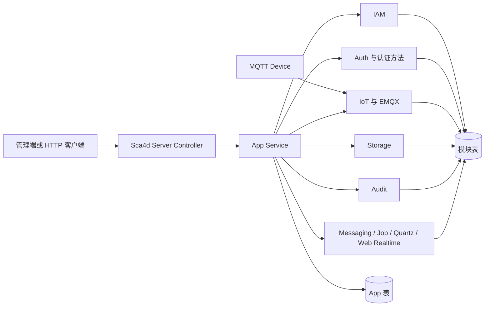
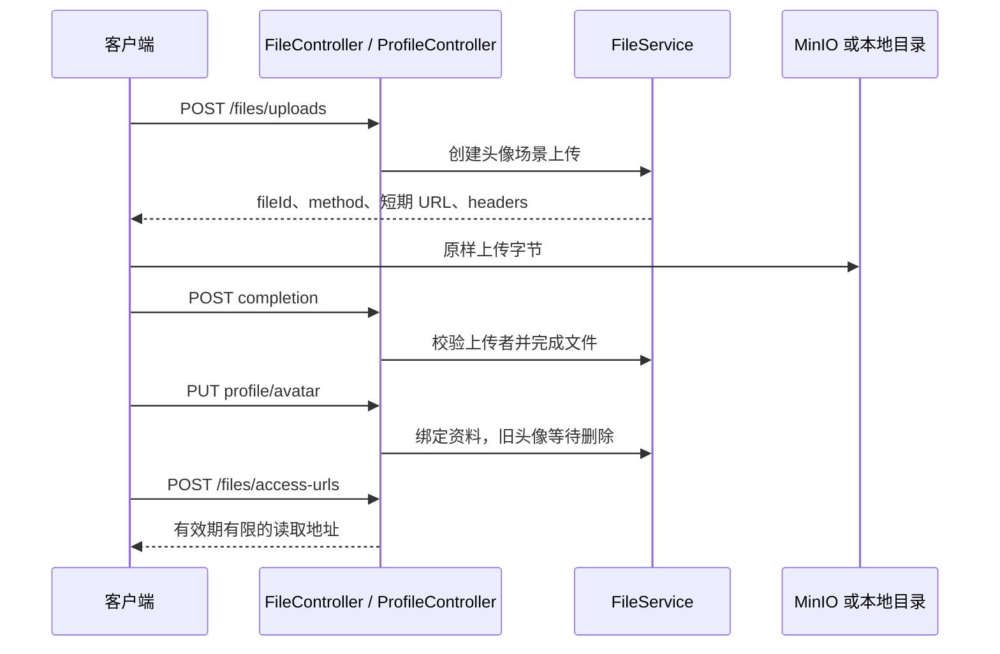

# 组装应用

组装应用就是选择模块、配置依赖，再由 App 补上 HTTP 接口、业务规则和跨模块事务。以 `apps/sca4d-server` 为起点，按下面的顺序删减功能、初始化数据库并验证启动；后面的功能清单用于确认删减时还要处理哪些调用。

Sca4d Server 组合身份认证、账号角色、通知、文件、审计、IoT、后台任务和浏览器通知。各模块维护自己的数据和公共规则，具体应用维护自己的资料、流程与对外契约。

## 选择模块并初始化数据库

以 `apps/sca4d-server/build.gradle.kts` 为依赖示例，按业务需要保留模块。删除一项功能时，先查 App 中调用它的 Controller、Service 和配置，再一起移除页面与依赖。例如删除 IoT 时，要同时处理设备接口、协议注册、EMQX 回调、TimescaleDB 配置和管理端设备入口。

给应用设置稳定的 `spring.application.name`。同一应用的多个实例使用相同名称，不同应用使用不同名称；Job、Quartz、Redis 和 RabbitMQ 的运行命名依赖它。

新 App 尚无任何 Flyway 迁移时，应用 `com.sca4dj.app` 插件，配置 `sca4djApp.migrationName`，需要应用表时再配置 `schemaFragment`，然后运行该 App 的 `initFlyway`。任务从运行依赖收集结构片段，生成 `src/main/resources/db/migration/V1__init_<migrationName>.sql`。具体配置见[App Gradle 插件](/reference/build-plugins#app-gradle-插件)。

已有数据库通过新的 Flyway 迁移修改结构。删减依赖不会自动删除数据库表，也不能通过重建 V1 更新已经运行的数据库。

配好 PostgreSQL、Redis、RabbitMQ 和保留功能需要的外部服务后，运行 App 的 `bootRun`。按[第一次运行](/tutorials/local-start)检查启动、Gateway 注册和登录，再检查保留功能的主要接口。以下列出 Sca4d Server 的具体组合，供删减时核对调用关系。

## 这个 App 展示什么

Sca4d Server 把一组可选模块组成一个可运行的后台应用，并补上具体应用才知道的流程：

- Platform 用户怎样登录、完成敏感动作验证并维护自己的资料与认证方法；
- 管理员怎样创建、停用和删除账号，怎样维护角色与 permission；
- 头像怎样经过申请、上传、完成、绑定和短期读取地址访问；
- 审计记录、系统字典和 Setting 怎样进入管理端；
- Product、物模型、Device、设备凭据、desired state 和 command 怎样组成 IoT 示例；
- 可靠业务消息、持久化 Job、Quartz 计划和浏览器即时通知分别解决什么问题。

它不是公共模块的一部分。其他应用可以选择不同模块、定义不同资料表与 Controller，也可以完全删除 IoT、文件或实时接口。

## 实际安装的组成

`apps/sca4d-server/build.gradle.kts` 直接安装以下项目：

| 组成 | 在本 App 中的用途 |
|---|---|
| `core/sca4dj-core-spring` | Core API 的 Spring MVC、AOP、Redis、MyBatis 和自动配置接入 |
| `modules/iam/sca4dj-iam` | Subject、Account、Principal、Role、Operation 和授权关系 |
| `modules/auth/sca4dj-auth` | AuthenticationAttempts、认证方法目录、Session 与 Token |
| `modules/auth/sca4dj-auth-password` | Password Credential 和 proof |
| `modules/auth/sca4dj-auth-totp` | TOTP enrollment、Credential 和 proof |
| `modules/auth/sca4dj-auth-passkey` | Passkey ceremony、Credential 和 proof |
| `modules/auth/sca4dj-auth-email` | Email Code Challenge 和认证方法 |
| `modules/auth/sca4dj-auth-sms` | SMS Code Challenge、PHONE Identifier 和认证方法 |
| `modules/notification/sca4dj-notification-inbox` | Account 站内信快照与已读状态 |
| `modules/notification/sca4dj-notification-sms` | SMS Provider、路由、绑定与投递尝试 |
| `modules/notification/sca4dj-notification-sms-aliyun` | 阿里云 SMS SDK 传输适配器 |
| `modules/auth/sca4dj-auth-federation` | 外部身份提供方、授权流程和认证方法 |
| `modules/auth/sca4dj-auth-shared-secret` | 通用 Shared Secret Credential 和认证方法 |
| `modules/auth/sca4dj-auth-hmac` | 通用 HMAC Credential、防重放和认证方法 |
| `modules/auth/sca4dj-auth-x509` | 通用 X.509 Credential 和认证方法 |
| `modules/audit/sca4dj-audit` | 审计写入与查询 |
| `modules/iot/sca4dj-iot` | Product、ThingModel、Device、当前状态、可靠下行和设备定时 |
| `modules/iot/sca4dj-iot-emqx` | EMQX HTTP 回调、MQTT 运行时、Topic 与协议转换 |
| `modules/iot/sca4dj-iot-timescale` | 独立 TimescaleDB 的 Telemetry 与事件历史 |
| `modules/web-realtime/sca4dj-web-realtime` | SSE、WebSocket 票据、STOMP 和节点路由 |
| `modules/messaging/sca4dj-messaging` | RabbitMQ 与 PostgreSQL Outbox；运行时安装 |
| `modules/job/sca4dj-job` | 持久化 Job run 与 worker；运行时安装 |
| `modules/scheduling/sca4dj-scheduling-quartz` | 代码计划与 Quartz 集群调度；运行时安装 |
| `modules/storage/sca4dj-storage-file` | 文件记录、短期传输授权和清理任务；运行时安装 |
| `modules/storage/sca4dj-storage-local` | 本地目录 backend；运行时安装但默认关闭 |
| `modules/storage/sca4dj-storage-minio` | MinIO backend；运行时安装且默认启用 |

App 直接声明 Spring MVC、Validation、Actuator 和 Springdoc UI，因此删除任一功能时可以从自己的依赖和配置中直接判断影响。它还直接使用 Jackson 注解、Servlet、JetBrains 注解、MyBatis、Spring JDBC、SLF4J、Swagger/OpenAPI 类型、Flyway 和 PostgreSQL 驱动；ZXing 作为 TOTP 二维码运行依赖。它没有依赖 Starter 或另一个应用来补齐这些模块。

Controller 绑定 HTTP 输入、声明认证与 permission，并把结果转换为 Request/View。App Service 负责跨模块事务、应用保护规则和副作用。App 不读取 IAM、Auth 或 IoT 的 Mapper 与内部表；模块也不反向依赖 App 的资料和 Profile 表。

## 登录、verification 与 Session

匿名客户端从登录 attempt 开始。Password、TOTP、Passkey 和 Email Code proof 由对应认证方法模块验证，Auth 保存 attempt 进度；当策略要求的不同因素满足后，App 建立 Session。HTTP 层只暴露 account、role 和 permission，不暴露 IAM 内部表关系。

Email Code 可以使用邮箱开始登录，也可以为已经确定 Account 的登录或 verification attempt 补充 `POSSESSION` 因素。匿名邮箱不存在、账号不可用或当前没有可投递 Email 配置时，App 仍返回相同 Challenge 字段，不暴露账号是否存在。verification 签发前还会检查 attempt Account 与当前 Session Account 相同。

敏感动作使用独立 verification。verification 绑定当前 Session、Account 和动作编码，只证明这一次动作已经满足认证要求；proof 成功不会自动改密码、修改认证设置或删除账号。最终业务请求通过 `X-Verification` 消费它一次。

Auth 使用 Redis 保存在线 Session 和失效代次。默认 `SESSION` 模式直接使用不透明 Session Token；`JWT` 模式另发短效 access Token，但改密、注销、账号删除等标明「强制 Session Token」的动作仍要求在线 Session Token。账号停用、Credential 替换或删除等流程调用 SessionControl 终止该账号的全部 Session；已签发的离线 JWT 不逐请求查询 Redis，只能等待其短 TTL 到期。

## 账号、角色与资料

IAM 负责 Account、Platform Principal、Role、permission 关系和保护规则。App 自己拥有 `platform_user_profile`，按 `principal_id` 保存显示名称、可空邮箱、可空 E.164 手机号、头像文件标识、时间和版本，不复制用户名、账号状态、密码或角色。

Profile 邮箱同时是本 App 为 `ACCOUNT` 通知接收人解析 Email 地址的来源。创建账号或替换 Profile 时，App 在同一事务内校验邮箱并同步 Account 唯一的 `EMAIL` 登录标识；清除 Profile 邮箱会删除该标识。启动时 App 复核已有非空 Profile，并在规范化邮箱冲突或一个 Profile 关联多个启用 Account 时停止启动；没有启用 Account 的 Profile 暂不复核。

创建 Platform Account 时，PlatformAccountApplicationService 在同一主库事务中创建 Subject、Account、Principal、用户名、初始 Password Credential、DEFAULT 角色和资料。任一步失败都会回滚整次创建。停用账号时，App 拒绝当前账号和受保护 ROOT Account，并在状态写入后终止目标账号全部 Session。

账号角色集合和角色 permission 集合使用强 ETag。读取根据当前 `Version` 返回 ETag，替换时要求 `If-Match`；版本已变化就停止写入，让客户端重新读取，而不是覆盖另一个管理员的修改。

Platform RBAC 写入不使用全局锁。创建角色按角色 code 互斥；角色状态、翻译、permission 和删除按 `roleId` 互斥；Principal 的角色替换、绑定和清理按 `principalId` 互斥。锁在对应数据库事务开始前取得并在提交后释放，因此不同角色和不同 Principal 可以并发修改。App 替换账号角色和删除同一账号时还共用 Account 写锁，并保持 Account、Profile、Principal 的固定加锁顺序。

### 删除账号为什么是单独流程

`DELETE /platform/accounts/{accountId}` 只接受在线 Session Token，并要求已满足 `account.delete` verification。App 在事务外按 Account 与 Profile 取得分布式锁，再调用 PlatformAccountLifecycleService 执行当前账号与 ROOT 保护校验、首次 Session 终止和 IAM 删除。

IAM 成功隔离 Account 后，App 在同一数据库事务中同步处理关联数据：

- Account 和登录标识改为 `DISABLED + deleted = 1`；
- Account-Principal 关系和 App 认证设置删除，AuthenticationMethods 再让每个已安装认证方法幂等删除自己负责的 Credential、Challenge 或 ceremony；
- Subject 还有其他 Account 时保留，删除最后一个 Account 时才逻辑删除；
- 共享 Principal 还有其他 Account 时保留 Principal、资料、角色和 ACL；否则 IAM 删除 Principal 授权关系，App 逻辑删除资料并清空邮箱、手机号；
- 事务提交后再次终止目标 Account Session。

保护校验或任一写入失败时，事务不留下部分认证数据或部分资料。删除后的账号不能再次登录、恢复在线 Session 或出现在账号目录中；普通离线 JWT 最长仍可使用到既定短 TTL 结束。

## 文件与头像

文件模块只管理文件状态、backend 和短期传输授权；「谁能把哪个文件作为谁的头像」由 App 决定。头像流程如下：

App 固定头像 scene、目标资料 Resource、媒体类型和 5 MiB 上限。FileController 在申请、完成和生成读取地址时声明资源权限，并为申请和完成这两个写操作声明审计；PlatformFileService 只执行已经通过 Controller 检查的文件业务动作。生成临时读取地址属于读取和展示动作，不写操作日志。MinIO 返回对象存储预签名 URL；本地 backend 返回 App 的匿名短期传输 URL。`/files/transfers/**` 只消费签名 token，不是绕过 FileService 的通用上传下载 API。

## 审计与系统管理

App 为账号、角色、资料、Password、TOTP、Passkey、认证设置、文件、字典和 Setting 等写操作声明稳定审计操作码。审计 payload 只选择追溯所需的状态、标识、字段名、媒体类型和字节数，不保存密码、验证码、Passkey proof、文件原名或资料实际值。

Audit 模块保存 `audit_record`。OperationLogService 只在查询时补充仍存在的 Platform 资料展示名称；资料删除不抹掉历史身份标识。操作日志查询本身不写审计，避免读取日志时产生新的日志。

系统字典聚合 Java 代码项、动态字典和允许扩展的数据库项；系统 Setting 只管理 Spring 容器已经注册的 Setting，不能创建任意键。准确字段与并发限制见[系统管理](/reference/http/sca4d-server)。

App 使用 `system:email:read` 和 `system:email:manage` 管理 SMTP 配置与 Email 模板。SMTP 密码只在创建或明确替换时进入请求，响应只返回 `passwordConfigured`；模板预览返回同一内容的纯文本和安全 HTML 结果。

## IoT 业务流程

App 安装通用 IoT 模块，并登记两个示例 MQTT 协议：规范 JSON 温控器协议和旧式二进制冷柜协议。它们分别展示结构稳定的标准设备和需要转换的旧设备怎样把各自 Topic、报文与 Pipeline 映射为物模型。

Product 创建后默认停用。只有停用 Product 可以修改技术定义或发布完整物模型 JSON；启用前必须至少存在一个接入方式、一个已安装协议和一个可用物模型，且每个协议都能验证模型。

Device 创建要求 `Idempotency-Key`。App 在十分钟窗口内保存请求摘要及加密创建结果；相同 key 与相同输入重放同一个 Device、Account 和一次性 secret，不同输入返回冲突。创建流程先取得 Product、Device 和幂等键对应的 Redis 分布式锁，再在事务中重新检查当前数据。App 自有 ClusterTaskSchedule 按 `expires_at` 索引使用有界 `DELETE` 清理过期结果，不使用显式行锁，幂等表不保存长期台账。新 Device、IAM Subject 和可选 Account 默认停用。Device 只有停用时才能修改展示资料、物模型/协议绑定和接入方式；启用前要求所属 Product 已启用并通过模块校验。

设备停用时，App 在同一主库事务中停用 Device Profile、IAM Subject 与可选 Account，可靠发布断连消息并终止 Account Session。这里的 Device Profile 是 App 保存的启停状态，不是 IoT 模块的 Device 台账；基础资料、绑定或认证方法变化使用 `DeviceChangeArea.DEVICE` 通知浏览器重新读取。Credential 重置由 App 调用 Shared Secret 或 HMAC 通用认证方法，再终止旧 Session 与 Connection。只有启用 Device 可以修改 desired state、提交物模型 command 或创建设备定时；这些动作先保存主库事实，再通过通用 Messaging 与 EMQX MQTT 运行时发送。

App 提供 Device HTTP HMAC Session 路由、运行投影与历史查询、设备定时管理接口。DeviceCredentialService 管理 Device Account 以及 Shared Secret、HMAC 和 X.509 Credential；Sca4dDeviceConnectionAdmission 实现统一 DeviceConnectionAdmission，并把直接 Account 认证交给 AuthenticationMethods；DeviceSessionService 通过 HMAC AuthenticationSubmission 建立通用 Session；Sca4dEmqxDeviceConnectionRequestFactory 只把 EMQX 字段转换成统一连接请求。IotDeviceSessionIdentityLoader 独立读取 Device Session 身份，IotDeviceSessionInvalidationListener 独立登记 Session 失效后的可靠断连消息。HTTP 请求头、Request/View 和路由留在 App，DeviceService 不依赖 Auth 或 IAM。

EMQX 回调只在 `sca4dj.iot.emqx.enabled=true` 时存在。App 只声明 `IOT.EMQX.AUTHENTICATE`，Server 注册时把回调编码交给 Gateway。EMQX 使用独立 Webhook Secret 调用 Gateway 回调，设备不能使用该 Secret。HTTP Authenticator 返回准入结果、`client_attrs` 和 ACL；内部 MQTT Runtime 订阅 `$SYS` 连接事件并用单 Client Management API 查询实时刷新在线状态，完整快照只负责启动和周期修复。需要 Session 的接入方式绑定 Auth Session，其他认证方式不伪造 Session。

`sca4dj-iot-timescale` 只保存 `iot_telemetry_sample` 和 `iot_event`。Telemetry 在 reported 主事务提交后直接发布，不写 Outbox；物模型 `RELIABLE` 事件、ACK 阶段、设备定时执行和断连使用通用 Messaging Outbox。主 PostgreSQL 保存 Product、ThingModel、Device、可选 latest reported、desired、下行状态、最新 ACK 和设备定时规则，不保存 IoT 私有 Secret/Certificate、遥测历史、事件历史、ACK 历史或定时执行历史表。

App 把模块提交后的 Device 数据区域变化发布到 `iot.device.<deviceId>`。事件只包含 Device 标识、失效区域和发生时间；浏览器收到后重新调用 HTTP API，Telemetry 样本和权威状态不放进 Realtime 事件。IoT 模块声明设备定时扫描计划，到期后只异步创建可靠 command 下行，消息 Consumer 再通过 EMQX 发送；半年后的业务预约继续使用 JobSchedule。

## 可靠业务消息

Messaging 在业务事务中写入 PostgreSQL Outbox，事务提交后再向 RabbitMQ 发布。它用于需要被其他业务 Consumer 处理的消息；发布失败会重试，Consumer 按自己的 HandlingPolicy 重试或进入 DLQ。Outbox 派发和清理由 ClusterTaskSchedule 触发，不创建 Job run。

## 后台 Job

Job 模块把运行、节点、尝试次数、租约和结果保存在 PostgreSQL。Worker 失联后，其他实例可以重新领取过期节点，因此业务动作必须能够处理重复执行。需要持久化运行结果和失败恢复的文件清理使用 Job；短周期轮询和数据清理使用 ClusterTaskSchedule。

## Quartz 计划

Quartz 保存代码声明的触发时间和集群状态。JobSchedule 到达时间后向 JobExecutor 提交一次运行；ClusterTaskSchedule 到达时间后直接执行不需要业务运行历史的集群任务。计划对账成功后 Scheduler 才开始领取 trigger。

## 浏览器通知

Web Realtime 向当前在线浏览器发送允许丢失的通知，不使用 Outbox，也不回放断线期间的消息。通知发送失败不会回滚账号、角色、认证设置或 Session 失效；客户端重连后重新读取 HTTP 数据。

默认管理端在登录或恢复 Session 后连接 `/events` SSE。收到 `authentication.session.changed` 后，它重新读取 Session、permission、菜单和动态路由。默认管理端不连接 `/events/ws`；该入口供明确使用 STOMP 的应用注册订阅和消息处理。

## 数据归属与运行依赖

主 PostgreSQL 同时保存模块表和 App 表。Flyway 的初始迁移按模块 fragment 后 App fragment 的顺序生成；后续版本继续向前迁移。App 自有数据包括 `platform_user_profile`、账号认证策略表、`app_iot_*` Profile 与 Device 创建幂等结果；IAM、Auth、Audit、Storage、Messaging、Notification Email、Job、Quartz 和 IoT 模块各自拥有自己的表。

Redis 是在线 Session、失效代次、认证临时状态、分布式锁、Web Realtime 索引/票据和 IoT HMAC 防重放所必需的运行依赖。RabbitMQ 是 Messaging 的必需依赖；Web Realtime 多实例节点路由或 STOMP relay 也可以使用它。默认文件 backend 是 MinIO；切换到本地 backend 后可以不运行 MinIO，但必须启用 `local` 且让默认 backend ID 与已注册实现一致。EMQX 和 TimescaleDB 只在对应 IoT 开关启用时需要。

## 哪些代码属于 App

模块公开稳定的业务 API、数据规则和自动配置，不注册 Sca4d Server 的业务 Controller。App 可以：

- 选择模块并提供配置；
- 定义 HTTP 名称、Request/View、permission 和产品文案；
- 组合跨模块事务与应用保护规则；
- 保存仅属于本 App 的资料、策略和 Profile；
- 登记设备协议、审计操作和实时通知目标。

App 不能直接使用模块 Mapper、Repository、内部包或表来绕过公开 API；模块也不能知道 Platform 用户资料、头像 scene、ROOT 管理页面或本 App 的 IoT Profile。复制示例建立具体应用时，应保留这种依赖方向，再按业务删除或替换流程，而不是把示例 Controller 移进公共模块。
