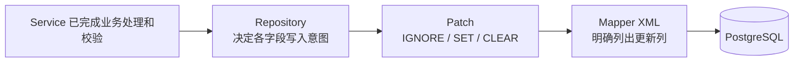

# 开发后端业务接口

新增业务字段要同时处理数据库存储、Service 规则和 HTTP 请求与响应。下面沿 Sca4d Server 的 `GET /me/profile`、`PUT /me/profile` 说明修改位置和验证方法，再补充分页、排序与字段部分更新的写法。

## 找到负责的代码

以下路径均相对于 `apps/sca4d-server/src/main/`：

| 文件 | 修改内容 |
|---|---|
| `java/com/sca4d/app/server/platform/request/ReplaceProfileRequest.java` | HTTP 输入字段和校验 |
| `java/com/sca4d/app/server/controllers/ProfileController.java` | 路由、当前 Principal、审计目标和响应转换 |
| `java/com/sca4d/app/server/service/PlatformAccountApplicationService.java` | 资料修改与 Account 邮箱标识同步 |
| `java/com/sca4d/app/server/service/PlatformUserProfileService.java` | 资料读取、头像绑定和删除 |
| `java/com/sca4d/app/server/repository/PlatformUserProfileRepository.java` | 资料持久化操作 |
| `java/com/sca4d/app/server/mapper/PlatformUserProfileMapper.java` | MyBatis 方法 |
| `resources/mapper/app/PlatformUserProfileMapper.xml` | 查询和写入 SQL |
| `java/com/sca4d/app/server/platform/view/ProfileView.java` | HTTP 返回字段 |

资料通过 `principal_id` 关联业务身份。用户名、密码和账号状态由 IAM 与认证模块管理。新增显示资料放在应用自己的表中；需要修改 Account 时调用 IAM 公开接口。

## 定义字段和写入规则

为字段确定类型、长度、空值含义、默认值和允许修改的条件。已有数据库通过新的 Flyway 迁移增加字段；检查旧记录怎样取得有效值，再增加非空或唯一约束。迁移要求见[数据库规范](/standards/06_database)。

在 `ReplaceProfileRequest` 中声明输入及校验，在 `ProfileView` 中声明返回值。确认修改是替换完整资料还是只改变一个字段：完整替换中，空值可能表示清除；局部修改中，未提交字段必须与明确清空区分。

## 实现业务修改

`ProfileController` 使用 `@CurrentPrincipal(selection = PlatformPrincipalSelection.class)` 选择当前 Platform Principal。`@CurrentPrincipal Long principalId` 参数由服务端填充，客户端不通过请求体指定正在修改哪个人的个人资料。

读取调用 `PlatformUserProfileService.loadByPrincipalId(...)`。替换资料调用 `PlatformAccountApplicationService.replaceProfile(...)`，因为邮箱还参与 Account 登录标识和通知地址解析。修改这条流程时，资料与登录标识必须共同提交或回滚。

Controller 返回 `ApiResponse.ok(ProfileView.from(updated))`，并通过 `@Audit` 和 `@AuditTarget` 声明操作及资料目标。审计只保存允许记录的标识和字段变化，不写入密码、验证码或完整个人资料。

Repository 组合 Mapper 查询与写入，向 Service 返回业务对象。SQL 明确列出本次更新的列，保留访问范围、状态和必要的版本条件。影响行数由 Repository 解释，具体写法见[持久化规范](/standards/05_persistence)。

## 调用接口确认资料变化

先按[认证与 Session](/tutorials/authentication-and-session)取得 Session Token，在 Swagger UI 中设置 Bearer Token，再读取 `GET /api/me/profile`。

以下请求会清除邮箱和手机号，只在测试账号上执行。保存当前资料后，向 Gateway 提交完整替换请求；字段限制以 `ReplaceProfileRequest` 为准：

```http
PUT /api/me/profile
Content-Type: application/json
Authorization: Bearer <sessionToken>

{
  "displayName": "测试用户",
  "email": null,
  "phoneNumber": null
}
```

再次读取，应得到修改后的资料。当前个人资料接口没有要求 `If-Match`；增加其他资源的完整编辑接口时，按[HTTP 并发契约](/reference/http/common#etag、if-match-与修改冲突)判断是否需要 ETag。

测试覆盖有效输入、非法值、清空和事务失败。涉及邮箱时，还要覆盖标识冲突及回滚后资料与 Account 是否一致。只修改本应用时，先编译 `:apps:sca4d-server:compileJava`，再运行直接相关测试；检查范围见[测试规范](/standards/10_testing)，资源限制以仓库构建指令为准。

## 列表查询

Sca4d-J 使用同一组公共类型处理列表分页和动态排序。业务筛选字段仍由具体接口声明，不使用字段 Map、查询 Wrapper 或自动 SQL 生成器。

### HTTP 参数

所有分页接口接受 `page` 和 `size`：

| 参数 | 默认值 | 限制 |
|---|---:|---|
| `page` | 1 | 不小于 1 |
| `size` | `sca4dj.core.pagination.default-size`，默认 20 | 不大于全局或当前接口声明的上限 |

支持动态排序的接口另外接受可以重复的 `sort`：

```http
GET /projects?page=2&size=20&status=ACTIVE&sort=STATUS,ASC&sort=UPDATED_AT,DESC
```

服务端按参数出现顺序应用排序。字段名和方向区分大小写，方向只能是 `ASC` 或 `DESC`。`sca4dj.core.sort-max-fields` 控制单次请求的字段数量，默认 5，配置范围是 1..20。

没有提交 `sort` 时使用接口声明的默认排序。动态排序接口不接受旧的 `sortBy` 和 `sortDirection`，出现任一旧参数都会返回 400。

### 声明排序字段

[Sort](/javadoc/core/sca4dj-core-api/com/sca4d/core/api/query/Sort.html) 内置常用字段：

- `Sort.CREATED_AT`：创建时间；
- `Sort.UPDATED_AT`：最近修改时间；
- `Sort.NAME`：ASCII 稳定名称，不表示本地化展示名称；
- `Sort.SERIAL`：数据库标识、序号或同类稳定流水字段。

业务字段通过 `Sort.of(...)` 创建。它只接受大写协议标识符，结果不包含数据库列或 SQL：

```java
private static final Sort STATUS = Sort.of("STATUS");

private static final ListDefinition PROJECT_LIST = ListDefinition.builder()
        .fields(Sort.CREATED_AT, Sort.UPDATED_AT, STATUS)
        .defaultSort(Sort.UPDATED_AT.desc())
        .maxSize(100)
        .build();
```

`ListDefinition` 是当前接口的字段白名单。默认排序必须使用已经登记的字段，同一个字段不能重复登记或重复排序。

### Controller 与业务筛选

Controller 显式绑定业务筛选参数，再用列表声明解析公共参数：

```java
@GetMapping
public ApiResponse<Page<ProjectView>> find(
        @RequestParam @Nullable String search,
        @RequestParam @Nullable ProjectStatus status,
        @NotNull ListParameters parameters) {
    ProjectQuery query = new ProjectQuery(
            search,
            status,
            parameters.resolve(PROJECT_LIST));
    return ApiResponse.ok(projects.find(query).map(ProjectView::from));
}
```

`ListParameters` 只存在于 Controller 边界。`resolve(...)` 完成后，`ProjectQuery` 保存业务筛选条件和不含外部字符串的 `ListRequest`。固定排序接口直接接收 `PageRequest`；需要更小页大小上限时使用 `@PageOptions(maxSize = 100)`。

业务 Query 负责自己的筛选规则，例如空白搜索词、标识正数、两个字段必须同时提供或时间下界必须早于上界。公共列表类型不解释这些业务条件。

### Repository 与 Mapper

Repository 使用同一个 Query 执行 count 和当前页查询，并返回 `Page<T>`。没有命中记录时可以跳过 rows 查询；超过末页时返回空 `items` 和不变的 `total`。

Mapper 的筛选 SQL 由 count 和 rows 共用，排序列逐项显式映射：

```xml
ORDER BY
<foreach collection="query.list.sort" item="order" separator=",">
    <choose>
        <when test="order.field.name() == 'CREATED_AT'">p.created_at</when>
        <when test="order.field.name() == 'UPDATED_AT'">p.updated_at</when>
        <when test="order.field.name() == 'STATUS'">p.status</when>
    </choose>
    <include refid="com.sca4d.core.spring.persistence.mybatis.SortSql.direction"/>
</foreach>,
p.id DESC
```

请求字段不会作为 SQL 片段传入 Mapper。每个 Mapper 仍需明确列出允许排序的数据库列，并追加能够消除相同字段值歧义的稳定排序。

### 分页响应

`Page<T>` 的 JSON 形状固定为：

```json
{
  "items": [],
  "page": 1,
  "size": 20,
  "total": "0"
}
```

`total` 表示满足全部筛选和数据范围条件的记录总数，不是当前页数量。Java `long` 在 HTTP JSON 中使用十进制字符串，`page` 和 `size` 保持数字。

页码、页大小、排序格式、字段、方向、重复字段或字段数量无效时，Core Spring 返回 `VALIDATION_FAILED`，HTTP 状态为 400。

## Patch

源码：`core/sca4dj-core-api/src/main/java/com/sca4d/core/api/persistence/Patch.java`

数据库字段的部分更新必须区分三种结果：保留原值、写入一个值、写入数据库 `NULL`。只传递可空 Java 值无法区分前两种结果；把数值零、`false` 或空字符串统一当作「空」又会丢失调用方明确给出的数据。Patch 使用三个互斥状态保存 Repository 已经确定的字段写入意图。

| 状态 | 构造方式 | Mapper 行为 |
|---|---|---|
| IGNORE | `Patch.ignore()` | 不在 `SET` 子句中写该列，数据库保留原值 |
| SET | `Patch.set(value)` | 把非空 value 绑定到该列 |
| CLEAR | `Patch.clear()` | 把该列写为数据库 `NULL` |

`Patch.set(null)` 抛出 NullPointerException。数值零、`false`、空字符串和空集合不是特殊状态，均由 SET 原样保存。只有 `value()` 或供映射框架读取的 `getValue()` 可以取得 SET 值；在 IGNORE 或 CLEAR 状态读取值会抛出 IllegalStateException。



Service 把已经校验的业务结果交给 Repository。Repository 根据稳定的持久化规则构造 Patch；Mapper XML 逐列读取状态，SET 绑定值、CLEAR 写 `NULL`、IGNORE 不生成列赋值。Repository 在调用 Mapper 前拒绝所有字段均为 IGNORE 的更新，避免生成没有列的 `UPDATE`。

Patch 不依赖 HTTP Request、Jackson、Jakarta Validation、Spring 或 MyBatis。Controller 仍负责 HTTP 绑定和统一请求校验，实体和值对象仍在自己的构造入口检查字段限制，Service 仍负责跨字段和业务规则。Patch 只在这些处理完成后表达数据库字段怎样写入，不能代替任何一层校验。

### 构造写入意图

固定结果直接使用三个静态方法：

```java
Patch<String> name = Patch.set(displayName);
Patch<String> remark = remarkValue == null ? Patch.clear() : Patch.set(remarkValue);
Patch<String> unchanged = Patch.ignore();
```

`resolve(source, resolver)` 让 Repository 使用回调集中解释一个业务处理结果。source 可以为 `null`，resolver 必须返回非空 Patch；回调返回 `null` 时立即失败。

```java
Patch<String> remark = Patch.resolve(
        change,
        value -> {
            if (value.clearRemark()) {
                return Patch.clear();
            }
            if (value.updateRemark()) {
                return Patch.set(value.remark());
            }
            return Patch.ignore();
        });
```

条件较少时可以使用 `choose()` 连续声明候选结果，并以 `otherwiseIgnore()`、`otherwiseSet(...)` 或 `otherwiseClear()` 明确没有条件命中时的结果。

```java
Patch<String> remark = Patch.<String>choose()
        .setIf(copyDefault, defaultRemark)
        .setIf(useGenerated, () -> generateRemark())
        .clearIf(removeRemark)
        .otherwiseIgnore();
```

零个条件命中时返回结束方法声明的结果。一个以上条件命中时抛出 IllegalStateException，不按声明先后静默覆盖。Supplier 只在对应分支唯一命中且结束构造时执行；未命中的分支和未使用的默认 Supplier 不执行。

### Mapper 限制

Patch 不生成 SQL，也不通过反射推断列名。Mapper 方法可以直接接收具名 Patch 参数，或者接收包含 Patch 字段的模块持久化参数对象。字段数量、共同使用方式和实际复用决定是否需要更新对象，不为每个 update 机械建立 Update 类。Mapper XML 明确写出每个允许修改的列、状态条件、版本条件和 `WHERE` 条件。例如，直接传入名为 `remark` 的 Patch：

```xml
<choose>
    <when test="remark.set">
        remark = #{remark.value},
    </when>
    <when test="remark.clear">
        remark = NULL,
    </when>
</choose>
```

Repository 将允许修改的字段转换为明确的 SQL 列。完整规则见[持久化规范](/standards/05_persistence)。
