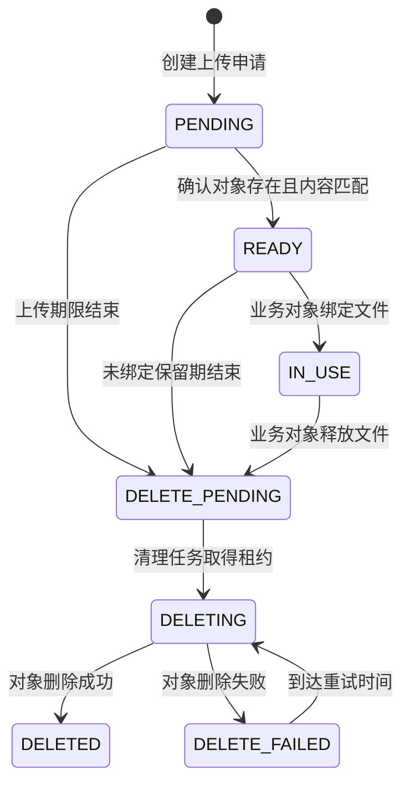
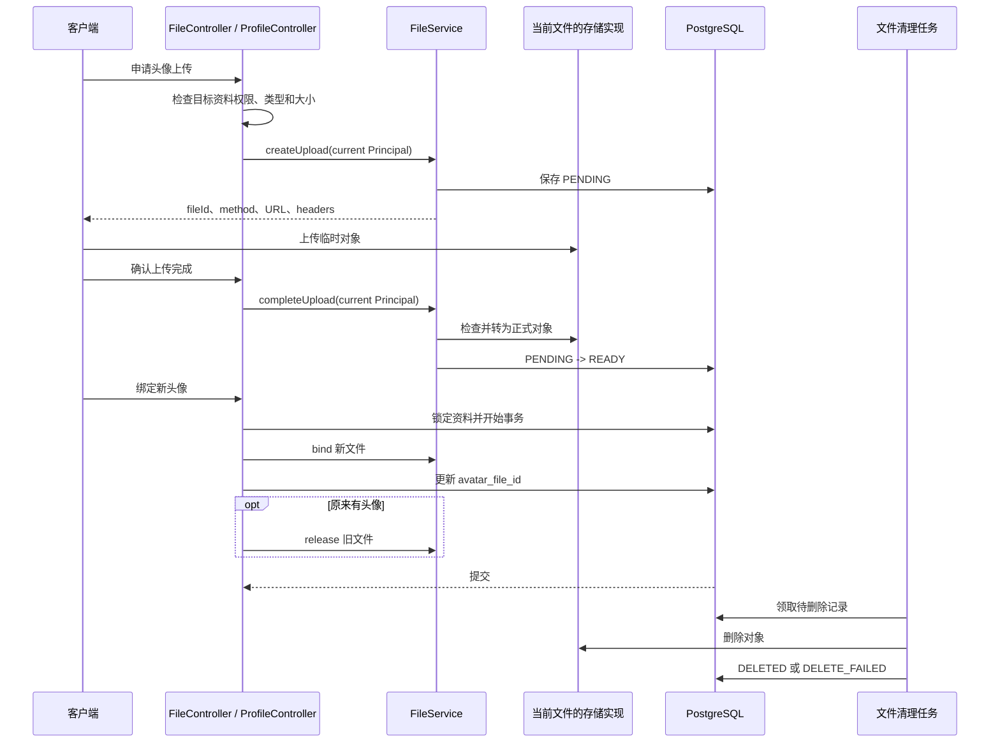

# 上传和引用文件

文件上传分为申请、传输字节、确认完成和绑定业务对象。业务表保存 fileId，读取时向文件服务申请短期地址。以下用 Sca4d Server 的头像替换完成一次上传。

## 替换当前账号头像

登录后，通过 Gateway 的 `/api` 入口依次调用：

1. `POST /files/uploads`：提交头像场景所需字段，取得 fileId、method、URL 和 headers。请求字段见[头像文件接口](/reference/http/sca4d-server#头像文件)。
2. 按响应中的 method、URL 和 headers 上传原始文件字节。对象存储地址不加管理端 Authorization，也不把文件包成 JSON。
3. `POST /files/uploads/{fileId}/completion`：由创建文件的 Principal 确认上传。服务端校验实际类型和大小后，文件进入 READY。
4. `PUT /me/profile/avatar`：提交 `{ "fileId": "<上一步的 fileId>" }`。绑定与资料更新共同提交，旧头像登记为待清理。
5. `POST /files/access-urls`：批量申请读取地址，使用返回 URL 显示头像。访问地址过期后重新申请，业务表继续保存 fileId。

在管理端接入时使用 `FilesController` 完成传输和地址缓存，Session 切换后清理缓存，具体约定见[管理端文件传输](/tutorials/admin-feature#文件传输)。

## 文件记录保存什么

[StoredFile](/javadoc/core/sca4dj-core-api/com/sca4d/core/api/storage/StoredFile.html) 包含文件 ID、创建文件的 Principal、业务用途、原文件名、媒体类型、字节数和 [FileStatus](/javadoc/core/sca4dj-core-api/com/sca4d/core/api/storage/FileStatus.html)。业务代码使用文件 ID 建立引用，不保存临时上传地址或对象存储地址。系统任务创建文件时使用 `SystemPrincipal.INSTANCE`。

数据库中的文件记录还保存创建时选中的存储实现、临时对象键和正式对象键。这些字段只供文件服务定位字节，StoredFile 不向业务代码返回它们。

## 状态变化

1. **创建文件**：应用先检查当前 Principal 是否可以维护目标业务对象，并校验媒体类型和大小。客户端上传调用 `createUpload` 创建 `PENDING` 记录并取得短期上传请求；服务端持有内容流时调用 `upload` 创建相同记录。
2. **上传字节**：客户端必须按返回的 method、URL 和 headers 发送内容。服务端上传由文件服务把调用方提供的 `InputStream` 写入当前 backend。两条路径都只写临时对象，不能覆盖正式对象。
3. **确认完成**：客户端上传由创建文件的 Principal 请求 `completeUpload`；服务端上传在 `upload` 内完成同样的核验。文件服务检查临时对象的实际媒体类型和字节数，再把对象转为正式对象，并将记录改为 `READY`。
4. **绑定业务对象**：业务 Service 在自己的事务中调用 `bind`，同时把文件 ID 写入业务表。文件记录变为 `IN_USE`。
5. **释放旧文件**：业务引用被替换或删除时，业务 Service 调用 `release`。文件记录变为 `DELETE_PENDING`，业务请求不等待实际删除结束。
6. **异步清理**：清理任务按状态、重试时间和租约到期条件执行 `UPDATE ... RETURNING`，分批取得文件删除租约；领取不使用显式行锁。任务在事务外删除临时对象和正式对象。成功后记录变为 `DELETED`；失败时记录重试时间并变为 `DELETE_FAILED`。

`completeUpload`、同一用途的 `bind` 和已经进入删除流程的 `release` 都可以安全重试。对象转正成功但数据库状态尚未更新时，再次执行完成操作可以恢复中断。

## 谁检查权限

文件服务只检查上传 Principal、文件用途、状态和期限。它不知道“头像管理员”“合同查看者”等产品规则。应用负责决定：

- 谁可以为目标业务对象申请上传；
- 一个场景允许哪些媒体类型和大小；
- 谁可以创建、完成、绑定或读取文件；
- 哪个业务字段保存文件 ID；
- 替换或删除引用时何时释放旧文件；
- 无权读取时是否隐藏为“文件不存在”。

Sca4d Server 的头像流程允许资料本人申请和读取头像，拥有账号管理权限的管理员也可以维护目标账号头像。批量申请读取地址时，只要有一个文件不存在、用途不符或无权读取，整个请求都返回文件不存在，不指出具体失败项。

## 头像替换

同一资料的分布式锁会串行处理并发替换。绑定新文件、更新资料引用和释放旧文件位于同一 PostgreSQL 事务；任一步失败都会回滚这些数据库变化。实际删除在提交后异步执行，因此删除失败不会撤销已经完成的头像替换。

## 失败时会发生什么

- 客户端上传请求无法签发，或服务端上传的内容流无法写入时，已创建的 `PENDING` 记录等待到期清理；调用方不会得到存储凭据、容器或对象键。
- 完成确认找不到对象时返回无效上传；实际类型或大小不符时返回内容不匹配；存储实现不可用时返回存储不可用。
- `READY` 文件过期后不能再绑定或生成读取地址，即使清理任务尚未删除对象。
- 文件释放后，字节可能要等清理任务重试成功才消失。业务代码必须先撤销引用和读取权限，不能等待对象删除后才提交业务事务。

存储地址和 backend 选择见[运行配置](/reference/runtime/sca4d-server)，HTTP 请求见[头像文件接口](/reference/http/sca4d-server#头像文件)。

## 文件访问

应用先校验目标资源权限和文件用途，再读取文件。不要把对象存储路径或长期凭据交给业务页面。

客户端通过 `createAccessUrls` 获取短期读取地址；批量请求中任一文件不可用时，整个请求失败。本地签名路由通过 `openAccess` 验签并重新检查状态。

服务端需要解析上传内容时调用 `FileService.openForServer(fileId)`，在 try-with-resources 中消费返回的 `FileContent`。此入口不签发客户端地址，也不替代应用的权限和用途校验。

只有未过期的 `READY` 和已绑定的 `IN_USE` 文件可以打开。其他状态或 READY 保留期限已结束时返回文件不存在；对象打开失败继续报告存储错误或 `IOException`，不会返回空内容。

## 文件清理

应用取消尚未使用的上传时调用 `FileService.discard(fileId, use)`。用途必须与上传申请一致，只允许 `PENDING` 或 `READY` 文件登记为 `DELETE_PENDING`；已经进入删除流程的重复调用保持幂等。

已绑定的 `IN_USE` 文件不能丢弃。业务删除引用时使用 `release`，并与业务表更新放在同一事务。`discard` 同样参与调用方事务，事务回滚后仍保留原文件状态。

清理任务在事务外删除临时对象和正式对象。删除失败进入 `DELETE_FAILED` 并按现有策略重试；应用请求只登记清理，不等待实际对象删除。READY 到期后即使对象仍存在，也不能继续绑定或打开。
