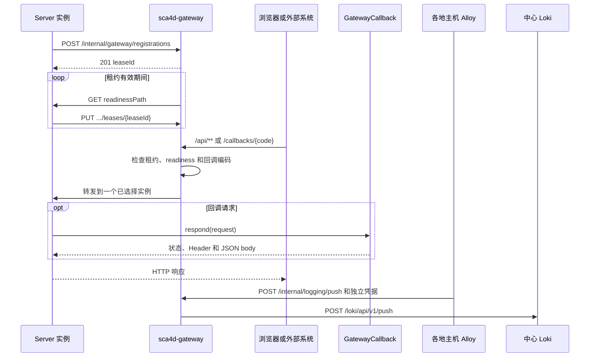

# 部署 Gateway 与接入回调

Gateway 把公开 API、长连接和外部回调转发给已注册的健康 Server，业务处理仍在 Server。先按[第一次运行](/tutorials/local-start)启动并确认注册，再通过 `/api` 调用接口；新增外部回调时声明 `GatewayCallback`，并在回调中校验专用凭据。

Server 注册的 Origin 必须从 Gateway 主机可达，且不能包含基础路径。Gateway health 为 `UP` 只说明网关进程可用，业务请求还需要健康且租约有效的 Server。

## 接入一个外部回调

应用实现 `GatewayCallback`，使用稳定的 `GatewayCallbackCode` 声明编码、请求类型和处理方法，并把它注册为 Bean。Server 会把实际安装的回调编码写入注册信息；外部调用方使用 `/callbacks/{code}`，Gateway 只选择声明该编码且 readiness 成功的实例。

回调自身检查外部调用方凭据。EMQX 示例位于 `apps/sca4d-server/src/main/java/com/sca4d/app/server/iot/EmqxGatewayCallbacks.java`，使用独立的 `X-Iot-Emqx-Secret`；Gateway Secret 只用于注册和可信转发。

先用有效凭据确认回调能够处理请求，再检查缺少凭据、错误凭据及没有健康实例时的结果。Gateway 不自动重试写请求，调用方需要根据回调业务规则确定幂等与重试方式。

Sca4d-J 把外部 HTTP 入口和具体应用分开。独立 Gradle 项目 `gateway:sca4d-gateway` 接收公开 API、SSE、WebSocket 和外部系统回调，再从当前可用的 Server 实例中选择一个目标。默认 BootJar 还携带可关闭的 `gateway:sca4dj-gateway-loki` addon；其他组装工程可以不添加该依赖。应用不需要为 EMQX 等调用方公开某个固定 Server 节点，也不需要让日志采集进程直接访问 Loki。

## 参与对象

- 独立 Gateway 保存 Server 租约，主动检查 readiness，并执行轮询选择和 HTTP 转发。
- Core 回调契约（[GatewayCallback](/javadoc/core/sca4dj-core-api/com/sca4d/core/api/gateway/GatewayCallback.html)）让应用用稳定编码声明一个 JSON 回调，不依赖 Gateway 的 Spring Cloud 实现。
- Core Spring 的 [GatewayCallbackDispatcher](/javadoc/core/sca4dj-core-spring/com/sca4d/core/spring/gateway/GatewayCallbackDispatcher.html) 把 `/callbacks/{code}` 转换成应用声明的回调调用。
- Core Spring 的 [GatewayRegistrationLifecycle](/javadoc/core/sca4dj-core-spring/com/sca4d/core/spring/gateway/GatewayRegistrationLifecycle.html) 在 Server 启动后建立租约并持续续租；注册失败只影响 Gateway 路由，不阻止 Server 启动。
- 具体应用决定回调编码、请求类型、认证规则和实际动作。Core 和 Gateway 不包含 EMQX 业务名称。

Server 注册实例标识、Gateway 可访问的 HTTP(S) Origin、readiness 路径和当前实例实际声明的回调编码。Origin 不能包含基础路径，因为 Spring Cloud LoadBalancer 只替换目标 scheme、host 和 port。新租约初始不可路由；Gateway 至少完成一次成功的 readiness 请求后才会选择它。相同实例标识重新注册会获得新租约 ID，旧租约不能续租或删除替换后的注册。

## 路由与外部路径

默认 `/api/**` 是普通应用入口。Gateway 在转发前移除 `/api`，并用 [GatewayHttpHeaders](/javadoc/core/sca4dj-core-api/com/sca4d/core/api/gateway/GatewayHttpHeaders.html) 告诉 Server 被移除的前缀。SSE `/api/events` 和 WebSocket `/api/events/ws` 使用专门路由，长连接建立后固定在已经选择的实例。路由定义来自 `spring.cloud.gateway.server.webflux.routes`；外部 YAML 可以替换完整列表。转发到注册 Server 的路由必须保留 `RegisteredServer` Filter。

`/callbacks/{code}` 保留完整路径转发，并且只选择注册了该回调编码的健康实例。回调编码由 [GatewayCallbackCode](/javadoc/core/sca4dj-core-api/com/sca4d/core/api/gateway/GatewayCallbackCode.html) 限制为稳定的小写命名空间。一个实例没有安装某项可选功能时，不登记对应回调编码，也不会收到该类回调。外部 YAML 使用其他 callback 入口时，先通过 `RewritePath` 恢复内部 `/callbacks/{code}`，再执行 `RegisteredServer`。

Loki addon 默认使用 `POST /internal/logging/push`，但入口路径和 Loki push 路径都可以配置。该路由不读取 Server 租约，也不使用 `RegisteredServer`。addon 不公开查询、删除或管理 API。Grafana 在中心端内部网络直接查询 Loki；详细关系见[集中日志](/tutorials/build-deploy-troubleshoot)。

Server 返回站内绝对路径形式的相对 `Location` 时，Gateway 为普通 API 响应补回 `/api`。外部 URL、签名 canonical path 和审计路径因此都以公开入口为准，而不是以 Server 内部路径为准。

## 信任边界

注册控制 API 和 Gateway 到 Server 的可信转发共同使用 `X-Gateway-Secret`。Gateway 对全部路由删除调用方提交的 `X-Gateway-*`。`RegisteredServer` 只允许配置的 backend service ID，并在转发前删除 `Forwarded` 和 `X-Forwarded-*`，再写入自己的 Secret、客户端地址和公开路径前缀。Server 只有在 Secret 固定时间比较成功后才采用这些值；Core Spring 随后对 Controller 隐藏控制 Header。

Gateway Secret 只证明请求经过配置相同 Secret 的 Gateway，不代替回调自己的认证。EMQX 回调继续校验独立的 `X-Iot-Emqx-Secret`，设备 HMAC 请求继续校验 Device 自己的凭据。Gateway 不读取或改写这些应用协议 Header。

Alloy 使用独立的 Loki 写入用户名和密码，不能取得 Gateway Secret。日志路由验证成功后删除 Basic Auth 与 Gateway 控制 Header，再转发到 Loki。跨公网部署必须由 Gateway 的 HTTPS 入口加密凭据和日志内容。

## 失败与集群限制

Gateway 没有选到租约有效、readiness 成功且支持指定回调编码的实例时返回 503。已经选中实例但 TCP 连接失败时返回 502。Gateway 不自动改选其他实例重试，因为回调、创建和其他写请求可能已经被目标 Server 接收；调用方必须按自身协议决定是否重试和怎样确认结果。

租约注册表只存在于单个 Gateway 进程内，不写数据库或 Redis。一个 Gateway 进程可以把请求分配给多个 Server 实例；多个 Gateway 副本之间不会复制注册状态。部署多个 Gateway 副本时，外部负载均衡器负责选择 Gateway，Server 必须向每个可能接收请求的 Gateway 建立租约，或由部署环境增加独立的共享注册方案。当前实现不处理这部分复制。

Gateway 进程不可用时，已经启动的 Server 仍可直接处理内部任务和明确直连的请求，但统一外部入口不可用。Server 注册或续租失败会继续重试，不会使 Spring 应用退出；租约过期后 Gateway 停止选择该实例。
