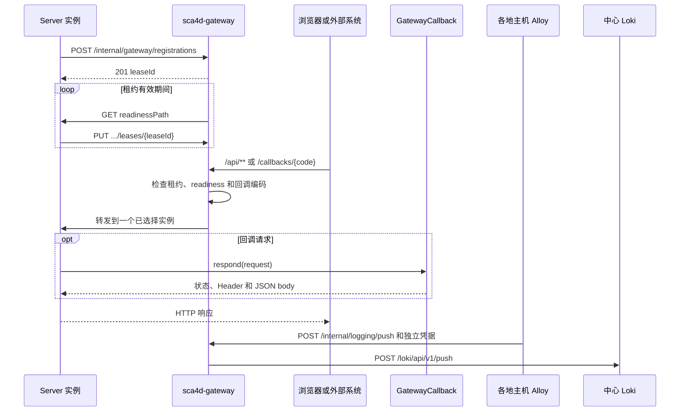

# 部署 Gateway 与接入回调

本页以 Workspace 为例。
Member 上传 Attachment 后，外部扫描服务完成检查，需要回调应用写入扫描结果。
外部服务不应直接访问某个固定 Server 节点，回调也不能绕过专用凭据。

Gateway 把公开 API、长连接和外部回调转发给已注册的健康 Server，业务处理仍在 Server。
读完本页后，可以完成以下工作：

- 让 Server 向 Gateway 注册，并通过 `/api` 调用接口；
- 实现 `GatewayCallback`，让外部扫描服务调用 `/callbacks/{code}`；
- 检查缺少凭据、错误凭据，以及没有健康实例时的结果。

前置条件：已按[第一次运行](/tutorials/local-start)启动 Server，并确认注册成功。

## 实现步骤

### 步骤 1：配置 Server 注册

Server 启动后向 Gateway 注册，并持续续租。
注册配置使用 `sca4dj.gateway.registration` 前缀：

```yaml
sca4dj:
  gateway:
    registration:
      enabled: true
      gateway-base-url: http://localhost:8088
      server-base-url: http://localhost:18080
      instance-id: workspace-server-1
      readiness-path: /actuator/health/readiness
      secret: ${SCA4DJ_GATEWAY_SECRET}
      renew-interval: PT10S
      request-timeout: PT3S
```

`enabled` 的 Java 默认值是 `false`。
`readiness-path` 默认是 `/actuator/health/readiness`，`renew-interval` 默认是 10 秒，`request-timeout` 默认是 3 秒。
`gateway-base-url` 和 `server-base-url` 没有默认值。
Server 注册的 Origin 必须从 Gateway 主机可达，且不能包含基础路径。

Gateway 使用 `sca4dj.gateway` 前缀。
`secret` 必须与 Server 的 `registration.secret` 相同。
`backend-service-id` 默认是 `sca4d-server`，`lease-ttl` 默认是 30 秒，`health-interval` 默认是 5 秒，`health-timeout` 默认是 3 秒，`health-concurrency` 默认是 8。

Gateway health 为 `UP` 只说明网关进程可用。
业务请求还需要健康且租约有效的 Server。

### 步骤 2：实现回调

应用实现 `GatewayCallback<I, O>`，并声明为 Spring Bean。
`code()` 返回稳定的 `GatewayCallbackCode`。
`requestType()` 返回 JSON 请求体必须转换成的精确类型。
`respond(request)` 返回 HTTP 状态、响应 Header 和可选 JSON 响应体。

```java
/** 接收外部扫描服务回传的 Attachment 扫描结果，由具体应用定义。 */
@Component
public class AttachmentScanCallback implements GatewayCallback<AttachmentScanResult, AttachmentScanAck> {

    private static final String SECRET_HEADER = "X-Scan-Secret";

    private final String expectedSecret;

    private final AttachmentScanService scans;

    public AttachmentScanCallback(
            @Value("${workspace.attachment-scan.secret}") String expectedSecret,
            AttachmentScanService scans) {
        this.expectedSecret = expectedSecret;
        this.scans = scans;
    }

    @Override
    public GatewayCallbackCode code() {
        return new GatewayCallbackCode("WORKSPACE.ATTACHMENT_SCAN");
    }

    @Override
    public Class<AttachmentScanResult> requestType() {
        return AttachmentScanResult.class;
    }

    @Override
    public GatewayCallbackResponse<AttachmentScanAck> respond(
            GatewayCallbackRequest<AttachmentScanResult> request) {
        String provided = request.header(SECRET_HEADER).orElse("");
        boolean valid = MessageDigest.isEqual(
                provided.getBytes(StandardCharsets.UTF_8),
                expectedSecret.getBytes(StandardCharsets.UTF_8));
        if (!valid) {
            return new GatewayCallbackResponse<>(401, null);
        }
        AttachmentScanResult result = request.body();
        if (result == null) {
            return new GatewayCallbackResponse<>(400, null);
        }
        scans.record(result.attachmentId(), result.clean());
        return new GatewayCallbackResponse<>(200, new AttachmentScanAck(result.attachmentId()));
    }
}
```

`AttachmentScanResult`、`AttachmentScanAck`、`AttachmentScanService` 和配置键 `workspace.attachment-scan.secret` 由具体应用定义。
回调自身检查外部调用方凭据。
Gateway Secret 只用于注册和可信转发，不能代替回调自己的认证。

Server 会把实际声明的回调编码写入注册信息。
Gateway 只选择声明该编码且 readiness 成功的实例。

### 步骤 3：让外部服务调用

外部调用方发送 `POST` 请求。
路径是 `/callbacks/{code}`，`code` 使用点式或冒号式 TreeCode，因为斜杠不能放进单个路径段。

```http
POST /callbacks/WORKSPACE.ATTACHMENT_SCAN
X-Scan-Secret: <扫描服务专用凭据>
Content-Type: application/json

{"attachmentId":9001,"clean":true}
```

回调路由只接受 `POST`，并保留完整路径转发。

## 扩展方式

回调由 Spring Bean 声明。
Core Spring 的 `GatewayCallbackDispatcher` 和 `GatewayRegistrationLifecycle` 都以 `List<GatewayCallback<?, ?>>` 接收全部回调。
Gateway 与 Server 之间只交换回调编码，不共享回调实现类型。需要可靠处理回调内容时，回调只验证凭据并登记请求，再通过 `DispatchPolicy.outbox()` 交给后台消费者，见[发布消息与通知](/tutorials/messaging-and-notification)。

| 要接入的内容 | 应用实现 | 声明方式 | 框架发现与校验 |
|---|---|---|---|
| 外部回调 | `GatewayCallback<I, O>` | Spring Bean | `GatewayCallbackDispatcher` 建立编码索引。两个回调使用同一编码时抛出 `IllegalStateException`，消息为「Gateway 回调编码重复」 |
| 回调编码上报 | 无需实现 | 自动配置 | `GatewayRegistrationLifecycle` 注册时上报当前实例声明的全部回调编码 |
| 路由与协议 | 部署配置 | `sca4dj.gateway.*` | Gateway 与 Server 读取同一组启动时生效的值 |

一个实例没有声明某项可选功能的回调时，不登记对应回调编码，也不会收到该类回调。

接入新回调后的验证：

1. 启动 Server，确认没有「Gateway 回调编码重复」异常。
2. 用有效凭据调用，确认回调处理请求。
3. 缺少凭据和使用错误凭据各调用一次，确认返回 401。
4. 停止所有声明该编码的 Server，再调用，确认 Gateway 没有可用实例。

## 验证

- 先用有效凭据确认回调能够处理请求。
- 再检查缺少凭据、错误凭据，以及没有健康实例时的结果。
- 调用不存在的回调编码，Server 返回 404。
- 请求体不能转换为 `requestType()` 时，Spring MVC 返回错误响应。
- Gateway 不自动重试写请求。调用方需要根据回调业务规则确定幂等与重试方式。

## 失败结果与限制

| 条件 | 结果 |
|---|---|
| Gateway 没有选到租约有效、readiness 成功且支持指定回调编码的实例 | 返回 503 |
| 已经选中实例但 TCP 连接失败 | 返回 502 |
| Gateway 与 Server 的协议摘要不一致 | 注册返回 409，不建立租约 |
| 回调编码在 Server 上不存在 | 返回 404 |
| 请求体 JSON 无法转换为 `requestType()` | `IllegalArgumentException`，由 Spring MVC 处理为错误响应 |
| 两个回调使用同一编码 | 启动抛出 `IllegalStateException` |
| `GatewayCallbackCode` 包含通配符节点，或超过 128 字符 | `IllegalArgumentException` |

状态码 503 来自负载均衡器未选到实例，该行为在 Gateway 源码中没有单独声明，以实际部署的 Spring Cloud Gateway 行为为准。

- Gateway 不自动改选其他实例重试。回调、创建和其他写请求可能已经被目标 Server 接收。调用方必须按自身协议决定是否重试，以及怎样确认结果。
- 租约注册表只存在于单个 Gateway 进程内，不写数据库或 Redis。一个 Gateway 进程可以把请求分配给多个 Server 实例。多个 Gateway 副本之间不会复制注册状态。
- 部署多个 Gateway 副本时，外部负载均衡器负责选择 Gateway。Server 必须向每个可能接收请求的 Gateway 建立租约，或由部署环境增加独立的共享注册方案。当前实现不处理这部分复制。
- Gateway 进程不可用时，已经启动的 Server 仍可直接处理内部任务和明确直连的请求，但统一外部入口不可用。
- Server 注册或续租失败会继续重试，不会使 Spring 应用退出。租约过期后，Gateway 停止选择该实例。
- 注册失败只影响 Gateway 路由，不阻止 Server 启动。
- 新租约初始不可路由。Gateway 至少完成一次成功的 readiness 请求后，才会选择它。相同实例标识重新注册时，会获得新的租约 ID。旧租约不能续租，也不能删除替换后的注册。

### 参与对象

- 独立 Gateway（`gateway:sca4d-gateway`）保存 Server 租约，主动检查 readiness，并执行轮询选择和 HTTP 转发。
- Core 回调接口约定（[GatewayCallback](/javadoc/core/sca4dj-core-api/com/sca4d/core/api/gateway/GatewayCallback.html)）让应用用稳定编码声明一个 JSON 回调，不依赖 Gateway 的 Spring Cloud 实现。
- Core Spring 的 [GatewayCallbackDispatcher](/javadoc/core/sca4dj-core-spring/com/sca4d/core/spring/gateway/GatewayCallbackDispatcher.html) 把 `/callbacks/{code}` 转换成应用声明的回调调用。
- Core Spring 的 [GatewayRegistrationLifecycle](/javadoc/core/sca4dj-core-spring/com/sca4d/core/spring/gateway/GatewayRegistrationLifecycle.html) 在 Server 启动后建立租约，并持续续租。
- 具体应用决定回调编码、请求类型、认证规则和实际动作。Core 和 Gateway 不包含具体业务名称。
- 默认 BootJar 还携带可关闭的 `gateway:sca4dj-gateway-loki` addon。其他组装工程可以不添加该依赖。



Server 注册时提交以下内容：实例标识、Gateway 可访问的 HTTP(S) Origin、readiness 路径、当前实例实际声明的回调编码，以及 `GatewayConstants.FINGERPRINT`。
Origin 不能包含基础路径，因为 Spring Cloud LoadBalancer 只替换目标的 scheme、host 和 port。
Gateway 在认证后比较双方公开协议名称的摘要。

### 路由与外部路径

- 默认 `/api/**` 是普通应用入口。`sca4dj.gateway.protocol.api-prefix` 可以在 Gateway 与 Server 的部署配置中统一覆盖该前缀。Gateway 转发前移除该前缀，并通过 [GatewayConstants](/javadoc/core/sca4dj-core-api/com/sca4d/core/api/gateway/GatewayConstants.html) 声明的 Header 告诉 Server。
- SSE `/api/events` 和 WebSocket `/api/events/ws` 是默认专用路由。应用内路径分别由 `sca4dj.gateway.routes.sse-path` 和 `websocket-path` 配置，并须与 Server 的有效路由一致。长连接建立后固定在已经选择的实例。
- 路由定义来自 `spring.cloud.gateway.server.webflux.routes`。外部 YAML 可以替换完整列表。转发到注册 Server 的路由必须保留 `RegisteredServer` Filter。
- `/callbacks/{code}` 保留完整路径转发，并且只选择注册了该回调编码的健康实例。外部 YAML 使用其他 callback 入口时，先通过 `RewritePath` 恢复内部 `/callbacks/{code}`，再执行 `RegisteredServer`。
- Loki addon 默认使用 `POST /internal/logging/push`，入口路径和 Loki push 路径都可以配置。该路由不读取 Server 租约，也不使用 `RegisteredServer`。addon 不公开查询、删除或管理 API。Grafana 在中心端内部网络直接查询 Loki。详细关系见[集中日志](/tutorials/build-deploy-troubleshoot)。
- Server 返回以 `/` 开头的站内 `Location` 时，Gateway 为普通 API 响应补回 `/api`。外部 URL、签名 canonical path 和审计路径因此都以公开入口为准，而不是以 Server 内部路径为准。

### 可信转发

注册控制 API 和 Gateway 到 Server 的可信转发默认使用 `X-Gateway-Secret`。

- `sca4dj.gateway.protocol.header-prefix`、`secret-header`、`client-ip-header` 和 `external-prefix-header` 在两个进程中必须一致。默认值依次是 `X-Gateway-`、`X-Gateway-Secret`、`X-Gateway-Client-Ip` 和 `X-Gateway-External-Prefix`。启动时会拒绝重复、非法或不属于控制前缀的 Header 名称。
- Gateway 对全部路由删除调用方提交的控制前缀 Header。`RegisteredServer` 只允许配置的 backend service ID。它在转发前删除 `Forwarded` 和 `X-Forwarded-*`，再写入自己的 Secret、客户端地址和公开路径前缀。
- Server 只有在 Secret 固定时间比较成功后，才采用这些值。Core Spring 随后对 Controller 隐藏控制 Header。
- `sca4dj.gateway.protocol.callback-path` 和 `registration-path` 分别确定回调及租约控制 API 的根路径，默认是 `/callbacks` 与 `/internal/gateway/registrations`。两个路径不能重叠。修改任一名称时，Gateway、Server 和外部回调调用方要一起改。同一进程不接受新旧名称并存。这些跨进程路径只在启动时读取。需要动态调整的业务设置使用 Setting。
- 具体应用的回调继续校验自己的调用方凭据，设备请求继续校验设备自己的凭据。Gateway 不读取或改写这些应用协议 Header。
- Alloy 使用独立的 Loki 写入用户名和密码，不能取得 Gateway Secret。日志路由验证成功后，删除 Basic Auth 与 Gateway 控制 Header，再转发到 Loki。跨公网部署必须由 Gateway 的 HTTPS 入口加密凭据和日志内容。

## 相关页面

- [第一次运行](/tutorials/local-start)
- [推送浏览器事件](/tutorials/realtime-events)
- [开放 API](/tutorials/external-api)
- [构建、部署与排障](/tutorials/build-deploy-troubleshoot)
- [实时与 Gateway 能力](/capabilities/realtime-gateway/)
- [Gateway 运行](/capabilities/realtime-gateway/gateway-runtime)
