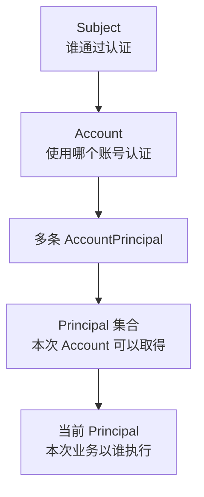

# 接入身份与权限

本页以「工作区文档」为例，说明如何为一个业务接口选择当前 Principal、声明 Operation，并按对象限制访问。适合新增业务接口、消息入口或任务的开发者。

场景：一个 Account 可以加入多个工作区（Workspace），在每个工作区中以成员（Member）身份读取文档（Document）。

需要解决三个问题：

- 请求进入 `/workspaces/{workspaceId}/...` 时，当前业务身份是哪一个工作区的成员。
- 成员是否有读取文档的固定权限。
- 该成员是否能读取这一份文档。

读完本页后，可以得到一个受保护的 `GET /workspaces/{workspaceId}/documents/{documentId}` 接口，以及判断各层应使用 Subject、Account 还是 Principal 的规则。

前置阅读：[身份与账号](/home/identity)和[资源与权限](/home/permission)。

## 实现步骤

本页的 `WorkspaceMemberPrincipal`、`WorkspaceMembers`、`WorkspaceOperations`、`DocumentService` 等类型由具体应用定义。框架类型来自 `com.sca4d.core.api.*` 与 `com.sca4d.core.spring.*`。

### 1. 定义业务 Principal

Principal 只要求返回 `principalId()`。成员身份在其上增加所属工作区。

```java
// 由具体应用定义
public final class WorkspaceMemberPrincipal implements Principal {

    private final long principalId;

    private final long workspaceId;

    public WorkspaceMemberPrincipal(long principalId, long workspaceId) {
        this.principalId = principalId;
        this.workspaceId = workspaceId;
    }

    @Override
    public long principalId() {
        return principalId;
    }

    public long workspaceId() {
        return workspaceId;
    }
}
```

登录时把它装入 Session 的方法见[接入认证与 Session](/tutorials/authentication-and-session#会话建立与身份装载)。

### 2. 声明 Operation 目录

在应用的操作目录中声明稳定编码。角色只能授予目录中的动作节点。下面的 `RbacDomain` 名称由具体应用定义。

```java
@Component
public final class WorkspaceOperations implements RbacOperationModule {

    public static final String DOCUMENTS_READ_VALUE = "WORKSPACE:DOCUMENTS:READ";

    public static final String DOCUMENTS_WRITE_VALUE = "WORKSPACE:DOCUMENTS:WRITE";

    private static final TreeCode MODULE = TreeCode.ofSegment("WORKSPACE");

    private static final TreeCode DOCUMENTS = TreeCode.ofSegment("DOCUMENTS");

    @Override
    public OperationNode.Module operationTree() {
        return OperationNode.module(
                MODULE,
                "operation.workspace",
                100,
                OperationNode.resource(
                        DOCUMENTS,
                        "operation.workspace.documents",
                        100,
                        OperationNode.action(Action.READ.code(), "operation.workspace.documents.read", 100),
                        OperationNode.action(Action.WRITE.code(), "operation.workspace.documents.write", 200)));
    }

    @Override
    public Set<RbacDomain> domains() {
        return Set.of(new RbacDomain("WORKSPACE")); // 领域名称由具体应用定义
    }
}
```

编码由模块、资源和动作三段以冒号连接。`SystemOperations` 与 `IotOperations` 是同一写法的参考。

### 3. 选择当前 Principal

`PrincipalSelection` 根据 Session 和类型化的请求输入返回当前 Principal。下面的选择器读取路径参数 `workspaceId`。

```java
@Component
public final class WorkspaceMemberPrincipalSelection
        implements PrincipalSelection<Map<String, @Nullable Object>> {

    private final WorkspaceMembers members; // 由具体应用定义

    public WorkspaceMemberPrincipalSelection(WorkspaceMembers members) {
        this.members = members;
    }

    @Override
    public boolean supportsSelectionBeforeArgumentBinding() {
        return true; // 只依赖 path、query、header
    }

    @Override
    public Class<Map<String, @Nullable Object>> parameterType() {
        return PrincipalSelection.mapParameterType();
    }

    @Override
    public @Nullable Principal select(
            @Nullable Session session,
            @Nullable Subject subject,
            @Nullable Account account,
            Map<String, @Nullable Object> parameters) {
        if (session == null || account == null
                || !(parameters.get("path") instanceof Map<?, ?> path)
                || path.get("workspaceId") == null) {
            return null;
        }
        long workspaceId = Long.parseLong(path.get("workspaceId").toString());
        return members.findPrincipal(account.accountId(), workspaceId)
                .orElseThrow(() -> new BusinessException(CoreErrorCode.PERMISSION_DENIED));
    }
}
```

选择器返回的对象还要经过 `Call.selectPrincipal(...)`。该方法校验对象的精确类型和 ID 是否存在于 Session 中。查询业务表不能把 Session 之外的 Principal 变成可信对象。

### 4. 在 Controller 声明身份和权限

```java
@RestController
@RequestMapping("/workspaces/{workspaceId}/documents")
@CurrentPrincipal(selection = WorkspaceMemberPrincipalSelection.class)
public class DocumentController {

    private final DocumentService documents; // 由具体应用定义

    public DocumentController(DocumentService documents) {
        this.documents = documents;
    }

    @GetMapping("/{documentId}")
    @RequirePermission(operation = WorkspaceOperations.DOCUMENTS_READ_VALUE)
    @RequirePermission(
            resource = "#documentId",
            resourceType = Document.RESOURCE_TYPE_VALUE,
            action = Action.READ_VALUE)
    public ApiResponse<DocumentView> find(
            @PathVariable long workspaceId,
            @PathVariable long documentId,
            @CurrentPrincipal WorkspaceMemberPrincipal member) {
        return ApiResponse.ok(DocumentView.from(documents.find(member, documentId)));
    }
}
```

`@RequirePermission` 可以重复声明。第一条检查固定 Operation，第二条检查目标 Resource。`operation`、`resource` 与 `resolver` 在同一条注解中三选一。

表达式不能直接得到 Resource 时，使用 `resolver` 指向 `CallValueResolver<Collection<Resource>>` 的实现。动态资源必须写明 `action`。

### 5. 定义 Resource 和 PermissionPolicy

```java
// 由具体应用定义
public final class Document implements Resource {

    public static final String RESOURCE_TYPE_VALUE = "WORKSPACE/DOCUMENTS";

    public static final TreeCode RESOURCE_TYPE = TreeCode.ofSlash(RESOURCE_TYPE_VALUE);

    private final long id;

    private final long workspaceId;

    // 构造方法与 getter 省略

    @Override
    public TreeCode type() {
        return RESOURCE_TYPE;
    }

    @Override
    public String id() {
        return Long.toString(id);
    }
}

@Component
public final class DocumentPermissionPolicy implements PermissionPolicy {

    private final DocumentRepository documents; // 由具体应用定义

    public DocumentPermissionPolicy(DocumentRepository documents) {
        this.documents = documents;
    }

    @Override
    public boolean supports(Resource resource) {
        return Document.RESOURCE_TYPE.equals(resource.type());
    }

    @Override
    public PermissionDecision decide(Call call, Permission permission) {
        if (!Action.READ.equals(permission.action()) && !Action.UPDATE.equals(permission.action())) {
            return PermissionDecision.deny("文档只支持读取和更新动作");
        }
        WorkspaceMemberPrincipal member =
                (WorkspaceMemberPrincipal) call.principal().orElseThrow();
        boolean sameWorkspace = documents
                .findWorkspaceId(Long.parseLong(permission.resource().id()))
                .filter(workspaceId -> workspaceId == member.workspaceId())
                .isPresent();
        return sameWorkspace
                ? PermissionDecision.allow()
                : PermissionDecision.deny("文档不属于当前工作区");
    }
}
```

Policy 只根据 Principal、目标 Resource、Action 和业务表作出判断。

需要限制列表范围时，返回 `PermissionDecision.allow(ResourceScope)`。ResourceScope 保存组织、区域或对象条件，Repository 通过 `ResourceScopeRequirement.consume(...)` 取得后加入 SQL，写操作同样包含范围条件。

### 6. 让 Service 和 Repository 只使用 Principal

```java
// 由具体应用定义
public Document find(WorkspaceMemberPrincipal member, long documentId) {
    return repository.findInWorkspace(member.workspaceId(), documentId)
            .orElseThrow(() -> new BusinessException(CoreErrorCode.NOT_FOUND));
}
```

```sql
SELECT d.*
FROM document d
JOIN workspace_member m ON m.workspace_id = d.workspace_id
WHERE d.id = :documentId
  AND d.workspace_id = :workspaceId
  AND m.principal_id = :principalId;
```

资源表保留自己的 `workspace_id` 和 `document_id`。`principal_id` 识别执行者、Owner、Member、Creator 或 Grantee，不代替资源 ID。

普通业务 SQL 不关联 `iam_subject` 或 `iam_account` 来确认调用来源。HUMAN、APPLICATION、DEVICE 的入口限制在进入业务 Service 前完成。
Subject、Account 和 Principal 集合在登录时确定，请求只能在 Session 已有的 Principal 中选择一个，因此业务 Service 不再验证调用者来源。

## 验证

前置条件：已登录并取得 Session Token，Token 对应的 Account 是工作区 `101` 的成员，角色已授予 `WORKSPACE:DOCUMENTS:READ`。

有权成员读取本工作区文档：

```http
GET /api/workspaces/101/documents/9001
Authorization: Bearer <sessionToken>
```

预期响应：200，`data` 为文档内容。

按以下场景再请求一次，对照结果：

| 场景 | 预期结果 |
| --- | --- |
| 没有 Token | 401，错误码 `1001` |
| 角色未授予 `WORKSPACE:DOCUMENTS:READ` | 403，错误码 `1002` |
| Account 不是路径中工作区的成员 | 403，错误码 `1002`，由上面的选择器抛出 |
| 文档属于其他工作区 | 403，错误码 `1002` |

角色或成员关系变更后，检查受影响的 Session 已刷新或失效。刷新方式见[接入认证与 Session](/tutorials/authentication-and-session#刷新要求)。

## 失败结果与限制

- 调用没有完成认证时，`IdentityCallInterceptor` 抛出 `AUTHENTICATION_REQUIRED`（`1001`），HTTP 状态为 401。
- 任一 `@RequirePermission` 被拒绝时，`PermissionCallInterceptor` 抛出 `PERMISSION_DENIED`（`1002`），HTTP 状态为 403。
- 声明了 `@RequirePermission` 或 `@Audit` 却没有完成 Principal 选择时，抛出 `IllegalStateException`，表示接入配置错误，不是请求错误。
- `operation`、`resource`、`resolver` 同时声明或都未声明，动态资源缺少 `action`，资源标识不是正整数或非空文本时，同样抛出 `IllegalStateException`。
- `Call.selectPrincipal(...)` 收到不在 Session 中的 Principal 时抛出 `IllegalArgumentException`。同一次调用不能切换业务身份，重复选择不同 Principal 抛出 `IllegalStateException`。
- Policy 返回 `allow(ResourceScope)` 后，Repository 没有消费该范围时，预提交校验抛出 `IllegalStateException`，提示数据权限范围没有被 Repository 消费。
- 匿名接口不能同时声明权限或身份审计，否则抛出 `IllegalStateException`。
- SYSTEM 请求使用唯一的 `Subject(id=1)`，Account 为空。Spring 自主入口使用 `@SystemExecution("IOT")`，不带值时为 `MAIN`。已有 Call 保持原身份。SYSTEM 仍然需要明确的 Operation 和 Resource Policy，见[系统、领域身份和实例](/home/identity#系统、领域身份和实例)。

## 使用 Subject、Account 还是 Principal



- Subject 表示实际接入者，类型有 `HUMAN`、`APPLICATION`、`DEVICE`、`SYSTEM`。主要用于接入限制、认证安全、已验证 Contact、Session 失效和审计。普通业务代码不根据 SubjectType 区分调用者。
- Account 表示一组可以完成认证的账号数据，关联 RealmKey、AccountIdentifier、Credential、MFA 策略和 Session。Account 不表示管理员、客户或工作区成员，也不能作为业务资源的 owner、member 或 creator。
- Principal 表示业务执行身份。业务资料、Role、Operation、Owner、Member、Grant、消息发送者、文件使用者和数据创建者都使用 Principal。一个 Session 可以包含多个 Principal，一次调用只选择一个。

| 组合 | 使用位置 | 普通业务是否使用 |
| --- | --- | --- |
| Subject | Subject 状态、已验证 Contact、Subject 下全部 Session | 否 |
| Account | Credential、MFA、IdentityProvider 关联、Account Session | 否 |
| Principal | 业务资料、RBAC、资源访问、Owner、Member、Grant | 是 |
| Account + Principal | AccountPrincipal 读写、Session 创建和 Principal 集合装载 | 否 |
| Subject + Account + Principal | Call、Session 创建、接入日志和审计 | 否 |

组合表不表示所有方法都要接收多个 ID。只有方法的实际判断需要某个对象时，才使用它。

IAM 与认证代码按实际操作使用完整名称：

```java
disableSubject(Long subjectId, long version)
changePassword(Long accountId, PasswordChange command)
grantPrincipal(Long accountId, Long targetPrincipalId)
createSession(Long accountId)
```

`createSession` 从 Account 读取 Subject 和 Principal 集合。能够从已验证对象读取的数据，不作为独立的客户端参数接收。`targetPrincipalId` 是被授予 Account 的 Principal，不一定是当前 Principal，方法和 SQL 用 `actorPrincipalId`、`targetPrincipalId` 区分操作者与目标。

文档、类型名、方法名和参数名使用 `Subject`、`Account`、`Principal` 完整名称，不用单字母代替。

业务 Service 接收 Principal 或由它解析出的业务身份。以下写法不符合本规则：

```java
updateProfile(principalId, accountId, principalId, command);
createDocument(principalId, accountId, memberPrincipalId, command);
```

需要限制 PrincipalType 时，接入检查先把公共 Principal 转换成明确的业务身份，例如 `WorkspaceMemberPrincipal`。后续业务方法使用该类型，不再接收 Subject 或 Account。

业务方法确实需要修改 Account、Credential 或 Subject Contact 时，它已经在处理 IAM 或认证资源，不属于「普通业务只使用 Principal」的情况。

## 扩展调用规则

应用的额外调用规则通过 `CallLifecycle.Participant` 挂载。注解匹配使用 `CallLifecycleAdvisor.AnnotationBinding<A>`，不依赖注解的规则使用只读取方法元数据的 `CallLifecycleAdvisor.MethodBinding`。

下面的例子为读取敏感文档增加一次附加风险校验。`StepUpRisk`、`StepUpRiskVerifier` 由具体应用定义。

```java
@Retention(RetentionPolicy.RUNTIME)
@Target({ElementType.TYPE, ElementType.METHOD})
@CallLifecycle.Intercepted
public @interface StepUpRisk {
}

@Component
public class StepUpRiskCallInterceptor implements CallLifecycle.Before {

    public static final TreeCode CODE = TreeCode.of("WORKSPACE/STEP_UP_RISK");

    private final StepUpRiskVerifier verifier; // 由具体应用定义

    public StepUpRiskCallInterceptor(StepUpRiskVerifier verifier) {
        this.verifier = verifier;
    }

    @Override
    public TreeCode code() {
        return CODE;
    }

    @Override
    public boolean supports(CallExecution execution) {
        return execution.declaration(StepUpRisk.class).isPresent();
    }

    @Override
    public void before(CallExecution execution) {
        verifier.verify(execution.call().principal().orElseThrow(), execution.arguments());
    }
}

@Bean
CallLifecycleAdvisor.AnnotationBinding<StepUpRisk> stepUpRiskCallBinding() {
    return () -> StepUpRisk.class;
}
```

应用在配置类中声明相对内置节点的位置，内置节点之间的顺序不变：

```java
@Bean
CallLifecycleConfiguration.Customizer stepUpRiskOrder() {
    return configuration -> {
        configuration.after(StepUpRiskCallInterceptor.CODE, PermissionCallInterceptor.CODE);
        configuration.before(StepUpRiskCallInterceptor.CODE, IdempotencyCallInterceptor.CODE);
    };
}
```

目标方法声明 `@StepUpRisk` 后，由统一 Advisor 拦截。

一个参与者只能实现一个阶段回调（`Before`、`Around`、`AfterReturning` 等），否则注册时抛出 `IllegalArgumentException`。编码重复或引用未注册的编码时同样抛出该异常。

功能注解标记了 `@CallLifecycle.Intercepted`，却没有注册对应的 `AnnotationBinding` 时，方法执行前明确失败。业务模块不修改 Advisor 的注解清单。

需要为某注解附着预提交条件时，轻量绑定可以通过 `ObjectProvider` 在实际方法执行时取得状态 Bean。依赖排序、失败与重放规则见[注解与环绕处理](/home/permission#注解与环绕处理)。

## 验收清单

- Core Principal 通过 `principalId` 标识业务身份，不把 Subject、Account 或业务 Profile 数据复制到公共身份接口约定。
- 普通业务 Service 的身份参数只有 Principal 或明确的业务 Actor。
- 普通业务 Repository 不使用 Subject 或 Account 判断 Owner、Member、Role 或数据范围。
- AccountPrincipal 只在 IAM、Authentication、Session 和账号管理代码中读写。
- HTTP、STOMP、MQTT 和任务入口在调用业务 Service 前完成 Principal 选择与操作限制。
- 审计从 Call 记录 Subject、Account 和 Principal，不改变业务方法签名。

## 相关页面

- [身份与账号](/home/identity)
- [资源与权限](/home/permission)
- [接入认证与 Session](/tutorials/authentication-and-session)
- [开发后端业务接口](/tutorials/backend-feature)
- [编写与运行测试](/tutorials/testing)
