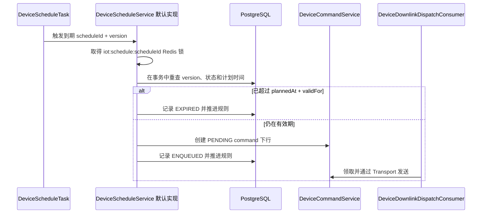
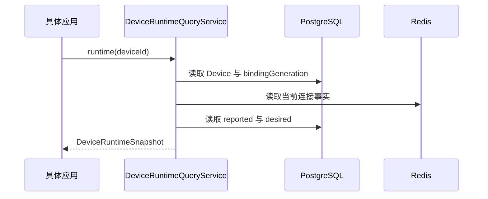

# 查询设备状态与下发命令

先按[接入第一台设备](/tutorials/iot-device-access)创建并连接设备，再使用应用接口查询当前状态和提交下行。设备已经连接不代表命令已经执行，提交后应继续检查下行记录及业务 ACK。

## 从查询到业务确认

应用 Service 先检查当前 Principal 是否可以访问 Device，然后调用 `DeviceRuntimeQueryService.runtime(deviceId)` 读取当前连接、reported 和 desired。列表中的连接使用 `DeviceConnectionQueryService` 批量查询，在线状态交给应用选择的 `DeviceOnlinePolicy` 判断。

提交命令使用 `DeviceCommandService.submit(...)`，输入中的命令编码和参数来自设备当前物模型。保存返回的 messageId，通过 `DeviceHistoryQueryService` 查询下行状态与 ACK；HTTP 路由见[Sca4d Server IoT 接口](/reference/http/sca4d-server)。

发送结果、设备业务 ACK 和最终状态分别检查。连接断开、超时、业务拒绝后，消息按提交时确定的重试策略继续或结束。需要撤销未完成命令时调用 `cancel(messageId)`；已经进入协议发送的命令仍可能到达设备。

`modules/iot/sca4dj-iot` 保存设备台账、当前状态、可靠下行和设备定时规则。它不拥有 Device 的 Account 或 Credential，不解析 MQTT Topic，不调用 EMQX Management API，也不保存遥测与事件历史。Product、Device、reported、desired、command、ACK 和定时的完整顺序见 [IoT 设备生命周期](/home/iot)。

## 公开入口

模块通过 `sca4dj-iot-api` 中的契约与具体应用和协议适配器协作：

- Product、Device、ThingModel 与 DeviceProtocol 分别描述产品约束、设备实例、业务能力和设备消息语义；Product 的动态展示字段与 ThingModel 的路径翻译和技术定义分开保存；
- DeviceConnectionBinding 保存 Device 可选的直接连接协议、身份类型和值。网关中继等间接 Device 不登记直接连接，也不登记认证接入方式；
- [DeviceConnectionAdmission](/javadoc/modules/iot/sca4dj-iot-api/com/sca4d/iot/api/connection/DeviceConnectionAdmission.html)、DeviceConnectionReceiver 与 DeviceConnectionTerminator 分别处理连接准入、当前连接事实和协议断连；
- DeviceUplinkDispatcher 按 Device 当前的 `protocolCode` 选择 DeviceUplinkProtocol，解码 DeviceProtocolMessage 后交给 DeviceUplinkReceiver；具体应用可以替换 Receiver，在同一业务事务中更新 IoT 当前事实和应用业务表；
- DeviceDownlinkPublisher 接收完整 Device，由设备协议适配器选择直接连接或应用业务路由并发送标准下行；
- [ReportedStateStore](/javadoc/modules/iot/sca4dj-iot-api/com/sca4d/iot/api/state/ReportedStateStore.html) 保存 latest reported，可以由 PostgreSQL、Redis 或具体应用的其他实现提供；
- [DeviceHistoryStore](/javadoc/modules/iot/sca4dj-iot-api/com/sca4d/iot/api/history/DeviceHistoryStore.html) 读取遥测、事件、ACK 和设备定时执行历史；IoT base 只依赖契约，不拥有历史数据库；
- [DeviceRuntimeQueryService](/tutorials/iot-state-and-commands)、[DeviceHistoryQueryService](/tutorials/iot-state-and-commands)、[DeviceScheduleService](/tutorials/iot-state-and-commands) 和 [DeviceScheduleQueryService](/javadoc/modules/iot/sca4dj-iot-api/com/sca4d/iot/api/schedule/DeviceScheduleQueryService.html) 分别管理当前状态、历史查询和设备定时；
- [DeviceChangePublisher](/javadoc/modules/iot/sca4dj-iot-api/com/sca4d/iot/api/change/DeviceChangePublisher.html) 接收事务提交后的数据区域失效通知，具体应用可以把它转换成浏览器 Realtime 事件。

`sca4dj-iot` 公开 ProductService、ThingModelService、DeviceService、DesiredStateService 和 DeviceCommandService 等 Java Service，供具体应用组合业务流程。自动配置不创建 HTTP 路由。

代码物模型可以在 `ThingCommand` 中使用 `DataKey<T>` 声明命令输入，并通过 `DeviceCommandService` 的 `ThingCommand + DataValues` 入口提交。命令 code、字段 code 和 Java 类型由同一份物模型声明负责；服务仍读取 Device 当前绑定的物模型，重新校验完整字段、范围、字符串 `pattern`、ACK 和重试策略。数据库物模型、设备定时和 HTTP 调试等运行时场景继续使用 `String + Map` 入口。

`DeviceHistoryQueryService.downlinks(Collection<Long>)` 批量读取主库仍保留的下行消息。实现先去重，再按公共 SQL 批次条目和绑定参数限制执行查询；空集合不访问数据库，不存在或已经按保留策略删除的标识不出现在结果中。应用在列表中组合下行状态时应使用这个入口，不按记录逐条查询。

DeviceService 只保存 Product、物模型、设备协议、可选 DeviceConnectionBinding 和 [DeviceAccessMethod](/javadoc/modules/iot/sca4dj-iot-api/com/sca4d/iot/api/DeviceAccessMethod.html)。DeviceProtocol 不声明 MQTT、TCP 或连接身份；同一种设备消息协议可以由不同传输带入。DeviceService 不依赖 IAM 或 Auth，不创建 Subject、Account、Credential 或 Session。匿名使用 `anonymous`，通用 Session 使用 `session`，直接 Account 认证使用 `account:<AuthenticationMethodCode>`。具体应用实现 DeviceConnectionAdmission，把协议输入转换为 AuthenticationSubmission 或 Session Token，再组合 Device、Account、Auth 和 Session。

## 模块拥有的数据

主 PostgreSQL 保存业务判断与失败恢复需要的当前事实：

- Product、Product 来源、动态多语言展示字段、允许的认证接入方式和设备协议 code；Product 不保存连接协议白名单；
- 连续发布且不可修改的物模型技术版本，以及可以独立完整替换的路径翻译；
- Device、当前物模型版本、设备协议、`bindingGeneration`、可选直接连接绑定和认证接入方式；
- 默认 PostgreSQL 实现使用的 latest reported 字段组；
- current desired 与可靠下行消息；每条下行只保存最新业务 ACK，不另建 ACK 历史表；
- 设备定时规则、下一次触发时间和最新执行结果；完整执行历史通过事件存储，不另建设备定时执行历史表。

`iot_downlink_message` 是需要跨事务恢复的业务状态，不是临时投递表。它保存 command 或 desired 下行从 `PENDING`、`SENDING`、`WAITING_ACK` 到终态的状态、attempt、ACK 截止时间、最新 ACK 和稳定失败 code，不保存面向某种语言的失败文本。发送、ACK 和超时处理使用同一个 `iot:downlink:<messageId>` Redis 分布式锁；进程在协议发布后、结果事务前退出时，重复派发可以从 `SENDING` 继续。终态记录按保留期分批删除，`SUCCEEDED`、`FAILED`、`EXPIRED` 与 `SUPERSEDED` 都必须进入清理范围。

Redis 保存可重建的当前连接投影，以及应用选择 RedisReportedStateStore 时的 latest reported。没有设备顺序的 reported 使用 IdGenerator 分配固定宽度的平台顺序值，不创建 Redis 递增 key。连接在线结果由 DeviceOnlinePolicy 在查询时计算，不写 PostgreSQL。Redis 丢失不会删除 Product、Device、desired、下行或定时规则。

Device 的 Credential 由通用 Auth 方法模块按 `account_id` 保存。Shared Secret、HMAC 和 X.509 分别属于 `sca4dj-auth-shared-secret`、`sca4dj-auth-hmac` 和 `sca4dj-auth-x509`；IoT 主库没有 Secret 或 Certificate 表。

具体应用自己的 Product/Device 启停 Profile、HTTP 幂等记录、权限和额外展示字段不属于该模块。

## 消息与历史边界

IoT 使用通用 [MessagePublisher](/javadoc/core/sca4dj-core-api/com/sca4d/core/api/messaging/MessagePublisher.html)，不创建 IoT 专用 Outbox：

- Telemetry 在 reported 主事务提交后使用 `publishAfterCommit(...)`。它不写 Outbox；代理发布失败可能丢失这一批历史样本，但不会回滚 latest reported。
- 物模型事件按 ThingEvent 的 delivery 声明发布。`RELIABLE` 在主事务写通用 `messaging_outbox`，其他事件在提交后直接发布。
- 下行发送、ACK 超时、断连、每个首次接受的 ACK 阶段和设备定时执行结果必须可靠发布，统一使用 `messaging_outbox`。

安装 `sca4dj-iot-timescale` 后，消息 Consumer 直接把 Telemetry 写入 `iot_telemetry_sample`，把物模型事件、ACK 和设备定时执行结果写入 `iot_event`。TimescaleDB 不参与 IoT 主事务，也没有高频 outbox、通信日志、ACK 历史或定时执行专表。

## 允许依赖

`sca4dj-iot` 直接依赖 `sca4dj-iot-api` 和 Core Spring，不依赖 IAM、Auth、EMQX 或 TimescaleDB 模块。传输适配器只依赖 IoT API：它从 Topic、端口、信道或报文头定位 Device，提交 DeviceProtocolMessage，并报告直接连接。实际设备协议由 IoT 分发器从 Device 台账选择，传输适配器不读取 IoT base 的 Repository 或 Mapper。

具体应用可以同时依赖 IoT、IAM、Auth 及认证方法模块，在 App Service 中建立 Device Subject、固定 Realm Account、Credential、Session 和 Connection。把这些组合写在 App 中是业务选择，不应把认证方法分支重新塞进 DeviceService。

## 安装条件

加入 `sca4dj-iot` 后，自动配置安装 MyBatis Repository、领域 Service、Redis 连接投影和上行入口。运行应用还必须提供：

- Core Spring、主 PostgreSQL、Redis、IdGenerator 和统一 JSON ObjectMapper；
- 通用 Messaging 的 MessagePublisher，用于提交后消息和可靠消息；
- 至少一个符合 Product 声明的 DeviceProtocol；
- 发送下行与处理 ACK 超时的 MessageConsumer 运行环境；
- 需要历史查询时安装一个 DeviceHistoryStore，例如独立的 `sca4dj-iot-timescale`。

模块结构片段由应用的 Flyway 初始迁移收集，已生成的迁移由应用继续维护。Timescale 模块使用自己的 DataSource 和 Flyway，不拼入应用主库 V1。

## 失败时哪些数据不会改变

- 物模型只有在全部声明协议、属性策略和命令策略通过校验后才发布。
- Device 重新绑定要求具体应用先停用设备，并且旧 binding generation 没有活动下行消息。
- reported、desired、ACK 与下行状态在主事务内改变；协议传输、消息代理和 TimescaleDB 不加入该事务。
- Telemetry 提交后发布失败不会回滚 latest reported，也没有主库重试副本。
- 可靠事件、下行、ACK 超时和断连的代理发布失败会留在通用 Messaging Outbox 重试。
- 下行发送、ACK 和超时 Consumer 在数据库事务前取得同一消息的 Redis 分布式锁，并在锁内短事务中重新检查状态和 attempt。协议 publish 在两个数据库事务之间执行，不占用数据库事务；传输失败、ACK 超时与业务拒绝由消息快照中的 RetryPolicy 决定重试或进入终态。
- 设备定时按 PostgreSQL `next_fire_at` 查询普通候选，取得 `iot:schedule:<scheduleId>` Redis 分布式锁后，在独立事务中重新检查 version、状态和计划时间；不使用显式行锁，也不为每条规则创建线程或 Redis 定时项。到期时只生成可靠 command 下行，实际发送由下行消息 Consumer 完成。
- 模块使用 `ClusterTaskSchedule` 声明设备定时扫描和终态下行清理。具体应用只配置触发间隔，Quartz 集群直接执行任务且不创建 `job.*` 运行记录。
- Session 终止、Redis 连接投影和 Broker 断连不构成跨存储事务。App 可靠发布带明确连接代次的断连消息；Consumer 先终止协议会话，再删除 DeviceConnection 和可选公共 ConnectionRegistry 投影，重复处理时不能断开后来建立的新连接。
- 模块不判断谁能创建 Product、启用 Device、修改 desired 或提交 command。具体应用必须在公开入口外层完成权限和状态检查。

EMQX 接入见[设备教程](/tutorials/iot-device-access)，历史数据库的连接与安装配置见[TimescaleDB 配置](/reference/runtime/sca4d-server)。

## 命令下发

`DeviceCommandService.submit` 校验 Device 当前物模型并登记可靠下行，返回的 `messageId` 用于查询下行结果。协议发布成功与设备业务确认是不同结果。

应用不再需要某条 command 时调用 `cancel(messageId)`，并与自己的业务状态修改使用同一事务。首次取消未完成命令返回 `true`；已经进入终态返回 `false`。消息不存在或不是 command 时报告无效输入。

取消提交后，后续发送、发布结果写回、ACK 超时和重试不能恢复这条消息。已经进入协议发布的命令仍可能送达，应用需要按自身业务决定是否发送补偿命令。取消定时规则不会自动取消已经生成的 command。

## 设备连接

`DeviceConnectionQueryService` 批量读取 Device 当前连接事实，并为没有连接的 Device 返回空列表。该接口不判断业务在线状态；具体应用把连接集合交给自己选择的 `DeviceOnlinePolicy`。

单个 Device 查询也使用同一个批量入口。默认 Redis 实现把较大的输入分成内部 pipeline 批次，每个 Device 的 Lua 查询同时删除过期索引和已经失去主记录的索引；内部批次大小不限制调用方可以查询的 Device 数量。

## DeviceScheduleService

DeviceScheduleService 管理只用于设备消息下发的高精度定时规则。单次绝对时间和带时区六字段 Cron 都会在到期时生成可靠 command 下行；半年后执行业务计划等低精度预约使用普通 Job 或 Quartz，不进入该接口。

### 规则修改

- `create` 要求 Device 存在、触发时间在未来且 `validFor` 为正数，创建 `ACTIVE` 规则并登记下一次触发时间。
- `replace` 使用 `expectedVersion` 完整替换 command、触发规则和有效期，并把规则恢复为 `ACTIVE`。
- `changeStatus` 只接受 `ACTIVE` 或 `PAUSED`。恢复单次规则时保留原计划时间，恢复 Cron 时从当前时间计算下一次触发。
- `cancel` 永久取消规则。取消不会撤销已经生成的下行消息，下行继续遵守自己的状态机和最晚发送时间。

替换、状态修改和取消都使用从查询结果取得的非负乐观版本，新建规则的初始版本是 `0`。规则不存在、版本变化或当前状态不允许修改时返回状态冲突，不覆盖并发修改。

### 到期执行

DeviceScheduleTask 不直接调用 Connection 或协议 Transport。它先普通查询一条到期候选，再取得规则级 Redis 分布式锁并开启独立事务；事务内重新读取当前规则，只有 version、状态和计划时间仍匹配才生成下行并按 version 条件推进。业务校验失败时默认实现记录 `FAILED`、稳定错误 code 并暂停规则，不把异常文本写入业务表；具体应用读取结果时再按请求 Locale 生成消息。数据库暂时失败时本次集群任务停止，下一次触发继续按 PostgreSQL 当前版本扫描。PostgreSQL 是规则、下一次触发时间和最新执行结果的权威存储，不建立 Redis 到期索引或处理租约。

查询规则与执行结果见 [DeviceScheduleQueryService](/javadoc/modules/iot/sca4dj-iot-api/com/sca4d/iot/api/schedule/DeviceScheduleQueryService.html)，模块整体边界见 [IoT 基础模块](/tutorials/iot-state-and-commands)。

## DeviceRuntimeQueryService

DeviceRuntimeQueryService 一次读取指定 Device 的当前运行态，供具体应用转换成 HTTP、管理端或其他展示结果。它不判断应用权限，也不返回历史数据。

### 查询行为

`runtime(deviceId)` 先确认 Device 存在并读取当前 `bindingGeneration`，随后读取属于这一代绑定的连接事实、reported 字段组和 desired 属性，返回 [DeviceRuntimeSnapshot](/javadoc/modules/iot/sca4dj-iot-api/com/sca4d/iot/api/query/DeviceRuntimeSnapshot.html)。Device 不存在时抛出 IoT 的 Device 不存在错误。

连接事实来自可恢复的 Redis 投影，reported 和 desired 来自主 PostgreSQL。该方法只保证三类数据属于同一个 Device 和当前读取到的 `bindingGeneration`，不把 Redis 与 PostgreSQL 组成跨存储事务快照；并发连接或状态上报可能在查询期间发生。

IoT 模块的数据归属与相邻接口见 [IoT 基础模块](/tutorials/iot-state-and-commands)。

## DeviceHistoryQueryService

DeviceHistoryQueryService 读取指定 Device 的下行状态、ACK、事件和 Telemetry 历史。具体应用负责权限、HTTP 参数绑定和响应格式；接口只返回模块公开类型。

### 数据来源

| 方法 | 数据与顺序 | 存储要求 |
|---|---|---|
| `downlinks` | 下行消息，按创建时间倒序分页 | 主 PostgreSQL |
| `acknowledgements` | 业务 ACK，按接收时间倒序分页 | 安装 DeviceHistoryStore 时读取完整 ACK 阶段；未安装时读取主 PostgreSQL 保存的每条下行最新 ACK |
| `events` | 离散 Device 事件，按发生时间倒序分页 | 具体应用安装的 DeviceHistoryStore |
| `telemetry` | 半开时间范围 `[from, to)` 内的属性样本，按观测时间升序 | 具体应用安装的 DeviceHistoryStore |

分页页码从 1 开始，页大小为 1 到 100。Telemetry 查询的 `limit` 不能超过历史存储配置上限；内置 TimescaleDB 实现使用 `sca4dj.iot.timescale.max-query-results`，默认 1000，可配置范围为 1 到 10000。`to` 必须晚于 `from`。所有方法先确认 Device 存在；DeviceHistoryStore 未安装时，`events` 和 `telemetry` 抛出依赖不可用错误，不返回空集合伪装成没有历史。

主库与高频历史的边界见 [IoT 基础模块](/tutorials/iot-state-and-commands)。
