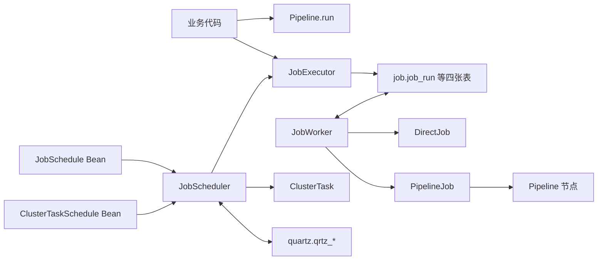
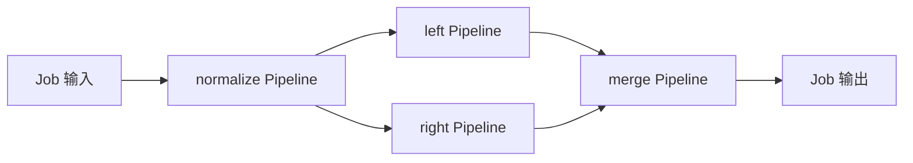
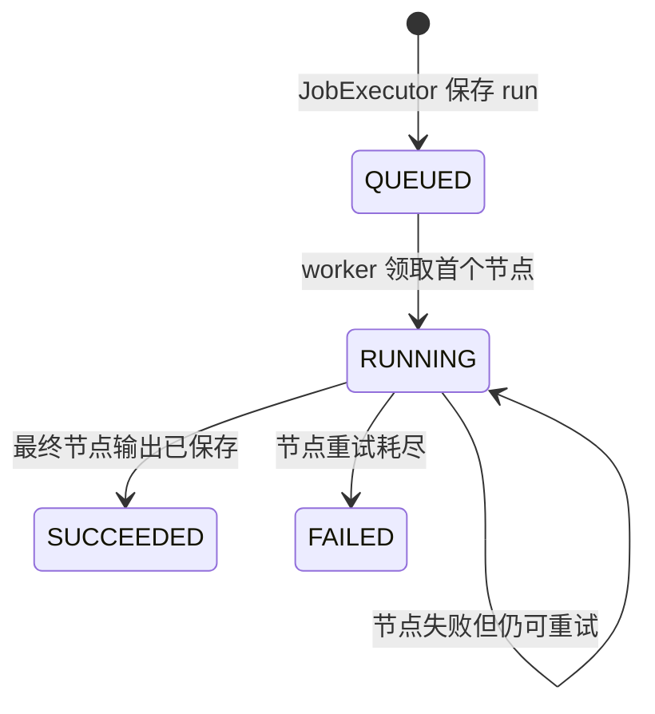

# 执行和调度任务

需要在请求返回后继续执行、保存结果或失败后恢复的业务工作，定义为 Job，通过 `JobExecutor` 提交。只在当前线程中完成数据转换时，直接使用 Pipeline。

## 提交一个后台任务

继承 `DirectJob<I, O>`，使用普通 Java 类定义需要持久化的输入与输出，并实现 `key()`、`definitionVersion()`、`inputType()`、`outputType()`、`retryPolicy()` 和 `execute(...)`。把 Job 注册为 Spring Bean，稳定 key 在应用内唯一。

输入保存执行需要的业务标识和参数，不保存当前线程、Session 或数据库连接。`JobExecutor.submit(job, input)` 不继承调用方事务；需要与业务提交保持顺序时，先明确业务事务成功后如何可靠提交任务。

```java
JobRunId runId = jobExecutor.submit(job, input);
JobRunStatus status = jobExecutor.status(runId);
Optional<Output> output = jobExecutor.result(runId, job);
```

这里的 `job` 是应用已注册的 Job，`input` 和 `Output` 分别对应它声明的输入、输出类型。`result` 不等待执行完成；尚未成功时返回空，失败时抛出 `JobRunFailedException`。Void 输出即使成功也为空，应同时检查 status。

需要定时执行同一个 Job 时，再注册 `JobSchedule`，声明稳定 key、固定输入、Cron 或间隔、misfire 与重叠策略。修改定义时递增 `definitionVersion`。运行后检查 run 状态和业务结果，并用重复执行验证幂等规则。

Quartz 计划的稳定身份由 `ScheduleKey`、`definitionVersion`、时间定义、misfire/overlap 策略和固定输入组成。`JobSchedule` 或 `ClusterTaskSchedule` 的实现类、包名和模块目录不属于计划定义；移动任务类不需要递增 `definitionVersion`。Quartz 的持久化对账由脚手架完成；当前记录缺少调度契约或同一版本的稳定定义发生变化时，Scheduler 拒绝启动。历史 Quartz 数据迁移属于发布和运维步骤，不由运行时调度机制自动放行。

Pipeline、Job 和 Scheduler 解决三个不同问题。类型化处理线（[Pipeline](/javadoc/core/sca4dj-core-api/com/sca4d/core/api/pipeline/Pipeline.html)）在调用线程中直接执行固定的输入输出转换；持久化工作（[Job](/javadoc/core/sca4dj-core-api/com/sca4d/core/api/job/Job.html)）描述一个可独立提交和恢复的执行单元；JobScheduler 在时间到达时提交 Job，[ClusterTaskScheduler](/javadoc/core/sca4dj-core-api/com/sca4d/core/api/scheduling/ClusterTaskScheduler.html) 则直接执行不需要业务运行历史的基础设施任务。

Flow 仍表示由业务调用逐步推进的无状态流程定义。Flow 不执行 Pipeline，不领取 Job，也不保存 Quartz trigger。需要继续处理 Flow 时，由业务代码明确发起下一次推进；不能把 Job 的持久化状态或 Pipeline 的输入输出线称为 Flow。

## 六个概念分别做什么

| 概念 | 负责什么 | 不负责什么 |
|---|---|---|
| Pipeline | 在当前线程中按固定顺序把非空输入转换成非空输出 | 不创建线程，不保存状态，不重试，不分支 |
| DirectJob | 在一次节点尝试中执行一个完整业务动作 | 不编排 Pipeline，不计算触发时间 |
| PipelineJob | 把多条 Pipeline 编排成顺序节点、两个并发分支和合并节点 | 不改变 Pipeline 可以直接执行的性质，不保存 Pipeline 内部阶段进度 |
| JobExecutor | 提交、查询、等待并恢复 Job run 的结果 | 不计算 Cron，不决定何时定时触发 |
| JobScheduler | 对账代码计划，在到达原定时间时调用 JobExecutor | 不执行 Job 业务代码，不保存 Job 节点和输出 |
| ClusterTaskScheduler | 对账基础设施计划，并由 Quartz 集群直接执行任务 | 不创建 Job run，不保存任务业务结果 |

DirectJob 和 PipelineJob 都继承 Job，因为两者都具有稳定 key、`definitionVersion`、输入类型和输出类型。Pipeline 不继承 Job；业务代码可以直接调用 `pipeline.run(input)`，只有需要持久化、异步、重试、并发分支或失败恢复时，才把一条或多条 Pipeline 放入 PipelineJob。

## 调用与数据关系



直接运行 Pipeline 时，调用从业务代码开始并在同一线程返回，不写数据库。提交 Job 时，JobExecutor 先把根运行、节点和依赖写入 `job.*`；JobWorker 再领取节点、执行 DirectJob 或 Pipeline 节点并写回结果。定时业务工作从 JobSchedule 开始，Quartz 到达原定时间后调用 `JobExecutor.submitScheduled(...)`，后续执行与手动提交完全相同。不需要业务运行历史的清理和轮询使用 ClusterTaskSchedule；Quartz 直接调用 ClusterTask，只在 `quartz.qrtz_*` 保存调度状态。

## PipelineJob 怎样拆分节点

PipelineJob 支持连续的顺序节点，也支持从当前终点发出两个并发分支，等两支都成功后执行一条接收 ParallelResults 的合并 Pipeline。

需要读取定时运行中的中间业务结果时，调用 `PipelineJob.nodeOutput(...)` 取得经过类型检查的节点输出声明，再交给 `JobHistory` 查询。具体应用不直接读取 `job.job_run_node`，也不把节点名称和输出 JSON 分别传给自己的 Service。



图中的每条 Pipeline 是一个持久化节点。顺序节点读取前一个节点的输出；左右分支读取同一个前置输出；合并节点按声明顺序恢复左右输出并构造 [ParallelResults](/javadoc/core/sca4dj-core-api/com/sca4d/core/api/job/ParallelResults.html)。节点失败时，只根据该节点的 JobRetryPolicy 重新执行整条 Pipeline；已经成功的前置节点不会重跑，但失败 Pipeline 内已经执行过的阶段也不会单独恢复。

当前编排故意只支持一条主线和二路并发合并。它不是任意有向图、工作流语言或补偿框架。需要三个以上分支、条件路由、人工等待或补偿事务时，应先定义新的稳定业务模型，不能把这些语义藏进节点名称或 PipelineStage。

## 运行状态与恢复



JobWorker 使用状态、attempt 和租约到期条件的 `UPDATE ... RETURNING` 领取节点，不使用显式行锁。同一个节点同一时刻只由一个有效租约写回，但 worker 可能在完成外部操作后、保存结果前失联；租约到期后其他实例会再次执行。因此运行语义是至少一次，不是仅一次。DirectJob 的业务动作和 PipelineStage 的外部副作用必须使用业务唯一键、条件更新或外部系统幂等键处理重复执行。

JobExecutor 的 `run(...)` 和 `await(...)` 都要求正数超时。超时只结束当前线程的等待，不取消持久化 run。当前 API 不提供强制取消；调用方可以稍后通过 `status(...)` 和 `result(...)` 继续查询。

## 定时触发与定义版本

[JobSchedule](/javadoc/core/sca4dj-core-api/com/sca4d/core/api/scheduling/JobSchedule.html) 使用代码声明固定 Job、固定输入、Cron 或固定间隔、misfire 策略和重叠策略。Quartz 模块启动时读取完整 JobSchedule Bean 集合，完成对账后才启动 Scheduler：

- 新 key 创建 durable JobDetail 和 Trigger；
- `definitionVersion` 增加时用当前定义更新 JobDetail 和 Trigger；
- `definitionVersion` 倒退会拒绝启动；
- key 和 `definitionVersion` 相同但定义摘要变化会拒绝启动，避免修改定义后忘记递增 `definitionVersion`；
- Trigger 缺失或处于 ERROR 时按当前定义重建；
- 当前完整集合中已经不存在的代码计划会从本应用 scheduler 删除。

每次 Quartz fire 使用 ScheduleKey 和 Quartz 原定触发时间去重。OverlapPolicy.SKIP_IF_RUNNING 在同一计划仍有 QUEUED 或 RUNNING run 时不创建新 run；OverlapPolicy.ALLOW 允许不同 fire 同时存在。MisfirePolicy 只决定 Scheduler 恢复后是否补一次触发，不改变 Job 重试策略。两类策略都不能把外部副作用变成仅一次。

## Namespace 与共享 PostgreSQL

具体应用必须配置 `spring.application.name`。Core Spring 用它创建 RuntimeNamespace；Job 和 Quartz 使用同一个实例隔离共享基础设施：

- `job.job_run.runtime_namespace` 保存应用技术 ID；状态查询、定时去重、活动 run 判断、worker 领取和过期租约处理都限制在该值内；
- 同一计划创建 run 前取得 `<app-id>:sca4dj:job:schedule:<schedule-key>` Redis 分布式锁，再在数据库事务中检查重复触发和重叠策略；
- Quartz `sched_name` 固定为 `<app-id>:sca4dj:scheduling:quartz`，不能另行配置；
- Quartz 的 JobDetail、Trigger、fire、集群节点和锁都由 `sched_name` 隔离。

因此多个具体应用可以使用同一个 PostgreSQL 实例、同一个 `job` schema 和同一个 `quartz` schema，但必须使用不同的 `spring.application.name`。同一具体应用的多个实例必须使用相同名称，才能共同领取 Job 节点并组成同一个 Quartz 集群。改变已经运行应用的名称会形成新的运行时命名空间，旧 run 和旧 Quartz trigger 不会自动迁移。

## 数据归属与未实现范围

- `job.job_run` 保存根运行、应用命名空间、Job 定义版本、输入输出和最终状态。
- `job.job_run_node` 保存独立领取、续租和重试的 DirectJob 或 Pipeline 节点。
- `job.job_run_dependency` 保存 PipelineJob 节点之间有序的直接依赖。
- `job.job_run_attempt` 保存每次领取、成功、失败或租约放弃的事实。
- `quartz.qrtz_*` 只保存 Quartz JDBC JobStore 的调度和集群状态，不保存业务输出。
- 两组表使用主 PostgreSQL DataSource，并位于分类 schema 中；模块提供 schema fragment，具体 App 的 Flyway 迁移负责把它们放入数据库。
- 文件清理使用 DirectJob，因为文件处理需要持久化 run 和失败恢复；Outbox 派发、Outbox 清理和成功 Job 历史清理使用 ClusterTask，因为每次扫描本身不需要业务运行记录。Web Realtime 的本机连接续约仍是节点本地定时动作，因为它只维护当前进程持有的连接。
- 当前不提供 Schedule HTTP CRUD、前端管理、动态计划、暂停、强制取消、人工重跑、补偿或任意图编排。

worker 与调度配置见[运行配置](/reference/runtime/sca4d-server)。
