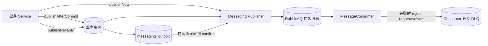
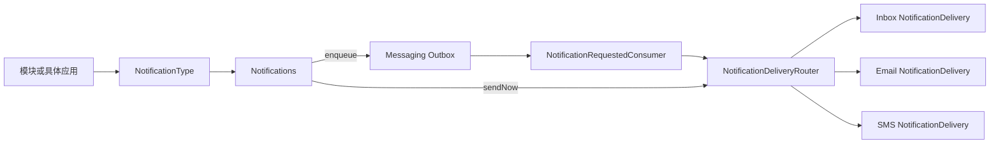
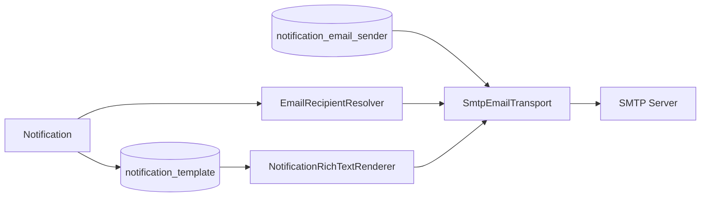

# 发布消息与通知

业务事件通过 MessagePublisher 发送给消费者；面向用户的邮件、站内信和短信通过 Notifications 发送。先确定接收方，再选择发布入口和失败后的处理方式。

## 注册事件并可靠发布

用 `EventType` 声明稳定编码、协议版本和 payload 类型，payload 使用只包含消费所需字段的普通 Java 类。为事件注册 `MessageConsumer`，为每个消费职责使用唯一编码。

在业务 Service 的数据库事务中完成写入后，调用 `MessagePublisher.publishReliably(event)`。该方法要求活跃事务；返回的 MessageId 对应同一事务中的 Outbox 记录。事务回滚时业务写入和 Outbox 一起回滚。

消费者按 MessageId 或业务唯一键防止重复执行。验证时分别检查事务回滚没有留下 Outbox、正常发送进入消费者、同一消息重复投递没有重复修改业务数据。消费失败进入独立 DLQ，修复原因后再决定重新发布或删除。

## 在本地发送一封通知邮件

先启动 Mailpit，再通过 `/system/email/senders` 创建 `host=localhost`、`port=1025`、`security=NONE` 的发送方，测试连接并启用。应用注册 `NotificationType`，声明接收人、变量及 EMAIL 渠道，为该通知编码创建并启用统一通知模板。

通过 `Notifications.enqueue(type, notice)` 在事务中登记发送请求，然后到 `http://localhost:8025` 查看收件结果。MessageId 表示请求已登记；收件箱中的邮件才能证明本地 SMTP 投递完成。接收地址由应用的 `EmailRecipientResolver` 提供。

## 业务消息与可靠发布

业务事件表示已经发生且可以由其他模块异步处理的业务事实。Sca4d-J 使用 [Event](/javadoc/core/sca4dj-core-api/com/sca4d/core/api/event/Event.html) 保存可选业务键、发生时间和 payload，使用 [EventType](/javadoc/core/sca4dj-core-api/com/sca4d/core/api/event/EventType.html) 声明稳定事件编码、协议版本和 payload 类型，使用 [MessagePublisher](/javadoc/core/sca4dj-core-api/com/sca4d/core/api/messaging/MessagePublisher.html) 选择立即发布、事务提交后发布或 Outbox 可靠发布。

Messaging 和 [Web Realtime](/tutorials/realtime-events) 共用 Event 表达业务事实，但它们是两条独立路径。Messaging 面向业务 Consumer，RabbitMQ 持久保存消息；Web Realtime 面向当前在线浏览器，允许丢失且不回放。

### 发布方式



- `publishNow` 立即发送，消息无法路由或 RabbitMQ 未确认时调用失败。
- `publishAfterCommit` 在当前事务提交后发送；它避免回滚事务产生外部消息，但进程可能在提交与发送之间退出，因此不保证最终发布。
- `publishReliably` 在当前事务写入 Outbox。事务回滚时记录一起回滚；事务提交后派发任务持续发送，直到 RabbitMQ 返回 publisher confirm。
- 带 `earliestPublishAt` 的可靠发布不会早于指定时间派发。

Outbox 只保证发布。它不是业务消息存储，不保存 Consumer 处理结果，也不负责消费失败恢复。消息发布到 RabbitMQ 后，持久保存、队列复制和重新投递由 RabbitMQ 负责。

### Outbox 状态与重复消息

Outbox 使用 `PENDING -> SENDING -> SENT` 和 `FAILED -> SENDING`。多实例通过状态、version、可用时间和租约到期条件的 `UPDATE ... RETURNING` 领取记录，不使用显式行锁；实例退出后，其他实例可以接管过期的 `SENDING` 租约。发布失败采用有上限的指数退避并持续尝试，不设置最大次数，也没有发布侧 `DEAD` 状态。

RabbitMQ 已确认而 Outbox 状态更新失败时，同一 `MessageId` 可能再次发布。Consumer 必须使用 `MessageId` 或稳定业务键实现幂等，不能把“通常只收到一次”当作接口保证。`SENT` 记录只用于短期审计和清理，不替代 RabbitMQ 的持久消息。

### Consumer 与死信

每个 [MessageConsumer](/javadoc/core/sca4dj-core-api/com/sca4d/core/api/messaging/MessageConsumer.html) 编码对应一条持久队列和一条独立 DLQ。同一 Consumer 的多个 App 实例竞争消费；不同 Consumer 分别获得一份消息。

Consumer 正常返回后才 ACK。业务异常、payload 反序列化失败或协议版本不匹配时，消息直接 `reject(requeue=false)` 进入该 Consumer 的 DLQ，不经过自动重试队列。人工核对失败原因后，只能选择重新发布或删除死信。Messaging 不自动重放 DLQ，也不提供 Inbox、补偿工作流或 DLQ 管理页面。

进程在 ACK 前退出或 ACK 丢失时，RabbitMQ 可以重新投递原消息。这与 Consumer 处理失败进入 DLQ 是不同情况，两者都要求 Consumer 具备幂等性。

### 设备消息由 IoT 模块处理

MQTT、TCP、设备 WebSocket、设备会话和 EMQX 属于后续 IoT 模块，不进入 Messaging 或 Web Realtime。IoT 只有在标准化后的设备消息需要可靠异步处理、削峰或跨模块消费时才发布到 Messaging；设备协议接入、命令应答和在线状态仍由 IoT 模块负责。

Outbox 派发间隔、租约和清理配置见[MessagingProperties](/reference/runtime/sca4d-server#messagingproperties)。

## Notification 模块

`modules/notification/sca4dj-notification` 把领域通知转换成已经确定接收人、Locale、Region、模板变量和渠道的标准通知。它封装 Settings，业务调用方不读取通知设置键，也不组装字符串变量 Map。



领域代码使用 [NotificationType](/javadoc/core/sca4dj-core-api/com/sca4d/core/api/notification/NotificationType.html) 声明必发渠道、可选渠道及 Java 默认值、模板变量回调和接收人回调。调用方只提交领域对象：

```java
public static final NotificationType<PasswordChanged> TYPE = NotificationType.define(
        "security.password-changed",
        PasswordChanged.class,
        definition -> {
            definition.required(NotificationChannel.SMS);
            definition.optional(NotificationChannel.EMAIL, true);
            definition.optional(NotificationChannel.INBOX, true);
            definition.variable("changedAt", (notice, locale) -> notice.changedAt().toString());
        },
        (notice, execution) -> execution.sendToAccount(notice.accountId()));

notifications.enqueue(TYPE, new PasswordChanged(accountId, changedAt));
```

[Notifications](/javadoc/core/sca4dj-core-api/com/sca4d/core/api/notification/Notifications.html) 读取 `notification.channel-defaults` 和接收人的 `notification.channel-preferences`。必发渠道不能被设置关闭；可选渠道按接收人覆盖、系统默认和 Java 初值的顺序选择。框架再通过具体应用提供的 `NotificationLocaleResolver` 和 `NotificationRegionResolver` 解析语言与业务区域。业务调用方不会取得 `Settings`、`NotificationCode` 或变量 Map。

[Notification](/javadoc/core/sca4dj-core-api/com/sca4d/core/api/notification/Notification.html) 是框架内部标准结果，保存通知编码、内部接收人、Locale、Region、变量和已经冻结的渠道集合。渠道只解析地址、渲染同一模板并执行自己的外部操作。

`sendNow` 同步执行已经选择的渠道。`enqueue` 把 `notification.requested@2` 写入 Messaging Outbox，返回 MessageId 只表示请求已经可靠登记。Inbox、Email 和 SMS 使用独立 Consumer 身份和 DLQ；一个渠道失败不会让已经成功的其他渠道重复执行。渠道使用原始 MessageId 实现自己的幂等或尝试记录。

### 模板表达

所有渠道读取同一张 `notification_template`。模板保存平台无关的 Tiptap/ProseMirror JSON；Email 读取 HTML 与纯文本，Inbox 保存渲染快照，SMS 使用纯文本。Provider 模板编码只属于 SMS 传输绑定，不是另一份通知模板。

## 通知模板

`notification_template` 为每个 `NotificationType` 保存一份平台无关的多语言模板。`content` 是 Locale 到 `title`、`body` 两个 ProseMirror `doc` 的 JSON object；默认 Locale 必须存在。

常用节点包括段落、标题、引用、列表、代码块、分隔线、图片、表格、文本和换行。`notificationVariable` 是结构化变量节点，`attrs.name` 必须由对应 `NotificationType` 声明。链接与图片只允许 HTTPS、`mailto`、`tel` 或 Storage 文件路径；颜色使用六位十六进制值。渲染器限制节点数量和嵌套深度，并对 HTML 转义或清洗。

新模板使用普通 Tiptap 节点和 `notificationVariable`。读取已有 `templateText` 或 `richHtml` 节点时，渲染器仍拒绝 section、partial、comment、未转义变量和对象属性访问。

Locale 选择顺序是精确标签、应用支持列表中的同语言项、应用默认 Locale。一次渲染同时得到无换行标题、纯文本正文和安全 HTML 正文。渠道可以使用其中适合自己的输出，但不能改写模板含义。

## Notification Email 模块

`modules/notification/sca4dj-notification-email` 把标准通知转换成收件邮箱，并使用 SMTP 投递。模块只保存 SMTP 配置；具体应用实现 `EmailRecipientResolver`，统一模板由 Notification 模块保存和渲染。



Email 渠道只有在接收人可以解析、存在启用 SMTP 配置且通知编码存在启用模板时才报告可用。数据库保证每个通知编码最多一张未删除模板，并保证最多一个启用 SMTP 配置；创建的配置和模板默认停用。

Email 使用统一模板的标题作为主题，并同时提交纯文本和安全 HTML 正文。主题不允许换行且不能超过 998 个字符。完整模板限制见[通知模板](#通知模板)。

SMTP 支持 `NONE`、`STARTTLS` 和 `TLS`。密码由 [SecretKeyring](/javadoc/core/sca4dj-core-api/com/sca4d/core/api/security/SecretKeyring.html) 加密后保存，管理读取结果不包含密码或密文。发送前按密文 keyId 选择密钥；密钥缺失、连接失败或 SMTP 拒绝都会使当前投递失败。

模块不保存通知已读状态，不保存用户收件箱，也不拥有另一份 Email 模板。可靠请求、Consumer 失败和 DLQ 由 Notification 与 Messaging 模块负责。

## 站内信

`modules/notification/sca4dj-notification-inbox` 为 Account 接收人保存统一模板的渲染快照。每条记录包含原始 MessageId、Account、通知编码、语言、标题、纯文本、安全 HTML、创建时间、已读时间和 Version。

`notification_inbox_message` 以原始 MessageId 和 Account 建立唯一约束，同一渠道消息重复投递不会生成第二条站内信。列表使用 `beforeId` 游标向前分页；单条已读使用 Version，全部已读只修改仍处于未读状态的记录。

新增站内信或已读状态变化后，模块在事务提交后发布 `notification.inbox.changed@1`。事件只提示 Account 的在线客户端重新读取列表和未读数，不携带正文，也不能替代持久化记录。

Sca4d Server Admin 在顶部铃铛显示最近站内信和未读提示，收到 Realtime 事件后重新读取 HTTP。完整列表位于 `/notifications`，展开未读消息时按 Version 标记已读，也可以一次标记全部已读。客户端不提供删除操作，已渲染快照由服务端持久保存。

## SMS 通知

`modules/notification/sca4dj-notification-sms` 解析接收人的规范 E.164 手机号，选择 Provider 与传输绑定，并记录 Provider API 的提交结果。`sca4dj-notification-sms-aliyun` 提供阿里云 `SendSms` 适配器。

SMS 公共模块不定义“中国国内”或“国外”分区。具体应用实现 `SmsRouteResolver`，直接使用通知编码、业务 `Region`、`ParsedPhoneNumber` 和 Locale 选择自己声明的 `SmsRoute`。Sca4d Server 示例声明 `china-mainland` 与 `international`，其他应用可以声明不同分区。

Provider 数据库存储类型、`credentialRef`、优先级和启用状态。启用的传输绑定把通知编码、`SmsRoute`、Locale、签名、Provider 模板编码和参数名映射关联起来。Provider 模板编码只是供应商传输约束，业务正文仍来自统一通知模板。

Sca4d Server 使用 `system:sms:read` 和 `system:sms:manage` 管理这些资源。Provider 和绑定创建后默认停用；启用 Provider 前至少需要一个启用绑定。启用中的 Provider 或绑定不能修改或删除。Provider 详情、绑定详情、替换、状态修改和删除使用各自 Version 的强 ETag。管理接口只保存 `credentialRef`，不会接收或返回 AccessKey。

默认 `PrioritySmsProviderSelector` 按数据库优先级尝试当前路由的候选 Provider；具体应用可以替换 `SmsProviderSelector`。Provider 明确拒绝时可以尝试下一个；超时或未知结果不会自动切换，避免同一验证码重复发送。`ACCEPTED` 只表示 Provider API 接受请求，不表示手机最终收到短信。

阿里云 AccessKey、Endpoint 和 Region ID 来自 `sca4dj.notification.sms.aliyun.credentials.<credentialRef>` 部署配置，不保存到 Settings 或数据库。

管理端“短信通知”页面先维护 Provider，再为选中的 Provider 维护通知编码、应用路由、Locale、签名、供应商模板编码及“供应商参数名 → 统一通知变量名”映射。参数映射中的变量必须由对应 `NotificationType` 声明。
