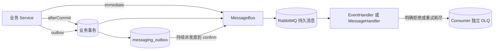
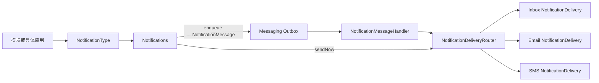
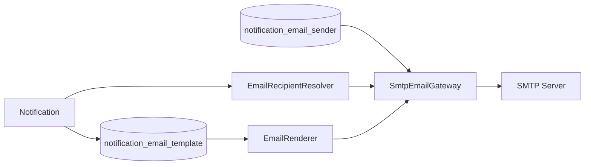

# 发布消息与通知

业务模块之间传递消息用 `MessageBus`，向用户发邮件、站内信或短信用 `Notifications`。必须随业务事务可靠发布时选择 Outbox；收到 MessageId 只表示已经登记，是否送达还要检查消费者或渠道结果。

Email 保存主题、纯文本和 HTML 源码，Inbox 保存 Tiptap JSON，SMS 使用供应商模板绑定。先声明通知类型，再配置要使用的渠道模板和接收人解析。

## 注册事件并可靠发布

用 `EventType` 声明稳定编码、协议版本和 payload 类型，payload 使用只包含消费所需字段的普通 Java 类。为事件注册 `EventHandler`，为动作消息注册 `MessageHandler`，每个消费职责使用唯一 TreeCode。

在业务 Service 的数据库事务中完成写入后，调用 `MessageBus.dispatch(message, DispatchPolicy.outbox())`。该方法要求活跃事务；返回的 `DispatchReceipt.messageId()` 对应同一事务中的 Outbox 记录。事务回滚时业务写入和 Outbox 一起回滚。

消费者按 MessageId 或业务唯一键防止重复执行。验证时分别检查事务回滚没有留下 Outbox、正常发送进入消费者、同一消息重复投递没有重复修改业务数据。消费失败按 Handler 的 `HandlingPolicy` 重试或进入独立 DLQ；修复原因后再决定重新发布或删除死信。

## 在本地发送一封通知邮件

先启动 Mailpit，再通过 `/system/email/senders` 创建 `host=localhost`、`port=1025`、`security=NONE` 的发送方，测试连接并启用。应用注册 `NotificationType`，声明接收人、变量及 EMAIL 渠道，为该通知编码创建并启用 Email 模板。

通过 `Notifications.enqueue(type, notice)` 在事务中登记发送请求，然后到 `http://localhost:8025` 查看收件结果。MessageId 表示请求已登记；收件箱中的邮件才能证明本地 SMTP 投递完成。接收地址由应用的 `EmailRecipientResolver` 提供。

## 业务消息与可靠发布

业务事件表示已经发生、可以由其他模块异步处理的业务变化。Sca4d-J 使用 [Event](/javadoc/core/sca4dj-core-api/com/sca4d/core/api/event/Event.html) 保存可选业务键、发生时间和 payload，使用 [EventType](/javadoc/core/sca4dj-core-api/com/sca4d/core/api/event/EventType.html) 声明稳定事件编码、协议版本和 payload 类型，使用 `MessageBus.dispatch` 选择立即发布、事务提交后发布或 Outbox 可靠发布。

Messaging 和 [Web Realtime](/tutorials/realtime-events) 共用 Event 表达业务事件，但它们是两条独立路径。Messaging 面向业务 Consumer，RabbitMQ 持久保存消息；Web Realtime 面向当前在线浏览器，允许丢失且不回放。

### 发布方式



所有发布都使用 `MessageBus.dispatch(message, policy)`，通过策略选择时机：

| 策略 | 调用条件 | 返回时已经完成什么 | 失败结果 |
|---|---|---|---|
| `DispatchPolicy.immediate()` | 可在事务外调用 | Broker 已确认接收 | 无法路由或未确认时调用失败 |
| `DispatchPolicy.afterCommit()` | 必须存在活跃事务 | 已登记提交后回调 | 回滚不发送；提交后只尝试一次，失败或进程退出可能丢失 |
| `DispatchPolicy.outbox()` | 必须存在活跃事务 | Outbox 已加入当前事务 | 回滚一起撤销；提交后持续重试发布 |
| `DispatchPolicy.outboxNotBefore(time)` | 必须存在活跃事务 | 已登记最早派发时间 | 不早于指定时间发送，仍可能因重试而延后 |

Outbox 消息不能直接携带 `BinaryContent`，需要持久保存内容时使用 `ReferencedContent`。返回的 DispatchReceipt 区分 Broker 接收、回调登记和 Outbox 登记，不代表消费者已经完成业务。

Outbox 只保证发布。它不是业务消息存储，不保存 Consumer 处理结果，也不负责消费失败恢复。消息发布到 RabbitMQ 后，持久保存、队列复制和重新投递由 RabbitMQ 负责。

### Outbox 状态与重复消息

Outbox 使用 `PENDING -> SENDING -> SENT` 和 `FAILED -> SENDING`。多实例通过状态、version、可用时间和租约到期条件的 `UPDATE ... RETURNING` 领取记录，不使用显式行锁；实例退出后，其他实例可以接管过期的 `SENDING` 租约。发布失败采用有上限的指数退避并持续尝试，不设置最大次数，也没有发布侧 `DEAD` 状态。

RabbitMQ 已确认而 Outbox 状态更新失败时，同一 `MessageId` 可能再次发布。Consumer 必须使用 `MessageId` 或稳定业务键实现幂等，不能把「通常只收到一次」当作接口保证。`SENT` 记录只用于短期审计和清理，不替代 RabbitMQ 的持久消息。

### Consumer 与死信

每个 `EventHandler` 或 `MessageHandler` 编码对应一条持久队列和一条独立 DLQ。同一 Handler 的多个 App 实例竞争消费；不同 Handler 分别获得一份消息。

Handler 返回 `HandlingDecision.acknowledge()` 后才 ACK；返回 `reject(...)` 时，消息以 `requeue=false` 进入该 Handler 的 DLQ。返回 `retry(...)` 或抛出异常时，基础设施按 `HandlingPolicy` 的最大尝试次数和间隔安排重试，耗尽后进入 DLQ。

默认 `HandlingPolicy.noRetry()` 只允许一次尝试，因此默认处理失败直接进入 DLQ。重试消息发布成功后才确认原消息；发布重试消息失败时，原消息重新入队。消息解码或协议版本错误同样受该 Handler 策略限制。Messaging 不自动重放 DLQ，也不提供 Inbox、补偿工作流或 DLQ 管理页面。

进程在 ACK 前退出或 ACK 丢失时，RabbitMQ 可以重新投递原消息。这与 Consumer 处理失败进入 DLQ 是不同情况，两者都要求 Consumer 具备幂等性。

### 设备消息由 IoT 模块处理

MQTT、TCP、设备 WebSocket、设备会话和 EMQX 由 IoT 模块负责，不进入 Messaging 或 Web Realtime。IoT 只有在标准化后的设备消息需要可靠异步处理、削峰或跨模块消费时才发布到 Messaging；设备协议接入、命令应答和在线状态仍由 IoT 模块负责。

Outbox 派发间隔、租约和清理配置见[MessagingProperties](/reference/runtime/sca4d-server#messagingproperties)。

## Notification 模块

`modules/notification/sca4dj-notification` 把领域通知转换成已经确定接收人、Locale、Region、模板变量和渠道的标准通知。它封装 Settings，业务调用方不读取通知设置键，也不组装字符串变量 Map。



领域代码使用 [NotificationType](/javadoc/core/sca4dj-core-api/com/sca4d/core/api/notification/NotificationType.html) 声明必发渠道、可选渠道及 Java 默认值、模板变量回调和接收人回调。调用方只提交领域对象，完整代码见[接入一种领域通知](#接入一种领域通知)。

[Notifications](/javadoc/core/sca4dj-core-api/com/sca4d/core/api/notification/Notifications.html) 读取 `notification.channel-defaults` 和接收人的 `notification.channel-preferences`。必发渠道不能被设置关闭；可选渠道按接收人覆盖、系统默认和 Java 初值的顺序选择。框架再通过具体应用提供的 `NotificationLocaleResolver` 和 `NotificationRegionResolver` 解析语言与业务区域。业务调用方不会取得 `Settings`、通知 `TreeCode` 或变量 Map。

[Notification](/javadoc/core/sca4dj-core-api/com/sca4d/core/api/notification/Notification.html) 是框架内部标准结果，保存通知编码、内部接收人、Locale、Region、变量和已经冻结的渠道集合。各渠道解析地址、读取自己的模板或传输绑定，并执行对应投递。

`sendNow` 同步执行已经选择的渠道。`enqueue` 把 `NotificationMessage` 写入 Messaging Outbox，返回 MessageId 只表示请求已经可靠登记。Inbox、Email 和 SMS 使用独立 Handler 身份和 DLQ；一个渠道失败不会让已经成功的其他渠道重复执行。各渠道能取得原始 MessageId；Inbox 用唯一约束去重，Email 的 SMTP 调用没有持久化去重记录，发生重复投递时可能再次发信。

### 接入一种领域通知

具体应用先定义普通领域对象，再用 `NotificationType` 声明稳定通知编码、渠道、模板变量和接收人。下面的 `PasswordChanged` 由具体应用定义；`NotificationType` 只读取它的公开业务字段：

```java
/** 保存一次密码修改安全通知需要的 Account 和发生时间。 */
public final class PasswordChanged {

    /** 声明改密通知的接收人、变量和渠道。 */
    public static final NotificationType<PasswordChanged> TYPE = NotificationType.define(
            "security.password-changed",
            PasswordChanged.class,
            definition -> {
                definition.required(EmailChannels.EMAIL);
                definition.optional(InboxChannels.INBOX, true);
                definition.variable(
                        "changedAt",
                        (notice, locale) -> notice.changedAt().toString());
            },
            (notice, execution) -> execution.sendToAccount(notice.accountId()));

    private final long accountId;

    private final Instant changedAt;

    /** 创建一次密码修改安全通知。 */
    public PasswordChanged(long accountId, @NotNull Instant changedAt) {
        this.accountId = accountId;
        this.changedAt = Objects.requireNonNull(changedAt, "改密时间不能为空");
    }

    public long accountId() {
        return accountId;
    }

    public @NotNull Instant changedAt() {
        return changedAt;
    }
}
```

每个 `NotificationType` 都必须作为 Spring Bean 注册。`NotificationTypeCatalog` 在应用启动时收集这些 Bean；重复通知编码会使启动失败：

```java
/** 注册具体应用的安全通知类型。 */
@Configuration(proxyBeanMethods = false)
public class SecurityNotificationConfiguration {

    /** 注册改密安全通知。 */
    @Bean
    NotificationType<PasswordChanged> passwordChangedNotificationType() {
        return PasswordChanged.TYPE;
    }
}
```

必发渠道不可由系统或接收人关闭。可选渠道的最终值依次读取接收人覆盖值、`notification.channel-defaults` 和 `NotificationType` 中的 Java 初值。必发渠道当前不可用时，通知发布失败；不可用的可选渠道不进入本次通知。

### 创建并启用 Email 模板

先注册上例的 `PasswordChanged.TYPE`。通过 `POST /api/system/email/templates` 创建 Email 模板，`locales` 的每种语言包含 `subject`、`text` 和 `html` 三段源码。下面使用 `zh-CN`；实际请求必须包含应用默认 Locale，且每个 Locale 都在应用支持列表中。

```json
{
  "notificationCode": "security.password-changed",
  "locales": {
    "zh-CN": {
      "subject": "密码已修改",
      "text": "密码修改时间：{{changedAt}}。如非本人操作，请联系管理员。",
      "html": "<p>密码修改时间：{{changedAt}}。</p><p>如非本人操作，请联系管理员。</p>"
    }
  }
}
```

模板变量使用双花括号引用，例如示例中的 `changedAt`，且必须已在 NotificationType 中声明。创建后默认停用；读取 `GET /api/system/email/templates/{templateId}` 的 ETag，再启用：

```http
PATCH /api/system/email/templates/{templateId}/status
If-Match: "<当前版本>"
Content-Type: application/json

{"enabled":true}
```

还需有启用的 SMTP 发送方和可解析的收件地址。模板缺少默认 Locale、使用不支持的 Locale 或未声明变量时，创建和替换失败。Email 模板只用于邮件，不能通过这个接口配置站内信或 SMS 模板。

### 选择同步或可靠发送

业务动作已经处于数据库事务中时，使用 `enqueue` 把通知请求和业务写入一起提交。事务回滚时不留下通知 Outbox：

```java
/** 在账号安全动作完成后登记对应通知。 */
@Service
public class AccountSecurityService {

    private final Notifications notifications;

    public AccountSecurityService(@NotNull Notifications notifications) {
        this.notifications = Objects.requireNonNull(notifications, "Notifications 不能为空");
    }

    /** 保存改密结果，并在同一事务中登记安全通知。 */
    @Transactional
    public void passwordChanged(long accountId, @NotNull Instant changedAt) {
        // 此处先保存具体应用负责的密码修改结果。
        notifications.enqueue(PasswordChanged.TYPE, new PasswordChanged(accountId, changedAt));
    }
}
```

`enqueue` 要求活跃事务，返回的 `MessageId` 只证明 Outbox 已登记。需要调用线程立即知道渠道成功或失败，且可以接受外部调用延长当前处理时间时，才使用 `sendNow`。`sendNow` 不经过 Outbox；调用失败直接返回给调用方。

### 保存接收人的语言、区域和渠道偏好

具体应用通过 `NotificationLocaleResolver` 和 `NotificationRegionResolver` 把自己的账号设置转换为 `Locale` 和 `Region`。业务 Service 不直接读取 `Settings`。Sca4d Server 提供领域化接口 `GET /api/me/notification-settings`，返回全局语言、业务区域、渠道覆盖值、通知类型定义和三个独立 Version。

修改语言或区域时，把对应 Version 放入 `If-Match`：`PUT /api/me/notification-settings/language` 接受 `{"value":"en-US"}`，`PUT /api/me/notification-settings/region` 接受 `{"value":"US"}`。

渠道覆盖使用 `PUT /api/me/notification-settings/channels` 和 `channelsVersion`，请求是完整替换。清除全部个人渠道覆盖值可以提交：

```http
PUT /api/me/notification-settings/channels
If-Match: "<channelsVersion>"
Content-Type: application/json

{"value":{}}
```

清除覆盖值后，可选渠道重新使用系统默认和 Java 初值。必发渠道不能通过偏好关闭。

当前接口用 `TreeCode.ofSegment(...)` 解析渠道键，但内置渠道使用 `NOTIFICATION/CHANNEL/EMAIL`、`NOTIFICATION/CHANNEL/INBOX` 等多节点编码。提交完整编码会因不是单节点而失败，提交 `email` 或 `inbox` 也不匹配已注册渠道。因此当前不能通过该接口修改内置渠道的非空偏好；语言、区域和清除全部覆盖值不受这一限制影响。

## 分渠道模板

同一种 NotificationType 可以发送到多个渠道，但各渠道分别保存适合自身协议的内容：

| 渠道 | 保存位置 | 模板内容 | 配置入口 |
|---|---|---|---|
| Email | `notification_email_template` | 每种 Locale 的 `subject`、`text`、`html` 源码 | `/system/email/templates` |
| Inbox | `notification_inbox_template` | 每种 Locale 的 `title`、`body` Tiptap JSON | 由具体应用组合站内信模块；当前没有对应管理 HTTP 路由 |
| SMS | Provider 传输绑定 | 供应商模板编码、签名、路由、Locale 和变量映射 | `/system/sms/providers/{providerId}/bindings` |

通知类型负责稳定编码、接收人和变量声明。模板不会因同名通知自动复制到其他渠道；每个必发渠道都必须具备自己需要的配置。

### Email 渲染与预览

EmailRenderer 读取三段源码并替换变量。主题中的换行会被替换为空格，HTML 变量先转义，最终 HTML 再按允许列表清洗。预览接口接收单个 Locale 的 `source`、`languageTag` 和 `variables`，不保存模板；发送时还会检查必需变量，不能以预览成功代替真实发送配置检查。

EmailTemplate 先选精确 Locale，再选同语言模板，均未命中时取保存集合中的一项。当前实现不保证最后一步选择应用默认 Locale；需要确定语言时，为目标 Locale 提供对应模板。

### Inbox 模板与限制

InboxTemplate 保存 Locale 到 `title`、`body` 的 Tiptap JSON。两项使用文档节点，变量通过 `notificationVariable.attrs.name` 引用。InboxTemplateRenderer 检查默认 Locale、节点结构、变量名、节点数量与深度，再生成标题、纯文本和安全 HTML。

模板最多 10,000 个节点，最大深度 32；每种渲染结果最多 500,000 个字符。语言选择依次使用精确 Locale、应用支持列表中的同语言项和默认 Locale。未知容器节点继续处理子节点，HTML 最终执行清洗；不能把任意扩展节点视为已经获得对应渲染语义。

站内信模板由 `sca4dj-notification-inbox` 负责，当前 Sca4d Server 没有模板管理 Controller。增加管理入口时，通过应用 Service 校验通知类型与变量，再组合模块接口；不要把 Email 请求中的源码提交成 Inbox JSON。

## Notification Email 模块

`modules/notification/sca4dj-notification-email` 把标准通知转换成收件邮箱，并使用 SMTP 投递。模块保存 SMTP 配置和 Email 模板，使用 EmailRenderer 渲染；具体应用实现 `EmailRecipientResolver` 解析收件地址。



Email 渠道只有在接收人可以解析、存在启用 SMTP 配置且通知编码存在启用模板时才报告可用。数据库保证每个通知编码最多一张未删除模板，并保证最多一个启用 SMTP 配置；创建的配置和模板默认停用。

Email 分别渲染主题、纯文本和 HTML 源码，再同时提交两种正文。主题不能超过 998 个字符，换行会在渲染时替换；请求字段与预览见[Email 模板契约](/reference/http/sca4d-server#通知模板、设置与站内信契约)。

SMTP 支持 `NONE`、`STARTTLS` 和 `TLS`。密码由 [SecretKeyring](/javadoc/core/sca4dj-core-api/com/sca4d/core/api/security/SecretKeyring.html) 加密后保存，管理读取结果不包含密码或密文。发送前按密文 keyId 选择密钥；密钥缺失、连接失败或 SMTP 拒绝都会使当前投递失败。

模块不保存通知已读状态，不保存用户收件箱，也不读取 Inbox 模板。可靠请求、Consumer 失败和 DLQ 由 Notification 与 Messaging 模块负责。

## 站内信

`modules/notification/sca4dj-notification-inbox` 为 Account 接收人保存 Inbox 模板的渲染快照。每条记录包含原始 MessageId、Account、通知编码、语言、标题、纯文本、安全 HTML、创建时间、已读时间和 Version。

`notification_inbox_message` 以原始 MessageId 和 Account 建立唯一约束，同一渠道消息重复投递不会生成第二条站内信。列表使用 `beforeId` 游标向前分页；单条已读使用 Version，全部已读只修改仍处于未读状态的记录。

新增站内信或已读状态变化后，模块在事务提交后发布 `NOTIFICATION/INBOX/CHANGED`（版本 1）。事件只提示 Account 的在线客户端重新读取列表和未读数，不携带正文，也不能替代持久化记录。

Sca4d Server Admin 在顶部铃铛显示最近站内信和未读提示，收到 Realtime 事件后重新读取 HTTP。完整列表位于 `/notifications`，展开未读消息时按 Version 标记已读，也可以一次标记全部已读。客户端不提供删除操作，已渲染快照由服务端持久保存。

HTTP 客户端使用 `GET /api/me/notifications?limit=20` 读取第一页；下一页把当前页最后一项的 `id` 作为 `beforeId`。响应中的 `messages` 按 `id` 倒序排列，`unreadCount` 是当前 Account 的完整未读数量。标记单条已读时提交该消息的 Version：

```http
POST /api/me/notifications/{messageId}/read
Content-Type: application/json

{"version":0}
```

Version 已变化或消息不属于当前 Account 时，请求失败。`POST /api/me/notifications/read-all` 只修改仍未读的记录，不需要客户端提交 Version。

## SMS 通知

`modules/notification/sca4dj-notification-sms` 解析接收人的规范 E.164 手机号，选择 Provider 与传输绑定，并记录 Provider API 的提交结果。`sca4dj-notification-sms-aliyun` 提供阿里云 `SendSms` 适配器。

SMS 公共模块不定义「中国国内」或「国外」分区。具体应用实现 `SmsRouteResolver`，直接使用通知编码、业务 `Region`、`ParsedPhoneNumber` 和 Locale 选择自己声明的 `SmsRoute`。Sca4d Server 示例声明 `china-mainland` 与 `international`，其他应用可以声明不同分区。

Provider 数据库存储类型、`credentialRef`、优先级和启用状态。启用的传输绑定把通知编码、`SmsRoute`、Locale、签名、Provider 模板编码和参数名映射关联起来。短信正文由供应商模板与参数确定；参数映射只能引用 NotificationType 声明的变量。

Sca4d Server 使用 `system:sms:read` 和 `system:sms:manage` 管理这些资源。Provider 和绑定创建后默认停用；启用 Provider 前至少需要一个启用绑定。启用中的 Provider 或绑定不能修改或删除。Provider 详情、绑定详情、替换、状态修改和删除使用各自 Version 的强 ETag。管理接口只保存 `credentialRef`，不会接收或返回 AccessKey。

默认 `PrioritySmsProviderSelector` 按数据库优先级尝试当前路由的候选 Provider；具体应用可以替换 `SmsProviderSelector`。Provider 明确拒绝时可以尝试下一个；超时或未知结果不会自动切换，避免同一验证码重复发送。`ACCEPTED` 只表示 Provider API 接受请求，不表示手机最终收到短信。

阿里云 AccessKey、Endpoint 和 Region ID 来自 `sca4dj.notification.sms.aliyun.credentials.<credentialRef>` 部署配置，不保存到 Settings 或数据库。

管理端「短信通知」页面先维护 Provider，再为选中的 Provider 维护通知编码、应用路由、Locale、签名、供应商模板编码及「供应商参数名 → NotificationType 变量名」映射。参数映射中的变量必须由对应 `NotificationType` 声明。

### 配置一个阿里云 SMS Provider

先在部署配置中声明凭据引用。凭据值来自环境变量，不写入 Git：

```yaml
sca4dj:
  notification:
    sms:
      aliyun:
        credentials:
          primary:
            access-key-id: ${ALIYUN_SMS_ACCESS_KEY_ID}
            access-key-secret: ${ALIYUN_SMS_ACCESS_KEY_SECRET}
            endpoint: dysmsapi.aliyuncs.com
            region-id: cn-hangzhou
```

然后通过 `POST /api/system/sms/providers` 创建默认停用的 Provider：

```json
{
  "code": "aliyun-primary",
  "type": "ALIYUN",
  "credentialRef": "primary",
  "priority": 10
}
```

为 Provider 创建与应用路由、Locale 和供应商审核模板匹配的绑定。Sca4d Server 的 `china-mainland` 和 `international` 是具体应用声明的 `SmsRoute`，不是 SMS 公共模块的固定分区：

```json
{
  "notificationCode": "AUTHENTICATION/SMS_CODE",
  "route": "china-mainland",
  "languageTag": "zh-CN",
  "signName": "示例应用",
  "providerTemplateCode": "SMS_123456789",
  "parameterMapping": {
    "code": "code",
    "minutes": "expiresInMinutes"
  }
}
```

绑定创建后先读取详情取得 `ETag`，调用 `PATCH /api/system/sms/providers/{providerId}/bindings/{bindingId}/status` 启用绑定；再读取 Provider 详情并调用 `PATCH /api/system/sms/providers/{providerId}/status` 启用 Provider。启用 Provider 前必须至少有一个启用绑定。Provider 或绑定启用后不能直接替换或删除，需要先按当前 `ETag` 停用。

同一通知编码、`SmsRoute` 和 Locale 可以配置多个 Provider。默认选择器按 `priority` 从小到大尝试候选项；明确拒绝可以尝试下一项，超时或未知结果不会切换。供应商模板中的参数名必须完整映射到 `NotificationType` 已声明变量，`credentialRef` 必须与部署配置中的引用一致。
