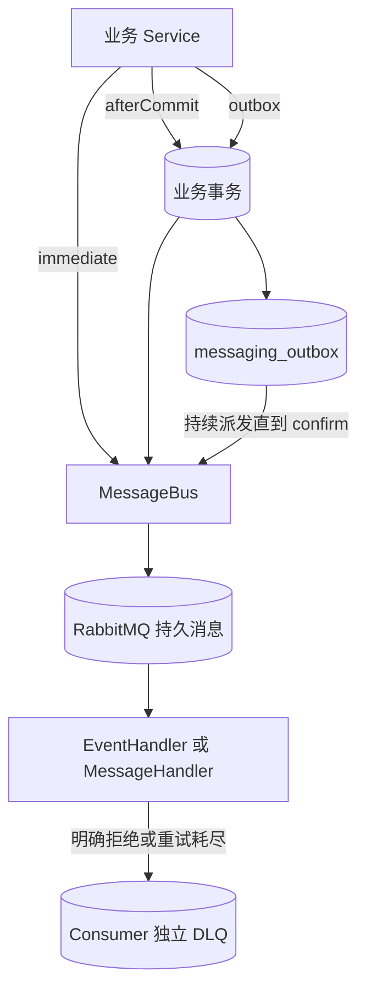

# 发布消息与通知

本页以 Workspace 中的 Document 发布为例。
Member 发布 Document 后，应用需要更新搜索索引，并通知其他 Member。
这两件事不能放在 HTTP 请求内同步完成。
同时，不能出现「Document 已发布但消息丢失」，也不能出现「事务回滚但通知已发出」。

`MessageBus` 在业务模块之间传递消息，可靠程度由 `DispatchPolicy` 选择。
`Notifications` 把领域对象转换成 Email、站内信或短信。
读完本页后，可以完成以下工作：

- 在事务内可靠发布 `DocumentPublished` 事件，并由 `EventHandler` 消费；
- 声明 `NotificationType`，用 Mailpit 在本地收到一封通知邮件；
- 接入自己的 `MessageHandler`、通知渠道和接收人解析。

返回的消息标识只表示请求已经登记。
是否送达，要检查消费者或渠道结果。

## 实现步骤

### 步骤 1：声明事件类型

用 `EventType` 声明稳定编码、协议版本和 payload 类型。
编码使用 TreeCode，节点只能包含字母、数字和下划线，并统一转为大写。
payload 使用只包含消费所需字段的普通 Java 类。

```java
/** 保存 Document 发布事件的消费字段，由具体应用定义。 */
public final class DocumentPublished {

    private final long workspaceId;

    private final long documentId;

    private final long authorMemberId;

    @JsonCreator
    public DocumentPublished(
            @JsonProperty("workspaceId") long workspaceId,
            @JsonProperty("documentId") long documentId,
            @JsonProperty("authorMemberId") long authorMemberId) {
        this.workspaceId = workspaceId;
        this.documentId = documentId;
        this.authorMemberId = authorMemberId;
    }

    public long workspaceId() {
        return workspaceId;
    }

    public long documentId() {
        return documentId;
    }

    public long authorMemberId() {
        return authorMemberId;
    }
}

/** 声明 Workspace 模块的事件类型，由具体应用定义。 */
public final class WorkspaceEvents {

    public static final EventType<DocumentPublished> DOCUMENT_PUBLISHED =
            new EventType<>("WORKSPACE/DOCUMENT_PUBLISHED", 1, DocumentPublished.class);

    private WorkspaceEvents() {
    }
}
```

### 步骤 2：在事务中发布

在业务 Service 的数据库事务内完成写入，再调用 `MessageBus.dispatch(message, DispatchPolicy.outbox())`。
`dispatch` 的返回值带有 `@CheckReturnValue`，需要保存或检查。

```java
/** 发布 Document，并在同一事务中登记发布事件，由具体应用定义。 */
@Service
public class DocumentService {

    private final DocumentRepository documents;

    private final MessageBus messages;

    private final Clock clock;

    public DocumentService(DocumentRepository documents, MessageBus messages, Clock clock) {
        this.documents = documents;
        this.messages = messages;
        this.clock = clock;
    }

    @Transactional
    public void publish(long workspaceId, long documentId, long authorMemberId) {
        documents.markPublished(documentId, clock.instant());
        Event<DocumentPublished> event = new Event<>(
                WorkspaceEvents.DOCUMENT_PUBLISHED,
                Long.toString(documentId),
                clock.instant(),
                new DocumentPublished(workspaceId, documentId, authorMemberId));
        DispatchReceipt receipt = messages.dispatch(event, DispatchPolicy.outbox());
        // receipt.messageId() 对应同一事务中的 Outbox 记录。
    }
}
```

`Event` 的第二个参数是可选业务键，最长 256 个字符。
事务回滚时，业务写入和 Outbox 一起回滚。

`DispatchPolicy` 提供四种选择：

| 策略 | 调用条件 | 返回时已经完成什么 | 失败结果 |
|---|---|---|---|
| `DispatchPolicy.immediate()` | 可在事务外调用 | Broker 已确认接收 | 无法路由或未确认时调用失败 |
| `DispatchPolicy.afterCommit()` | 必须存在活跃事务 | 已登记提交后回调 | 回滚不发送；提交后只尝试一次，失败或进程退出可能丢失 |
| `DispatchPolicy.outbox()` | 必须存在活跃事务 | Outbox 已加入当前事务 | 回滚一起撤销；提交后持续重试发布 |
| `DispatchPolicy.outboxNotBefore(time)` | 必须存在活跃事务 | 已登记最早派发时间 | 不早于指定时间发送，仍可能因重试而延后 |

`DispatchReceipt.status()` 区分 `BROKER_ACCEPTED`、`AFTER_COMMIT_REGISTERED` 和 `OUTBOX_ENLISTED`。
它不代表消费者已经完成业务。

### 步骤 3：注册消费者

为每个消费职责实现一个 `EventHandler`，并声明为 Spring Bean。
`code()` 在应用内必须唯一，并跨部署保持稳定。

```java
/** 消费 Document 发布事件并更新搜索索引，由具体应用定义。 */
@Component
public class DocumentIndexHandler implements EventHandler<DocumentPublished> {

    private final DocumentIndexRepository index;

    public DocumentIndexHandler(DocumentIndexRepository index) {
        this.index = index;
    }

    @Override
    public TreeCode code() {
        return TreeCode.of("WORKSPACE/DOCUMENT_INDEX/HANDLER");
    }

    @Override
    public EventType<DocumentPublished> eventType() {
        return WorkspaceEvents.DOCUMENT_PUBLISHED;
    }

    @Override
    public RetryRule retryRule() {
        return RetryRule.once();
    }

    @Override
    public void handleEvent(IncomingMessage<Event<DocumentPublished>> message) {
        // 以消息标识做幂等键，重复投递不会产生第二条索引记录。
        index.upsert(message.messageId().value(), message.message().payload().documentId());
    }
}
```

`handleEvent` 正常返回，等价于 `HandlingDecision.acknowledge()`。
消费者按消息标识或业务唯一键防止重复执行。

### 步骤 4：声明通知类型

`NotificationType` 声明稳定编码、渠道、模板变量和接收人。
下面的 `DocumentShared` 由具体应用定义，`NotificationType` 只读取它的公开业务字段。

```java
/** 保存一次「Document 已分享给 Member」通知需要的字段，由具体应用定义。 */
public final class DocumentShared {

    public static final NotificationType<DocumentShared> TYPE = NotificationType.define(
            "WORKSPACE/DOCUMENT_SHARED",
            DocumentShared.class,
            definition -> {
                definition.required(EmailChannels.EMAIL);
                definition.optional(InboxChannels.INBOX, true);
                definition.variable("documentTitle", (notice, locale) -> notice.documentTitle());
                definition.variable("sharedAt", (notice, locale) -> notice.sharedAt().toString());
            },
            (notice, execution) -> execution.sendToAccount(notice.recipientAccountId()));

    private final long recipientAccountId;

    private final String documentTitle;

    private final Instant sharedAt;

    public DocumentShared(long recipientAccountId, String documentTitle, Instant sharedAt) {
        this.recipientAccountId = recipientAccountId;
        this.documentTitle = Objects.requireNonNull(documentTitle, "Document 标题不能为空");
        this.sharedAt = Objects.requireNonNull(sharedAt, "分享时间不能为空");
    }

    public long recipientAccountId() {
        return recipientAccountId;
    }

    public String documentTitle() {
        return documentTitle;
    }

    public Instant sharedAt() {
        return sharedAt;
    }
}
```

`NotificationType.define` 的第一个参数是通知编码，规则与 TreeCode 相同。
`definition.required` 声明必发渠道，`definition.optional(channel, defaultEnabled)` 声明可选渠道及 Java 初值。
`definition.variable` 声明模板变量。
一种通知类型至少需要声明一个渠道。

把它声明为 Spring Bean：

```java
/** 注册 Workspace 通知类型，由具体应用定义。 */
@Configuration(proxyBeanMethods = false)
public class WorkspaceNotificationConfiguration {

    @Bean
    NotificationType<DocumentShared> documentSharedNotificationType() {
        return DocumentShared.TYPE;
    }
}
```

### 步骤 5：在本地配置 Email 发送

1. 启动 Mailpit。
2. 通过 `/system/email/senders` 创建发送方：`host=localhost`、`port=1025`、`security=NONE`。测试连接，并启用发送方。
3. 应用提供 `EmailRecipientResolver` Bean，把 `NotificationRecipient` 解析为邮箱地址。
4. 为通知编码创建并启用 Email 模板。

调用 `POST /api/system/email/templates` 创建 Email 模板。
`locales` 中，每种语言包含 `subject`、`text` 和 `html` 三段源码。
请求必须包含应用默认 Locale，且每个 Locale 都在应用支持列表中。

```json
{
  "notificationCode": "WORKSPACE/DOCUMENT_SHARED",
  "locales": {
    "zh-CN": {
      "subject": "有一份 Document 已分享给你",
      "text": "「{{documentTitle}}」已在 {{sharedAt}} 分享给你。",
      "html": "<p>「{{documentTitle}}」已在 {{sharedAt}} 分享给你。</p>"
    }
  }
}
```

模板变量使用双花括号引用，变量必须已在 `NotificationType` 中声明。
模板创建后默认停用。
读取 `GET /api/system/email/templates/{templateId}` 响应中的 ETag，再启用模板：

```http
PATCH /api/system/email/templates/{templateId}/status
If-Match: "<当前版本>"
Content-Type: application/json

{"enabled":true}
```

Email 模板只用于邮件，不能通过 `/api/system/email/templates` 配置站内信或 SMS 模板。

### 步骤 6：在事务中登记通知

业务动作已经处于数据库事务时，使用 `Notifications.enqueue`。
通知请求和业务写入一起提交，事务回滚时不留下通知 Outbox。
`Notifications.enqueue` 与业务事件、Web Realtime 事件使用同一个 Outbox，发布入口仍是 `MessageBus.dispatch(message, DispatchPolicy)`。

```java
/** 分享 Document，并在同一事务中登记通知，由具体应用定义。 */
@Service
public class DocumentSharingService {

    private final Notifications notifications;

    private final ShareRepository shares;

    public DocumentSharingService(Notifications notifications, ShareRepository shares) {
        this.notifications = notifications;
        this.shares = shares;
    }

    @Transactional
    public void share(long documentId, String title, long recipientAccountId, Instant now) {
        shares.save(documentId, recipientAccountId, now);
        Id messageId = notifications.enqueue(
                DocumentShared.TYPE, new DocumentShared(recipientAccountId, title, now));
        // messageId 只证明 Outbox 已登记。
    }
}
```

`enqueue` 要求活跃事务。
调用线程需要立即知道渠道成功或失败，并且可以接受外部调用延长处理时间时，才使用 `sendNow`。
`sendNow` 不经过 Outbox，失败时直接返回给调用方。
`Notifications.isAvailable(type, recipient)` 判断必发渠道当前能否处理指定接收人。

### 步骤 7：配置其他渠道的模板

同一种 `NotificationType` 可以发送到多个渠道，各渠道分别保存适合自身协议的内容：

| 渠道 | 保存位置 | 模板内容 | 配置入口 |
|---|---|---|---|
| Email | `notification_email_template` | 每种 Locale 的 `subject`、`text`、`html` 源码 | `/system/email/templates` |
| Inbox | `notification_inbox_template` | 每种 Locale 的 `title`、`body` Tiptap JSON | 由具体应用组合站内信模块；当前没有对应管理 HTTP 路由 |
| SMS | Provider 传输绑定 | 供应商模板编码、签名、路由、Locale 和变量映射 | `/system/sms/providers/{providerId}/bindings` |

模板不会因同名通知自动复制到其他渠道。
每个必发渠道都必须具备自己需要的配置。

Email 渲染规则：

- EmailRenderer 读取三段源码并替换变量。
- 主题中的换行替换为空格，主题不能超过 998 个字符。
- HTML 变量先转义，最终 HTML 再按允许列表清洗。
- 预览接口接收单个 Locale 的 `source`、`languageTag` 和 `variables`，不保存模板。预览成功不能代替真实发送配置检查。
- 先选精确 Locale，再选同语言模板。两步均未命中时，取保存集合中的一项。当前实现不保证最后一步选择应用默认 Locale。需要确定语言时，为目标 Locale 提供对应模板。

SMTP 支持 `NONE`、`STARTTLS` 和 `TLS`。
密码由 [SecretKeyring](/javadoc/core/sca4dj-core-api/com/sca4d/core/api/security/SecretKeyring.html) 加密后保存，管理接口的读取结果不包含密码或密文。
请求字段与预览见 [Email 模板约定](/reference/http/sca4d-server#通知模板、设置与站内信契约)。

Inbox 模板规则：

- 保存 Locale 到 `title`、`body` 的 Tiptap JSON，变量通过 `notificationVariable.attrs.name` 引用。
- InboxTemplateRenderer 检查默认 Locale、节点结构、变量名、节点数量与深度，再生成标题、纯文本和安全 HTML。
- 模板最多 10,000 个节点，最大深度 32，每种渲染结果最多 500,000 个字符。
- 语言选择依次使用精确 Locale、应用支持列表中的同语言项和默认 Locale。
- 未知容器节点继续处理子节点，HTML 最终执行清洗。不能把任意扩展节点视为已经按其含义完成渲染。
- 当前没有模板管理 Controller。增加管理入口时，通过应用 Service 校验通知类型与变量，再组合模块接口。

仓库的 `settings.gradle.kts` 当前没有 include `sca4dj-notification-inbox` 和 `sca4dj-notification-sms-aliyun`。
在构建中引用这两个模块前，先补充 include。

### 步骤 8：读取站内信

`sca4dj-notification-inbox` 为 Account 接收人保存 Inbox 模板的渲染快照。
每条记录包含原始消息标识、Account、通知编码、语言、标题、纯文本、安全 HTML、创建时间、已读时间和 Version。

HTTP 客户端使用 `GET /api/me/notifications?limit=20` 读取第一页。
下一页把当前页最后一项的 `id` 作为 `beforeId`。
响应中的 `messages` 按 `id` 倒序排列，`unreadCount` 是当前 Account 的完整未读数量。

标记单条已读时，提交该消息的 Version：

```http
POST /api/me/notifications/{messageId}/read
Content-Type: application/json

{"version":0}
```

`POST /api/me/notifications/read-all` 只修改仍未读的记录，不需要提交 Version。

新增站内信或已读状态变化后，模块在事务提交后发布 `NOTIFICATION/INBOX/CHANGED`（版本 1）。
该事件只提示在线客户端重新读取列表和未读数，不携带正文，也不能替代持久化记录。

### 步骤 9：配置 SMS

`sca4dj-notification-sms` 解析接收人的规范 E.164 手机号，选择 Provider 与传输绑定，并记录 Provider API 的提交结果。
`sca4dj-notification-sms-aliyun` 提供阿里云 `SendSms` 适配器。

阿里云 AccessKey、Endpoint 和 Region ID 来自部署配置，不保存到 Settings 或数据库。
先声明凭据引用，凭据值来自环境变量，不写入 Git：

```yaml
sca4dj:
  notification:
    sms:
      aliyun:
        credentials:
          primary:
            access-key-id: ${ALIYUN_SMS_ACCESS_KEY_ID}
            access-key-secret: ${ALIYUN_SMS_ACCESS_KEY_SECRET}
            endpoint: dysmsapi.aliyuncs.com
            region-id: cn-hangzhou
```

通过 `POST /api/system/sms/providers` 创建默认停用的 Provider：

```json
{
  "code": "aliyun-primary",
  "type": "ALIYUN",
  "credentialRef": "primary",
  "priority": 10
}
```

为 Provider 创建绑定。
绑定需要与应用路由、Locale 和供应商审核模板匹配：

```json
{
  "notificationCode": "WORKSPACE/DOCUMENT_SHARED",
  "route": "china-mainland",
  "languageTag": "zh-CN",
  "signName": "示例应用",
  "providerTemplateCode": "SMS_123456789",
  "parameterMapping": {
    "title": "documentTitle"
  }
}
```

`route` 的取值由具体应用实现的 `SmsRouteResolver` 声明。
SMS 公共模块不定义「中国国内」或「国外」分区。

启用时按以下顺序操作：

1. 绑定创建后，读取绑定详情，取得 `ETag`。
2. 调用 `PATCH /api/system/sms/providers/{providerId}/bindings/{bindingId}/status`，启用绑定。
3. 读取 Provider 详情。
4. 调用 `PATCH /api/system/sms/providers/{providerId}/status`，启用 Provider。

Sca4d Server 使用 `system:sms:read` 和 `system:sms:manage` 管理这些资源。
启用 Provider 前，至少需要一个启用绑定。
启用中的 Provider 或绑定不能修改或删除，需要先按当前 `ETag` 停用。
详情、替换、状态修改和删除使用各自 Version 的强 ETag。
管理接口只保存 `credentialRef`，不接收也不返回 AccessKey。
`credentialRef` 必须与部署配置中的引用一致。
参数映射只能引用 `NotificationType` 声明的变量，且供应商模板的参数名必须完整映射。

## 扩展方式

框架通过 Spring 容器中的 Bean 发现扩展。
使用方以 `List<T>` 接收全部实现，在启动时建立索引并校验。
缺失或重复的扩展使启动失败，不在运行时才暴露。

| 要接入的内容 | 应用实现 | 声明方式 | 框架发现与校验 |
|---|---|---|---|
| 事件消费者 | `EventHandler<T>` | Spring Bean | 以 `List<EventHandler<?>>` 注入。`code()` 重复时抛出 `IllegalStateException`，消息为「MessageHandler 编码重复」 |
| 动作消息消费者 | `MessageHandler<M>`，同时提供 `MessageCodec<M>` | Spring Bean | 以 `List<MessageHandler<?>>` 注入，与 `EventHandler` 共用编码校验 |
| 通知类型 | `NotificationType<T>` | Spring Bean | `NotificationTypeCatalog` 收集全部 Bean。重复编码时抛出 `IllegalArgumentException`，消息为「重复通知类型」 |
| 通知渠道 | `NotificationDelivery` 与对应的 `NotificationMessageHandler` | 两个 Spring Bean | `NotificationDeliveryRouter` 收集全部渠道。同一渠道重复时抛出 `IllegalArgumentException`，消息为「重复通知渠道投递实现」 |
| Email 收件地址 | `EmailRecipientResolver` | Spring Bean，必须由应用提供 | Email 渠道装配时注入 |
| 语言与区域 | `NotificationLocaleResolver`、`NotificationRegionResolver` | Spring Bean | 自动配置使用 `@ConditionalOnMissingBean`，应用 Bean 替换默认的应用默认 Locale 与空区域 |
| SMS 路由与 Provider 选择 | `SmsRouteResolver`、`SmsProviderSelector` | Spring Bean | `SmsProviderSelector` 带 `@ConditionalOnMissingBean`，默认是 `PrioritySmsProviderSelector` |

### 接入一个消息处理器

动作消息继承 `Message`，实现 `code()` 和 `protocolVersion()`。
`MessageHandler` 返回 `HandlingDecision`，由基础设施据此确认、重试或拒绝。

```java
/** 请求清理一个 Attachment 的存储对象，由具体应用定义。 */
public final class AttachmentCleanupRequested extends Message {

    private final long attachmentId;

    @JsonCreator
    public AttachmentCleanupRequested(@JsonProperty("attachmentId") long attachmentId) {
        this.attachmentId = attachmentId;
    }

    public long attachmentId() {
        return attachmentId;
    }

    @Override
    public TreeCode code() {
        return TreeCode.of("WORKSPACE/ATTACHMENT_CLEANUP");
    }

    @Override
    public int protocolVersion() {
        return 1;
    }
}

/** 消费 Attachment 清理请求，由具体应用定义。 */
@Component
public class AttachmentCleanupHandler implements MessageHandler<AttachmentCleanupRequested> {

    private final MessageCodec<AttachmentCleanupRequested> codec;

    private final AttachmentStorage storage;

    public AttachmentCleanupHandler(@Sca4djJson Sca4djMapper json, AttachmentStorage storage) {
        this.codec = new JacksonMessageCodec<>(
                TreeCode.of("WORKSPACE/ATTACHMENT_CLEANUP"), 1, AttachmentCleanupRequested.class, json);
        this.storage = storage;
    }

    @Override
    public TreeCode code() {
        return TreeCode.of("WORKSPACE/ATTACHMENT_CLEANUP/HANDLER");
    }

    @Override
    public MessageCodec<AttachmentCleanupRequested> codec() {
        return codec;
    }

    @Override
    public RetryRule retryRule() {
        return RetryRule.once();
    }

    @Override
    public HandlingDecision handle(IncomingMessage<AttachmentCleanupRequested> message) {
        if (!storage.deleteIfExists(message.message().attachmentId())) {
            return HandlingDecision.retry("存储对象暂时不可删除");
        }
        return HandlingDecision.acknowledge();
    }
}
```

`JacksonMessageCodec` 的构造参数是消息编码、协议版本、Java 类型和 `ObjectMapper`。
上例中 `Sca4djMapper` 与 `@Sca4djJson` 的注入方式与 `NotificationAutoConfiguration` 相同。
发送方使用 `messages.dispatch(new AttachmentCleanupRequested(id), DispatchPolicy.outbox())`。

### 接入一个通知渠道

新渠道需要两个 Bean。
`NotificationDelivery` 声明渠道编码、可用性和一次幂等投递。
`NotificationMessageHandler` 为该渠道提供独立的 Consumer 和 DLQ。

```java
/** 把通知写入 Workspace 的内部看板，由具体应用定义。 */
@Configuration(proxyBeanMethods = false)
public class BoardNotificationConfiguration {

    static final TreeCode BOARD = TreeCode.of("WORKSPACE/CHANNEL/BOARD");

    @Bean
    NotificationDelivery boardNotificationDelivery(BoardRepository boards) {
        return new NotificationDelivery() {
            @Override
            public TreeCode channel() {
                return BOARD;
            }

            @Override
            public boolean available(Notification notification) {
                return boards.hasBoard(notification.recipient());
            }

            @Override
            public DeliveryOutcome deliver(Id messageId, Notification notification) {
                boards.insertOnce(messageId.value(), notification.recipient());
                return DeliveryOutcome.confirmed();
            }
        };
    }

    @Bean
    NotificationMessageHandler boardNotificationMessageHandler(
            NotificationDelivery boardNotificationDelivery,
            NotificationDeliveryRouter deliveries,
            NotificationMessageCodec codec) {
        return new NotificationMessageHandler(boardNotificationDelivery, deliveries, codec);
    }
}
```

`NotificationMessageHandler` 的 `code()` 是渠道编码加 `DELIVERY` 节点，这里是 `WORKSPACE/CHANNEL/BOARD/DELIVERY`。
新渠道的编码需要出现在 `NotificationType` 的 `required` 或 `optional` 声明中，才会被选中。
`DeliveryOutcome` 提供 `confirmed()`、`pending(...)`、`retryableFailure(...)`、`rejected(...)` 和 `unknown(...)`。
`NotificationDelivery.retryRule()` 默认是 `RetryRule.once()`。

## 验证

发布事件：

- 在测试中让 `DocumentService.publish` 抛出异常，确认没有 Outbox 记录。
- 正常调用后，确认消息进入 `DocumentIndexHandler`。
- 对同一消息标识重复投递，确认没有重复修改业务数据。

发送通知邮件：

1. 调用 `DocumentSharingService.share`。
2. 打开 `http://localhost:8025`，查看收件结果。
3. 收件箱中出现邮件，才能证明本地 SMTP 投递完成。

接入新渠道或新 Handler 后，启动应用。
启动成功说明编码没有重复。
再用一次 `enqueue` 确认新渠道各自产生独立的投递结果。

## 失败结果与限制

### 启动阶段

| 条件 | 结果 |
|---|---|
| 两个 Handler 的 `code()` 相同 | `IllegalStateException`：MessageHandler 编码重复 |
| 两个 `NotificationType` 编码相同 | `IllegalArgumentException`：重复通知类型 |
| 两个 `NotificationDelivery` 声明同一渠道 | `IllegalArgumentException`：重复通知渠道投递实现 |
| `NotificationType` 没有声明任何渠道，或在定义完成后继续修改 | `IllegalArgumentException` 或 `IllegalStateException` |
| 通知编码包含通配符节点 | `IllegalArgumentException`：通知编码不能包含通配符节点 |

### 发布阶段

- `afterCommit()`、`outbox()`、`outboxNotBefore(...)` 和 `enqueue` 在没有活跃事务时抛出 `IllegalStateException`，消息为「要求当前线程存在活跃事务」。
- `Event` 的 payload 类型与 `EventType` 不一致，或业务键为空白、超过 256 个字符时，抛出 `IllegalArgumentException`。
- `Notifications` 在必发渠道不可用时抛出 `NotificationException`，消息为「通知必发渠道不可用」。不可用的可选渠道不进入本次通知。
- 通知没有选中任何渠道，或没有可用渠道时，抛出 `IllegalStateException`。
- 一次领域通知只能确定一个接收人，否则抛出 `IllegalStateException`。
- `sendNow` 对同步渠道要求结果为 `CONFIRMED`，否则抛出 `IllegalStateException`。
- Outbox 消息不能直接携带 `BinaryContent`。需要持久保存内容时，使用 `ReferencedContent`。

### 模板与配置

通知模板的错误码在 `NotificationErrorCode` 中，范围为 3100 至 3199：

| 错误码 | 类别 | 含义 |
|---|---|---|
| 3100 | NOT_FOUND | 通知模板不存在 |
| 3101 | VALIDATION | 模板结构、Locale 或模板变量无效 |
| 3102 | CONFLICT | 通知类型已经存在未删除模板 |

Email 渠道只有在以下条件都满足时才报告可用：接收人可以解析、存在启用的 SMTP 配置，且通知编码存在启用模板。
数据库保证每个通知编码最多一张未删除模板，并保证最多一个启用 SMTP 配置。
模板缺少默认 Locale、使用不支持的 Locale 或未声明变量时，创建和替换失败。
密钥缺失、连接失败或 SMTP 拒绝，都会使当前投递失败。

### Outbox 状态与重复消息

Outbox 使用 `PENDING -> SENDING -> SENT` 和 `FAILED -> SENDING` 两组状态迁移。
多实例通过状态、version、可用时间和租约到期条件的 `UPDATE ... RETURNING` 领取记录，不使用显式行锁。
实例退出后，其他实例可以接管过期的 `SENDING` 租约。

发布失败时采用有上限的指数退避，并持续尝试。
不设置最大次数，也没有发布侧 `DEAD` 状态。

RabbitMQ 已确认、而 Outbox 状态更新失败时，同一消息标识可能再次发布。
Consumer 必须使用消息标识或稳定业务键实现幂等，不能把「通常只收到一次」当作接口保证。
`SENT` 记录只用于短期审计和清理，不替代 RabbitMQ 的持久消息。
Outbox 派发间隔、租约和清理配置见 [MessagingProperties](/reference/runtime/sca4d-server#messagingproperties)。



### Consumer 与死信

- 每个 `EventHandler` 或 `MessageHandler` 编码对应一条持久队列和一条独立 DLQ。
- 同一 Handler 的多个 App 实例竞争消费。不同 Handler 分别获得一份消息。
- Handler 返回 `HandlingDecision.acknowledge()` 后才 ACK。
- 返回 `reject(...)` 时，消息以 `requeue=false` 进入该 Handler 的 DLQ。
- 返回 `retry(...)` 或抛出异常时，基础设施按 `RetryRule` 的最大尝试次数和间隔安排重试，耗尽后进入 DLQ。
- 默认 `RetryRule.once()` 只允许一次尝试，因此默认处理失败会直接进入 DLQ。`RetryRule.atMost(...)` 和 `RetryRule.unlimited(...)` 需要传入退避规则。
- 定向重试记录提交到 Outbox 后，才确认原消息。交接失败时，原消息重新入队。损坏信封或重试元数据直接拒绝。
- 进程在 ACK 前退出，或 ACK 丢失时，RabbitMQ 可以重新投递原消息。这与处理失败进入 DLQ 是不同情况，两者都要求 Consumer 具备幂等性。
- Messaging 不自动重放 DLQ，也不提供 Inbox、补偿工作流或 DLQ 管理页面。修复原因后，再决定重新发布或删除死信。

### 通知渠道的重复与失败

- Inbox、Email 和 SMS 使用独立 Handler 身份和 DLQ。一个渠道失败，不会让已经成功的其他渠道重复执行。
- 各渠道能取得原始消息标识。Inbox 用唯一约束去重。Email 的 SMTP 调用没有持久化去重记录，发生重复投递时可能再次发信。
- `notification_inbox_message` 以原始消息标识和 Account 建立唯一约束，同一渠道消息重复投递不会生成第二条站内信。
- 站内信单条已读的 Version 已变化，或消息不属于当前 Account 时，请求失败。
- 默认 `PrioritySmsProviderSelector` 按数据库优先级尝试候选 Provider。Provider 明确拒绝时，可以尝试下一个。超时或未知结果不会自动切换，以避免同一验证码重复发送。
- SMS 的 `ACCEPTED` 只表示 Provider API 接受请求，不表示手机最终收到短信。
- Messaging 与 [Web Realtime](/tutorials/realtime-events) 共用 `Event` 表达业务事件，但它们是两条独立路径。Messaging 面向业务 Consumer，RabbitMQ 持久保存消息。Web Realtime 面向当前在线浏览器，允许丢失且不回放。
- MQTT、TCP、设备 WebSocket、设备会话和 EMQX 由 IoT 模块负责，不进入 Messaging 或 Web Realtime。

### 偏好接口的限制

`GET /api/me/notification-settings` 返回全局语言、业务区域、渠道覆盖值、通知类型定义，以及三个独立的 Version。
修改时把对应 Version 放入 `If-Match`：

- `PUT /api/me/notification-settings/language` 接受 `{"value":"en-US"}`；
- `PUT /api/me/notification-settings/region` 接受 `{"value":"US"}`；
- `PUT /api/me/notification-settings/channels` 使用 `channelsVersion`，请求是完整替换。

清除全部个人渠道覆盖值时，提交 `{"value":{}}`。
可选渠道的最终值，依次读取接收人覆盖值、`notification.channel-defaults` 和 `NotificationType` 中的 Java 初值。
必发渠道不能通过设置或偏好关闭。

当前接口使用 `TreeCode.ofSegment(...)` 解析渠道键。
内置渠道使用 `NOTIFICATION/CHANNEL/EMAIL`、`NOTIFICATION/CHANNEL/INBOX` 等多节点编码。
提交完整编码时，因不是单节点而失败。
提交 `email` 或 `inbox` 时，也不匹配已注册渠道。
因此，当前不能通过该接口修改内置渠道的非空偏好。
语言、区域和清除全部覆盖值不受这一限制影响。

## 相关页面

- [推送浏览器事件](/tutorials/realtime-events)
- [定义并触发后台 Job](/tutorials/jobs-and-scheduling)
- [文件生命周期](/tutorials/file-lifecycle)
- [消息与通知能力](/capabilities/messaging-notification/)
- [Outbox](/capabilities/messaging-notification/outbox)
- [通知](/capabilities/messaging-notification/notification)
