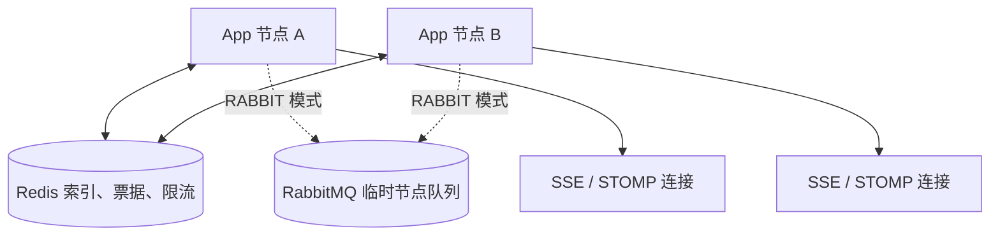
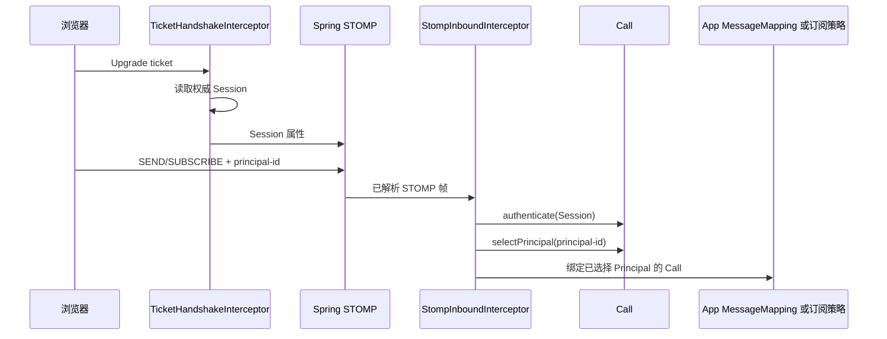

# 推送浏览器事件

实时事件提醒在线页面重新读取数据，断线期间的通知允许丢失。默认管理端用 SSE，需要双向消息时使用 WebSocket/STOMP；连接建立后由 `WebRealtimePublisher` 发布，重连后主动读取 HTTP 状态。

## 建立连接

使用在线 Session Token 请求 `GET /api/events`，并设置 `Accept: text/event-stream` 与 Bearer Authorization，即可通过 Gateway 建立 SSE。原生 EventSource 不能设置任意 Authorization 头，客户端应使用支持请求头的流式 HTTP 实现。

默认管理端在 `_app.config.js` 中通过 `VITE_GLOB_HTTP_CLIENT_STATE_REFRESH_HEADER` 与 `VITE_GLOB_REALTIME_SSE_PATH` 覆盖客户端状态响应头和 SSE 应用内路径；未配置时分别使用 `X-Client-State-Refresh` 与 `/events`。修改 Server 的启动配置时，管理端和 Gateway 长连接路由也必须使用对应有效值。

需要双向消息时，先带在线 Session Token 请求 `POST /api/events/ws/tickets`，取得一次性票据，再连接 Gateway 的 `/api/events/ws`。票据用于 Upgrade，不能把 Session Token 放进 URL。握手完成后使用 STOMP 1.2 连接，并订阅 `/user/queue/events`。

每个 SUBSCRIBE 和 SEND 都带一个属于当前 Session 的 `principal-id`。需要动态 Resource 或 Topic 订阅时，应用实现 `WebRealtimeSubscriptionPolicy`；没有授权策略的目标无法订阅。

## 在业务提交后发布

应用使用 `WebRealtimePublisher` 和 `WebRealtimeTarget` 选择 Account、Principal、Resource 等目标。IoT 示例的 `AppIotRealtime` 将设备数据变化转成浏览器事件。业务事务提交后发布刷新通知，页面收到后重新查询受影响数据。

多个 Server 实例使用 `RABBIT` 节点传输模式。检查时让连接与业务请求落到不同实例，确认目标连接收到事件；断线期间的消息不回放，重新连接后必须主动读取完整状态。

`modules/web-realtime/sca4dj-web-realtime` 在一个 Gradle 项目内实现 SSE 和原生 WebSocket/STOMP。模块使用 Redis 保存共享连接索引和一次性票据，使用 Core [RateLimiter](/javadoc/core/sca4dj-core-api/com/sca4d/core/api/concurrent/RateLimiter.html) 执行跨节点令牌桶限流，并在 App 节点内维护连接和有界写出缓冲。本节点连接始终直接投递；[NodeRouterMode](/javadoc/modules/web-realtime/sca4dj-web-realtime/com/sca4d/web/realtime/config/NodeRouterMode.html) 可以只允许单实例本地投递，或使用 RabbitMQ 临时节点队列投递其他 App 实例的连接。

模块不注册 HTTP Controller；具体应用调用 `WebRealtimeSseConnector` 建立自己的 SSE 路由，并通过 `WebRealtimeTicketService` 签发 Upgrade 票据。模块使用 Spring `@EnableWebSocketMessageBroker` 注册默认 `/events/ws` 的原生 STOMP 入口，不启用 SockJS。模块不注册具体业务 destination；具体应用使用 Spring `@MessageMapping("/invoices")` 之类的方法处理浏览器发往默认 `/app/invoices` 的消息。

## 包结构

| 包 | 职责 |
|---|---|
| `com.sca4d.web.realtime.connection` | 登记本地与 Redis 连接、解析目标，并选择本地或跨节点投递 |
| `com.sca4d.web.realtime.rabbit` | 通过 RabbitMQ 临时节点队列传递跨实例消息 |
| `com.sca4d.web.realtime.sse` | 建立、写入和关闭 SSE 连接 |
| `com.sca4d.web.realtime.stomp` | 配置 Spring STOMP，检查帧、限流、订阅授权和 Broker Relay |
| `com.sca4d.web.realtime.ticket` | 签发一次性 Ticket，并在 WebSocket 握手时校验 |
| `com.sca4d.web.realtime.config` | 绑定配置并装配上述组件 |

这些包仍属于一个可删除的 Web Realtime Gradle 模块，不形成第二层模块 API。Rabbit 节点传输、连接注册和协议拦截器因跨包协作开放的类型仍是模块内部实现。

## 运行结构

`LOCAL` 模式只安装 LocalNodeTransport，适用于单个 App 实例。`RABBIT` 模式安装 RabbitNodeTransport；本节点连接仍直接投递，只有其他节点的连接进入 RabbitMQ。节点队列独占、自动删除、消息非持久并带短 TTL。Web Realtime 不使用业务消息 exchange、Consumer durable queue、Outbox 或 DLQ。节点不可用时通知可以丢失，浏览器通过重连和 HTTP 读取恢复权威状态。

## Spring 与 Web Realtime 各自负责什么

| 对象 | 负责内容 | 不负责 |
|---|---|---|
| Spring WebSocket | Upgrade 后连接、首消息等待时间、入站帧大小、写出时间和缓冲限制 | 票据签发、业务身份恢复 |
| Spring Messaging STOMP | 帧解析、命令状态机、`ERROR`、用户 destination、simple broker 或 broker relay | 业务订阅授权、共享限流 |
| Web Realtime 握手扩展 | Origin、一次性票据、重新读取 Session，并把它保存到 WebSocket Session 属性 | 创建 Spring Principal、解析 STOMP `CONNECT` 登录信息 |
| Web Realtime 入站拦截器 | STOMP 1.2、CONNECT/SUBSCRIBE/SEND 限流、按 `principal-id` 选择业务 Principal、动态订阅策略和每帧 Call | 手写 STOMP 帧或调用具体业务 Service |
| StompConnections | 把 Spring STOMP Session 登记到 Redis 共享索引，并通过 SimpMessagingTemplate 向该 Session 发送 BrowserEnvelope | 持久化消息、回放或业务 Consumer |
| LocalNodeTransport | 把通知直接交给当前 JVM 的 LocalConnectionRegistry | 跨实例投递、持久化或回放 |
| RabbitNodeTransport | 直接投递本机连接，并使用临时 RabbitMQ exchange 和节点队列投递其他 App 实例 | RabbitMQ STOMP relay、业务消息 exchange 或 Outbox |

`RabbitNodeTransport` 只在 `RABBIT` 模式安装；它直接投递本机连接，并把其他节点的投递交给 RabbitMQ。`NodeMessageCodec` 只编解码跨节点临时消息，不参与本机连接投递；这些类型都不是公开 Node 模型。`TargetPublisher` 和 `NodeMessageCodec` 使用脚手架固定的 [@Sca4djJson](/javadoc/core/sca4dj-core-spring/com/sca4d/core/spring/json/Sca4djJson.html) `ObjectMapper`。Spring Messaging 解析并执行 STOMP 帧，模块没有另一套 STOMP Handler。

Java 的 `java.security.Principal` 是 Spring 可以从 HTTP Upgrade 请求继承的连接用户，不是 Sca4d-J 的[业务身份（Principal）](/home/identity)。Web Realtime 不创建自定义 `java.security.Principal`，也不把 [Session](/javadoc/core/sca4dj-core-api/com/sca4d/core/api/authentication/Session.html) 或 [ConnectionId](/javadoc/core/sca4dj-core-api/com/sca4d/core/api/connection/ConnectionId.html) 包装成 Spring 用户。`/user/queue/events` 使用 Spring STOMP Session ID 定向，因此一个 Account 的多条浏览器连接仍然分别投递。

握手只证明 Subject 和 Account 已通过认证，并提供当前 Account 可选择的 Principal 集合。`SEND`、`SUBSCRIBE` 必须恰好提供一个正整数 `principal-id`；该值不属于握手 Session 时，当前帧在进入 App 或登记订阅前失败。`CONNECT`、`DISCONNECT` 和 `UNSUBSCRIBE` 不选择业务 Principal。

`NODE_ROUTED` 使用每个 App 实例内的 Spring simple broker。`RABBIT` 节点传输模式下，跨实例通知先由 Redis 找到连接所在节点，再通过 RabbitNodeTransport 定向投递；simple broker 只处理已经到达本机的 STOMP 连接。`BROKER_RELAY` 把 `/queue` 和 `/topic` broker destination 交给 RabbitMQ STOMP plugin，但 Web Realtime 的节点传输模式和允许丢失语义不变。

`/events/ws`、`/app`、`/user`、`/queue`、`/topic`、`/user/queue/events` 和 `principal-id` 是 WebRealtimeProtocol 的默认值。STOMP 标准定义命令和帧格式，不规定这些 destination 或业务 header；启动时可通过 `sca4dj.web-realtime.protocol.*` 配置这些名称，具体应用和 Gateway 的公开路由必须采用同一组有效路径。

## 基础设施命名

RabbitMQ 和 Redis 名称使用 Key，由全局 App 名隔离，基本格式为 `<APP_NAME>:WEB_REALTIME:...`。节点 ID、ConnectionId、目标和票据作为动态值，用 `V_` 加 UTF-8 大写十六进制编码；Redis 同槽标记由模块声明，业务原文不会改变名称段结构。内部 JSON 使用 Sca4djMapper，浏览器与 STOMP 使用 HTTP Mapper。

Web Realtime 的 Redis Lua 会在一次调用中同时修改连接、订阅和目标 key。这些 key 带同一应用级 Redis Cluster hash tag，确保脚本使用的 key 位于同一槽位。限流 key 不由 Web Realtime 自行拼接；StompRateLimits 只声明 CONNECT、SUBSCRIBE、SEND 的容量和维度，Redis key 和 Bucket4j 状态由 Core RedisRateLimiter 管理。

## 扩展点

- `WebRealtimeTicketService` 由 App 的认证 HTTP 路由调用，签发绑定 Session 与 WebSocket 路径的短期一次性票据。
- `WebRealtimeSseConnector` 使用已认证 Session 建立 SSE 连接。
- `WebRealtimeSubscriptionPolicy` 授权 Resource 或 Topic 动态订阅。
- WebSocket Upgrade 默认进入 `/events/ws`，可由 `sca4dj.web-realtime.protocol.websocket-endpoint` 覆盖。浏览器先从 App HTTP 路由取得票据，握手阶段完成 Origin、票据和 Session 检查；STOMP 帧由 Spring 处理。
- App 使用 Spring `@MessageMapping` 声明去掉 `/app` 前缀后的处理路径；浏览器仍向 `/app/**` 发送，并用 `principal-id` 选择本次业务调用代表的 Principal。每个 `SEND` 的 Call 由模块入站拦截器创建、绑定和清理。

每个 `SUBSCRIBE` 和 `SEND` 都使用独立 `Call`，并且已经绑定该帧选择的 Principal。Spring 负责解析帧并按 Session 发送 user destination；模块负责连接状态、限流、业务身份选择和订阅授权；具体业务规则由 App 的订阅策略或 `@MessageMapping` 方法执行。

## 配置

节点传输、连接租约、路由批量、SSE、一次性票据、STOMP 限制、Origin 和 broker relay 的全部配置键、默认值与范围见 [WebRealtimeProperties](/reference/runtime/sca4d-server)。生产环境必须显式设置实际管理端 Origin；broker relay 凭据不能写入版本库。

## WebRealtimeProtocol

源码：`modules/web-realtime/sca4dj-web-realtime/src/main/java/com/sca4d/web/realtime/stomp/WebRealtimeProtocol.java`

WebRealtimeProtocol 集中保存浏览器、具体 App 和模块必须逐字一致的 STOMP 名称。进程启动时从 `sca4dj.web-realtime.protocol.*` 读取覆盖值，未配置时使用下列默认值；模块固定只接受 STOMP `1.2`，不注册 SockJS。

WebRealtimeProtocol 分别声明 `/app` 应用 destination 前缀、`/user` 用户前缀以及 `/queue`、`/topic` broker 前缀。STOMP 标准不规定这些路径；它们是 Spring 配置和本模块协议的一部分，不能散落为配置类中的重复字面量。

浏览器使用 `/user/queue/events` 订阅当前连接的服务端事件。服务端把统一浏览器信封发送到内部 `/queue/events`，并以 Spring STOMP Session ID 定向到该连接；模块不创建 `java.security.Principal`，也不把 Session 或 Core ConnectionId 伪装成 Spring 用户。

`principal-id` 是 Sca4d-J 定义的 STOMP native header，不是 STOMP 标准字段。每个 `SEND`、`SUBSCRIBE` 必须恰好提供一个正整数值，模块使用它从握手 Session 选择本帧 Call 的业务 Principal。header 缺失、重复、格式错误、非正数或 Principal 不属于 Session 时，当前帧在进入 App 或登记订阅前失败。

浏览器只能向 `/app/**` 发送业务消息；具体 App 使用去掉 `/app` 前缀的 `@MessageMapping` 路径接收。`SEND` 到 `/queue`、`/topic` 或 `/user` 会被模块拒绝。`CONNECT`、`DISCONNECT` 和 `UNSUBSCRIBE` 不读取 `principal-id`。

`authentication.session.changed` 表示握手绑定的 Session 已失效。浏览器收到该事件后重新读取 HTTP Session；服务端在事件写出后以策略违规状态关闭连接。

## WebRealtimeSubscriptionPolicy

源码：`modules/web-realtime/sca4dj-web-realtime/src/main/java/com/sca4d/web/realtime/stomp/WebRealtimeSubscriptionPolicy.java`

`supports(destination)` 选择负责的 STOMP `SUBSCRIBE` destination；`authorize(assessment, destination)` 接收当前帧独有且已经认证 Session、选择 `principal-id` 对应业务 Principal 的 Call，检查权限后返回 Resource 或 Topic 目标。

没有策略负责、返回其他目标类型或授权抛出异常时，Spring 返回 STOMP `ERROR`，模块不登记订阅。
