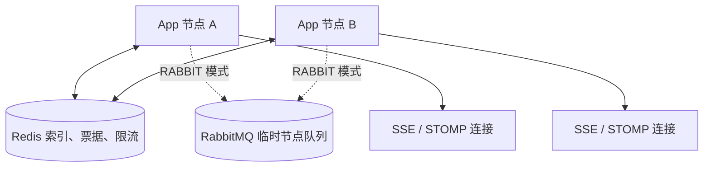
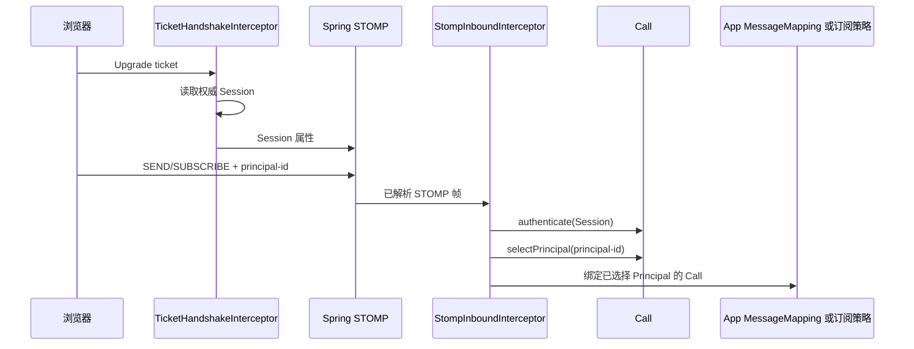

# 推送浏览器事件

本页以 Workspace 为例。
Member A 修改了 Document，同一 Workspace 中另一位 Member B 的页面仍显示旧内容。
页面不应轮询，也不应通过 Messaging 为浏览器保存消息。

实时事件只提醒在线页面重新读取数据，断线期间的通知允许丢失。
默认管理端使用 SSE。
需要双向消息时，使用 WebSocket/STOMP。
浏览器重连后，主动读取 HTTP 状态。

读完本页后，可以完成以下工作：

- 为应用开放 SSE 路由，并让浏览器带 Session Token 连接；
- 在事务提交后向 Workspace 内的 Member 推送「Document 已变化」；
- 为 STOMP 动态订阅接入 `WebRealtimeSubscriptionPolicy`。

## 实现步骤

### 步骤 1：开放 SSE 路由

`modules/web-realtime/sca4dj-web-realtime` 不注册 HTTP Controller。
应用调用 `WebRealtimeSseConnector.connect(Session)` 建立自己的 SSE 路由。
`connect` 返回 `SseEmitter`，并自动订阅当前 Account、Subject、Principal、Session 和 Connection。

```java
/** 开放 Workspace 页面使用的 SSE 与 WebSocket 票据路由，由具体应用定义。 */
@RestController
class WorkspaceRealtimeController {

    private final WebRealtimeSseConnector sse;

    private final WebRealtimeTicketService tickets;

    WorkspaceRealtimeController(WebRealtimeSseConnector sse, WebRealtimeTicketService tickets) {
        this.sse = sse;
        this.tickets = tickets;
    }

    @GetMapping(path = "/events", produces = MediaType.TEXT_EVENT_STREAM_VALUE)
    SseEmitter connect() {
        Session session = CallHolder.current().session().orElseThrow();
        return sse.connect(session);
    }

    @PostMapping("/events/ws/tickets")
    WebRealtimeTicket ticket() {
        Session session = CallHolder.current().session().orElseThrow();
        return tickets.issue(session, WebRealtimeProtocol.WEBSOCKET_ENDPOINT);
    }
}
```

路由的认证声明与权限声明见[接入身份与权限](/tutorials/identity-and-permission)。
Gateway 默认把 `/api/events` 和 `/api/events/ws` 作为长连接专用路由，转发前去掉 `/api`。
因此上例的应用内路径是 `/events` 和 `/events/ws/tickets`。

### 步骤 2：浏览器连接

前置条件：持有在线 Session Token。

请求 `GET /api/events`，并设置 `Accept: text/event-stream` 和 Bearer Authorization 请求头。
原生 EventSource 不能设置任意 Authorization 头，因此客户端应使用支持请求头的流式 HTTP 实现。

默认管理端在 `_app.config.js` 中，可以通过 `VITE_GLOB_HTTP_CLIENT_STATE_REFRESH_HEADER` 和 `VITE_GLOB_REALTIME_SSE_PATH` 覆盖两项设置：客户端状态响应头，以及 SSE 应用内路径。
未配置时，分别使用 `X-Client-State-Refresh` 和 `/events`。
修改 Server 的启动配置时，管理端和 Gateway 的长连接路由也必须使用对应的有效值。

需要双向消息时，按以下顺序连接：

1. 带在线 Session Token 请求 `POST /api/events/ws/tickets`，取得一次性票据。
2. 连接 Gateway 的 `/api/events/ws`。票据用于 Upgrade，不能把 Session Token 放进 URL。
3. 握手完成后，使用 STOMP 1.2 连接，并订阅 `/user/queue/events`。

每个 `SUBSCRIBE` 和 `SEND` 都带一个属于当前 Session 的 `principal-id`。
没有授权策略的动态目标无法订阅。

### 步骤 3：在业务提交后发布

`WebRealtimePublisher.publish(target, event, policy)` 向目标发布事件。
`WebRealtimeTarget` 提供 `account`、`subject`、`principal`、`resource`、`topic`、`session` 和 `connection` 几种目标。
事件使用 Core 的 `Event`，发布策略使用 `DispatchPolicy`。

```java
/** 在 Document 修改提交后提醒同一 Workspace 的在线 Member，由具体应用定义。 */
@Service
public class DocumentChangeNotifier {

    public static final EventType<DocumentChanged> DOCUMENT_CHANGED =
            new EventType<>("WORKSPACE/DOCUMENT_CHANGED", 1, DocumentChanged.class);

    private final WebRealtimePublisher realtime;

    private final Clock clock;

    public DocumentChangeNotifier(WebRealtimePublisher realtime, Clock clock) {
        this.realtime = realtime;
        this.clock = clock;
    }

    /** 在业务事务内调用。事务提交后才发送，回滚时不发送。 */
    public void changed(long workspaceId, long documentId) {
        Event<DocumentChanged> event = new Event<>(
                DOCUMENT_CHANGED,
                Long.toString(documentId),
                clock.instant(),
                new DocumentChanged(workspaceId, documentId));
        DispatchReceipt receipt = realtime.publish(
                WebRealtimeTarget.topic("workspace-" + workspaceId),
                event,
                DispatchPolicy.afterCommit());
    }
}
```

`DocumentChanged` 只携带 Workspace 和 Document 标识，由具体应用定义。
页面收到后重新调用 HTTP API，不把权威状态放进实时事件。

`publish` 要求调用方选择 `DispatchPolicy`。
有活跃事务时使用 `afterCommit()`。
没有事务时使用 `immediate()`。
`afterCommit()` 在没有活跃事务时抛出 `IllegalStateException`。
Web Realtime 使用不可靠的策略，因为页面可以通过 HTTP 恢复状态。需要可靠投递的业务消息使用 `DispatchPolicy.outbox()`，见[发布消息与通知](/tutorials/messaging-and-notification)。

### 步骤 4：授权动态订阅

上例使用 Topic 目标。
Topic 和 Resource 目标需要浏览器通过 STOMP 订阅，订阅前必须有应用的 `WebRealtimeSubscriptionPolicy` 授权。
Account、Subject、Principal、Session 和 Connection 目标由 `connect` 自动订阅。

```java
/** 只允许 Workspace 的 Member 订阅 Workspace Topic，由具体应用定义。 */
@Component
public class WorkspaceTopicSubscriptionPolicy implements WebRealtimeSubscriptionPolicy {

    private static final String PREFIX = "/topic/workspaces/";

    private final WorkspaceAccess access;

    public WorkspaceTopicSubscriptionPolicy(WorkspaceAccess access) {
        this.access = access;
    }

    @Override
    public boolean supports(String destination) {
        return destination.startsWith(PREFIX);
    }

    @Override
    public WebRealtimeTarget authorize(Call call, String destination) {
        long workspaceId = Long.parseLong(destination.substring(PREFIX.length()));
        // 检查 call 中已选择的 Principal 是否是该 Workspace 的 Member，不是则抛出异常。
        access.requireMember(call, workspaceId);
        return WebRealtimeTarget.topic("workspace-" + workspaceId);
    }
}
```

`call` 是当前帧专用的 `Call`，已经认证 Session，并选择了 `principal-id` 对应的业务 Principal。
`WorkspaceAccess` 由具体应用定义。

浏览器订阅时发送：

```text
SUBSCRIBE
id:sub-1
destination:/topic/workspaces/42
principal-id:1001

^@
```

### 步骤 5：处理浏览器发来的消息

应用使用 Spring `@MessageMapping` 声明去掉 `/app` 前缀后的处理路径。
浏览器向 `/app/**` 发送，并用 `principal-id` 选择本次业务调用代表的 Principal。
每个 `SEND` 的 `Call` 由模块入站拦截器创建、绑定和清理。

```java
/** 接收 Workspace 页面发来的光标消息，由具体应用定义。 */
@Controller
class WorkspaceCursorController {

    @MessageMapping("/documents/cursor")
    void cursor(CursorMoved message) {
        // 浏览器发往 /app/documents/cursor，Call 已绑定所选 Principal。
    }
}
```

### 步骤 6：多实例部署

多个 Server 实例使用 `RABBIT` 节点传输模式：

```yaml
sca4dj:
  web-realtime:
    node:
      transport: RABBIT
```

默认是 `LOCAL`，只适用于单个 App 实例。
节点传输、连接租约、路由批量、SSE、一次性票据、STOMP 限制、Origin 和 broker relay 的全部配置键、默认值与范围，见 [WebRealtimeProperties](/reference/runtime/sca4d-server)。
生产环境必须显式设置实际管理端 Origin。
broker relay 凭据不能写入版本库。

## 扩展方式

Web Realtime 的扩展点是 Spring Bean。
框架以 `List<T>` 接收应用 Bean，并在使用时校验。

| 要接入的内容 | 应用实现 | 声明方式 | 框架发现与校验 |
|---|---|---|---|
| 动态订阅授权 | `WebRealtimeSubscriptionPolicy` | Spring Bean | 以 `List<WebRealtimeSubscriptionPolicy>` 注入。订阅时按 `supports(destination)` 筛选，必须恰好一个策略负责 |
| 浏览器上行消息 | Spring `@MessageMapping` 方法 | `@Controller` Bean | 由 Spring Messaging 解析，浏览器发往 `/app/**` |
| SSE 与票据路由 | 调用 `WebRealtimeSseConnector`、`WebRealtimeTicketService` | `@RestController` Bean | 模块只提供接口实现，不注册 Controller |
| 发布 | 注入 `WebRealtimePublisher` | 无需实现 | 内部通过 `MessageBus.dispatch` 发布 |

接入新的订阅策略后的验证：

1. 启动应用，确认没有异常。
2. 用有权限的 Principal 订阅，确认收到 Topic 事件。
3. 用无权限的 Principal 订阅，确认收到 STOMP `ERROR`，且没有登记订阅。
4. 让两个策略的 `supports` 同时返回 `true`，确认订阅失败。

## 验证

- 浏览器连接 `GET /api/events`，在另一个会话中修改 Document，确认连接收到 `WORKSPACE/DOCUMENT_CHANGED`。
- 让业务事务回滚，确认没有事件。
- 多实例部署时，让连接与业务请求落到不同实例，确认目标连接收到事件。
- 断开连接后再修改 Document，重新连接，确认断线期间的事件没有回放。页面必须主动读取完整状态。

## 失败结果与限制

- 断线期间的消息不回放。节点不可用时，通知可以丢失。浏览器通过重连和 HTTP 读取恢复权威状态。
- `SEND` 和 `SUBSCRIBE` 必须恰好提供一个正整数 `principal-id`。header 缺失、重复、格式错误、非正数，或 Principal 不属于握手 Session 时，当前帧在进入应用或登记订阅前失败。`CONNECT`、`DISCONNECT` 和 `UNSUBSCRIBE` 不读取 `principal-id`。
- 订阅 destination 没有策略负责，或多个策略同时负责时，模块抛出 `IllegalStateException`，消息为「STOMP destination 必须由唯一订阅策略负责」。
- 策略返回 Resource 或 Topic 以外的目标时，登记订阅抛出 `IllegalArgumentException`。授权抛出异常时，Spring 返回 STOMP `ERROR`，模块不登记订阅。
- 同一连接重复使用 STOMP subscription ID 时，抛出 `IllegalStateException`。
- 浏览器 `SEND` 到 `/queue`、`/topic` 或 `/user` 会被模块拒绝。只能发往 `/app/**`。
- `WebRealtimeTicketService.issue` 的 `endpointPath` 必须是以 `/` 开头且不含查询或片段的路径，否则抛出 `IllegalArgumentException`。
- `WebRealtimeMessage` 无法编码时，抛出 `WebRealtimeException`。
- 握手阶段检查 Origin、一次性票据和 Session，并重新读取权威 Session。票据只能消费一次。
- `authentication.session.changed` 表示握手绑定的 Session 已失效。浏览器收到该事件后，重新读取 HTTP Session。服务端在事件写出后，以策略违规状态关闭连接。
- Messaging 与 Web Realtime 共用 `Event` 表达业务事件，但它们是两条独立路径。Web Realtime 不使用业务消息 exchange、Consumer durable queue、Outbox 或 DLQ。

### 包结构

| 包 | 职责 |
|---|---|
| `com.sca4d.web.realtime.connection` | 登记本地与 Redis 连接、解析目标，并选择本地或跨节点投递 |
| `com.sca4d.web.realtime.rabbit` | 通过 RabbitMQ 临时节点队列传递跨实例消息 |
| `com.sca4d.web.realtime.sse` | 建立、写入和关闭 SSE 连接 |
| `com.sca4d.web.realtime.stomp` | 配置 Spring STOMP，检查帧、限流、订阅授权和 Broker Relay |
| `com.sca4d.web.realtime.ticket` | 签发一次性 Ticket，并在 WebSocket 握手时校验 |
| `com.sca4d.web.realtime.config` | 绑定配置并装配上述组件 |

这些包仍属于一个可删除的 Web Realtime Gradle 模块，不形成第二层模块 API。
Rabbit 节点传输、连接注册和协议拦截器因跨包协作开放的类型，仍是模块内部实现。

### 运行结构

模块使用 Redis 保存共享连接索引和一次性票据。
模块使用 Core [RateLimiter](/javadoc/core/sca4dj-core-api/com/sca4d/core/api/concurrent/RateLimiter.html) 执行跨节点令牌桶限流。
App 节点内维护连接和有界写出缓冲。
本节点连接始终直接投递。



[NodeRouterMode](/javadoc/modules/web-realtime/sca4dj-web-realtime/com/sca4d/web/realtime/config/NodeRouterMode.html) 有两个取值：

- `LOCAL` 只安装 LocalNodeTransport，只投递当前 JVM 持有的连接。
- `RABBIT` 安装 RabbitNodeTransport。本节点连接仍直接投递，只有其他节点的连接进入 RabbitMQ。

节点队列独占、自动删除、消息非持久，并带短 TTL。

模块使用 Spring `@EnableWebSocketMessageBroker` 注册默认 `/events/ws` 的原生 STOMP 入口，不启用 SockJS。
模块不注册具体业务 destination。

### Spring 与 Web Realtime 各自负责什么

| 对象 | 负责内容 | 不负责 |
|---|---|---|
| Spring WebSocket | Upgrade 后连接、首消息等待时间、入站帧大小、写出时间和缓冲限制 | 票据签发、业务身份恢复 |
| Spring Messaging STOMP | 帧解析、命令状态机、`ERROR`、用户 destination、simple broker 或 broker relay | 业务订阅授权、共享限流 |
| Web Realtime 握手扩展 | Origin、一次性票据、重新读取 Session，并把它保存到 WebSocket Session 属性 | 创建 Spring Principal、解析 STOMP `CONNECT` 登录信息 |
| Web Realtime 入站拦截器 | STOMP 1.2、CONNECT/SUBSCRIBE/SEND 限流、按 `principal-id` 选择业务 Principal、动态订阅策略和每帧 Call | 手写 STOMP 帧或调用具体业务 Service |
| StompConnections | 把 Spring STOMP Session 登记到 Redis 共享索引，并通过 SimpMessagingTemplate 向该 Session 发送 BrowserEnvelope | 持久化消息、回放或业务 Consumer |
| LocalNodeTransport | 把通知直接交给当前 JVM 的 LocalConnectionRegistry | 跨实例投递、持久化或回放 |
| RabbitNodeTransport | 直接投递本机连接，并使用临时 RabbitMQ exchange 和节点队列投递其他 App 实例 | RabbitMQ STOMP relay、业务消息 exchange 或 Outbox |

`NodeMessageCodec` 只编解码跨节点临时消息，不参与本机连接投递。
这些类型都不是公开 Node 模型。
`TargetPublisher` 和 `NodeMessageCodec` 使用脚手架固定的 [@Sca4djJson](/javadoc/core/sca4dj-core-spring/com/sca4d/core/spring/json/Sca4djJson.html) `ObjectMapper`。

Java 的 `java.security.Principal` 是 Spring 可以从 HTTP Upgrade 请求继承的连接用户，不是 Sca4d-J 的[业务身份（Principal）](/home/identity)。
Web Realtime 不创建自定义 `java.security.Principal`，也不把 [Session](/javadoc/core/sca4dj-core-api/com/sca4d/core/api/authentication/Session.html) 或 [ConnectionId](/javadoc/core/sca4dj-core-api/com/sca4d/core/api/connection/ConnectionId.html) 包装成 Spring 用户。
`/user/queue/events` 使用 Spring STOMP Session ID 定向，因此一个 Account 的多条浏览器连接仍然分别投递。



握手只证明 Subject 和 Account 已通过认证，并提供当前 Account 可选择的 Principal 集合。

`StompBrokerMode` 有两个取值：

- `NODE_ROUTED`：使用每个 App 实例内的 Spring simple broker。跨实例通知先由 Redis 找到连接所在节点，再通过 RabbitNodeTransport 定向投递。
- `BROKER_RELAY`：把 `/queue` 和 `/topic` broker destination 交给 RabbitMQ STOMP plugin。启动时检查 TCP 端口可连接，无法连接时启动失败。Web Realtime 的节点传输模式和允许丢失的规则不变。

### WebRealtimeProtocol

源码：`modules/web-realtime/sca4dj-web-realtime/src/main/java/com/sca4d/web/realtime/stomp/WebRealtimeProtocol.java`

WebRealtimeProtocol 集中保存浏览器、应用和模块必须逐字一致的 STOMP 名称。
进程启动时，从 `sca4dj.web-realtime.protocol.*` 读取覆盖值。
未配置时，使用下表的默认值。
模块固定只接受 STOMP `1.2`，不注册 SockJS。

| 配置键 | 默认值 |
|---|---|
| `websocket-endpoint` | `/events/ws` |
| `application-destination-prefix` | `/app` |
| `user-destination-prefix` | `/user` |
| `queue-destination-prefix` | `/queue` |
| `topic-destination-prefix` | `/topic` |
| `user-event-destination` | `/user/queue/events` |
| `user-event-broker-destination` | `/queue/events` |

STOMP 标准定义命令和帧格式，不规定这些 destination 或业务 header。
应用和 Gateway 的公开路由必须采用同一组有效路径。
`principal-id` 是 Sca4d-J 定义的 STOMP native header，不是 STOMP 标准字段。

### 基础设施命名

RabbitMQ 和 Redis 名称使用 Key，由全局 App 名隔离，基本格式为 `<APP_NAME>:WEB_REALTIME:...`。
节点 ID、ConnectionId、目标和票据作为动态值，用 `V_` 加 UTF-8 大写十六进制编码。
Redis 同槽标记由模块声明，业务原文不会改变名称段结构。

内部 JSON 使用 Sca4djMapper。
浏览器与 STOMP 使用 HTTP Mapper。

Web Realtime 的 Redis Lua 会在一次调用中同时修改连接、订阅和目标 key。
这些 key 带同一应用级 Redis Cluster hash tag，确保脚本使用的 key 位于同一槽位。

限流 key 不由 Web Realtime 自行拼接。
StompRateLimits 只声明 CONNECT、SUBSCRIBE、SEND 的容量和维度。
Redis key 和 Bucket4j 状态由 Core RedisRateLimiter 管理。

## 相关页面

- [发布消息与通知](/tutorials/messaging-and-notification)
- [部署 Gateway 与接入回调](/tutorials/gateway-and-callbacks)
- [接入身份与权限](/tutorials/identity-and-permission)
- [实时与 Gateway 能力](/capabilities/realtime-gateway/)
- [订阅策略](/capabilities/realtime-gateway/subscription-policy)
- [STOMP 协议](/capabilities/realtime-gateway/stomp-protocol)
