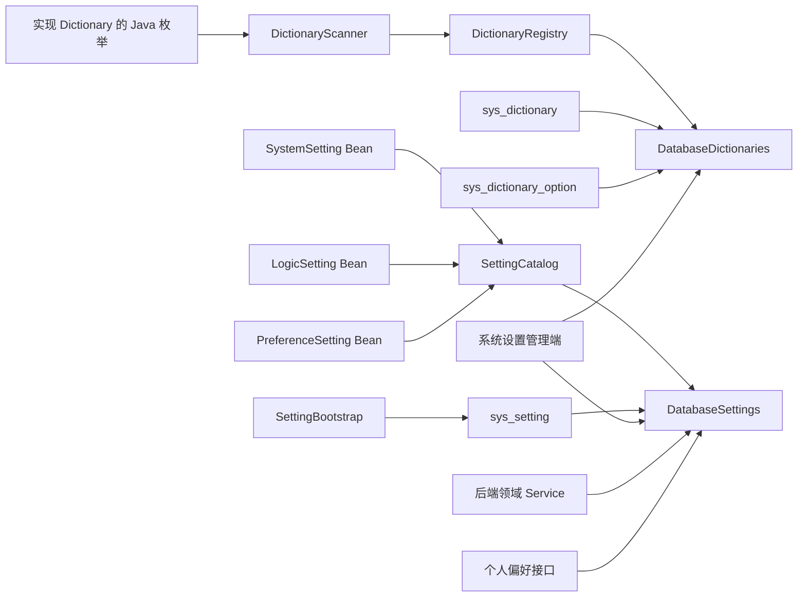

# 字典与设置

Dictionary 管理供业务选择的选项，Setting 保存某个系统、账号或业务身份的一项配置值。选项标签与启停用字典，系统参数与个人偏好用 Setting；下面先修改产品名称，再解释定义、数据归属和并发限制。

## 修改产品名称

Sca4d Server 的 `ProductSettings.DISPLAY_NAME` 声明了 `product.display-name`，默认值为 `Sca4d-J`，最多 100 个字符。该定义通过 Spring Bean 注册到 SettingCatalog。

使用有系统设置权限的账号读取 `GET /system/settings`，找到 `product.display-name` 及其当前版本，然后提交：

```http
PUT /system/settings/product.display-name
If-Match: "<读取到的版本>"
Content-Type: application/json

{
  "value": "示例管理系统"
}
```

通过 Gateway 调用时，路径加 `/api` 前缀并携带 Session Token。写入后重新读取，应返回新名称和递增版本；旧版本再次提交返回 412。设置受 ENV 持续同步控制时返回 409，需先按初始化规则解除只读状态。

需要恢复时，用最新 `If-Match` 调用 `DELETE /system/settings/product.display-name`，结果回到 Java 默认值。

## 数据归属



实现 Dictionary 的枚举只由 DictionaryScanner 扫描到 DictionaryRegistry，不写入 `sys_dictionary`。DatabaseDictionaries 在读取时将代码项与 `sys_dictionary_option` 中允许的数据库扩展项合并；动态字典和其选项分别保存在 `sys_dictionary` 与 `sys_dictionary_option`。字典管理服务在写入前检查代码键、选项扩展规则和乐观锁版本，失败时不产生部分更新。

应用将每个 Setting 作为 Spring Bean 注册到 SettingCatalog。SettingCatalog 拒绝全局重复 key，并按 SystemSetting、LogicSetting 和 PreferenceSetting 限制不同调用入口。DatabaseSettings 每次读取 `sys_setting`，没有显式覆盖值时使用 Setting 声明的 Java 默认值。敏感 Setting 只保存密文。SettingBootstrap 只处理 SystemSetting，并且仅在指定初始化节点启动时写入或同步 System owner；节点启动失败时该节点不会就绪。

## 字典保存哪些数据

Dictionary 的 `dictionaryKey()` 必须由同一枚举的所有常量一致返回。代码字典默认封闭，`allowsDatabaseOptions()` 返回 `true` 时才允许 `sys_dictionary_option` 增加枚举之外的值。动态字典不需要 Java 枚举，但必须先存在 `sys_dictionary` 行才能写入选项。

代码选项使用国际化消息键。数据库选项的 `label` 保存所有目标 Locale 都没有翻译时使用的必填回退文本，`i18n` 按 BCP 47 Locale 保存可选 `label` 翻译。查询结果先按 `sortOrder`、再按值排序；禁用项仍保留在读取结果中，调用方不能把它用于新的业务输入。字典不保存业务对象、业务流程、语言包或每个选项的复杂生命周期；这些数据仍由相应模块的表和 Service 负责。

## 哪些值适合做 Setting

Setting 保存一个 owner 的完整类型化值，例如系统范围的文件传输有效期、Account 的认证策略或 Principal 的界面偏好。短信模板、邮件模板、可独立创建、删除、审计、授权或排序的业务对象拥有自己的 Repository 和表，不能改写为 Setting 键值。数据库地址、连接凭据、模块启用条件和启动装配参数仍是运行配置；除非另有动态生效设计，不能仅因它们可配置就写入 `sys_setting`。

所有 Setting 都声明稳定 key、结构版本、默认值、SettingCodec、Pipeline 和敏感标记。SystemSetting 另外声明分组、国际化消息键、环境变量名和展示顺序。SettingCodec 在写入和读取时使用同一组文本与 JSON 编码规则，Pipeline 在值进入数据库前执行与 owner 无关的规范化和校验。

| 定义 | owner | 调用入口 | 主要限制 |
| --- | --- | --- | --- |
| SystemSetting | 固定 `SYSTEM:1`，即 `Subject.SYSTEM` | Settings、系统设置管理接口、SettingBootstrap | 可以声明敏感值和 ENV 同步 |
| LogicSetting | 调用方提供 Account、Principal 或 Resource | 后端 Settings | 前端不能按 key 任意访问 |
| PreferenceSetting | 调用方提供当前 Principal 或其他个人 owner | PreferenceSettings、具体应用偏好接口 | 只能保存可完整传输的非敏感 JSON |

`sys_setting` 使用 `owner_type + owner_id + setting_key` 作为主键。`sys_` 是公共基础表前缀，不限制 owner 类型；Account、Principal 和 Resource 仍使用各自稳定类型和标识，不增加每种 owner 的专用设置表。`has_value=false` 的行是恢复默认值后的 tombstone，它保留递增的行版本，避免旧客户端用过期 ETag 覆盖新状态。owner 已删除时，负责该 owner 生命周期的 Service 使用 `erase` 物理清理对应设置。

每个定义的 `schemaVersion` 是值结构版本。当前定义以 V1 为基线；版本 Codec 目录按行中的 `schema_version` 选择读取策略，未注册的结构版本直接失败。`Migratable` 每次只转换一个相邻结构版本，`VersionedCodecMigrator` 可以沿完整链路执行手工迁移，但 Settings 正常读取不会自动改写数据库。每行 `version` 是乐观并发版本；不存在行时为零，每次替换或恢复默认值后递增。HTTP 接口把它发布为强 ETag，写入使用 `If-Match`，版本不一致返回 412。

Settings 的 SystemSetting 批量读取返回一次查询得到的 SettingValues 快照；跨多次 `get` 调用不承诺相同数据库时刻。同一数据库中的多个 JVM 读取同一个 System owner，不按实例复制设置。不同发布版本通过 `schemaVersion` 和版本 Codec 选择读取策略；需要兼容多版本并行运行时，必须先登记旧版本 Codec，并由独立迁移任务按相邻版本转换。

## 应用与管理端

Sca4d Server 的 SystemDictionaryController 与 SystemSettingController 在 `system:dictionaries:*` 和 `system:settings:*` Operation 下开放字典与 SystemSetting 管理路由。PreferenceController 只读取 SettingCatalog 中已注册的 PreferenceSetting，并把当前 Platform Principal 固定为 owner；客户端不能通过请求切换 owner，也不能访问 LogicSetting。账号认证策略是 Account owner 的 LogicSetting，仍由认证 Service 检查 Credential、已安装方法和因素数量。

管理端只呈现服务端返回的标签、只读状态和值版本；权限、枚举封闭性、值格式、加密、环境同步和并发冲突始终由后端判断。路由、请求和响应见[系统管理 HTTP 规格](/reference/http/sca4d-server)和 [Sca4d Server HTTP API](/reference/http/sca4d-server)。具体 Java 类型见 [Setting](/javadoc/core/sca4dj-core-api/com/sca4d/core/api/setting/Setting.html)、[Settings](/javadoc/core/sca4dj-core-api/com/sca4d/core/api/setting/Settings.html) 与 [PreferenceSettings](/javadoc/core/sca4dj-core-api/com/sca4d/core/api/setting/PreferenceSettings.html)。

## 设置定义

先根据谁读取和修改值选择定义类型：系统管理页维护的值使用 SystemSetting；后端按 owner 执行业务规则使用 LogicSetting；前端按当前 owner 保存完整界面状态使用 PreferenceSetting。不要用 LogicSetting 绕过领域 Service，也不要让通用偏好接口访问任意 Setting。

每个定义都要提供全局稳定 key、正整数 `schemaVersion`、Java 默认值、SettingCodec 和 Pipeline。key 使用点分小写形式。Codec 同时负责数据库文本和 HTTP JSON 的稳定转换；Pipeline 只做与 owner 无关的规范化与校验。默认值会在定义创建时经过 Pipeline 和 Codec 往返校验，非法定义会阻止应用启动。

SystemSetting 还要声明 SettingGroup、标签和说明消息键、初始化 ENV、敏感标记与展示顺序。LogicSetting 和 PreferenceSetting 不声明管理分组或 ENV。PreferenceSetting 不能是敏感值，因为前端必须读取完整 JSON。

把定义作为 Spring Bean 注册。SettingCatalog 会拒绝重复 key、重复 SystemSetting ENV、冲突分组以及不符合格式的元数据。调用 Settings 或 PreferenceSettings 时必须传入容器注册的同一个定义对象，不能临时构造同 key 的替代实例。

修改现有值结构时新增版本 Codec，并为每个相邻版本登记 `Migratable`。当前版本 Codec 写入新结构，旧版本 Codec 只负责读取或迁移；不要在普通请求中隐式写回。没有登记迁移步骤时，迁移命令在缺少中间版本处失败。

完整构造参数和异常见 [Setting API](/javadoc/core/sca4dj-core-api/com/sca4d/core/api/setting/package-summary.html)，定义示例位于 `apps/sca4d-server/src/main/java/com/sca4d/app/server/ProductSettings.java`。

## 设置初始化

只有 SystemSetting 参与 ENV 初始化。先在定义中声明 ENV 名称，再只对承担初始化职责的 JVM 设置 `sca4dj.bootstrap.enabled=true`。普通运行节点不解释 Setting ENV，也不会因本机 ENV 不同而得到另一份 System owner 数据。

初始化节点支持三种动作：

| 输入 | 结果 |
| --- | --- |
| `<ENV>_INIT=true` 与非空 `<ENV>` | 数据库没有该 SystemSetting 行时写入一次，之后允许管理端修改 |
| `<ENV>_SYNC=true` 与非空 `<ENV>` | 每次启动覆盖同一个 System owner 行，并标记为管理端只读 |
| `<ENV>_SYNC=false` | 保留最后值，解除只读标记 |

只有 `<ENV>` 而没有 `_INIT` 或 `_SYNC` 会使初始化失败；`_INIT` 与 `_SYNC` 不能同时存在。全部定义在同一数据库事务和初始化锁中处理，任一 ENV、Codec、schemaVersion 或 SecretKeyring 失败都不会留下部分更新。

多个 JVM 共享同一个 `SYSTEM:1` owner。部署不同代码版本时，先保证所有仍在运行的版本都能读取目标 schemaVersion，再让唯一初始化节点同步新值；不能依赖 JVM 标识创建各自副本。需要不同实例使用不同连接地址、凭据或启动条件时，继续使用部署配置，不要改成 SystemSetting。

运行配置键和完整失败结果见 [Sca4d Server Setting 初始化节点](/reference/runtime/sca4d-server#setting-初始化节点)。

## 设置管理

系统设置页面先请求 `GET /system/settings`。响应只包含已注册的 SystemSetting，并按 SettingGroup 排序。每个设置的 `value` 和 `defaultValue` 是 JSON 值，`version` 是后续写入使用的行版本；敏感值不返回内容。

完整替换时向 `PUT /system/settings/{key}` 提交：

```json
{
  "value": "PT15M"
}
```

同时发送当前版本对应的强 `If-Match`，例如 `If-Match: "3"`。恢复 Java 默认值使用 `DELETE /system/settings/{key}` 和同一个并发头。成功响应返回完整分组和新版本；其他客户端已经修改时返回 412，持续 ENV 同步的只读设置返回 409，未知 key 或 Codec 不能读取的 JSON 不会写入。

个人偏好使用 `GET|PUT|DELETE /me/preferences/{key}`。服务端从当前 Session 选择 Platform Principal，客户端不提交 owner。GET 返回完整 JSON 和强 ETag；PUT 的正文同样是 `{ "value": ... }`，PUT 与 DELETE 都必须使用最近读取的 `If-Match`。发生 412 时先重新读取，再由具体前端决定保留本地完整值还是采用服务端值。

LogicSetting 没有通用 HTTP 管理接口。具体应用的 Controller 调用领域 Service，由 Service 检查 owner 和业务限制后再使用 Settings。例如账号认证策略虽然保存于 `sys_setting`，仍要检查当前 Credential 和认证因素，不能让通用 key-value 接口直接覆盖。
